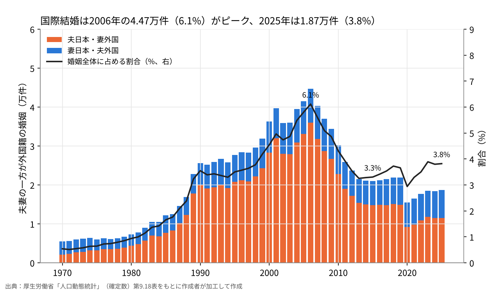
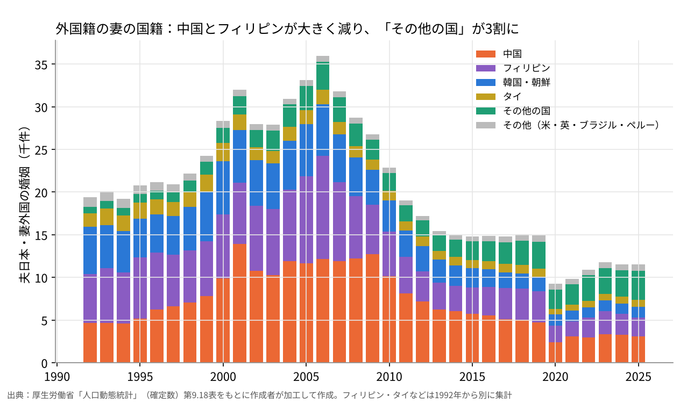
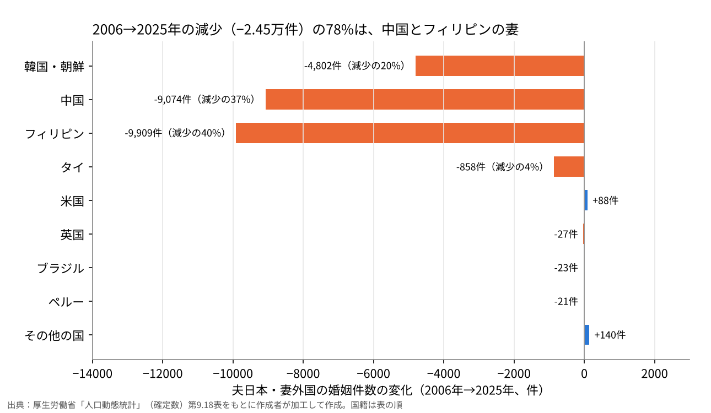
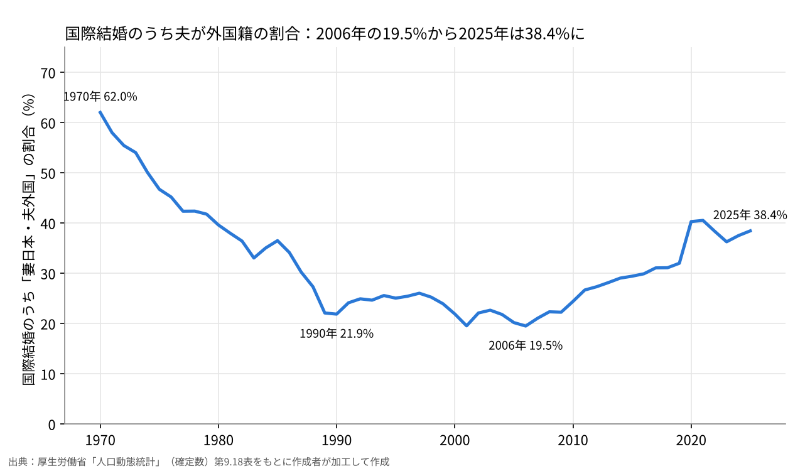

# F399 国際結婚は、どこまで減ったのか？ 2006年の4.5万件（6.1%）から2025年は1.9万件（3.8%）。妻が外国籍の結婚の減少の78%は中国とフィリピン

## 結論（先に）

- 人口動態統計で、夫妻の一方が外国籍の婚姻（国際結婚）は2006年の44,701件、婚姻全体の6.1%がピークでした。2015年には20,984件（3.3%）まで減り、2025年は18,687件（3.8%）です。件数はピークの4割ほどですが、日本人どうしの結婚も減っているため、割合の下がり方は件数より小さくなっています。
- 減ったのはおもに「夫が日本・妻が外国」の結婚で、2006→2025年に35,993→11,507件（−68.0%）。「妻が日本・夫が外国」は8,708→7,180件（−17.5%）で、減り方はずっと小さいものでした。
- 妻が外国籍の結婚の減少（−24,486件）のうち、フィリピンの妻の分が40.5%、中国の妻の分が37.1%で、合わせて77.5%。韓国・朝鮮が19.6%でした。
- 外国籍の妻のうち、表に国名のない「その他の国」の割合は、2006年の9.2%から2025年は29.9%に上がりました。相手の国籍が多様になっています。
- 問い直しとして、国際結婚のうち夫が外国籍の割合を見ると、1970年の62.0%から2006年の19.5%まで下がり、2025年は38.4%に戻っています。

## 問い

2000年代半ばに国際結婚が多かったことは、よく話題になります。家族や地域の記事を書く人、外国の人と暮らす地域の仕事をする人にとっては、それがいつがピークで、いまどこまで減ったのか、減ったのはどの国籍の相手との結婚なのかが大事です。

そこで、厚生労働省の人口動態統計で、夫妻の国籍別の婚姻件数（1965〜2025年）を見ました。国際結婚の良し悪しや、在留の制度の話は扱いません。

既存の看板記事（F321 外国人の増加と人口の減り方、F398 再婚の割合）に、国際結婚の件数と相手の国籍を扱ったものはありません。

## データ（出典）

- 厚生労働省「人口動態統計」（確定数、令和7年）上巻 婚姻 第9.18表 夫妻の国籍別にみた年次別婚姻件数（1965〜2025年。1970年以降は毎年）
  - 夫日本・妻外国、妻日本・夫外国のそれぞれについて、相手の国籍（韓国・朝鮮、中国、フィリピン、タイ、米国、英国、ブラジル、ペルー、その他の国）。フィリピン・タイ・英国・ブラジル・ペルーは1992年から別に集計されています。
- 1ファイル（約7KB）を `data/raw/` に同梱しています。URL と取得日は `data/raw/SOURCES.md` にあります。

## 事前の計画

計画は [PLAN.md](PLAN.md)（2026-11-16、割合や寄与の計算の前に作成）です。表の形を確かめるときに1965〜2019年の行を目にしたので、2006年ごろがピークであることは集計の前から知っていました（H1 は確かめの意味が小さい仮説です）。

| 仮説 | 外れの基準 | 結果 | 判定 |
|---|---|---|---|
| H1 国際結婚の割合のピークは2005〜2007年 | それ以外 | 2006年（6.12%） | 支持（見たうえでの仮説） |
| H2 夫日本・妻外国の減少のうち中国とフィリピンが50%以上 | 50%未満 | 77.5% | 支持 |
| H3 妻日本・夫外国の減り方のほうが小さい | 大きければ外れ | −17.5% 対 −68.0% | 支持 |
| H4 外国籍の妻の「その他の国」の割合が2倍以上に | 2倍未満 | 9.2% → 29.9%（3.3倍） | 支持 |

## やったこと

1. 国際結婚の割合 ＝ 夫妻の一方が外国 ÷ 婚姻総数 を年ごとに出しました。
2. 夫日本・妻外国と、妻日本・夫外国に分けて、2006→2025年の増減を比べました。
3. 夫日本・妻外国の減少を、妻の国籍ごとの件数の差に分けました（国籍の差 ÷ 全体の差）。
4. 外国籍の妻・夫それぞれについて、国籍の構成（%）を2006年と2025年で比べました。

## 分かったこと

### 図1 2006年の6.1%がピーク、2025年は3.8%



国際結婚は1970年の5,546件（0.5%）から増え、1990年に25,626件（3.6%）、2006年に44,701件（6.1%）でピークでした。そのあと2015年の20,984件（3.3%）まで急に減り、2020年に一度大きく下がったあと、2025年は18,687件（3.8%）です。2015年からは件数がほぼ横ばいで、婚姻全体が減っているぶん割合は少し上がっています。

### 図2 中国とフィリピンが大きく減り、「その他の国」が3割に



夫日本・妻外国の結婚を妻の国籍で積み上げました。2006年は中国（33.7%）とフィリピン（33.8%）で全体の3分の2を占めていましたが、2025年は中国26.6%、フィリピン19.5%です。一方で「その他の国」は9.2%から29.9%に上がりました。

### 図3 減少の78%は中国とフィリピンの妻



2006→2025年の減少24,486件のうち、フィリピンの妻が9,909件（40.5%）、中国の妻が9,074件（37.1%）、韓国・朝鮮の妻が4,802件（19.6%）でした。米国と「その他の国」はわずかに増えています。

## 問い直し（結果を見てから足した）

### 図4 国際結婚のうち夫が外国籍の割合は、19.5%から38.4%に



妻が外国籍の結婚が大きく減り、夫が外国籍の結婚はあまり減らなかったので、国際結婚の中身が変わりました。国際結婚のうち「妻日本・夫外国」の割合は、1970年には62.0%と半分を超えていましたが、1990年に21.9%、2006年に19.5%（1990年以降で最も低い）まで下がり、2025年は38.4%に戻っています。2020年に急に上がったのは、この年に妻が外国籍の結婚が特に大きく減ったためです。夫が外国籍の場合の国籍は、2025年に韓国・朝鮮23.9%、米国16.3%、中国14.4%、その他の国33.3%で、2006年とあまり変わりません。

## 頑健性

| 確かめ | 中国＋フィリピンの寄与 | 妻外国の増減 | 夫外国の増減 | その他の国の割合 |
|---|---|---|---|---|
| 0 主（2006→2025年） | 77.5% | −68.0% | −17.5% | 9.2% → 29.9% |
| 1 端の年を3年平均（2005〜07→2023〜25年） | 75.9% | −65.5% | −18.6% | — |
| 2 コロナの前まで（2006→2019年） | 75.4% | −58.6% | −19.5% | 9.2% → 20.8% |
| 3 分母を夫妻とも日本の婚姻に | — | — | — | 比は2006年 6.51% → 2025年 3.97% |
| 4 H4 を夫外国の側で | — | — | — | 31.8% → 33.3% |

端の年を3年平均にしても、コロナの前の2019年で止めても、中国とフィリピンの寄与は75%を超え、妻外国のほうが大きく減ったという結論は同じでした。2019年で止めると「その他の国」の割合は20.8%で2倍を超えますが、2025年ほどではありません。夫が外国籍の側では「その他の国」の割合はほとんど変わらず、国籍が多様になったのは妻の側の話です。

## 言えないこと

- 日本で届け出た婚姻に限られます。海外で結婚して日本に届け出ていないものは入りません。
- 国籍は届け出の時点のもので、帰化した人や二重国籍の人は区別できません。
- 「その他の国」の中身（どの国が増えたか）はこの表では分かりません。
- 減った理由（在留資格の審査、結婚の仲介、景気、相手の国の経済の変化など）は、このデータでは分かりません。理由についての話はすべて推測です。
- 国際結婚の良し悪しや、離婚の多さは扱っていません。

## 仕事で使うなら

- 「国際結婚が減った」と書くときは、件数（約4割に）と割合（6.1%→3.8%）のどちらの話かを書き分けると、誤解を生みにくくなります。
- 減ったのはおもに妻が外国籍の結婚で、夫が外国籍の結婚は2割ほどの減少にとどまっています。夫と妻を分けて見ると、中身の変化が見えます。
- 相手の国籍は多様になっているので、表に国名のある国だけで傾向を語ると、3割を見落とします。

## 計画からの変更

- 計画どおりに計算しました。問い直しは、計画で候補にした「国際結婚のうち妻日本・夫外国の割合」をそのまま使いました。

## 再現のしかた

```sh
pip install -r requirements.txt
python3 src/01_fetch.py   # 取得（ネットが必要。data/raw に同梱済みなので通常は不要）
sh src/run_all.sh         # 02 → 03 → 04（オフライン）
```

| ファイル | 中身 |
|---|---|
| src/01_fetch.py | 元データの取得（e-Stat、1ファイル） |
| src/02_build.py | data/marriage_nationality.csv を作る |
| src/03_analysis.py | 割合、寄与、国籍の構成、頑健性、問い直し。results/ に出力 |
| src/04_figures.py | figures/ の4枚 |
| results/main.json | 本文の数字のもと |
| results/yearly.csv・wife_nationality_contrib_2006_2025.csv・robustness.csv | 表 |

所要時間は約3秒（CPU 1つ）。`results/repro_check.txt` に、/tmp に写して流し直し、9ファイルがバイト単位で一致した結果を書いています。

## レビューで直したこと

独立レビューで数字の照合・再実行・図を確かめ、直すところはなかった。

## 出典

- 厚生労働省「人口動態統計」（確定数） https://www.e-stat.go.jp/stat-search/files?toukei=00450011&tstat=000001028897

（いずれも 厚生労働省「人口動態統計」 をもとに作成者が加工して作成）
