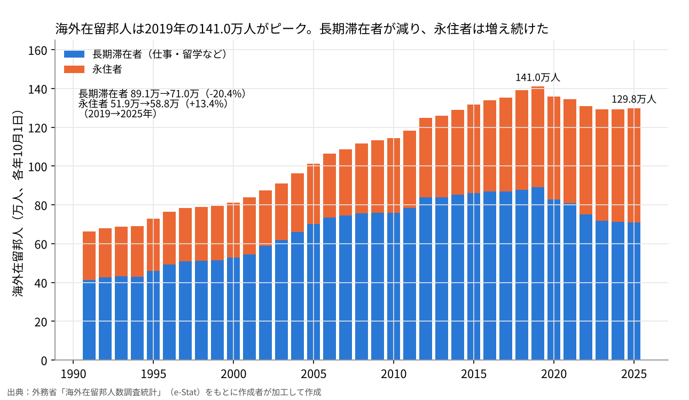
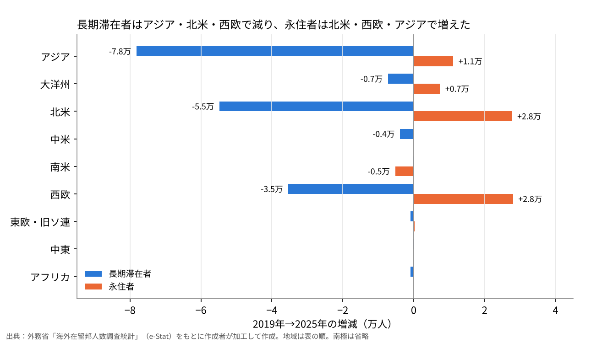
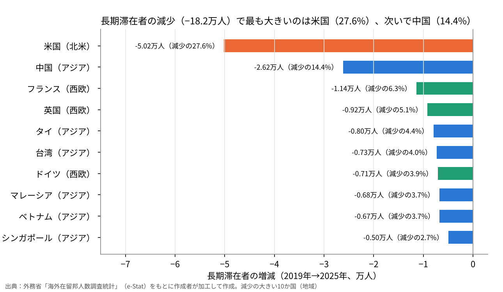
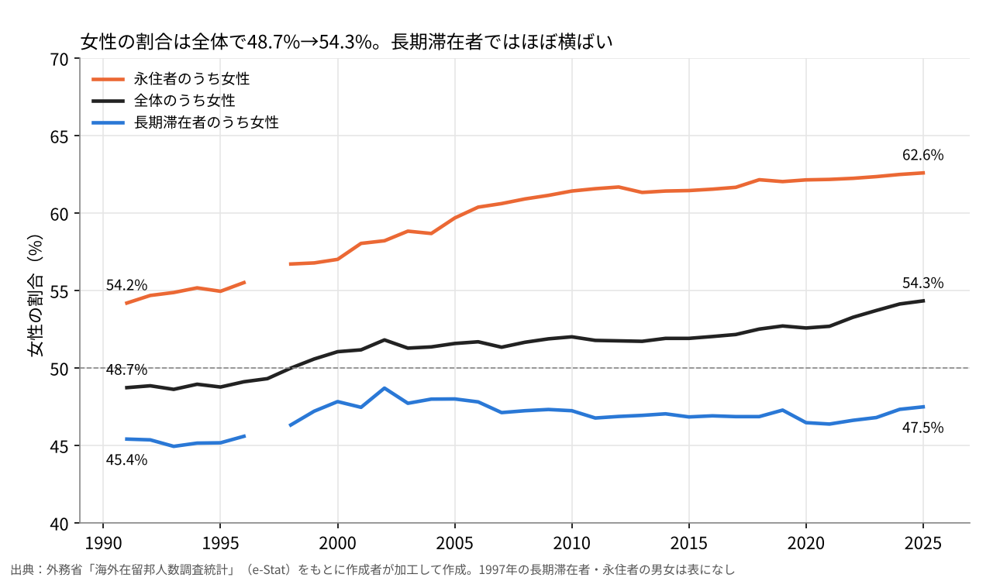

# F400 海外に住む日本人は、増え続けているのか？ 2019年の141.0万人がピークで2025年は129.8万人。仕事や留学の長期滞在者が20%減り、永住者は13%増えた

## 結論（先に）

- 外務省の海外在留邦人数調査統計で、海外に住む日本人は1991年の66.3万人から増え続け、2019年の141.0万人がピークでした。そのあと減り、2025年は129.8万人（2019年より8.0%少ない）です。2024→2025年はわずかに増えました（+0.4%）。
- 中身で分けると、仕事や留学などで住む「長期滞在者」は2019年の89.1万人から2025年の71.0万人へ20.4%減りました。その国に生活の本拠を移した「永住者」は51.9万人から58.8万人へ13.4%増え、2003年から毎年増えています。永住者の割合は36.8%から45.3%に上がりました。
- 長期滞在者の減少（−18.2万人）を地域で分けると、アジア43.0%、北米30.1%、西欧19.5%でした。国では米国が27.6%と最も大きく、中国は14.4%でした。「中国の駐在が減ったから」だけでは説明できません。
- 永住者の増加（+7.0万人）は、西欧40.2%、北米39.8%、アジア16.0%、大洋州10.6%で、南米では減りました（−0.5万人）。
- 問い直しとして女性の割合を見ると、全体では1991年48.7%→2025年54.3%に上がりましたが、長期滞在者の中ではほぼ横ばい（45.4%→47.5%）でした。2019年からの上がりの大部分は、女性の多い永住者の割合が増えたことによるものでした。

## 問い

海外に住む日本人は、長く増えてきたといわれます。海外とつながる仕事をする人、地域や家族の記事を書く人にとっては、いまも増え続けているのか、仕事や留学で一時的に住む人と、その国に根を下ろした人で動きが違うのか、どの地域・国で増減したのかが大事です。

そこで、外務省の海外在留邦人数調査統計（e-Stat 掲載の Excel）で、1991〜2025年の推移と、2019年・2025年の国（地域）別の数を見ました。移住の良し悪しや、どこに住むべきかは扱いません。

既存の看板記事に、海外に住む日本人の数を扱ったものはありません（170 は海外の現地法人の数で、人の数ではありません）。

## データ（出典）

- 外務省「海外在留邦人数調査統計」（e-Stat 掲載）
  - 令和7年版：邦人数推移（1991〜2025年、長期滞在者・永住者、男女別）、国（地域）別一覧表（2025年10月1日）
  - 令和元年版：国（地域）別一覧表（2019年10月1日）
  - 平成27年版：地域別の推移（2006〜2015年）
- 在外公館に出された在留届をもとにした、各年10月1日の推計です。3か月以上住む日本人が対象で、「長期滞在者」は3か月以上の滞在で永住者でない人、「永住者」は相手国から永住権を認められ、生活の本拠を移した人です。
- 外務省のサイトは自動取得に 403 を返すため使わず、e-Stat 掲載の同じ統計のファイルを使いました。3ファイル（約1.3MB）を `data/raw/` に同梱しています。URL と取得日は `data/raw/SOURCES.md` にあります。

## 事前の計画

計画は [PLAN.md](PLAN.md)（2026-11-16、増減や寄与の計算の前に作成）です。表の形を確かめるときに、全体・長期滞在者・永住者の推移の数を目にしたので、ピークが2019年であることは集計の前から知っていました（H1 は確かめの意味が小さい仮説です）。

| 仮説 | 外れの基準 | 結果 | 判定 |
|---|---|---|---|
| H1 総数のピークは2019年で、2025年は5%以上少ない | 違えば外れ | 2019年、−8.0% | 支持（見たうえでの仮説） |
| H2 長期滞在者の減少のうちアジアが50%以上 | 50%未満 | 43.0% | **外れ** |
| H3 長期滞在者の減少のうち中国が30%以上 | 30%未満 | 14.4% | **外れ** |
| H4 永住者の増加のうち北米・大洋州・西欧が70%以上 | 70%未満 | 90.6% | 支持 |

H2・H3 は外れました。計画のときは「アジア、特に中国の駐在が減った」と考えていましたが、減少は北米と西欧にも広がっていて、国では米国の分が最も大きいものでした。

## やったこと

1. 総数・長期滞在者・永住者の推移（1991〜2025年）と、ピークからの増減を出しました。
2. 2019年と2025年の国（地域）別の表を合わせ、地域ごと・国ごとの増減と、全体の増減に対する割合（寄与）を出しました。国名の表記が2つの年で違うもの（15件）は2025年の表記にそろえました。
3. 地域は表の順（アジア、大洋州、北米、中米、南米、西欧、東欧・旧ソ連、中東、アフリカ）で示しました。
4. 女性の割合を、全体・長期滞在者・永住者で出しました。

## 分かったこと

### 図1 2019年の141.0万人がピーク。長期滞在者が減り、永住者は増え続けた



総数は1991年66.3万人、2006年106.4万人、2015年131.7万人と増え、2019年に141.0万人でピークでした。2020年から減り、2024年の129.3万人のあと、2025年は129.8万人です。長期滞在者は2019年がピーク（89.1万人）で、2025年は71.0万人まで減りました。永住者は2003年から毎年増え、2025年は58.8万人です。

### 図2 長期滞在者はアジア・北米・西欧で減り、永住者は北米・西欧・アジアで増えた



2019→2025年に、長期滞在者はアジアで7.8万人、北米で5.5万人、西欧で3.5万人減りました。永住者は西欧で2.8万人、北米で2.8万人、アジアで1.1万人、大洋州で0.7万人増え、南米では0.5万人減りました。北米と西欧では、長期滞在者が減り、永住者が増えるという動きが同時に起きています。

### 図3 長期滞在者の減少で最も大きいのは米国、次いで中国



長期滞在者の減少18.2万人のうち、米国が5.0万人（27.6%）、中国が2.6万人（14.4%）、フランス1.1万人（6.3%）、英国0.9万人（5.1%）、タイ0.8万人（4.4%）でした。アジアの減少は、中国のほかタイ・台湾・マレーシア・ベトナム・シンガポールなどに分かれています。永住者の増加では、米国が2.2万人（32.3%）と最も大きく、ドイツ・フランス・オーストラリア・英国・カナダがそれぞれ0.5万〜0.7万人でした。

## 問い直し（結果を見てから足した）

### 図4 女性の割合は上がったが、長期滞在者の中ではほぼ横ばい



結果を見てから、「男女で動きは違うのか」を足しました。女性の割合は全体で1991年48.7%、2019年52.7%、2025年54.3%と上がりました。ところが長期滞在者の中では45.4%→47.3%→47.5%とほぼ横ばいで、永住者の中では54.2%→62.0%→62.6%です。2019→2025年の全体の上がり（+1.6ポイント）を分けると、それぞれの中での変化は+0.3ポイント、女性の多い永住者の割合が増えたことによる分が+1.3ポイントでした。

## 頑健性

| 確かめ | 長期滞在者の減少のうちアジア | 同 中国 | 永住者の増加のうち北米・大洋州・西欧 | 備考 |
|---|---|---|---|---|
| 0 主（2019→2025年） | 43.0% | 14.4% | 90.6% | |
| 1 2025年に非公表の3か国を2019年からも除く | 43.1% | 14.4% | 90.7% | 除いた2019年の人数は209人 |
| 2 総数を2018→2024年で | — | — | — | 総数 −7.0%、長期滞在者 −18.7%、永住者 +13.0% |
| 3 国の合計と表の地域別総数 | — | — | — | 2019年・2025年とも、すべて一致 |
| 4 2015→2025年で（地域別） | 39.5% | — | 88.6% | 長期滞在者 86.0万→71.0万、永住者 45.7万→58.8万 |

2025年に安全上の理由で公表されていない3か国（ウクライナ、アフガニスタン、シリア）を2019年からも除いても、結論は変わりませんでした。年を1年ずらしても、2015年からの10年で見ても、長期滞在者が減り永住者が増えたこと、長期滞在者の減少のうちアジアは半分に届かないこと、永住者の増加の9割近くが北米・大洋州・西欧であることは同じでした。

## 言えないこと

- 在留届をもとにした推計で、届けていない人や、3か月未満の人は入りません。
- 長期滞在者が減った理由（コロナ、円安、企業の駐在の見直し、留学の減少など）は、このデータでは分かりません。理由についての話はすべて推測です。
- 永住者が増えた理由（長期滞在者が永住権をとったのか、新しく移った人が増えたのか）も分かりません。
- 外国の国籍をとった人は日本国籍を失うので、この統計には入りません。
- 国（地域）の数字は在外公館の管轄で集計されています。
- 移住の良し悪しや、どこに住むべきかは扱っていません。

## 仕事で使うなら

- 「海外に住む日本人」を語るときは、長期滞在者と永住者を分けると、2019年からの動きが逆向きであることが見えます。
- 長期滞在者の減少はアジアだけでなく、北米・西欧にも広がっています。特定の国の事情だけで説明しないほうが数字に合います。
- 女性の割合の変化のように、全体の割合が動いたときは、中の構成（長期滞在者と永住者の比）が変わったのかどうかを先に確かめると、読み違いを減らせます。

## 計画からの変更

- H2・H3 は外れのまま書きました。図3（国別の寄与）は、外れた理由を示すために、計画にはなかった「米国」を含む上位10か国（地域）にしました。
- 国名の表記の違い（15件）を2025年の表記にそろえる手順を足しました（イスラエルとガザ地区等は「イスラエル・パレスチナ」にまとめました）。

## 再現のしかた

```sh
pip install -r requirements.txt
python3 src/01_fetch.py   # 取得（ネットが必要。data/raw に同梱済みなので通常は不要）
sh src/run_all.sh         # 02 → 03 → 04（オフライン）
```

| ファイル | 中身 |
|---|---|
| src/01_fetch.py | 元データの取得（e-Stat、3ファイル） |
| src/02_build.py | data/national.csv・country.csv・region_2006_2015.csv・check_region_sums.csv を作る |
| src/03_analysis.py | 増減、地域・国別の寄与、頑健性、問い直し。results/ に出力 |
| src/04_figures.py | figures/ の4枚 |
| results/main.json | 本文の数字のもと |
| results/national.csv・region_2019_2025.csv・country_long_2019_2025.csv・robustness.csv | 表 |

所要時間は約3秒（CPU 1つ）。`results/repro_check.txt` に、/tmp に写して流し直し、13ファイルがバイト単位で一致した結果を書いています。

## レビューで直したこと

独立レビューで数字の照合・再実行・図を確かめ、直すところはなかった。

## 出典

- 外務省「海外在留邦人数調査統計」 https://www.e-stat.go.jp/stat-search/files?toukei=00300100&tstat=000001055779

（いずれも 外務省「海外在留邦人数調査統計」 をもとに作成者が加工して作成）
