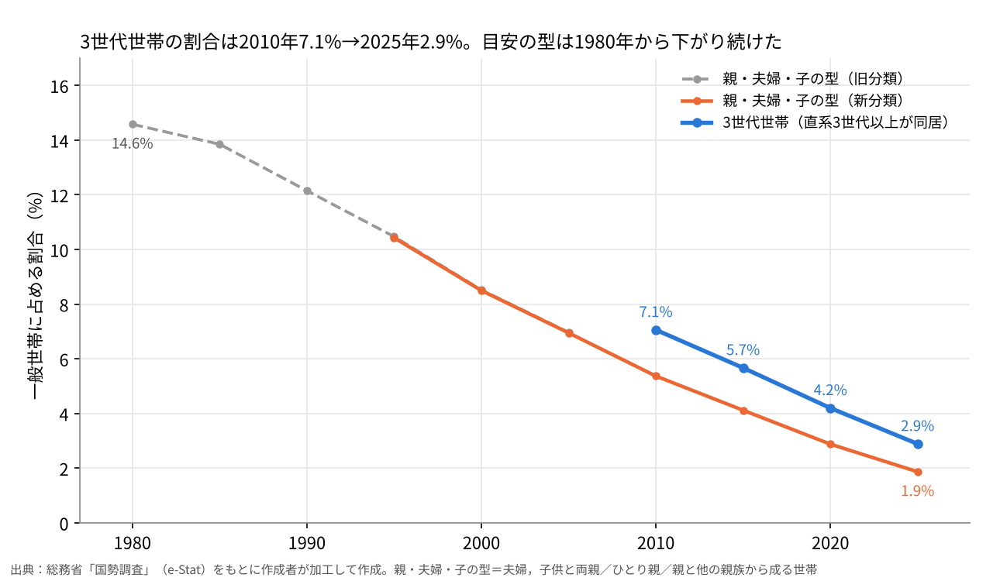
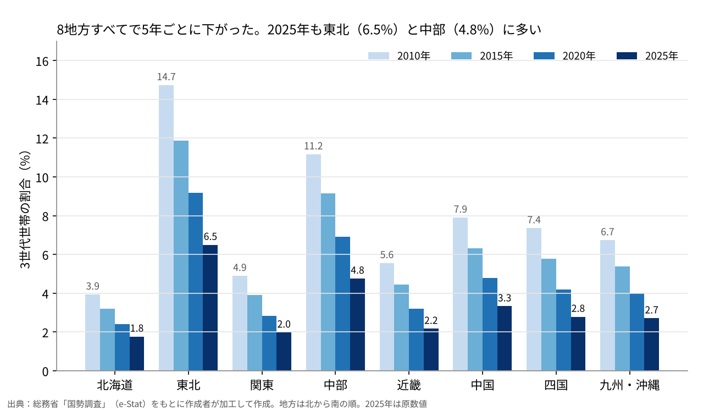
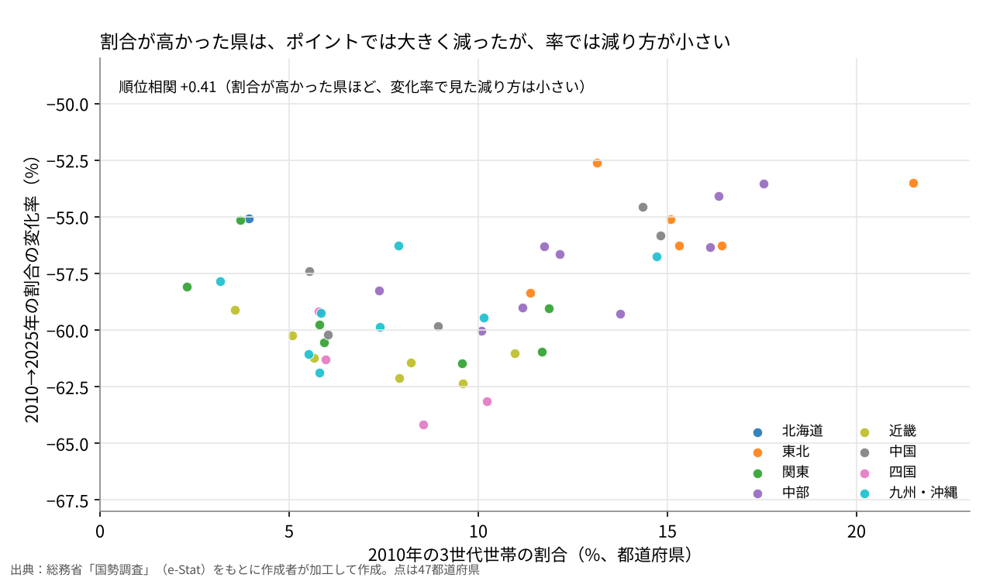
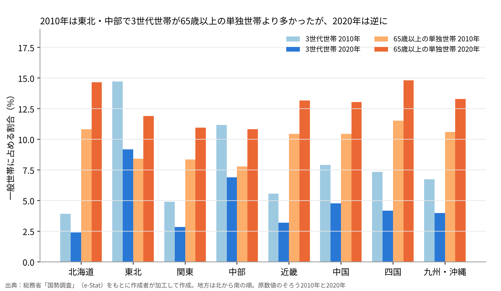

# F401 三世代で暮らす世帯は、どの地方に残っているのか？ 一般世帯に占める割合は2010年7.1%→2025年2.9%。8地方すべてで下がり、東北は6.5%で関東の3.3倍

## 結論（先に）

- 国勢調査で、直系の3つ以上の世代が同居する「3世代世帯」は、2010年の365.8万世帯（一般世帯の7.06%）から、2025年は165.4万世帯（2.89%）になりました。割合は15年で59.0%下がりました。
- 北から南の8地方すべてで、2010→2015→2020→2025年と5年ごとに割合が下がりました。2025年は、北海道1.8%、東北6.5%、関東2.0%、中部4.8%、近畿2.2%、中国3.3%、四国2.8%、九州・沖縄2.7%です。いまも東北と中部に多く、東北は関東の3.3倍です。
- 割合の下がり方をポイントで見ると、東北（−8.2ポイント）や中部（−6.4ポイント）が大きく、率で見ると、どの地方も55〜62%の低下でした。都道府県で見ると、2010年の割合が高かった県ほど、率で見た減り方は小さい傾向がありました（順位相関 +0.41）。
- 長い期間の目安として「夫婦・子供・親から成る世帯」の型を見ると、一般世帯の14.6%（1980年）から1.9%（2025年）まで、5年ごとに下がり続けています。
- 問い直しとして高齢者の暮らし方を見ると、2010年には東北と中部で3世代世帯が65歳以上の単独世帯より多かったのに対し、2020年にはすべての地方で65歳以上の単独世帯のほうが多くなりました。

## 問い

祖父母・親・子のように三世代で暮らす世帯は減ったといわれます。地域や家族の記事を書く人、住まいや地域の暮らしに関わる仕事の人にとっては、それがいまどれだけ残っているのか、どの地方に多いのか、減り方は地方で違うのかが大事です。

そこで、総務省の国勢調査で、都道府県別の3世代世帯数（2010〜2025年）と、世帯の家族類型の長い時系列（1980〜2025年）を見ました。三世代同居の良し悪しや、すすめる・すすめないは扱いません。

既存の看板記事（367 世帯人員の100年）は世帯の人数を扱ったもので、三世代世帯は扱っていません。

## データ（出典）

- 総務省「国勢調査」（e-Stat 掲載）
  - 都道府県・市区町村別の主な結果（2010・2015・2020・2025年）：一般世帯数、（再掲）3世代世帯数、65歳以上の単独世帯数、高齢夫婦世帯数
  - 令和7年 人口等基本集計 第9-1表（原数値）：2025年の3世代世帯数と家族類型。2025年の「主な結果」の世帯の列は不詳補完値なので、2010〜2020年（原数値）とそろえるため、こちらを主に使いました。
  - 時系列データ 第3表 世帯の家族類型（16区分）別一般世帯数（旧分類1980〜2005年、新分類1995〜2020年）
- 3世代世帯は、世帯主との続柄で、祖父母・父母・本人（配偶者）・子・孫のうち、直系の3つ以上の世代が同居していることが分かる世帯です。「主な結果」に3世代世帯の列があるのは2010年からです。
- 長い期間の目安には「夫婦，子供と両親」「夫婦，子供とひとり親」「夫婦，子供，親と他の親族」から成る世帯の3つの型（以下「親・夫婦・子の型」）を足したものを使いました。2025年の3世代世帯の64.5%にあたり、定義は同じではありません。
- 7ファイル（約11.9MB）を `data/raw/` に同梱しています。URL と取得日は `data/raw/SOURCES.md` にあります。

## 事前の計画

計画は [PLAN.md](PLAN.md)（2026-11-16、割合や減り方の計算の前に作成）です。表の形を確かめるときに、2020年・2025年の全国の3世代世帯数を目にしました（2025年は約2.9%）。

| 仮説 | 外れの基準 | 結果 | 判定 |
|---|---|---|---|
| H1 全国の割合が2010→2025年に40%以上下がる | 40%未満 | −59.0% | 支持 |
| H2 8地方すべてで、5年ごとに毎回割合が下がる | 1回でも上がれば外れ | すべて毎回低下 | 支持 |
| H3 2025年の東北の割合は関東の2倍以上 | 2倍未満 | 3.28倍 | 支持 |
| H4 2010年の割合が高い県ほど、率で見た減り方は小さい | 順位相関が0以下 | +0.41 | 支持 |

## やったこと

1. 3世代世帯の割合 ＝ 3世代世帯数 ÷ 一般世帯数 を、都道府県・8地方・全国で出しました。8地方は北から南の順（北海道、東北、関東、中部、近畿、中国、四国、九州・沖縄）で、順位は作っていません。
2. 2010→2025年の変化を、ポイントと率（%）の両方で出しました。
3. 都道府県で、2010年の割合と2025/2010年の比の順位相関を出しました。
4. 長い期間の目安として、親・夫婦・子の型の割合を1980〜2025年で出しました。

## 分かったこと

### 図1 3世代世帯の割合は2010年7.1%→2025年2.9%



3世代世帯の割合は、2010年7.06%、2015年5.67%、2020年4.20%、2025年2.89%と、5年ごとに1.3〜1.5ポイントずつ下がりました。目安の型（親・夫婦・子の型）は、1980年14.6%、1995年10.4%、2010年5.4%、2025年1.9%で、40年以上下がり続けています。旧分類と新分類が重なる1995〜2005年は、ほぼ同じ値でした。

### 図2 8地方すべてで5年ごとに下がった



2010年から2025年に、東北は14.7%→6.5%、中部は11.2%→4.8%、中国は7.9%→3.3%、四国は7.4%→2.8%、九州・沖縄は6.7%→2.7%、近畿は5.6%→2.2%、関東は4.9%→2.0%、北海道は3.9%→1.8%でした。どの地方でも、5年ごとに毎回下がっています。都道府県では、2025年の割合は0.96%〜9.99%の幅で、2010年（2.29%〜21.49%）より幅が狭くなりました。

### 図3 割合が高かった県は、率で見ると減り方が小さい



ポイントで見ると、もともと割合が高かった東北（−8.2ポイント）や中部（−6.4ポイント）で大きく下がりました。一方、率で見ると、地方ごとの低下は北海道55.0%、東北55.9%から四国62.1%までで、2010年の割合が高かった県ほど率で見た減り方は小さい傾向がありました（都道府県の順位相関 +0.41）。

## 問い直し（結果を見てから足した）

### 図4 2020年には、すべての地方で65歳以上の単独世帯のほうが多くなった



結果を見てから、「高齢者の暮らし方はどう変わったか」を足しました。原数値のそろう2010年と2020年で比べると、65歳以上の単独世帯の割合は全国で9.2%→12.1%に上がりました。2010年には、東北（3世代14.7%、65歳以上の単独8.4%）と中部（11.2%、7.8%）で3世代世帯のほうが多かったのですが、2020年には東北（9.2%、11.9%）、中部（6.9%、10.8%）とも逆になり、すべての地方で65歳以上の単独世帯のほうが多くなりました。高齢夫婦世帯（夫65歳以上・妻60歳以上の夫婦のみ）も、全国で10.1%→11.7%に上がっています。

## 頑健性

| 確かめ | 結果 |
|---|---|
| 0 主：3世代世帯の割合（2010→2025年） | 全国 7.06%→2.89%（−59.0%）、8地方すべて毎回低下、東北÷関東 3.28倍、順位相関 +0.41 |
| 1 親・夫婦・子の型で（1995→2025年、5年ごと） | 全国 10.43%→1.87%（−82.1%）、8地方すべて毎回低下、2025年の東北÷関東 3.78倍 |
| 2 割合でなく世帯数で（2010→2025年） | 全国 −54.8%。8地方とも −53.2%〜−61.9% |
| 3 H4 を2010→2020年で | 順位相関 +0.52 |
| 4 地方のまとめ方（沖縄を除く九州／都道府県の中央値） | 沖縄を除く九州 2010年6.86%→2025年2.78%、中央値での東北÷関東 2.87倍 |
| 5 2025年を不詳補完値で | 全国 2.92%（2010年比 −58.7%）、東北÷関東 3.26倍 |

目安の型で見ても、世帯数で見ても、2025年の値を不詳補完値に替えても、8地方すべてで下がったこと、東北と関東の差が大きいことは同じでした。世帯数で見ると、一般世帯の数が増えているぶん、割合より減り方が少し小さくなります。

## 言えないこと

- 二世帯住宅などで、同じ建物でも家計や住まいを分けて暮らす場合は、別の世帯として数えられ、3世代世帯に入らないことがあります。
- 近くに住む「近居」は、このデータでは分かりません。
- 減った理由（住まい方の好み、仕事の場所、高齢化、未婚の増加など）は、このデータでは分かりません。理由についての話はすべて推測です。
- 2020年・2025年は世帯の家族類型が「不詳」の世帯が多く、原数値の割合は少し低めに出ている可能性があります（2025年は不詳補完値でもほぼ同じでした）。
- 三世代同居の良し悪しは扱っていません。

## 仕事で使うなら

- 「三世代同居」を語るときは、全国の2.9%という数字と、東北の6.5%・中部の4.8%という地方の差を並べると、地域の実情に合った話になります。
- 減り方は、ポイントで見るか率で見るかで印象が変わります。割合が高い地方はポイントでは大きく、率では小さく減っています。
- 高齢者の暮らし方では、3世代世帯の代わりに65歳以上の単独世帯と高齢夫婦世帯が増えています。地域の暮らしや住まいの話をするときの手がかりになります。

## 計画からの変更

- データを取ったあと、2025年の「主な結果」の世帯の列が不詳補完値であることに気づき、割合の計算の前に、2025年は第9-1表（原数値）を使うよう計画を直しました（PLAN.md に記載）。不詳補完値は頑健性5で使いました。
- 問い直しは計画の候補どおり、高齢者の暮らし方（原数値のそろう2010→2020年）にしました。

## 再現のしかた

```sh
pip install -r requirements.txt
python3 src/01_fetch.py   # 取得（ネットが必要。data/raw に同梱済みなので通常は不要）
sh src/run_all.sh         # 02 → 03 → 04（オフライン）
```

| ファイル | 中身 |
|---|---|
| src/01_fetch.py | 元データの取得（e-Stat、7ファイル） |
| src/02_build.py | data/pref_3gen.csv・pref_type.csv を作る |
| src/03_analysis.py | 割合、減り方、順位相関、頑健性、問い直し。results/ に出力 |
| src/04_figures.py | figures/ の4枚 |
| results/main.json | 本文の数字のもと |
| results/region_share.csv・pref_share.csv・region_typeshare_new.csv・region_typeshare_old.csv・requestion_elderly.csv・robustness.csv | 表 |

所要時間は約8秒（CPU 1つ）。`results/repro_check.txt` に、/tmp に写して流し直し、13ファイルがバイト単位で一致した結果を書いています。

## レビューで直したこと

独立レビュー（2026-11-17）で次を直しました。直したあと /tmp で流し直し、results・figures・data の CSV が一致することを確かめています。

| # | 指摘 | 直し方 |
|---|---|---|
| 1 | 「仕事で使うなら」の「地域の見守り」が、扱わない話題に近い言い回し | README・note とも「地域の暮らしや住まい」に言い換えた |

## 出典

- 総務省「国勢調査」 https://www.e-stat.go.jp/stat-search/files?toukei=00200521

（いずれも 総務省「国勢調査」 をもとに作成者が加工して作成）
