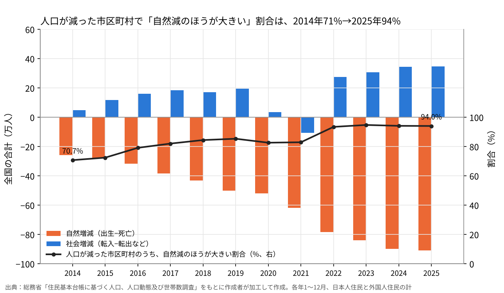
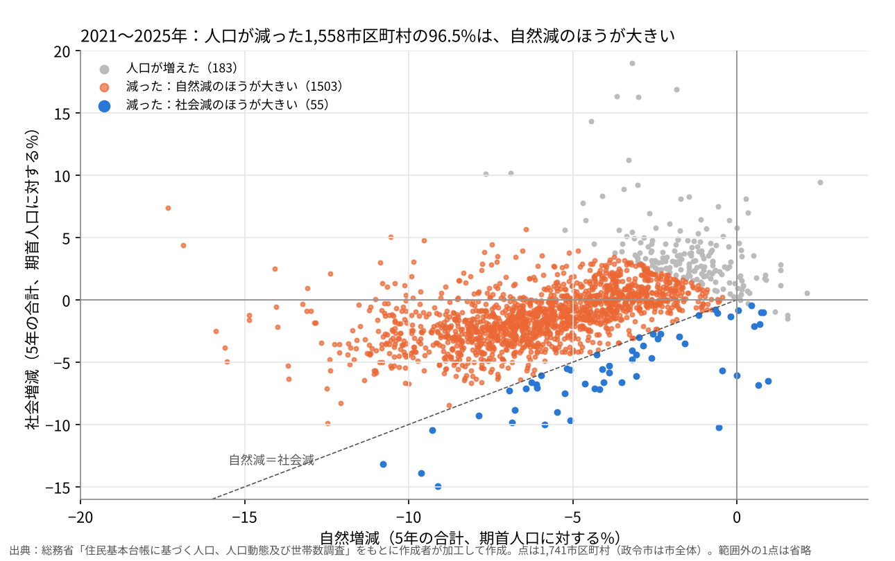
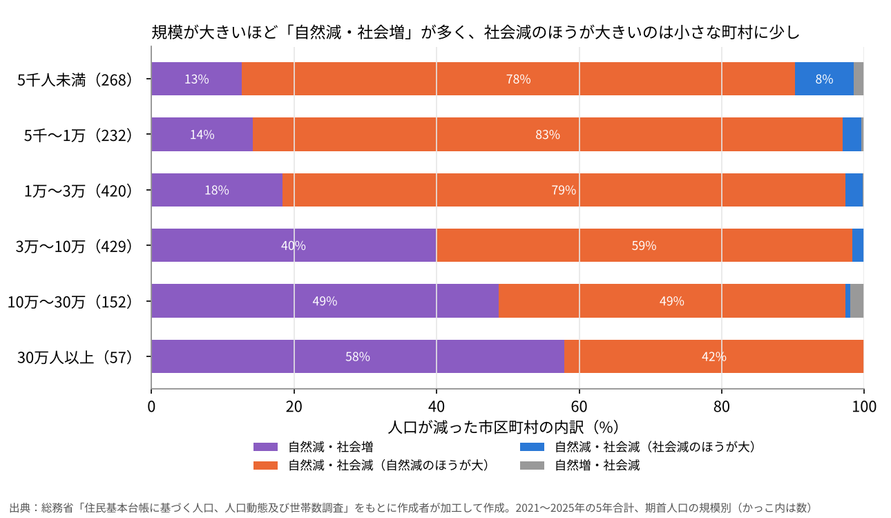
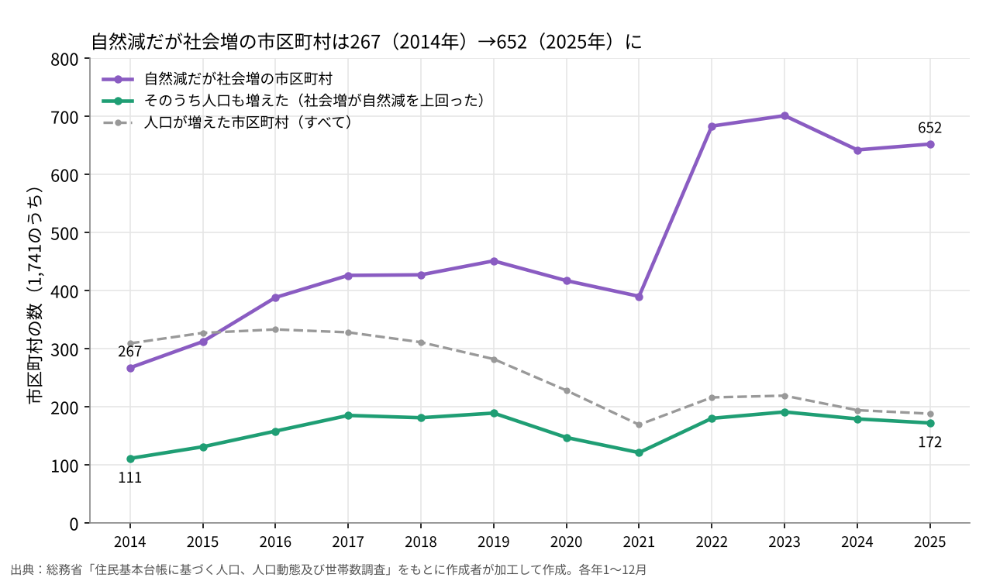

# F402 人口が減る市町村は、「生まれる人より亡くなる人が多い」のと「出ていく人が多い」のどちらが大きいのか？ 2021〜25年に減った1,558市区町村の96.5%は自然減のほうが大きい。1年ごとでは2014年の71%から2025年は94%に

## 結論（先に）

- 住民基本台帳の人口動態で、2021〜2025年の5年間に人口が減った市区町村は1,741のうち1,558（89.5%）でした。そのうち96.5%（1,503）は、自然減（出生 − 死亡）のほうが社会減（転入 − 転出など）より大きく、社会減のほうが大きいのは55でした。
- 1年ごとに見ると、人口が減った市区町村のうち自然減のほうが大きい割合は、2014年の70.7%から上がり、2022年からは93〜95%です。全国の自然減は2014年の25.9万人から2025年の90.9万人に広がりました。
- 人口が減った市区町村の27.1%は「自然減だが社会増」、つまり入ってくる人のほうが多いのに、亡くなる人の多さで人口が減っていました。人口30万人以上の市では、減った市の58%がこの型でした。
- 社会減のほうが大きい市町村は、人口1万人未満で6.6%、10万人以上で1.9%と、小さな町村にやや多いものの、どの規模でも少数でした。
- 日本人住民だけで見ると、2025年に人口が減った市区町村は1,553から1,646に増え、社会減のほうが大きい割合も6.0%から8.0%に上がります。外国人の転入が、社会減を小さく見せている面があります。

## 問い

人口が減っている市町村について、「若い人が出ていくから」と語られることがよくあります。地域の記事を書く人や、市町村の仕事にかかわる人にとっては、実際の減少が「生まれる人より亡くなる人が多い」こと（自然減）と「出ていく人が多い」こと（社会減）のどちらによるのかが、話の前提として大事です。

そこで、総務省の住民基本台帳に基づく人口、人口動態及び世帯数調査で、全国1,741市区町村の2014〜2025年の人口動態を、自然増減と社会増減に分けて見ました。どの市町村がよい・悪いという評価や、政策の提案はしません。

既存の看板記事の043は、2050年までの将来推計を「出生・死亡」と「人の移動」に分けたもので、この記事は実際に記録された2014〜2025年の動きを使います。

## データ（出典）

- 総務省「住民基本台帳に基づく人口、人口動態及び世帯数調査」市区町村別人口、人口動態及び世帯数（e-Stat、2015〜2026年調査）
  - 各年1月1日の人口と、前年1〜12月の人口動態（出生、死亡、転入・転出（国内・国外）、その他の記載・消除）。総計（日本人住民と外国人住民の合計）を主に使い、2014年と2025年は日本人住民の表も使いました。
  - 自然増減 ＝ 出生 − 死亡。社会増減 ＝ 転入 ＋ その他の記載 − 転出 − その他の消除（表の定義どおり）。
- 政令指定都市は市全体で1つと数え、東京23区は1区ずつ数えました（計1,741）。郡や島しょ部の小計の行、人口0の北方領土の6村は除きました。富谷市・那珂川市は町だった時期と同じ団体として足しました。全国の合計が表の「合計」と一致することを確かめています。
- 14ファイル（約7.9MB）を `data/raw/` に同梱しています。URL と取得日は `data/raw/SOURCES.md` にあります。

## 事前の計画

計画は [PLAN.md](PLAN.md)（2026-11-16、市区町村ごとの計算の前に作成）です。表の形を確かめるときに、2025年と2014年の全国の自然増減・社会増減の値を目にしましたが、市区町村ごとの集計はしていませんでした。

| 仮説 | 外れの基準 | 結果 | 判定 |
|---|---|---|---|
| H1 2021〜25年に人口が減った市区町村のうち、自然減のほうが大きいのが6割以上 | 6割未満 | 96.5% | 支持 |
| H2 減った市区町村の減少の合計に占める自然減の割合は、2014年より2025年が大きい | 小さければ外れ | 60.6% → 104.0% | 支持 |
| H3 社会減のほうが大きい割合は、1万人未満のほうが10万人以上より高い | 低ければ外れ | 6.6% 対 1.9% | 支持 |
| H4 日本人住民だけで見ると、社会減のほうが大きい割合は総計より高い（2025年） | 低ければ外れ | 8.0% 対 6.0% | 支持 |

H2 の「104.0%」は、人口が減った市区町村全体では社会増減の合計がプラス（入ってくる人のほうが多い）で、自然減が減少の全部を上回っていることを表します。

## やったこと

1. 市区町村ごとに、自然増減・社会増減・増減を、1年ごとと2021〜2025年の5年合計で出しました。
2. 人口が減った市区町村を、自然減と社会減のどちらが大きいかで分けました（自然減で社会増の場合は「自然減のほうが大きい」、自然増で社会減の場合は「社会減のほうが大きい」に入ります）。
3. 期首の人口の規模別（6区分）、北から南の8地方別に集計しました。順位は作っていません。
4. 2014年と2025年について、日本人住民だけの表でも同じ計算をしました。

## 分かったこと

### 図1 自然減のほうが大きい割合は、2014年71%→2025年94%



全国の自然増減は、2014年の−25.9万人から毎年広がり、2025年は−90.9万人でした。社会増減は2021年（−10.7万人）を除いてプラスで、2025年は+34.6万人です。人口が減った市区町村のうち自然減のほうが大きい割合は、2014年70.7%、2019年85.3%、2022年93.4%、2025年94.0%と上がりました。

### 図2 2021〜2025年：減った市区町村の96.5%は自然減のほうが大きい



5年合計で、全国の人口は288.7万人減り、そのうち自然減が405.2万人、社会増減は+116.5万人でした。点線より上の市区町村は自然減のほうが大きく、人口が減った1,558のうち1,503がここに入ります。社会減のほうが大きい55の市町村は、点線より下に散らばっています。

### 図3 規模が大きいほど「自然減・社会増」が多い



人口が減った市区町村のうち「自然減・社会増」の割合は、5千人未満で13%、1万〜3万人で18%、3万〜10万人で40%、30万人以上で58%でした。社会減のほうが大きい（自然増・社会減を含む）のは、5千人未満で9.7%、1万〜3万人で2.6%、30万人以上では0でした。

北から南の8地方で見ても、人口が減った市区町村のうち自然減のほうが大きい割合は、どこでも9割前後以上でした。

| 地方 | 市区町村 | 人口が減った | うち自然減のほうが大きい | うち自然減・社会増 |
|---|---|---|---|---|
| 北海道 | 179 | 171 | 88.9% | 11.7% |
| 東北 | 227 | 223 | 98.2% | 10.3% |
| 関東 | 316 | 238 | 98.7% | 58.8% |
| 中部 | 316 | 286 | 96.5% | 31.5% |
| 近畿 | 227 | 210 | 99.5% | 27.6% |
| 中国 | 107 | 101 | 98.0% | 9.9% |
| 四国 | 95 | 94 | 98.9% | 21.3% |
| 九州・沖縄 | 274 | 235 | 93.6% | 26.0% |

## 問い直し（結果を見てから足した）

### 図4 自然減だが社会増の市区町村は267→652に



結果を見てから、「人は入ってくるのに、亡くなる人の多さで人口が減る」市区町村がどれだけあるかを足しました。自然減だが社会増の市区町村は、2014年の267から、2022年以降は640〜700ほどになり、2025年は652でした。そのうち社会増が自然減を上回って人口が増えたのは、2014年111、2025年172で、残りの多くは社会増があっても人口が減っています。人口が増えた市区町村は、2014年の309から2025年は188に減りました。

## 頑健性

| 確かめ | 減った市区町村のうち自然減のほうが大きい | 減少の合計に占める自然減 | 減った市区町村の数 |
|---|---|---|---|
| 0 主：2021〜2025年の5年合計 | 96.5% | 99.5% | 1,558 |
| 1a 2023〜2025年の3年合計 | 96.6% | 104.7% | 1,560 |
| 1b 2025年の1年 | 94.0% | 104.0% | 1,553 |
| 2 社会増減を転入−転出だけに（その他を除く） | 96.2% | 102.5% | 1,536 |
| 3 政令指定都市を行政区ごとに（浜松市は市全体） | 96.5% | 96.8% | 1,642 |
| 4a 2025年：総計 | 94.0% | 104.0% | 1,553 |
| 4b 2025年：日本人住民 | 92.0% | 89.7% | 1,646 |
| 4c 2014年：総計 | 70.7% | 60.6% | 1,432 |
| 4d 2014年：日本人住民 | 69.3% | 59.8% | 1,452 |
| 5 人口の重み：減少の合計に占める自然減（規模別） | 5千人未満 74.8%、5千〜1万 76.7%、1万〜3万 78.2%、3万〜10万 90.1%、10万〜30万 103.1%、30万人以上 136.2% | | |

期間を変えても、社会増減から「その他」を除いても、政令市を区ごとに数えても、9割以上という結論は同じでした。日本人住民だけで見ると、減った市区町村が増え、社会減のほうが大きい割合も少し上がりますが、9割以上は自然減のほうが大きいままでした。人口の重みで見ると、小さな町村では減少の4分の1ほどが社会減で、数で見るよりも社会減の役割が大きくなります。

## 言えないこと

- 住民票の届け出にもとづく記録で、届け出ていない移動は入りません。
- 社会減の理由（進学、就職、結婚など）や、どこへ移ったかは、この表では分かりません。
- 自然減が大きいのは高齢の人が多いことと関係すると考えられますが、このデータで原因は確かめていません（推測）。
- 若い人が出ていくと、将来の出生が減って自然減が大きくなるという、つながりは分けられません。「社会減の影響が小さい」とまでは言えません。
- どの市町村がよい・悪いという評価はしていません。

## 仕事で使うなら

- 人口が減る理由を語るときは、自然増減と社会増減を並べて見ると、話の前提をそろえられます。いまは多くの市町村で、亡くなる人の多さのほうが大きく効いています。
- 「人は入ってきているのに人口が減る」市区町村が増えています。転入の数だけで地域の勢いを判断しないほうが、数字に合います。
- 総計には外国人住民が入っています。日本人だけの動きを見たいときは、日本人住民の表を使うと違いが分かります。

## 計画からの変更

- 計画どおりに計算しました。表の中に郡・島しょ部の小計や北方領土の村の行があったので、除いて全国の合計と一致させました。浜松市は2024年に行政区を再編したので、頑健性3では市全体のままにしました。

## 再現のしかた

```sh
pip install -r requirements.txt
python3 src/01_fetch.py   # 取得（ネットが必要。data/raw に同梱済みなので通常は不要）
sh src/run_all.sh         # 02 → 03 → 04（オフライン）
```

| ファイル | 中身 |
|---|---|
| src/01_fetch.py | 元データの取得（e-Stat、14ファイル） |
| src/02_build.py | data/muni.csv を作る（各行で増減＝自然＋社会を確かめる） |
| src/03_analysis.py | 分け方、規模・地方別、日本人住民、頑健性、問い直し。results/ に出力 |
| src/04_figures.py | figures/ の4枚 |
| results/main.json | 本文の数字のもと |
| results/yearly.csv・muni_2021_2025.csv・by_size_region_2021_2025.csv・requestion.csv・robustness.csv | 表 |

所要時間は約6秒（CPU 1つ）。`results/repro_check.txt` に、/tmp に写して流し直し、11ファイルがバイト単位で一致した結果を書いています。

## レビューで直したこと

独立レビューで数字の照合・再実行・図を確かめ、直すところはなかった。

## 出典

- 総務省「住民基本台帳に基づく人口、人口動態及び世帯数調査」 https://www.e-stat.go.jp/stat-search/files?toukei=00200241&tstat=000001039591

（いずれも 総務省「住民基本台帳に基づく人口、人口動態及び世帯数調査」 をもとに作成者が加工して作成）
