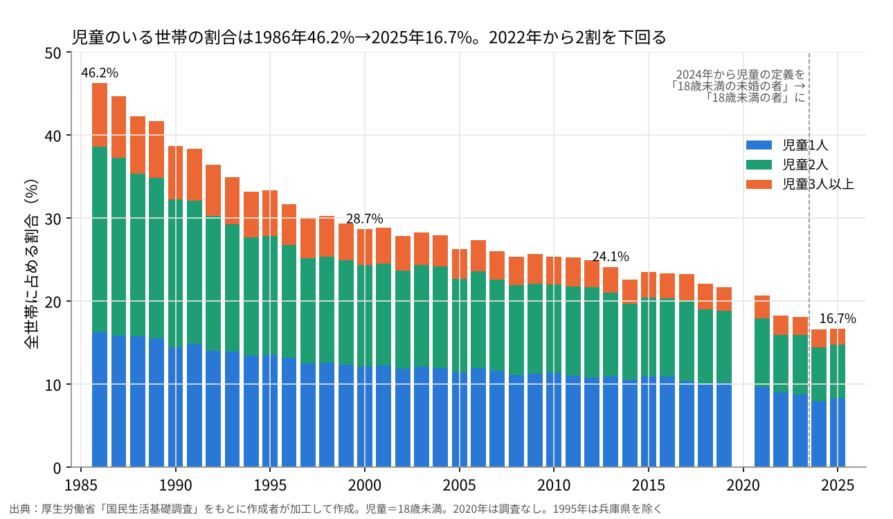
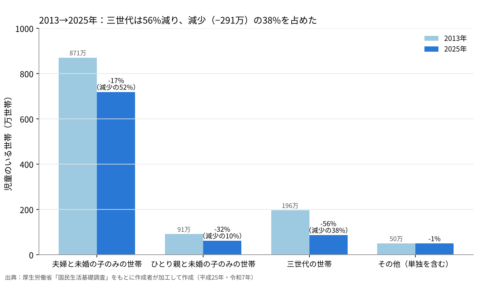
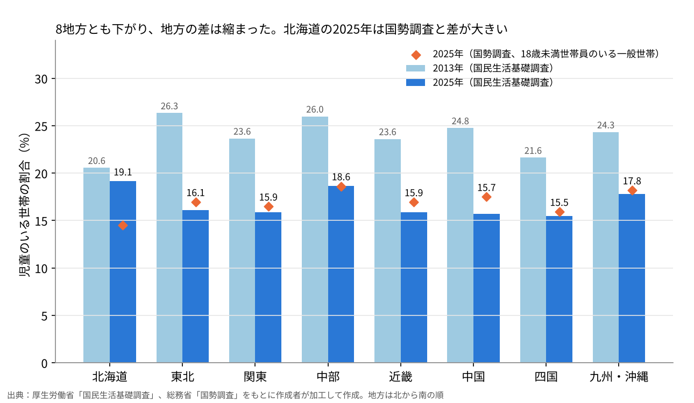
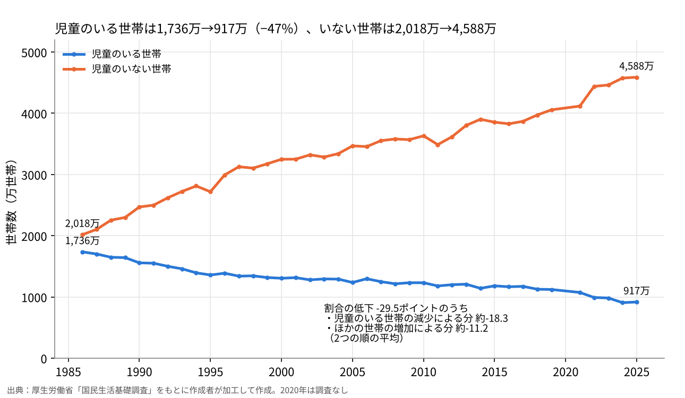

# F403 子どものいる世帯は、全世帯の何割まで減ったのか？ 1986年の46.2%から2025年は16.7%、6世帯に1世帯。2013年からの減少の38%は三世代の世帯

## 結論（先に）

- 厚生労働省の国民生活基礎調査で、児童（18歳未満）のいる世帯は、1986年の1,736万世帯（全世帯の46.2%）から、2025年は917万世帯（16.7%）になりました。2000年に28.7%、2013年に24.1%、2022年からは2割を下回っています。
- 割合の下がり（−29.5ポイント）を分けると、児童のいる世帯の数が減ったことによる分が約−18.3ポイント、児童のいない世帯が2,018万から4,588万に増えたことによる分が約−11.2ポイントでした（2つの計算の順の平均）。
- 2013→2025年の児童のいる世帯の減少（−291万）のうち、三世代世帯の分が38%（−110万、56%減）、夫婦と未婚の子のみの世帯が52%（−152万、17%減）、ひとり親と未婚の子のみの世帯が10%（−29万）でした。
- 北から南の8地方すべてで割合は下がり、地方の差（最大と最小）は2013年の5.8ポイントから2025年の3.7ポイントに縮まりました。ただし北海道は国民生活基礎調査では−1.4ポイントにとどまり、「すべての地方で3ポイント以上下がる」という仮説は外れました。2025年の北海道は国勢調査（14.5%）との差が大きく、標本の誤差の影響が考えられます（推測）。

## 問い

子どものいる世帯は減ったといわれます。家族や地域の記事を書く人、子育てや住まいにかかわる仕事の人にとっては、それがいま全世帯の何割なのか、どんな型の世帯が減ったのか、地方でどう違うのかが大事です。

そこで、厚生労働省の国民生活基礎調査で、児童のいる世帯の数と割合（1975〜2025年）、世帯構造別・都道府県別の数（2013年と2025年）を見ました。2025年は総務省の国勢調査の値とも比べました。子どもを持つことの良し悪しや、少子化対策の提案はしません。

既存の看板記事には出生数（F262 など）や保育（F118 など）の記事がありますが、世帯のうち子どものいる世帯の割合と型を扱ったものはありません。

## データ（出典）

- 厚生労働省「国民生活基礎調査」（e-Stat、CSV）
  - 令和7年 第14表：児童の有無・児童数別の世帯数（1975・1980年、1986〜2025年。2020年は調査なし。1995年は兵庫県、2011年は岩手・宮城・福島県、2012年は福島県、2016年は熊本県を除く）
  - 第89表（令和7年）・第75表（平成25年）：児童のいる世帯の世帯構造別
  - 第153表・第155表（令和7年）、第15表・第17表（平成25年）：都道府県別の児童のいる世帯数と世帯構造（どちらも大規模調査の年）
- 児童の定義は、2023年以前が「18歳未満の未婚の者」、2024年以降が「18歳未満の者」です（厚生労働省「2024（令和6）年 国民生活基礎調査の概況」用語の解説）。
- 総務省「国勢調査」令和7年 人口等基本集計 第9-1表（原数値）：都道府県別の一般世帯数と、18歳未満世帯員のいる一般世帯数（確かめ用、全数調査）。
- 8ファイル（約4.8MB）を `data/raw/` に同梱しています。URL と取得日は `data/raw/SOURCES.md` にあります。

## 事前の計画

計画は [PLAN.md](PLAN.md)（2026-11-16、地方別の割合や分解の計算の前に作成）です。表の形を確かめるときに、全国の推移と全国の世帯構造別の数、都道府県別の表の一部を目にしたので、H1・H2 は見たうえでの仮説です。

| 仮説 | 外れの基準 | 結果 | 判定 |
|---|---|---|---|
| H1 2025年の割合は1986年の半分以下 | 半分より大きい | 46.2% → 16.7% | 支持（見たうえでの仮説） |
| H2 2013→2025年の減少のうち三世代世帯の分が3割以上 | 3割未満 | 37.7% | 支持（見たうえでの仮説） |
| H3 8地方すべてで、2013→2025年に3ポイント以上下がる | 1つでも3ポイント未満 | 北海道 −1.4ポイント | **外れ** |
| H4 8地方の割合の最大と最小の差は、2013年より2025年のほうが小さい | 大きければ外れ | 5.8 → 3.7ポイント | 支持 |

## やったこと

1. 児童のいる世帯の割合 ＝ 児童のいる世帯数 ÷ 世帯総数 を、年次別・都道府県別に出しました。
2. 2013→2025年の児童のいる世帯の減少を、世帯構造（夫婦と未婚の子のみ、ひとり親と未婚の子のみ、三世代、その他）に分けました。2013年と2025年で扱いをそろえるため、全国の表の「単独世帯」は「その他」に含めました。
3. 都道府県の値（千世帯）を北から南の8地方に足して割合を出しました。順位は作っていません。
4. 2025年の地方別の割合を、国勢調査でも出して比べました。

## 分かったこと

### 図1 1986年46.2%→2025年16.7%。2022年から2割を下回る



児童のいる世帯の割合は、1975年53.0%、1986年46.2%、1990年38.7%、2000年28.7%、2010年25.3%、2019年21.7%、2023年18.1%、2025年16.7%と下がりました。2024年に児童の定義が「18歳未満の未婚の者」から「18歳未満の者」に変わりましたが、対象が少し広がる向きの変更で、2023→2024年の下がり（−1.5ポイント）は定義の変更によるものではありません。児童が3人以上いる世帯は、1986年の7.7%から2025年は1.9%になりました。

### 図2 減少の38%は三世代の世帯



2013年から2025年に、児童のいる世帯は1,209万から917万に減りました（−291万）。三世代世帯は196万から87万へ56%減り、減少の38%を占めました。夫婦と未婚の子のみの世帯は871万から719万へ17%減り（減少の52%）、ひとり親と未婚の子のみの世帯は91万から62万へ32%減りました（同10%）。児童のいる世帯のうち夫婦と未婚の子のみの世帯の割合は、72.0%から78.4%に上がっています。

### 図3 8地方とも下がり、地方の差は縮まった



| 地方 | 2013年 | 2025年 | 変化（ポイント） | 2025年 国勢調査 |
|---|---|---|---|---|
| 北海道 | 20.6% | 19.1% | −1.4 | 14.5% |
| 東北 | 26.3% | 16.1% | −10.2 | 17.0% |
| 関東 | 23.6% | 15.9% | −7.8 | 16.5% |
| 中部 | 26.0% | 18.6% | −7.3 | 18.6% |
| 近畿 | 23.6% | 15.9% | −7.7 | 17.0% |
| 中国 | 24.8% | 15.7% | −9.1 | 17.5% |
| 四国 | 21.6% | 15.5% | −6.2 | 15.9% |
| 九州・沖縄 | 24.3% | 17.8% | −6.5 | 18.2% |

東北（−10.2ポイント）や中国（−9.1ポイント）で大きく下がり、2013年に高かった地方ほど下がって、地方の差は縮まりました。東北では、全世帯に占める「児童のいる三世代世帯」の割合が8.5%から4.0%に下がっています。北海道は国民生活基礎調査では19.1%ですが、国勢調査では14.5%で、ほかの地方（差は0〜1.8ポイント）より大きく離れています。

## 問い直し（結果を見てから足した）

### 図4 児童のいない世帯が2倍以上に増えたことも、割合を押し下げた



結果を見てから、「割合の低下は、子どものいる世帯が減ったからか、ほかの世帯が増えたからか」を足しました。1986→2025年に、児童のいる世帯は1,736万から917万（−47.2%）、児童のいない世帯は2,018万から4,588万（2.3倍）になり、世帯総数は46.6%増えました。世帯総数が1986年のままだったとすると、2025年の割合は24.4%です。計算の順によって分け方が変わるので2つの順の平均をとると、−29.5ポイントのうち約−18.3ポイントが児童のいる世帯の減少、約−11.2ポイントがほかの世帯の増加によるものでした。

## 頑健性

| 確かめ | 結果 |
|---|---|
| 0 主：国民生活基礎調査（2013→2025年） | 全国 24.1%→16.7%、8地方の差（最大−最小）5.8→3.7ポイント |
| 1 2025年を国勢調査（18歳未満世帯員のいる一般世帯）で | 全国 17.1%、8地方の差 4.1ポイント（国民生活基礎調査は3.7） |
| 2 児童の定義の変更（2024年）の前後 | 2019→2023年 −3.6ポイント（4年）、2023→2025年 −1.4ポイント（2年）、2023→2024年 −1.5 |
| 3 H2 を三世代＋その他（単独を含む）で | 減少のうち37.9% |
| 4 世帯総数を1986年のままにした場合の2025年の割合 | 24.4%（実際は16.7%） |

国勢調査で見ても、全国の割合（17.1%）は国民生活基礎調査（16.7%）に近く、2025年の地方の差も4.1ポイントと小さいものでした。定義が変わった前後でも、下がり方の速さは大きく変わっていません。

## 言えないこと

- 国民生活基礎調査は標本調査で、都道府県や地方の値には誤差があります。北海道の2025年の値は国勢調査と大きく違い、誤差の影響が考えられます（推測）。
- 減った理由（出生の減少、結婚の時期の遅れ、ひとり暮らしの増加など）は、このデータでは分けられません。理由についての話はすべて推測です。
- 世帯を分けて近くに住む祖父母（近居）は分かりません。
- 世帯総数は2021年の5,191万から2022年の5,431万へ、1年で約240万増えています。推計のもとにする人口の切り替えなど、調査の側の変化の影響が考えられ（推測）、2021→2022年の割合の下がり（20.7%→18.3%）には、その分が含まれている可能性があります。
- 国勢調査の「18歳未満世帯員のいる一般世帯」は、国民生活基礎調査の「児童のいる世帯」と定義や時点が少し違います。
- 子どもを持つことの良し悪しは扱っていません。

## 仕事で使うなら

- 「子育て世帯」を語るときは、全世帯の6世帯に1世帯（16.7%）という大きさと、その8割近くが夫婦と子だけの世帯であることを並べると、実情に近い話になります。
- 割合の低下には、子どものいる世帯の減少だけでなく、ひとり暮らしなどほかの世帯の増加も効いています。件数と割合を分けて書くと誤解を生みにくくなります。
- 地方の比較には、標本調査の誤差があることに注意して、国勢調査の値と並べて確かめると安心です。

## 計画からの変更

- H3 は外れのまま書きました。北海道の値が国勢調査と大きく違うことを、図3と表に加えました。
- 問い直しの分解は、計算の順によって結果が変わるため、2つの順の平均を使いました（両方の値も results/main.json にあります）。

## 再現のしかた

```sh
pip install -r requirements.txt
python3 src/01_fetch.py   # 取得（ネットが必要。data/raw に同梱済みなので通常は不要）
sh src/run_all.sh         # 02 → 03 → 04（オフライン）
```

| ファイル | 中身 |
|---|---|
| src/01_fetch.py | 元データの取得（e-Stat、8ファイル） |
| src/02_build.py | data/national.csv・structure.csv・pref.csv を作る |
| src/03_analysis.py | 割合、構造別の寄与、地方別、頑健性、問い直し。results/ に出力 |
| src/04_figures.py | figures/ の4枚 |
| results/main.json | 本文の数字のもと |
| results/national.csv・structure_2013_2025.csv・region.csv・robustness.csv | 表 |

所要時間は約7秒（CPU 1つ）。`results/repro_check.txt` に、/tmp に写して流し直し、12ファイルがバイト単位で一致した結果を書いています。

## レビューで直したこと

独立レビュー（2026-11-17）で次を直しました。直したあと /tmp で流し直し、results・figures・data の CSV が一致することを確かめています。

| # | 指摘 | 直し方 |
|---|---|---|
| 1 | 2021→2022年に世帯総数が1年で約240万増えている（調査の側の変化とみられる）ことに触れていない | 「言えないこと」に、2022年の割合の下がりにその分が含まれうること（推測）を README・note に追記 |

## 出典

- 厚生労働省「国民生活基礎調査」 https://www.e-stat.go.jp/stat-search/files?toukei=00450061
- 厚生労働省「2024（令和6）年 国民生活基礎調査の概況」用語の解説 https://www.mhlw.go.jp/toukei/saikin/hw/k-tyosa/k-tyosa24/dl/10.pdf
- 総務省「国勢調査」 https://www.e-stat.go.jp/stat-search/files?toukei=00200521

（いずれも 各統計 をもとに作成者が加工して作成）
