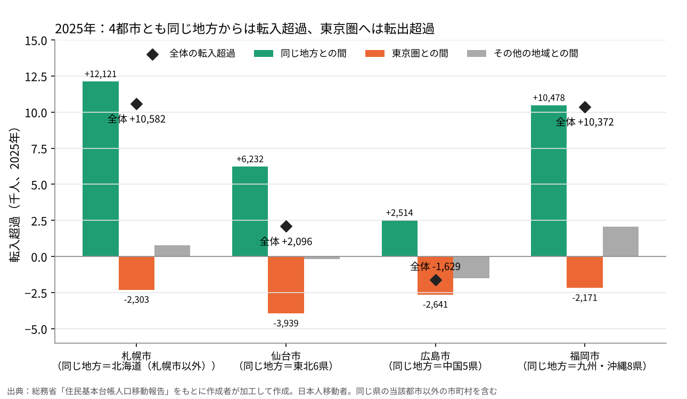
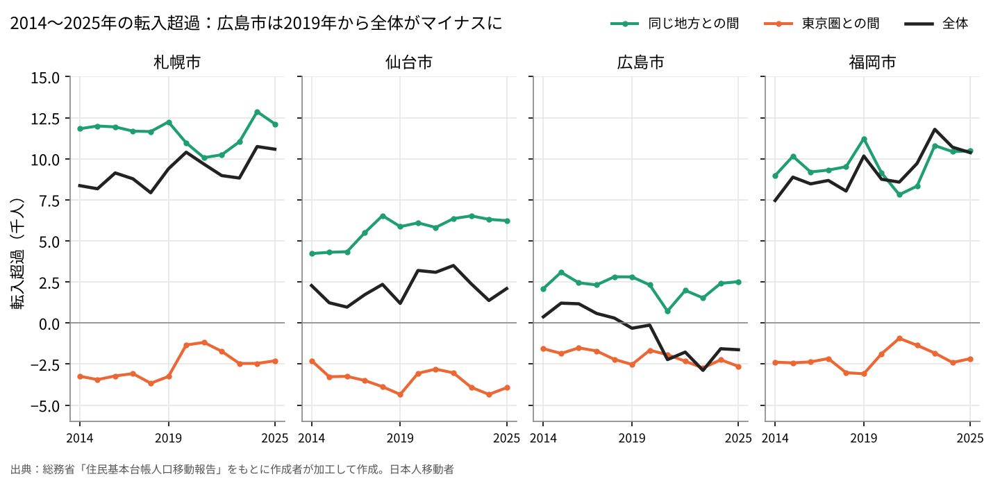
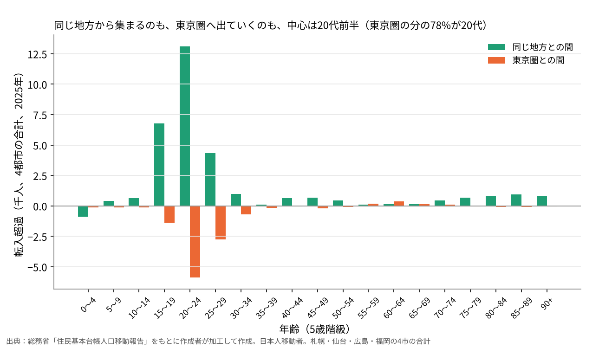
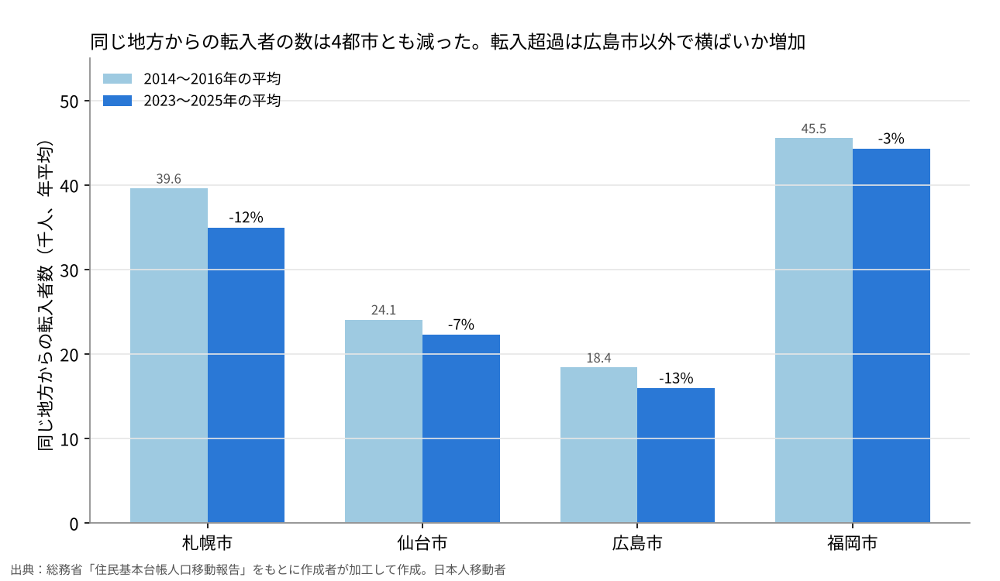

# F404 地方の人は、札幌・仙台・広島・福岡などの地方中枢都市に集まっているのか？ 2025年は4市とも同じ地方から転入超過、東京圏へは転出超過。全体がプラスは札幌・仙台・福岡で、広島市は2019年からマイナス

## 結論（先に）

- 住民基本台帳人口移動報告（日本人移動者）で、2025年の転入超過（転入 − 転出）を見ると、4市とも同じ地方の中からは人が集まっていました。札幌市は北海道（札幌市以外）から+12,121人、仙台市は東北6県から+6,232人、広島市は中国5県から+2,514人、福岡市は九州・沖縄8県から+10,478人です。
- 一方、4市とも東京圏（埼玉・千葉・東京・神奈川）に対しては転出超過で、札幌市−2,303人、仙台市−3,939人、広島市−2,641人、福岡市−2,171人でした。
- 全体の転入超過は、札幌市+10,582人、仙台市+2,096人、福岡市+10,372人がプラス、広島市は−1,629人でした。広島市は2018年まではプラスでしたが、2019年からマイナスが続いています。
- 年齢で見ると、4市の合計で、同じ地方からの転入超過の77%が15〜29歳、東京圏への転出超過の78%が20代でした。地方の若い人が中枢都市に集まり、その中枢都市から東京圏へも出ていく形です。
- 問い直しとして転入者の数そのものを見ると、同じ地方からの転入者は2014〜16年平均から2023〜25年平均に4市とも減りました（札幌市−12%、仙台市−7%、広島市−13%、福岡市−3%）。転入超過が保たれているのは、出ていく人も減っているためです。

## 問い

地方では、人が東京圏へ出ていく一方で、札幌・仙台・広島・福岡のような地方中枢都市に人が集まっているともいわれます。地域の記事を書く人や、地方の都市や県の仕事にかかわる人にとっては、その集まり方が「同じ地方の中からの移動」なのか「東京圏との移動」なのか、年齢や年でどう違うのかが大事です。

そこで、総務省の住民基本台帳人口移動報告で、4市の転入・転出を相手の都道府県別に分けて見ました（2014〜2025年）。どの都市がよい・悪いという評価や、政策の提案はしません。

既存の看板記事の080（引っ越しと距離、東京圏へ向かう割合）は都道府県の間の移動の全体像で、地方中枢都市に分けた分析はしていません。

## データ（出典）

- 総務省「住民基本台帳人口移動報告」年報（e-Stat、Excel）
  - 21大都市の、移動前の住所地（都道府県）別転入者数と、移動後の住所地別転出者数（2014〜2025年。2014〜2019年は第7表、2020〜2025年は第6表）。表側の都道府県は「その都道府県のうち、当該都市を除く市町村」です。
  - 2025年 第8-3表：年齢（5歳階級）別、住所地別の転入超過数。
- 2014〜2017年の表は日本人移動者だけなので、年の比較は日本人移動者でそろえました。2025年は外国人を含む「移動者」でも確かめました。
- 13ファイル（約16MB）を `data/raw/` に同梱しています。URL と取得日は `data/raw/SOURCES.md` にあります。

## 事前の計画

計画は [PLAN.md](PLAN.md)（2026-11-16、都市ごとの集計の前に作成）です。表の形を確かめるときに札幌市の行（2025年の移動者の値、2014年の都道府県別の値）を目にしましたが、ほかの3市や年齢別、推移は計算していませんでした。

| 仮説 | 外れの基準 | 結果 | 判定 |
|---|---|---|---|
| H1 2025年、4市すべてで同じ地方からは転入超過 | 1つでもマイナス | 4市ともプラス | 支持 |
| H2 2025年、4市すべてで東京圏に対しては転出超過 | 1つでもプラス | 4市ともマイナス | 支持 |
| H3 2025年、4市のうち3つ以上で全体の転入超過がプラス | 2つ以下 | 3市（広島市はマイナス） | 支持 |
| H4 東京圏への転出超過のうち20〜29歳が半分以上 | 半分未満 | 77.9% | 支持 |

## やったこと

1. 4市（北から南の順。順位は作っていません）について、相手の都道府県ごとに転入超過 ＝ 転入 − 転出 を出しました。
2. 相手を「同じ地方」（札幌＝北海道の札幌市以外、仙台＝東北6県、広島＝中国5県、福岡＝九州・沖縄8県。自分の県は当該都市以外の市町村）、「東京圏」、「その他」に分けて足しました。
3. 2014〜2025年の推移と、2025年の年齢別の値を出しました。

## 分かったこと

### 図1 2025年：4市とも同じ地方からは転入超過、東京圏へは転出超過



同じ地方からの転入超過は、札幌市+12,121人、仙台市+6,232人、広島市+2,514人、福岡市+10,478人でした。仙台市と福岡市は、その多くが自分の県以外から（仙台市は東北の他県から+4,550人、福岡市は九州・沖縄の他県から+8,190人）で、県を越えて集まっています。東京圏に対しては4市とも転出超過で、仙台市（−3,939人）がいちばん大きく、ほかは−2,100〜−2,700人ほどでした。

### 図2 広島市は2019年から全体がマイナスに



2014〜2025年で、札幌市と福岡市は全体の転入超過が毎年8,000人前後以上、仙台市は1,000〜3,500人ほどのプラスでした。広島市は2014〜2018年にプラス（+300〜+1,200人）でしたが、2019年からマイナスが続き、2023年は−2,885人でした。広島市は同じ地方からの転入超過が小さく（2021年は+722人）、東京圏やその他の地域への転出超過を補えていません。

### 図3 集まるのも、出ていくのも、中心は20代前半



4市の合計で、同じ地方からの転入超過（+31,345人）のうち、15〜19歳が+6,781人、20〜24歳が+13,108人、25〜29歳が+4,330人で、15〜29歳が77%でした。東京圏への転出超過（−11,054人）のうち、20〜24歳が−5,869人、25〜29歳が−2,741人で、20代が78%でした。同じ地方からは75歳以上の転入超過も+3,251人あり、高齢の人が中枢都市に移る動きも見えます。

## 問い直し（結果を見てから足した）

### 図4 同じ地方からの転入者の数は、4市とも減った



結果を見てから、「転入超過は保たれていても、移ってくる人の数はどうか」を足しました。同じ地方からの転入者数（年平均）は、2014〜16年から2023〜25年に、札幌市39.6千→35.0千人（−12%）、仙台市24.1千→22.3千人（−7%）、広島市18.4千→15.9千人（−13%）、福岡市45.5千→44.3千人（−3%）と、4市とも減りました。一方、同じ地方からの転入超過は、札幌市+11,920→+12,006人、仙台市+4,291→+6,355人、福岡市+9,441→+10,572人と横ばいか増え、広島市は+2,543→+2,153人に減りました。地方の若い人の数そのものが減るなかで、転出も減ったため、差し引きの転入超過は保たれている形です（理由は推測）。

## 頑健性

| 確かめ | 札幌市 | 仙台市 | 広島市 | 福岡市 |
|---|---|---|---|---|
| 0 主：2025年、日本人移動者（全体／同じ地方／東京圏） | +10,582／+12,121／−2,303 | +2,096／+6,232／−3,939 | −1,629／+2,514／−2,641 | +10,372／+10,478／−2,171 |
| 1 2025年、外国人を含む移動者 | +10,835／+12,002／−2,162 | +1,603／+6,319／−4,361 | −2,342／+2,279／−2,798 | +8,175／+9,174／−2,666 |
| 2 2023〜2025年の3年平均 | +10,050／+12,006／−2,411 | +1,951／+6,355／−4,068 | −2,027／+2,153／−2,541 | +10,956／+10,572／−2,137 |
| 3 同じ地方のうち他県からだけ（2025年） | （北海道のみ） | +4,550 | +1,062 | +8,190 |
| 4 東京圏の代わりに3大都市圏（2025年） | −2,331 | −4,347 | −4,276 | −2,707 |

外国人を含めても、3年平均にしても、同じ地方からはプラス、東京圏へはマイナス、全体がプラスは3市という結論は同じでした。他県からだけで見ても3市ともプラスで、県を越えて集まっています。3大都市圏に広げると、広島市は名古屋圏・大阪圏へも転出超過が大きく（−4,276人）、これが全体のマイナスの一因です。

## 言えないこと

- 住民票の届け出にもとづく記録で、届け出ていない移動は入りません。
- 移動の理由（進学、就職、転勤など）は、このデータでは分かりません。理由についての話はすべて推測です。
- 同じ県の中の移動には、都市の周り（郊外）への移動も入ります。都市圏としての集まり方は分かりません。
- 2025年の年齢別は1年分だけで、年齢別の推移は見ていません。
- どの都市がよい・悪いという評価はしていません。

## 仕事で使うなら

- 地方中枢都市への集まり方は、「同じ地方からの転入超過」と「東京圏への転出超過」を分けて並べると、実態が見えやすくなります。
- 転入超過が保たれていても、移ってくる人の数は減っています。差し引きの数字だけでなく、転入と転出の数も一緒に見ると、誤解を生みにくくなります。
- 都市によって形は違います。広島市のように、東京圏だけでなく名古屋圏・大阪圏との差し引きも大きい都市もあります。

## 計画からの変更

- 計画どおりに計算しました。計画では2014年の表を日本人移動者だけと書きましたが、2014〜2017年が日本人移動者だけの表でした（2018年以降は外国人を含む表もある）。比較は日本人移動者でそろえています。

## 再現のしかた

```sh
pip install -r requirements.txt
python3 src/01_fetch.py   # 取得（ネットが必要。data/raw に同梱済みなので通常は不要）
sh src/run_all.sh         # 02 → 03 → 04（オフライン）
```

| ファイル | 中身 |
|---|---|
| src/01_fetch.py | 元データの取得（e-Stat、13ファイル） |
| src/02_build.py | data/flows.csv・age_net_2025.csv を作る（各市・各年で相手が47都道府県そろうことを確かめる） |
| src/03_analysis.py | 分け方、推移、年齢別、頑健性、問い直し。results/ に出力 |
| src/04_figures.py | figures/ の4枚 |
| results/main.json | 本文の数字のもと |
| results/yearly_japanese.csv・age_2025_japanese.csv・robustness.csv | 表 |

所要時間は約14秒（CPU 1つ）。`results/repro_check.txt` に、/tmp に写して流し直し、10ファイルがバイト単位で一致した結果を書いています。

## レビューで直したこと

独立レビュー（2026-11-17）で次を直しました。直したあと /tmp で流し直し、results・figures・data の CSV が一致することを確かめています。

| # | 指摘 | 直し方 |
|---|---|---|
| 1 | 結論の「東京圏への転出超過の78%が15〜29歳」は誤り（78%は20代。15〜29歳では約90%） | 結論を「同じ地方からの転入超過の77%が15〜29歳、東京圏への転出超過の78%が20代」に直した |
| 2 | 「言えないこと」の移動の理由の例に、扱わない話題の言葉が入っている | 例から外した |

## 出典

- 総務省「住民基本台帳人口移動報告」 https://www.e-stat.go.jp/stat-search/files?toukei=00200523&tstat=000000070001

（いずれも 総務省「住民基本台帳人口移動報告」 をもとに作成者が加工して作成）
