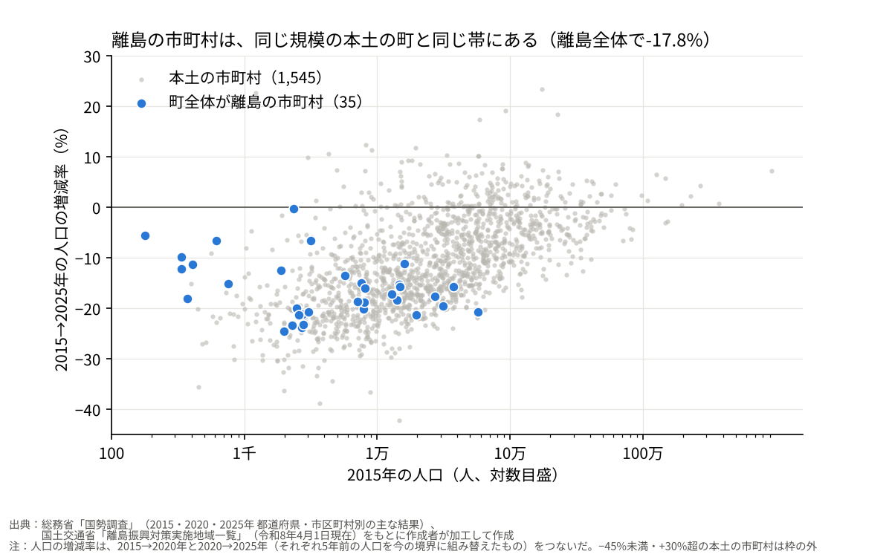
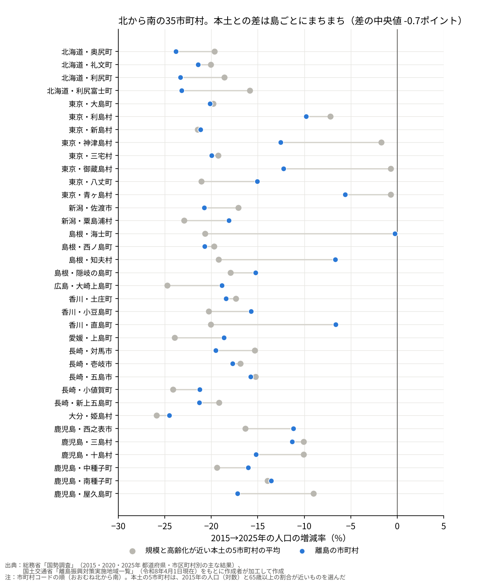
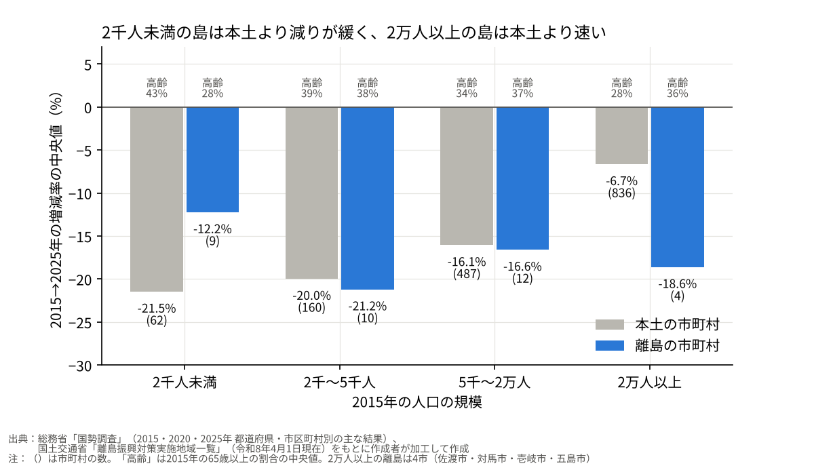
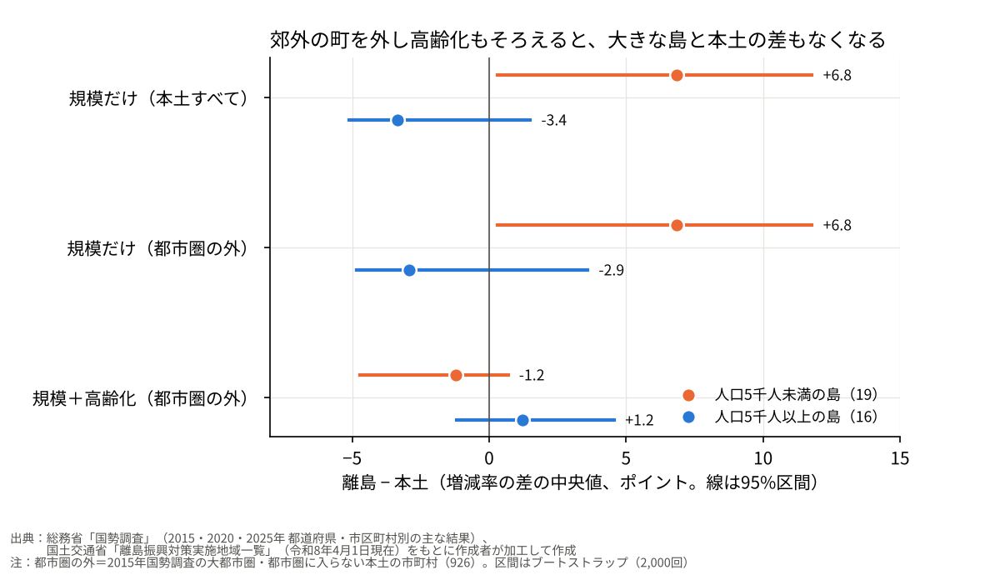

# F405 離島の人口は、本土の同じ規模の町より速く減っているのか？ 2015→2025年に離島の35市町村は−17.8%。規模をそろえた本土との差は中央値+1.0ポイントで、速いとは言えない

## 結論（先に）

- 町全体が離島（離島振興対策実施地域）でできている35市町村の人口は、2015年の32.3万人から2025年の26.6万人へ、17.8%減りました。
- 2015年の人口が近い本土の市町村（5つ）の平均と比べると、離島の増減率の中央値は−17.7%、本土は−18.3%で、差の中央値は+1.0ポイント（95%区間 −3.2〜+3.8）でした。本土より速く減った島は35のうち16（46%）です。「同じ規模の本土の町より速く減っている」とは言えませんでした。
- 65歳以上の割合もそろえると、差は−0.7ポイント（−2.1〜+1.4）で、やはり0に近いままでした。
- 規模で分けると、人口2千人未満の島は本土の同じ規模より減りが緩く（−12.2%対−21.5%）、2万人以上の4市は速く減っていました（−18.6%対−6.7%）。ただ、大きな島と比べた本土の町には都市圏の郊外が多く、都市圏の外の町と高齢化もそろえて比べると、大きな島の差も+1.2ポイントに縮みました（結果を見てから足した問い）。
- 島は一つ一つ事情が違い、本土との差は島ごとに−18〜+19ポイントと大きくばらつきます。

## 問い

離島の人口は減っている、とよく言われます。けれども離島の多くは人口の小さな町村で、本土でも小さな町村は速く減っています。「離島だから速く減る」のか、「小さくて高齢化が進んだ町だから速く減る」のかは、同じような本土の町と比べないと分かりません。島の仕事・観光・物流・行政に関わる人や、地方の人口について書く人に向けて、町全体が島である市町村と、規模（と高齢化の度合い）の近い本土の市町村を、2015→2025年の人口の増減で比べます。どの島に何をすべきかは扱いません。島を減り方の順に並べることもせず、図は北から南の順か人口の規模別にしています。

## データ（出典）

- 国土交通省「離島振興対策実施地域一覧」（令和8年4月1日現在、PDF）：255の有人離島と、その市町村、島ごとの2020年の人口
- 総務省「国勢調査」都道府県・市区町村別の主な結果（2015・2020・2025年、Excel）：市町村の人口、5年前の人口（今の境界に組み替えたもの）、年齢3区分、2015年の大都市圏・都市圏
- 4ファイル（5.2MB）を `data/raw/` に同梱（取得日・URL は `data/raw/SOURCES.md`）
- **離島の市町村**：一覧の島だけで町全体ができている35市町村。島の人口の合計が市町村の2020年の人口と一致することをコードで確かめました（大崎上島町だけ一覧にない小さな島の分とみられる33人の差）。
- **本土の市町村**：一覧に島が一つでも載る市町村（一部が島、76）、沖縄県と奄美群島・小笠原村（別の法律の離島）、政令市の区を除いた1,545市町村。2015年の人口が100人未満の町と、2010→2015年に人口が半分未満になった1町は除きました。

## 事前の計画

[PLAN.md](PLAN.md)（2026-11-18 04:15、増減の集計の前に作成）。

| 仮説 | 内容（外れの基準） | 結果 | 判定 |
|---|---|---|---|
| H1 | 離島は規模の近い本土5市町村の平均より、増減率の差の中央値で3ポイント以上低い | +1.0ポイント（−3.2〜+3.8） | 外れ |
| H2 | 高齢化もそろえると H1 の差が半分以下に縮む | −0.7ポイント | 判定できず（H1 の差がそもそもなかった） |
| H3 | 5千人未満の島の方が、5千人以上の島より本土との差が大きい（速く減る） | 5千人未満 +6.8、5千人以上 −3.4 | 外れ（逆） |
| H4 | 15〜64歳の人口の減り方が、離島の方が3ポイント以上大きい | +2.6ポイント（−3.1〜+5.5） | 外れ |

## やったこと

1. 2015→2020年（2020年ファイル）と2020→2025年（2025年ファイル）の増減率を、2025年の境界でつないで、2015→2025年の増減率を作りました（`src/02_build.py`、`src/03_analysis.py`）。
2. 離島の市町村ごとに、2015年の人口（対数）が近い本土の5市町村を選び（同じ町を何度選んでもよい）、その平均との差を出しました。差の中央値の区間は、ブートストラップ（離島35を選び直す、2,000回、種 20261116）で出しました。
3. 2015年の65歳以上の割合もそろえた選び方、規模別、回帰（増減率 ～ 離島 ＋ 人口の対数 ＋ 65歳以上の割合 ＋ 地方）でも確かめました。

## 分かったこと

### 図1：離島は、同じ規模の本土の町と同じ帯にある



- 本土でも人口の小さな町ほど速く減っていて、離島の35市町村はその帯の中に入っています。
- 規模だけそろえた比較では、離島の中央値−17.7%に対し本土−18.3%、差の中央値は+1.0ポイントでした。

### 図2：北から南へ。本土との差は島ごとにまちまち



- 規模と65歳以上の割合をそろえた本土の5市町村と比べると、差の中央値は−0.7ポイント（−2.1〜+1.4）、本土より速く減った島は35のうち20でした。
- 同じ県の中でも、本土より速い島と緩い島が混じっています。差の大きさは島ごとに−18〜+19ポイントでした（規模だけの比較）。

### 図3：小さな島は本土より緩く、大きな島は速い



- 2千人未満：離島−12.2%（9）、本土−21.5%（62）。この規模の島は65歳以上の割合が28%と、本土の同じ規模（43%）より若い構成でした。
- 2千〜5千人・5千〜2万人では、離島と本土の差は1ポイント前後でした。
- 2万人以上：離島の4市−18.6%、本土−6.7%。本土の2万人以上には人口が増えている都市やその周りの町も入っています。

## 問い直し（結果を見てから足した）

**問い：大きな島が速く減って見えるのは、比べた本土の町に都市圏の郊外が多いからではないか？**



- 規模だけで選んだ本土の町のうち、都市圏（2015年の大都市圏・都市圏）に入る町の割合は、5千人以上の島の相手で33%、5千人未満の島の相手で2%でした。
- 本土の側を都市圏の外の926市町村に絞り、規模と高齢化をそろえると、5千人以上の島の差は+1.2ポイント（−1.2〜+4.6）、5千人未満の島は−1.2ポイント（−4.7〜+0.7）になりました。
- 大きな島が速く減って見えた分の多くは、比べた相手の違い（郊外の町や、若い構成の町）で説明できました。

## 頑健性

| 確かめ | 差の中央値（ポイント） | 95%区間 | 結論は変わったか |
|---|---|---|---|
| 主：規模の近い5つ | +1.0 | −3.2〜+3.8 | － |
| 選ぶ数を10に | −0.4 | −3.2〜+3.4 | 変わらない |
| 同じ地方の中から選ぶ | +0.1 | −2.8〜+3.3 | 変わらない |
| 期間を2020→2025年だけに | +0.6 | −1.0〜+1.8 | 変わらない |
| 期間を2010→2025年に | +1.2 | −2.5〜+7.0 | 変わらない |
| 本土の極端な増減（上下1%）を除く | −1.2 | −3.1〜+1.5 | 変わらない |
| 規模と高齢化、10個選ぶ | −0.6 | −2.3〜+1.1 | 変わらない |
| 東京都の島（8村町）を除く | +0.3 | −4.6〜+3.8 | 変わらない |
| 回帰：規模（離島の係数） | +1.5 | −1.5〜+4.6 | 変わらない |
| 回帰：規模＋高齢化 | −0.2 | −2.6〜+2.2 | 変わらない |
| 回帰：規模＋高齢化＋地方 | −1.5 | −3.7〜+0.7 | 変わらない（離島がやや速い向きだが区間は0を含む） |

どの確かめでも、差は±1.5ポイントの範囲で、区間は0を含みました。H1 の基準（3ポイント以上速い）に届くものはありませんでした。

## 言えないこと

- 町の一部が島の市町村（多くの小さな島）は扱えていません。島ごとの人口の推移は、一覧に2020年の値しかないためです。小さな島だけを見ると、違う結果になる可能性があります。
- 沖縄・奄美・小笠原の島は、別の法律の離島で、この一覧に入っていません。
- 減り方の理由（出生と死亡、進学・仕事での転出、移住）は分けていません。
- 離島は35市町村と少なく、個々の町の事情（大きな事業所や学校の有無など）で差が動きます。
- 2025年の値は国勢調査の公表値で、今後の確定や組み替えで小さく変わる可能性があります。将来の予測ではありません。

## 仕事で使うなら

- 離島の人口の減り方は、本土の「同じ規模・同じ高齢化」の町と並べて示すと、離島に固有の部分とそうでない部分を分けて伝えられます。
- 島ごとの差は大きいので、平均だけでなく島ごとの値（北から南の順など）を添えると誤解が減ります。

## 計画からの変更

- 2010→2015年に人口が半分未満になった本土の1町（特別な事情で人口が大きく動いた町）を、比べる相手から除きました。比べる相手に入ると、5つの平均が+70%にもなり比較にならないためです。除く前と後で、主な差の中央値（+1.0）は変わりません。
- 本土の側の分け方として、2015年の大都市圏・都市圏を 02_build で取り込み、問い直しに使いました。
- 離島の市町村は計画で37と見込みましたが、一覧で町全体が島と確かめられたのは35でした。

## 再現のしかた

```
pip install -r requirements.txt
sh src/run_all.sh        # 02_build → 03_analysis → 04_figures（オフライン）
python3 src/01_fetch.py  # 元データを取り直すときだけ（ネットと pdftotext が要る）
```

| ファイル | 中身 |
|---|---|
| `src/01_fetch.py` | 国勢調査3ファイルと国交省の一覧（PDF とそのテキスト）を取る（run_all.sh からは呼ばない） |
| `src/02_build.py` | 市町村の表 `data/municipalities.csv`（離島・本土・除外の区分つき） |
| `src/03_analysis.py` | 規模をそろえた比較・規模別・回帰・頑健性・問い直し → `results/` |
| `src/04_figures.py` | 図4枚 → `figures/` |
| `results/main.json` | 本文の数字すべて |

所要時間：約6秒（CPU 1つ）。`results/repro_check.txt`：/tmp に写して生成物を消して流し直し、13ファイルがバイト単位で一致しました。

## レビューで直したこと

独立レビューで数字の照合・再実行・図を確かめ、直すところはなかった。比べる相手から外した本土の1町の書き方が、扱わない話題に触れていないことも確かめた。

## 出典

- 総務省「国勢調査」平成27年・令和2年・令和7年 都道府県・市区町村別の主な結果（[e-Stat](https://www.e-stat.go.jp/stat-search/files?toukei=00200521&tstat=000001049104)）
- 国土交通省「離島振興対策実施地域一覧」（令和8年4月1日現在、[PDF](https://www.mlit.go.jp/kokudoseisaku/chirit/content/001886615.pdf)）、同「日本の島嶼の構成」（[PDF](https://www.mlit.go.jp/kokudoseisaku/chirit/content/001477518.pdf)）

（いずれも総務省「国勢調査」、国土交通省「離島振興対策実施地域一覧」をもとに作成者が加工して作成）
