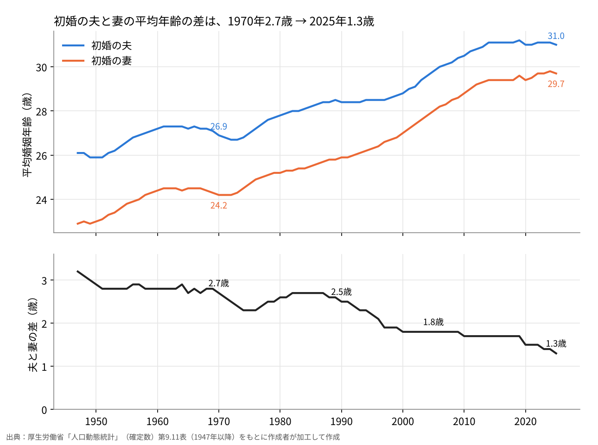
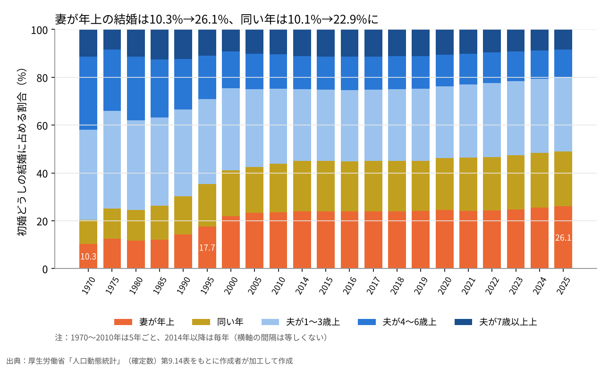
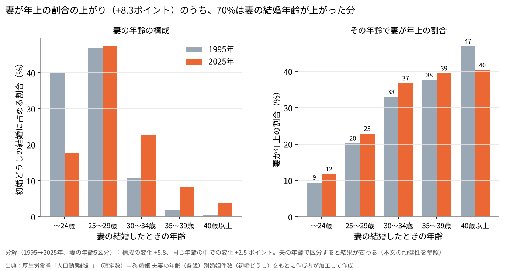
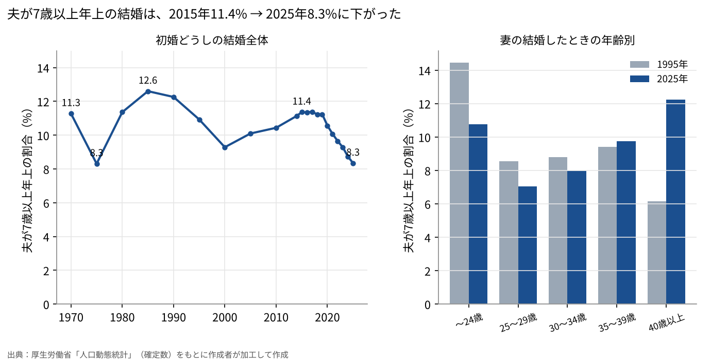

# F406 結婚する夫婦の年の差は、縮まったのか？ 初婚の平均の差は1970年2.7歳→2025年1.3歳。妻が年上は10.3%→26.1%、同い年は22.9%に

## 結論（先に）

- 初婚どうしの夫と妻の平均婚姻年齢の差は、1970年の2.7歳から2025年の1.3歳に縮まりました。1947年以降でいちばん小さい値です。夫の平均は26.9→31.0歳、妻は24.2→29.7歳で、妻のほうが大きく上がりました。
- 初婚どうしの結婚のうち、妻が年上の割合は1970年の10.3%から2025年の26.1%（2.5倍）に、同い年は10.1%から22.9%になりました。夫が年上は79.5%から51.0%で、ほぼ半分です。
- 1995→2025年の妻が年上の割合の上がり（+8.3ポイント）を分けると、妻の結婚する年齢の構成が上がった分が+5.8ポイント（70%）、同じ年齢の中での上がりが+2.5ポイント（30%）でした。ただし、夫の年齢で区分すると、同じ年齢の中での上がりのほうが大きくなります。どちらの年齢で見るかで答えが変わるので、「晩婚化のせい」とは言い切れません。
- 問い直しとして「夫が7歳以上年上」の割合を見ると、2015年の11.4%から2025年は8.3%に下がり、1975年（8.3%）と並ぶ低さでした。

## 問い

「夫が年上」の結婚が多かった時代から、いまはどこまで変わったのでしょうか。家族や暮らしの記事を書く人、結婚式や住まいなど夫婦向けの商品を考える人には、夫婦の年の差がどれだけ縮まったのか、妻が年上の結婚はどれだけ増えたのかが、基本の数字になります。

もう1つ気になるのは、結婚する年齢が上がったこと（晩婚化）との関係です。年をとってから結婚する人が増えると、相手の年齢の幅も広がるかもしれません。年の差が縮まったのは、結婚の年齢が上がったからなのか、同じ年齢で結婚する人どうしの中でも変わったのかを確かめました。

ここでは初婚どうしの夫婦に絞ります。結婚の良し悪しや、望ましい年の差の話は扱いません。既存の看板記事（F87 結婚の減少の時代と世代、153 平均初婚年齢、F396〜F399 未婚・離婚・再婚・国際結婚）に、夫妻の年齢差の分布を扱ったものはありません。

## データ（出典）

- 厚生労働省「人口動態統計」（確定数、令和7年）上巻 婚姻
  - 第9.14表 初婚夫妻の年齢差別にみた年次別婚姻件数及び百分率（1970〜2010年は5年ごと、2014〜2025年は毎年）
  - 第9.11表 全婚姻－初婚別にみた年次別夫妻の平均婚姻年齢及び夫妻の年齢差（1899〜2025年。図は1947年以降）
- 同 中巻 婚姻 夫の年齢（各歳）×妻の年齢（各歳）×初婚－再婚の組合せ別 婚姻件数（1995・2005・2015・2025年）。初婚どうしの部分だけを使いました。年齢が「75歳～」「80歳以上」「不詳」のものは除いています（各年25件以下）。
- 6ファイル（合わせて約0.2MB）を `data/raw/` に同梱しています。URL と取得日は `data/raw/SOURCES.md` にあります。

年齢は、結婚式をあげたときか同居を始めたときの、早いほうの年齢です。

## 事前の計画

計画は [PLAN.md](PLAN.md)（2026-11-17、平均・割合・分解の計算の前に作成）です。PLAN.md の冒頭には「14:45 作成」とありますが、これは誤りです。ファイルの最終更新は 14:36 で、02〜03 のスクリプトと結果のファイル（14:37〜14:38）より前、作業の完了（14:40）よりも前でした。順番は「計画 → 集計」と読めますが、記載の時刻は当てにできません（レビューで確かめた事実。PLAN.md の本文は変えていません）。表の形を確かめるときに第9.14表の全体を目にしたので、妻が年上の割合が大きく上がったことは集計の前から知っていました（H2 は確かめの意味が小さい仮説です）。

| 仮説 | 外れの基準 | 結果 | 判定 |
|---|---|---|---|
| H1 初婚の平均の年齢差は1970→2025年に1.0歳以上縮まる | 1.0歳未満 | 2.7→1.3歳（1.4歳縮小） | 支持 |
| H2 妻が年上の割合が2倍以上に | 2倍未満 | 10.3%→26.1%（2.53倍） | 支持（見たうえでの仮説） |
| H3 1995→2025年の上がりのうち、同じ妻の年齢の中での変化が半分以上 | 半分未満 | 30% | 外れ |
| H4 2025年に、妻の年齢が高いほど妻が年上の割合が高い（〜24歳から35〜39歳まで） | どこかで逆転 | 11.7<22.8<36.7<39.4% | 支持 |

## やったこと

1. 第9.11表で、初婚の夫と妻の平均婚姻年齢と、その差を1947年から並べました。
2. 第9.14表で、初婚どうしの結婚を年齢差の区分（妻が年上、同い年、夫が1〜3歳上、4〜6歳上、7歳以上上）に分けた割合を出しました。
3. 中巻の年齢の組合せの表（1995・2005・2015・2025年）で、妻の結婚した年齢を5つの区分（〜24、25〜29、30〜34、35〜39、40歳以上）に分け、区分ごとの妻が年上の割合を出しました。
4. 1995→2025年の妻が年上の割合の変化を、「妻の年齢の構成の変化」と「同じ年齢の中での変化」に分けました（重みは2つの年の平均。シフト・シェア分解と呼ばれる方法です）。

## 分かったこと

### 図1 初婚の平均の年齢差は2.7歳から1.3歳に



初婚の平均の年齢差は、1950年代〜60年代は2.7〜2.9歳で、1970年は2.7歳、1990年は2.5歳でした。そのあと縮まり、2005年に1.8歳、2015年に1.7歳、2025年に1.3歳です。夫の平均は1970年26.9歳→2025年31.0歳（+4.1歳）、妻は24.2歳→29.7歳（+5.5歳）で、妻の結婚年齢のほうが大きく上がったぶん、差が縮まりました。再婚を含むすべての結婚で見ても、差は3.0歳から1.9歳に縮まっています。

### 図2 妻が年上は4組に1組、同い年は5組に1組を超えた



初婚どうしの結婚で、妻が年上の割合は1970年10.3%、1995年17.7%、2025年26.1%です。同い年は10.1%から22.9%に、夫が年上は79.5%から51.0%に変わりました。夫が年上の中では、4〜6歳上が30.6%から11.5%へ大きく減り、1〜3歳上は37.6%から31.2%で、減り方は小さめでした。妻が4歳以上年上の結婚は1.8%から5.9%です。上がり方は2000年ごろまでが大きく、2005〜2019年はほぼ横ばいで、2020年からまた少しずつ上がっています。

### 図3 上がりの7割は、妻が結婚する年齢が上がった分（妻の年齢で区分した場合）



妻の結婚した年齢で分けると、どの年でも、年齢が高いほど妻が年上の割合は高くなっています（2025年は〜24歳11.7%、25〜29歳22.8%、30〜34歳36.7%、35〜39歳39.4%、40歳以上40.3%）。そして、24歳以下で結婚する妻は1995年の39.9%から2025年の17.8%に減り、30〜34歳は10.6%から22.6%に増えました。

1995→2025年の妻が年上の割合の上がり+8.3ポイントのうち、妻の年齢の構成が変わった分が+5.8ポイント（70%）、同じ年齢の中での上がりが+2.5ポイント（30%）でした。妻の年齢をそろえて見ると、上がりの多くは「年齢が高くなってから結婚する妻が増えた」ことで説明できます。40歳以上の妻では、妻が年上の割合が46.9%から40.3%に下がっています。

ただし、後で示すとおり、夫の年齢で区分すると逆の答えになります。

## 問い直し（結果を見てから足した）

### 図4 夫が7歳以上年上の結婚は、2015年から下がった



年の差が縮まる中で、大きな年の差の結婚はどうなったのかを足しました。初婚どうしで夫が7歳以上年上の割合は、1970年11.3%、1975年8.3%、1985年12.6%と上下し、2015年は11.4%でした。2020年から下がり続け、2025年は8.3%と、1975年と並ぶ低さです。

妻の年齢別に見ると、2025年は24歳以下で10.8%、25〜29歳で7.0%、40歳以上で12.2%でした。1995年と比べると、24歳以下（14.4%→10.8%）では下がり、40歳以上（6.1%→12.2%）では上がっています。同じ分解をすると、1995→2025年の下がり（−2.6ポイント）のうち68%が同じ年齢の中での変化でした。夫が7歳以上年上の結婚の減り方は、晩婚化だけでは説明しにくいといえます。

## 頑健性

| 確かめ | 妻が年上の割合の変化 | 構成の変化の分 | 同じ年齢の中での変化の分 | 同じ年齢の中の割合 |
|---|---|---|---|---|
| 0 主：1995→2025年、妻の年齢5区分 | +8.3 | +5.8 | +2.5 | 30% |
| 1a 期間を2005→2025年に | +2.7 | +2.4 | +0.3 | 9% |
| 1b 期間を1995→2015年に | +6.3 | +5.9 | +0.4 | 7% |
| 2 区分を夫の年齢に | +8.3 | −3.2 | +11.5 | 138% |
| 4 妻20〜44歳に限る | +8.0 | +5.4 | +2.7 | 33% |

| 確かめ | 1995年 | 2025年 |
|---|---|---|
| 3 平均の年齢差（第9.11表、平均の差） | 2.2歳 | 1.3歳 |
| 3 年齢差の平均（中巻の組合せから。夫婦ごとの差の平均） | 2.16歳 | 1.29歳 |
| 3 年齢差の中央値（同） | 2歳 | 1歳 |
| 3 年齢差の標準偏差（同） | 3.73歳 | 3.98歳 |

- 妻の年齢で区分するかぎり、期間を変えても、年齢の端を除いても、「構成の変化の分が大きい」という結論は同じでした（2015年からの上がりのほうが、同じ年齢の中での変化の割合が大きいことは分かります）。
- 夫の年齢で区分すると、構成の変化の分はマイナスで、同じ年齢の中での変化が上がり全体より大きくなりました。夫も結婚する年齢が上がっていて、年齢の高い夫ほど妻が年上の割合は低いためです。夫と妻の両方の年齢が同時に動いているので、この分解では「晩婚化による分」を1つに決められません。H3 は主の決め方では外れですが、結論の強さには限りがあります。
- 年齢差の平均は、組合せの表から夫婦ごとに出しても第9.11表とほぼ同じでした。中央値は2歳から1歳になりました。一方、標準偏差は3.7歳から4.0歳とむしろ少し大きくなり、年の差の「ばらつき」は縮まっていません。

## 言えないこと

- 初婚どうしの結婚に限っています。再婚を含む結婚は別の傾向の可能性があります（平均の差は全婚姻でも縮まっていますが、分布は確かめていません）。
- 年齢は結婚式または同居を始めたときの年齢で、各歳の表は満年齢です。第9.11表の平均（月齢から計算）とは0.5歳ほどずれますが、差はほぼ同じです。
- 年の差が縮まった理由（働き方、出会い方、考え方の変化など）は、このデータでは分かりません。理由についての話はすべて推測です。
- 結婚しなかった人は入りません。年の差の変化は、結婚した人の中での話です。結婚が減ったこと自体が、どんな組合せの結婚が残るかに影響している可能性があります（推測）。
- 分解は「どちらの年齢でそろえるか」で答えが変わります。晩婚化が年の差を縮めた、という因果は言えません。

## 仕事で使うなら

- 「夫が年上」はいまも半分ですが、妻が年上（26%）と同い年（23%）を合わせると半分に近く、夫婦の年齢を「夫が2〜3歳上」と決めて考えると、実際の姿から外れやすくなります。
- 年の差を説明するときは、妻の結婚年齢の区分ごとの数字（例：30〜34歳で結婚する妻の37%は年上）を添えると、年齢による違いが伝わります。
- 「晩婚化で年の差が縮まった」と書くときは、どちらの年齢でそろえたかで答えが変わることを添えると、誤解を生みにくくなります。

## 計画からの変更

- 計画どおりに計算しました。問い直しは、計画で候補にした「夫が7歳以上年上の割合」を使い、同じ分解もしました。
- 標準偏差は計画の頑健性3の中で出しましたが、ばらつきが縮まっていないことは結果を見てから気づいたので、本文で触れています。

## 再現のしかた

```sh
pip install -r requirements.txt
python3 src/01_fetch.py   # 取得（ネットが必要。data/raw に同梱済みなので通常は不要）
sh src/run_all.sh         # 02 → 03 → 04（オフライン）
```

| ファイル | 中身 |
|---|---|
| src/01_fetch.py | 元データの取得（e-Stat、6ファイル） |
| src/02_build.py | data/gap_dist.csv・mean_age.csv・cross_first.csv を作る |
| src/03_analysis.py | 割合、平均の差、妻の年齢別の割合、分解、頑健性、問い直し。results/ に出力 |
| src/04_figures.py | figures/ の4枚 |
| results/main.json | 本文の数字のもと |
| results/gap_dist_share.csv・mean_age_gap.csv・by_wife_age.csv・cross_stats.csv・decomposition.csv | 表 |

所要時間は約2秒（CPU 1つ）。`results/repro_check.txt` に、/tmp に写して流し直し、バイト単位で一致した結果を書いています。

## レビューで直したこと

| # | 指摘 | 直し方 |
|---|---|---|
| 1 | README の見出しが、status の題名・note の1行目（「同い年は22.9%に」を含む）と違っていた | README の見出しを status の題名にそろえた |
| 2 | PLAN.md の作成時刻「14:45」が、ファイルの更新時刻（14:36）・結果のファイル（14:38）・完了（14:40）と合わない | 「事前の計画」の節に、記載の時刻は誤りで、ファイルの時刻では計画が集計より前であることを書き足した（PLAN.md の本文は変えていない） |

数字の照合・再実行（/tmp で13ファイル一致）・図4枚は独立レビューで確かめ、ほかに直すところはなかった。

## 出典

- 厚生労働省「人口動態統計」（確定数） https://www.e-stat.go.jp/stat-search/files?toukei=00450011&tstat=000001028897

（いずれも 厚生労働省「人口動態統計」 をもとに作成者が加工して作成）
