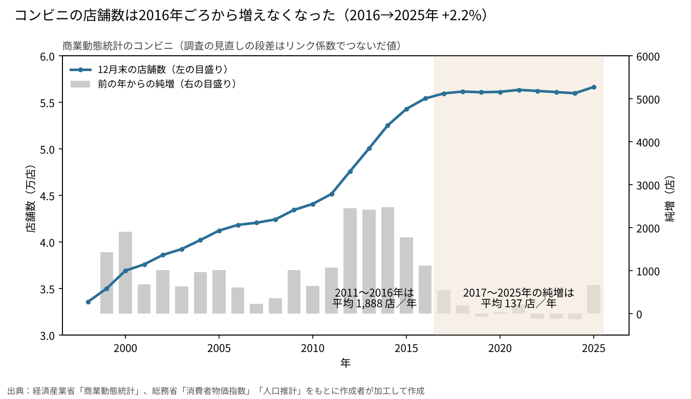
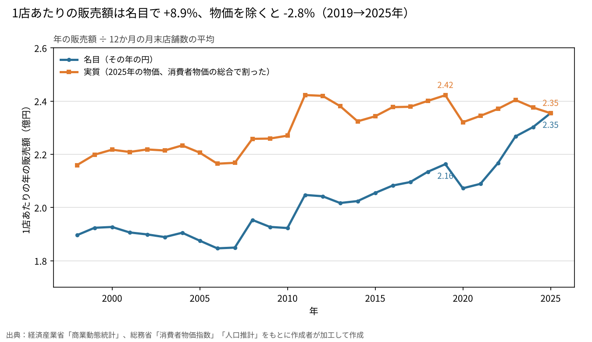
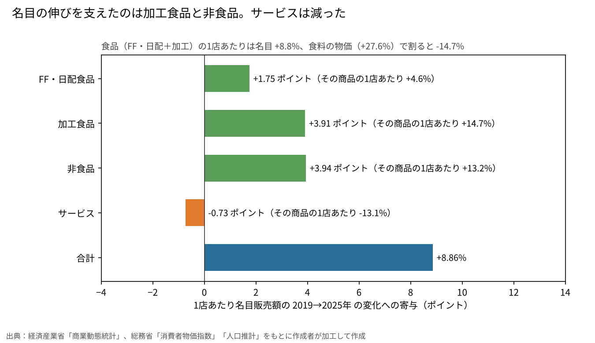
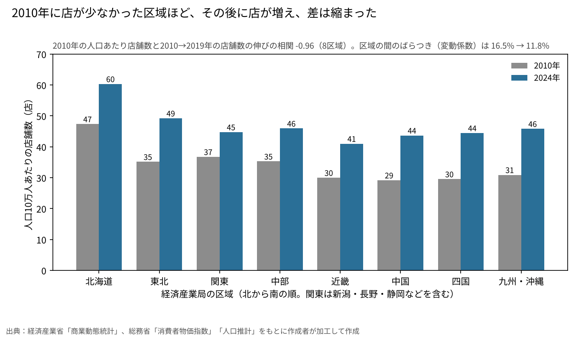

# F407 「コンビニは飽和した」は、店の数と1店あたりの売上でどう見えるか？ 店の数は2016→2025年で+2.2%。1店あたりの販売額は名目+8.9%、物価を除くと−2.8%（2019→2025年）

## 結論（先に）

- 商業動態統計のコンビニの店舗数（12月末）は、2011〜2016年に年平均1,888店ずつ増えたあと、2017〜2025年は年平均137店の増加にとどまりました。2016→2025年の変化は +2.2%（55,423店→56,659店）です。
- 1店あたりの年の販売額は、2019→2025年に名目で +8.9%（2億1,628万円→2億3,545万円）でした。消費者物価の総合（暦年の年平均。同じ期間に +12.0%）で割った実質では −2.8% で、2025年は2019年を下回ります。
- 2010→2016年の販売額の伸び（対数で30.6%）は、その74%が店の数の増加によるものでした。2019→2025年の伸び（9.2%）では、店の数の寄与は8%だけで、残りは1店あたりの名目の増加でした。
- 2019→2025年の1店あたり名目の伸び（+8.86%）の内訳は、加工食品 +3.91ポイント、非食品 +3.94ポイント、FF・日配食品 +1.75ポイント、サービス −0.73ポイントです。食品（FF・日配＋加工）は名目 +8.8%ですが、食料の物価（+27.6%）で割ると −14.7% です。
- 経済産業局の8区域では、2010年に人口あたりの店が少なかった区域ほど、2010→2019年に店が増えていました（相関 −0.96）。人口10万人あたりの店舗数の区域の間のばらつき（変動係数）は16.5%→11.8%に縮みました。

「飽和」を「店の数が増えなくなった」と読むなら、2016年からその状態に近いと言えます。ただし1店あたりの名目の販売額は伸びており、物価を除くと横ばいからやや減、という形です。

## 問い

2010年代の半ばから「コンビニは飽和した」と言われることが増えました。一方で、業界団体は「店を増やしているチェーンもあり、一概に飽和とは言えない」としている、という報道もあります（J-CAST ニュース、2023年11月2日）。

小売や食品の仕事をする人、地域の買い物の記事を書く人にとって、「飽和」が何を指すかは大事です。店の数が止まったのか、1店あたりの売上が落ちたのか、それとも物価で見え方が変わっているのか。この記事は、経済産業省の商業動態統計で、店の数・1店あたりの販売額（名目と実質）・売れるものの中身・人口あたりの店の数を、1998〜2025年の長さで確かめます。特定の会社や、出店の良し悪しは扱いません。

## データ（出典）

| データ | 使った部分 | ファイル |
|---|---|---|
| 経済産業省「商業動態統計」時系列データ コンビニエンスストア商品別販売額等 | 全国の月次販売額（合計・商品・FF・日配食品・加工食品・非食品・サービス売上高）と月末の店舗数、経済産業局別の月次販売額と店舗数、注のリンク係数 | data/raw/meti_cvs_timeseries.xlsx |
| 総務省「消費者物価指数」2025年基準 全国 中分類指数（年平均） | 中分類指数（暦年の年平均）の総合と食料。2025年＝100 | data/raw/cpi_annual_middle_class.csv |
| 総務省「人口推計」都道府県別人口（10月1日） | 2000〜2024年。経済産業局の区域に足し上げた | data/raw/pop_pref_2000_2020.xlsx、pop_pref_2020_2024.xlsx |

取得日と URL は [data/raw/SOURCES.md](data/raw/SOURCES.md) にあります。商業動態統計のコンビニは、一定の規模を満たすチェーンの店を対象にした調査です。2012年1月、2017年1月、2021年3月に調査の対象が見直され、表の注にある「リンク係数」をそれより前の月の値にかけると、段差なくつながります。

## 事前の計画

計画は [PLAN.md](PLAN.md) に、集計の前に書きました（2026-11-18 04:05）。この記事は、前の担当が取得と計画の下書きまでで止まっていたものを引き継いでいます。前の担当の下書きは [PLAN_prev.md](PLAN_prev.md) にそのまま残しました。下書きには「表の形を確かめるときに、つなぐ前の年の店舗数と販売額を見た。店舗数は2016年ごろから5.6万店前後で止まり、名目の販売額は2025年が最も多い」とあります。前の担当がそれ以上の結果を見たかは分かりません。引き継いだ側は表の見出しと注、最初の数行だけを見て、仮説と基準は下書きのまま採りました。

レビューで確かめた事実：PLAN.md に書かれた作成時刻「04:05」は、結果のファイルの時刻（04:04）より後で、当てになりません。ファイルの最終更新は 04:01 で、集計のスクリプト（03_analysis.py、04:02）と結果（04:04）より前でした。順番は「計画 → 集計」と読めますが、記載の時刻は誤りです（PLAN.md の本文は変えていません）。仮説 H1〜H4 と基準は PLAN_prev.md（前の担当の下書き）と一字一句ではないものの同じ内容で、引き継ぎで変わっていないことも確かめました。

| 仮説 | 外れの基準 | 結果 | 判定 |
|---|---|---|---|
| H1 店舗数（12月末）の2016→2025年の変化は±3%以内 | 超えれば外れ | +2.23% | 支持（見たうえでの仮説で、確かめの意味は小さい） |
| H2 名目の1店あたり販売額は2019→2025年に5%以上増える | 5%未満なら外れ | +8.86% | 支持 |
| H3 実質の1店あたり販売額は2025年が2019年を下回る | 上回れば外れ | −2.79% | 支持 |
| H4 2010年の人口あたり店舗数が少ない区域ほど、2010→2019年の伸びが大きい | 相関が0以上なら外れ | −0.96 | 支持 |

## やったこと

1. 月次の表にリンク係数をかけ、1998年4月〜2026年9月の系列をつなぎました（`src/02_build.py`）。
2. 12か月そろう1998〜2025年について、年の販売額（1〜12月の合計）、12月末の店舗数、12か月の月末店舗数の平均を出しました。
3. 1店あたり販売額 ＝ 年の販売額 ÷ 平均店舗数。実質 ＝ 名目 ÷ 消費者物価の総合（2025年＝100）。金額は「2025年の物価で見た値」になります。
4. 経済産業局の8区域で、12月末の店舗数を10月1日の人口で割り、人口10万人あたりの店舗数を出しました（`src/03_analysis.py`）。
5. 結果を見てから、販売額の伸びを「店の数」と「1店あたり」に分け、1店あたりの伸びを商品別に分けました（`src/03b_requestion.py`）。
6. 頑健性を7通り確かめました。

## 分かったこと

### 店の数は2016年から増えなくなった（図1）



- 12月末の店舗数は、2000年 36,926店、2010年 44,096店、2016年 55,423店、2019年 56,095店、2025年 56,659店でした（リンク係数でつないだ値）。
- 2011〜2016年は年平均 +1,888店でした。2017〜2025年は年平均 +137店で、2019〜2024年は減った年もあります。
- 2025年は前の年から670店ほど増え、28年間で最も多い年末の店舗数になりました。2025年だけ増えた理由は、このデータでは分かりません。調査の対象の入れ替わりが影響している可能性もあります（推測）。

### 1店あたりは名目で伸び、物価を除くと2019年を下回った（図2）



- 1店あたりの年の販売額（名目）は、2010年 1億9,227万円、2016年 2億825万円、2019年 2億1,628万円、2025年 2億3,545万円です。2019→2025年は +8.9% でした。
- 2025年の物価で見た実質では、2019年 2億4,220万円、2025年 2億3,545万円で、−2.8% です。実質の最も高い年は2011年でした（2019年とほぼ同じ）。
- 2010→2016年は実質でも +4.7%、2016→2019年も +1.9% でした。実質の1店あたりが下がったのは、2020年（2019年比 −4.2%）からです。
- 2008年と2011年に名目が段のように上がっています。たばこの値上げや成人識別カードの導入の時期と重なりますが、このデータで理由は確かめていません（推測）。

### 名目の伸びを支えたのは加工食品と非食品（図3、問い直し）



- 2019→2025年の1店あたり名目 +8.86% のうち、加工食品が +3.91ポイント（その商品の1店あたり +14.7%）、非食品が +3.94ポイント（+13.2%）でした。
- 最も大きな商品であるFF・日配食品（弁当・おにぎり・パン・総菜など）は +1.75ポイント（+4.6%）にとどまりました。
- サービス売上高（チケット・各種の取次ぎなど）は −0.73ポイント（−13.1%）で、販売額に占める割合は 5.6%→4.4% に下がりました。
- 食品（FF・日配＋加工）の1店あたりは名目 +8.8% ですが、食料の物価は同じ期間に +27.6% 上がっています。食料の物価で割ると −14.7% です。コンビニの食品の値上がりが食料の物価と同じとは限らないので、この値は「量が15%減った」という意味ではありません。

### 店が少なかった区域ほど増え、差は縮まった（図4）



- 人口10万人あたりの店舗数は、2010年に区域の間で29.2〜47.3店、2024年に41.0〜60.3店でした。全国では34.4店→45.2店です。
- 2010年に人口あたりの店が少なかった区域ほど、2010→2019年の店舗数の伸びが大きく、相関は −0.96 でした（8区域）。
- 区域の間のばらつき（変動係数：標準偏差÷平均）は 16.5%→11.8% に縮みました。どの区域も2010年より人口あたりの店が多く、北海道が2010年・2024年とも最も多い区域です。

## 問い直し（結果を見てから足した）

H2 と H3 がともに支持されたので、「店が止まったあと、販売額の伸びは何が支えたのか」を足しました。

| 期間 | 販売額の伸び（対数、%） | うち店の数 | うち1店あたり（名目） | 物価（総合） | 1店あたり（実質） | 店の数の割合 |
|---|---|---|---|---|---|---|
| 2010→2016 | 30.6 | 22.6 | 8.0 | 3.4 | 4.6 | 74% |
| 2016→2019 | 6.0 | 2.2 | 3.8 | 1.9 | 1.9 | 37% |
| 2019→2025 | 9.2 | 0.7 | 8.5 | 11.3 | −2.8 | 8% |

2010年代前半の伸びは主に「店が増えたこと」、2019年以降の名目の伸びは主に「1店あたりの名目の増加」で、その中身は物価の上がりより小さい、という形です。商品別の内訳は図3のとおりです。

## 頑健性

| 確かめ | 仮説 | 値 | 判定 |
|---|---|---|---|
| 基本（リンク係数でつなぐ） | H1 / H2 / H3 / H4 | +2.23% / +8.86% / −2.79% / −0.96 | すべて支持 |
| 1. リンク係数を使わない | H1 / H2 / H3 / H4 | +1.84% / +9.35% / −2.35% / −0.87 | すべて支持 |
| 2. 実質化の物価を食料にする | H3 | −14.65% | 支持 |
| 3. 年末の店舗数で割る | H2 / H3 | +8.55% / −3.07% | 支持 |
| 4. 比べる年を2018年にする | H2 / H3 | +10.32% / −1.92% | 支持 |
| 5. サービスを除く商品販売額 | H2 / H3 | +10.16% / −1.62% | 支持 |
| 6. 順位の相関（スピアマン） | H4 | −0.93 | 支持 |
| 7. 四国を除く（計画にない追加） | H4 | −0.96 | 支持 |

どの確かめでも結論は変わりませんでした。H3 の大きさは物価や比べ方の選び方で −1.6%〜−14.7% と幅があります。「物価を除くと2019年を下回る」という向きは同じでも、どれだけ下回るかは物価の取り方しだいです。7 は、四国の2012年のリンク係数（店舗数1.57）が大きく、2010年の値がつなぎ方に強く左右されるため足しました。

## 言えないこと

- 商業動態統計のコンビニは、一定の規模を満たすチェーンの店です。すべてのコンビニではありません。調査の対象の見直しはリンク係数で調整していますが、完全にはそろいません。
- 開店と閉店の数（入れ替わり）は分かりません。純増だけです。店の数が止まっていても、多くの店が入れ替わっている可能性はあります。
- 1店あたりの利益、客数、客単価は分かりません。販売額が同じでも、費用の動きは別です。
- 店の数が止まった理由（人手、競争、立地、ほかの業態との関係）は、このデータでは分かりません。
- 実質の値は、消費者物価（家計が買うもの全体、または食料全体）で割ったものです。コンビニで売られるものの値上がりとは同じではありません。
- 区域の分析は8点だけで、相関の強さは区域の大きさ（関東が大きい）に左右されます。人口の多い・少ないで店の採算を語ることはできません。

## 仕事で使うなら

- 「飽和」という言葉を使うときは、店の数・1店あたり（名目）・1店あたり（実質）のどれを指すかを分けて書くと、読み手の誤解が減ります。
- 2019年以降の名目の伸びを比べるときは、同じ期間の物価の上がり（総合 +12.0%、食料 +27.6%）を横に置いておくと、数字の読み方がそろいます。

## 計画からの変更

- 計画では年の値を1999〜2025年としていましたが、表に1998年の12か月がそろっていたので1998年も入れました。主な比較の年（2010・2016・2019・2025）は変えていません。
- 消費者物価は、最初に使った表（品目別価格指数、statInfId=000040482959）が年度平均の表で（2025年の総合が100.4）、暦年の販売額と期間がずれていました。レビューで暦年の年平均の中分類指数の表（statInfId=000040482829、2025年＝100.0）に替えました（下の「レビューで直したこと」）。
- 頑健性に「7. 四国を除く」を足しました（理由は上）。
- 問い直しは、予定の候補のうち「商品別の1店あたり」を選び、販売額の伸びの分け方も加えました。

## 再現のしかた

```sh
pip install -r requirements.txt   # numpy・pandas・scipy・matplotlib・openpyxl
sh src/run_all.sh                 # オフラインで 02 → 03 → 03b → 04（所要 約4秒）
# 元データを取り直すときだけ（ネットにつなぐ）：python3 src/01_fetch.py
```

| ファイル | 中身 |
|---|---|
| src/01_fetch.py | e-Stat から4ファイルを取る（run_all.sh からは呼ばない） |
| src/02_build.py | リンク係数・全国の月次・区域の月次・物価・区域の人口を data/ に出す |
| src/03_analysis.py | 年の値、仮説の判定、頑健性 → results/main.json、annual_national.csv、region_per_capita.csv、robustness.csv |
| src/03b_requestion.py | 問い直し → results/requestion.json、requestion_decomp.csv、requestion_items.csv |
| src/04_figures.py | 図4枚 → figures/ |

確かめ：`results/repro_check.txt` のとおり、/tmp に写して 02 以降が作るファイルを消し、`sh src/run_all.sh` を流し直して、results の CSV・JSON と figures の PNG、02 が作る data の CSV の16ファイルが `cmp` でバイト単位で一致しました（所要4秒）。フォルダ全体は約1.4MBです。

## レビューで直したこと

| # | 指摘 | 直し方 |
|---|---|---|
| 1 | 実質化に使った消費者物価の表（statInfId=000040482959）は**年度平均**の表で（2025年の総合が100.4）、暦年の販売額と3か月ずれていた。README では「年平均」と書いていた | 暦年の年平均の中分類指数の表（statInfId=000040482829、2025年＝100.0）を取得して `data/raw/` に足し、`02_build.py` と `01_fetch.py` を替えた。実質の数字を直した（2019→2025年の1店あたり実質 −3.0% → −2.8%、物価の総合 +12.2% → +12.0%、食料 +28.2% → +27.6%、頑健性の H3 の値）。結論の向きは変わらない。題名・note・status もそろえた。古い表は使わないファイルとして残した |
| 2 | PLAN.md の作成時刻「04:05」が、結果のファイル（04:04）より後 | 「事前の計画」に、記載の時刻は誤りで、ファイルの時刻では計画が集計より前であることを書き足した |

## 出典

- 経済産業省「商業動態統計」時系列データ コンビニエンスストア商品別販売額等（政府統計の総合窓口 e-Stat）：https://www.e-stat.go.jp/stat-search/file-download?statInfId=000031387995&fileKind=0
- 総務省「消費者物価指数」2025年基準 全国 中分類指数（年平均）（e-Stat）：https://www.e-stat.go.jp/stat-search/file-download?statInfId=000040482829&fileKind=1
- 総務省「人口推計」都道府県別人口（e-Stat）：https://www.e-stat.go.jp/stat-search/file-download?statInfId=000013168605&fileKind=4 、https://www.e-stat.go.jp/stat-search/file-download?statInfId=000040268859&fileKind=0
- 「飽和」をめぐる報道の例：J-CAST ニュース（2023年11月2日）https://www.j-cast.com/2023/11/02472272.html

（いずれも経済産業省「商業動態統計」、総務省「消費者物価指数」「人口推計」をもとに作成者が加工して作成）
