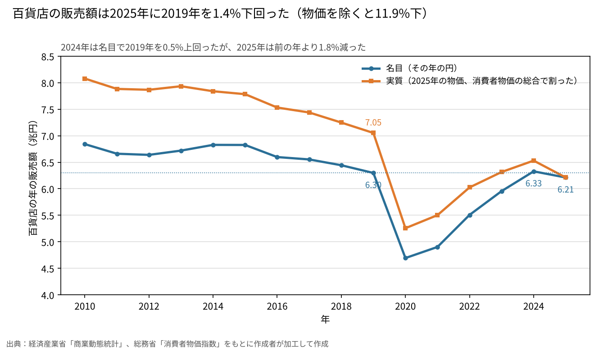
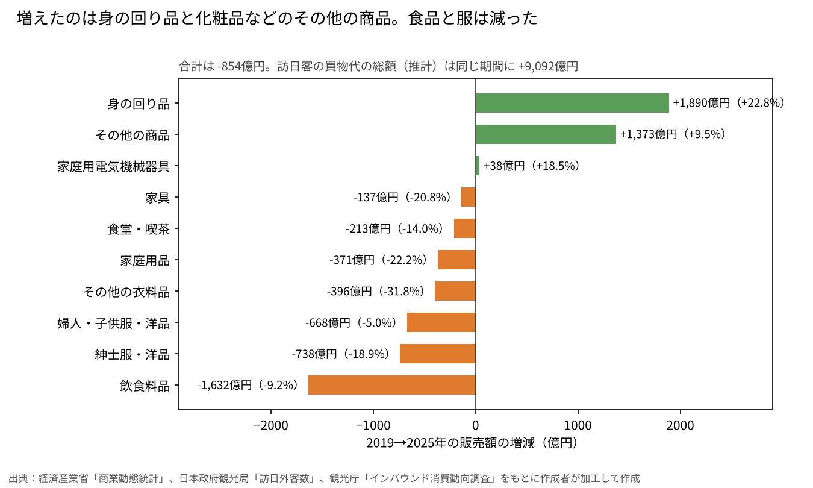
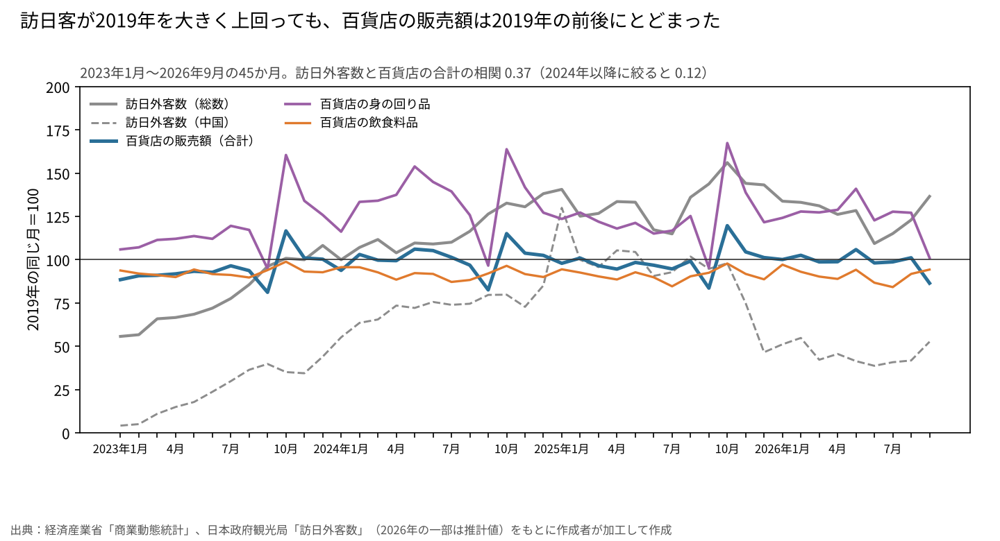
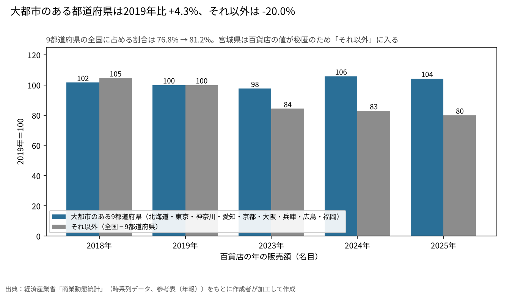

# F408 百貨店の売上は、訪日客の買物でどこまで戻ったのか？ 2025年は2019年を1.4%下回り、物価を除くと11.9%下。訪日客の買物代（推計）は9,092億円増えたが、百貨店の合計は854億円減った。身の回り品は+22.8%、大都市のある都道府県は+4.3%

## 結論（先に）

- 商業動態統計の百貨店の販売額は、2019年 6兆2,979億円に対し、2024年 6兆3,282億円（+0.5%）、2025年 6兆2,124億円（−1.4%）でした。名目でほぼ2019年に戻ったところで止まり、消費者物価の総合（暦年の年平均、+12.0%）で割った実質では2019年より11.9%少ない水準です。
- 2019→2025年に増えたのは、身の回り品（かばん・靴など）+1,890億円（+22.8%）と、その他の商品（化粧品・宝飾品・時計など）+1,373億円（+9.5%）でした。飲食料品は −1,632億円（−9.2%）、紳士服 −738億円、婦人・子供服 −668億円です。
- 訪日客の買物代の総額（推計）は、同じ期間に +9,092億円増えました（1兆7,003億円→2兆6,095億円）。百貨店の合計は増えていません。訪日客の買物のうち百貨店で使われた分が増えていれば、それ以外の客の分が減って打ち消し合ったことになりますが、百貨店で使われた割合は分からないので、ここは推測です。訪日客の買物のうち百貨店で使われる割合を仮に10〜40%と置くと、訪日客以外の販売額は2.9〜8.0%減った計算です。
- 月ごとに見ると、訪日外客数と百貨店の販売額（どちらも2019年の同じ月との比）の相関は0.37でした。ただ2024年以降に絞ると0.12と弱く、訪日客が2019年を3〜5割上回る月でも、百貨店は2019年の前後にとどまりました。
- 大都市（札幌・東京・横浜・名古屋・京都・大阪・神戸・広島・福岡）のある9都道府県の百貨店は2019→2025年に +4.3%、それ以外は −20.0% でした。9都道府県が全国に占める割合は 76.8%→81.2% に上がりました。

## 問い

「百貨店の売上は訪日客の免税売上で戻った」とよく報じられます。日本百貨店協会の集計では、2024年の全国百貨店の売上高は2019年を上回り、免税売上高は6,487億円と大きく伸びたと報じられました（FASHIONSNAP、2025年1月30日）。

では、経済産業省の商業動態統計で見ると、百貨店の販売額はどこまで2019年（コロナの前）に戻ったのでしょうか。戻った分を、訪日客の買物でどこまで説明できるのでしょうか。小売・商業施設・観光の仕事をする人や、地域の商業の記事を書く人に向けて、「戻った」の中身を商品・月・地域に分けて確かめます。特定の百貨店や会社の話、出店や価格の良し悪しは扱いません。

日本百貨店協会の免税売上の統計は接続できず使えなかったので、観光庁の調査による訪日客の買物代と免税物品購入額で代えています。このため題名は、作成時の「訪日客の免税売上で」から、中身に合わせて「訪日客の買物で」に直しました（レビュー）。

関連する記事：098（業態別の販売額が2019年まで・コロナ前の伸びに戻ったか）、145（訪日客の支出の内訳）、F270（訪日客1人あたりの支出）、F437（宿泊料と訪日客）。この記事は、百貨店の販売額の戻り方を、商品・月・地域に分けて訪日客の買物と並べる点が違います。

## データ（出典）

| データ | 使った部分 | ファイル |
|---|---|---|
| 経済産業省「商業動態統計」時系列データ 百貨店・スーパー商品別販売額等 | 百貨店の月次販売額（合計と商品別）、1980年1月〜2026年9月 | data/raw/meti_dept_super_timeseries.xlsx |
| 同 参考表（年報）都道府県別、百貨店・スーパー別、商品別販売額等 | 2019年版（2017〜2019年）と2025年版（2023〜2025年）の百貨店の年の販売額 | data/raw/meti_pref_2019.xls、meti_pref_2025.xlsx |
| 日本政府観光局「訪日外客数」 | 月次の総数と中国（2003年〜2026年9月） | data/raw/jnto_visitors_2003_2026.xlsx |
| 観光庁「訪日外国人消費動向調査」「インバウンド消費動向調査」集計表 | 1人あたり買物代、免税手続きをした人の割合と1人あたり免税物品購入額、百貨店・デパートの利用率（2019・2023・2024・2025年） | data/raw/kanko_<年>_annual.xls |
| 総務省「消費者物価指数」2025年基準 全国 中分類指数 | 総合（暦年の年平均）、2025年＝100 | data/raw/cpi_annual_middle_class.csv |

取得日と URL は [data/raw/SOURCES.md](data/raw/SOURCES.md) にあります。「身の回り品」はかばん・靴・傘・装身具など、「その他の商品」は化粧品・医薬品・宝石・貴金属・時計などを含みます（経済産業省「2024年間・小売業販売を振り返る」）。百貨店は2010年以降のリンク係数が空欄なので、値をそのまま使いました。

## 事前の計画

計画は [PLAN.md](PLAN.md) に、集計の前に書きました（2026-11-18 04:15）。前の担当は着手の印をつけただけで、中身は引き継いだ側が作りました。表の形を確かめるときに見た値（2025年の都道府県別の百貨店、観光庁の1人あたり買物代など）は PLAN.md に書いています。観光庁の1人あたり買物代（2019年 53,331円、2025年 61,136円）を計画の前に見ていて、訪日客の数が増えたことも広く知られていたので、「訪日客の買物代の総額が2019年より増えた」ことは計画の前にほぼ分かっていました（H5 の前半は確かめの意味が小さい。レビューで書き足し）。都道府県別では東京都・大阪府の2025年の値と北海道の2019年の値を見ていましたが、同じ都道府県の2019年と2025年の両方は見ていません。

| 仮説 | 外れの基準 | 結果 | 判定 |
|---|---|---|---|
| H1 百貨店の販売額（名目）は2025年が2019年を上回る | 下回れば外れ | −1.36% | 外れ |
| H2 2019→2025年の伸び率は、身の回り品が飲食料品と衣料品計のどちらよりも大きい | どちらかを下回れば外れ | 身の回り品 +22.8%、飲食料品 −9.2%、衣料品計 +0.3% | 支持（ただし衣料品計は身の回り品を含む。下の「計画からの変更」） |
| H3 訪日外客数と百貨店の販売額（2019年同月比）の相関が0.3以上 | 0.3未満なら外れ | 0.37（45か月） | 支持（2024年以降では0.12で外れ） |
| H4 大都市のある都道府県の伸びが、それ以外より5ポイント以上大きい | 差が5ポイント未満なら外れ | +4.3% と −20.0%、差24.3ポイント | 支持 |
| H5 訪日客の買物代の総額の増加は、百貨店の増加より大きい | 小さければ外れ。H1 が外れたら判定できず | 買物代 +9,092億円、百貨店 −854億円 | 判定できず（計画の決まりどおり） |

## やったこと

1. 百貨店の月次販売額を年に足し、2019・2024・2025年を名目と実質（消費者物価の総合で割る）で比べ、商品別（10区分）の増減も出しました。
2. 訪日客の買物代の総額 ＝ 訪日外客数 × 1人あたり買物代。免税物品購入額の総額 ＝ 訪日外客数 × 免税手続きをした人の割合 × その人の1人あたり購入額。
3. 2023年1月〜2026年9月の各月で、百貨店の販売額と訪日外客数を2019年の同じ月と比べ、相関を出しました。
4. 年報の都道府県別の値から、大都市のある都道府県の合計と、それ以外（全国−その合計）を出しました。宮城県は百貨店の値が秘匿（X）なので「それ以外」に入ります。

## 分かったこと

### 名目でほぼ戻ったところで止まり、物価を除くと12%下（図1）



- 百貨店の販売額は、2019年 6兆2,979億円、2020年 4兆6,938億円、2023年 5兆9,557億円、2024年 6兆3,282億円、2025年 6兆2,124億円でした。
- 2024年は2019年を0.5%上回りましたが、2025年は前の年から1.8%減り、2019年を1.4%下回りました。
- 消費者物価の総合が12.0%上がったので、実質では −11.9% です。最も多かった1991年（12兆852億円）の約半分です。

### 増えたのは身の回り品と化粧品など、減ったのは食品と服（図2）



- 身の回り品 +1,890億円（+22.8%）、その他の商品 +1,373億円（+9.5%）で、2つ合わせて +3,263億円です。
- 飲食料品 −1,632億円（−9.2%）、紳士服・洋品 −738億円（−18.9%）、婦人・子供服・洋品 −668億円（−5.0%）、その他の衣料品 −396億円（−31.8%）などが減りました。
- 割合は、身の回り品 13.2%→16.4%、その他の商品 23.0%→25.5%、飲食料品 28.2%→26.0% です。
- 増えた商品は訪日客がよく買うもの（化粧品、かばん・靴）と重なりますが、どこまでが訪日客の分かは分かりません。

| 年 | 訪日外客数 | 1人あたり買物代 | 買物代の総額（推計） | 免税物品購入額の総額（推計） | 百貨店・デパートの利用率 | 百貨店の販売額 |
|---|---|---|---|---|---|---|
| 2019 | 3,188万人 | 53,331円 | 1兆7,003億円 | 9,844億円 | 55.6% | 6兆2,979億円 |
| 2023 | 2,507万人 | 56,098円 | 1兆4,062億円 | 6,408億円 | 56.1% | 5兆9,557億円 |
| 2024 | 3,687万人 | 66,046円 | 2兆4,351億円 | 1兆2,468億円 | 58.6% | 6兆3,282億円 |
| 2025 | 4,268万人 | 61,136円 | 2兆6,095億円 | 1兆4,267億円 | 59.4% | 6兆2,124億円 |

訪日客の買物のうち百貨店で使われた割合を仮に置くと、訪日客以外の販売額の2019→2025年の変化は、10%で −2.9%、20%で −4.5%、30%で −6.2%、40%で −8.0% です。参考：日本百貨店協会の2024年の免税売上高（6,487億円、報道）は、同じ年の買物代の総額の推計の約27%にあたります。協会と商業動態統計は対象の店が違うので、目安にとどまります（推測）。

### 訪日客が大きく増えても、百貨店は2019年の前後（図3）



- 2023年1月〜2026年9月の45か月で、訪日外客数は2019年同月の 56〜156、百貨店の販売額は 81〜120 の範囲でした。
- 相関は0.37です（その他の商品 0.48、衣料品計 0.33、身の回り品 0.32、飲食料品 0.04）。
- 2024年1月以降では0.12です。訪日客が戻る途中の2023年には一緒に上がりましたが、訪日客が2019年を超えてからは、百貨店の合計はあまり伸びていません。

### 大都市のある都道府県だけが2019年を上回った（図4）



- 大都市のある9都道府県の合計は2019→2025年に +4.3%、それ以外は −20.0% でした。差は24.3ポイントです。
- 9都道府県の内訳（北から南の順）：北海道 −1.1%、東京都 +1.5%、神奈川県 −7.9%、愛知県 +6.8%、京都府 +12.0%、大阪府 +18.2%、兵庫県 +1.6%、広島県 −30.2%、福岡県 +7.1%。
- 「それ以外」の減少には閉店も入っていて、訪日客の多さと結びつけることはできません。

## 問い直し（結果を見てから足した）

2024年以降の連動が弱かったので、訪日客の国籍の構成が大きく変わった2026年の動きを足しました（`src/03b_requestion.py`）。

| 2026年1〜9月の前年同期比 | 値 |
|---|---|
| 訪日外客数（総数） | −2.9% |
| 訪日外客数（中国） | −55.5% |
| 百貨店の販売額（合計） | +3.2% |
| 身の回り品 | +6.0% |
| その他の商品 | +6.8% |
| 飲食料品 | +0.4% |

中国からの訪日客が半分以下になった2026年1〜9月にも、身の回り品とその他の商品は前の年より伸びました。2024年1月〜2026年9月の33か月の前年同月比どうしの相関は、百貨店の合計と訪日外客数（総数）が0.56、中国からの訪日客が0.50でした。2026年は、前の年の百貨店が弱かった反動や国内の高額品の買物も重なっている可能性があります（推測）。2026年の値は速報です。

## 頑健性

| 確かめ | 仮説 | 値 | 判定 |
|---|---|---|---|
| 1. 2018年を基準にする | H1 | −3.59% | 外れ |
| 1. 2018年を基準にする | H2 | 身の回り品 +20.3%（飲食料品 −11.0%、衣料品計 −3.7%） | 支持 |
| 1. 2018年を基準にする | H4 | 差 26.2ポイント | 支持 |
| 2. 実質（消費者物価の総合） | H1 | −11.91% | 外れ |
| 3. 2024年1月以降に絞る | H3 | 0.12（33か月） | 外れ |
| 3b. 前年同月比どうし（2024年1月以降） | H3 | 0.56（33か月） | 支持 |
| 4. 大都市を5都府県（東京・愛知・京都・大阪・福岡）に絞る | H4 | +7.5% と −14.9%、差 22.4ポイント | 支持 |
| 5. 免税物品購入額の総額で見る | H5 | 免税物品 +4,423億円、百貨店 −854億円 | 判定しない（H1 が外れ） |
| 6. 衣料品から身の回り品を除く（計画にない追加） | H2 | 身の回り品 +22.8%、衣料品（身の回り品を除く）−9.8% | 支持 |

H1・H2・H4 は、基準の年や定義を変えても変わりませんでした。H3 は期間と比べ方で変わり、2024年以降は2019年同月比どうしでは弱く、前年同月比どうしでは連動が見えます。

## 言えないこと

- 百貨店の販売額のうち訪日客の分（免税売上）の金額は、このデータからは分かりません。訪日客の買物代のうち百貨店で使われた割合も分かりません。上の10〜40%は仮定です。
- 月ごとの相関は、季節や景気の動きでも生まれます。訪日客が増えたから百貨店の売上が増えた、という因果は言えません。
- 都道府県の多くは百貨店の値が秘匿で、地方の中の違いは見えません。年報と時系列の値は公表の時期の違いで少しずれることがあります。
- 物価・為替・国内の高額品の消費の影響は分けられません。
- 2026年の値は速報で、訪日外客数の一部は推計値です。

## 仕事で使うなら

- 百貨店の「回復」は、名目と実質、商品別、地域別に分けて示すと中身が伝わります。
- 訪日客の分を見積もるときは、「百貨店で使われる割合」が仮定であることを書き、幅で示すと誤解が減ります。

## 計画からの変更

- H2 の比べる相手「衣料品計」は、商業動態統計では身の回り品を含む区分でした。計画を書いた時点では気づいていませんでした。判定は計画どおりにしたうえで、身の回り品を除いた衣料品（−9.8%）との比較を頑健性6として足しました。
- H5 は H1 が外れたため、計画の決まりどおり「判定できず」としました。そのかわり、百貨店で使われた割合を仮に置いた計算（10〜40%）を足しました（計画にない追加）。
- 日本百貨店協会の2024年の免税売上は報道の数字として触れただけで、計算には使っていません。
- 年報の2018年版・2024年版は、2019年版・2025年版に同じ年の値があるので使わず、フォルダから外しました。

## 再現のしかた

```sh
pip install -r requirements.txt   # numpy・pandas・scipy・matplotlib・openpyxl・xlrd
sh src/run_all.sh                 # オフラインで 02 → 03 → 03b → 04（所要 約6秒）
# 元データを取り直すときだけ（ネットにつなぐ）：python3 src/01_fetch.py
```

| ファイル | 中身 |
|---|---|
| src/01_fetch.py | e-Stat・JNTO・観光庁から9ファイルを取る（run_all.sh からは呼ばない） |
| src/02_build.py | 百貨店の月次、訪日外客数、観光庁の値、都道府県の年の値、物価を data/ に出す |
| src/03_analysis.py | 年の値・商品別・訪日客の買物との比較・月次の相関・地域・頑健性 → results/main.json ほか |
| src/03b_requestion.py | 問い直し（2026年の動き）→ results/requestion.json、requestion_yoy.csv |
| src/04_figures.py | 図4枚 → figures/ |

確かめ：`results/repro_check.txt` のとおり、/tmp に写して 02 以降が作るファイルを消し、`sh src/run_all.sh` を流し直して、results の CSV・JSON 11、figures の PNG 4、data の CSV 6 の21ファイルが `cmp` でバイト単位で一致しました（所要6秒）。フォルダ全体は約22MB（元データ約21MB）です。

## レビューで直したこと

| # | 指摘 | 直し方 |
|---|---|---|
| 1 | 題名が「訪日客の免税売上で」と言っているが、免税売上そのもの（日本百貨店協会）は使えず、観光庁の調査の買物代で代えている | 題名を「百貨店の売上は、訪日客の買物でどこまで戻ったのか？」に直し、結果の部分に訪日客の買物代の増加（+9,092億円）と百貨店の合計の減少（−854億円）を入れた。status の title・md、note の1行目とファイル名、README の見出しをそろえた |
| 2 | 実質化に使った消費者物価の表（statInfId=000040482959）は**年度平均**の表で（2025年の総合が100.4）、暦年の販売額と3か月ずれていた | 暦年の年平均の中分類指数の表（statInfId=000040482829、2025年＝100.0）を取得して `data/raw/` に足し、`01_fetch.py`・`02_build.py` を替えた。物価の上がり +12.2% → +12.0%、実質 −12.1% → −11.9%。結論は変わらない。古い表は使わないファイルとして残した |
| 3 | 「訪日客で増えた分とそれ以外で減った分が打ち消し合った」を事実のように書いていた。note の最後の段落は「訪日客で戻った」は商品と地域で見ると当てはまる、と書いていた | 百貨店で使われた割合が分からないため推測であると書き直した。note の最後の段落も、訪日客の分かどうかは確かめられないと直した |
| 4 | note で9都道府県を伸びの大きい順に並べていた | README と同じ北から南の順に直した |
| 5 | 計画の前に見た観光庁の1人あたり買物代で、H5 の前半（買物代の総額が増える）はほぼ分かっていたことが README に書かれていなかった | 「事前の計画」に書き足した |
| 6 | 既存の記事との関係が README になかった | 「問い」に関連する記事（098・145・F270・F437）と違いを書いた |

## 出典

- 経済産業省「商業動態統計」時系列データ 百貨店・スーパー商品別販売額等（e-Stat）：https://www.e-stat.go.jp/stat-search/file-download?statInfId=000031387994&fileKind=0
- 経済産業省「商業動態統計」参考表（年報）2019年・2025年（e-Stat）：https://www.e-stat.go.jp/stat-search/file-download?statInfId=000031960815&fileKind=0 、https://www.e-stat.go.jp/stat-search/file-download?statInfId=000040471260&fileKind=0
- 日本政府観光局（JNTO）「訪日外客数」：https://www.jnto.go.jp/statistics/data/_files/20261021_1615-5.xlsx
- 観光庁「訪日外国人消費動向調査」「インバウンド消費動向調査」：https://www.mlit.go.jp/kankocho/tokei_hakusyo/gaikokujinshohidoko.html
- 総務省「消費者物価指数」2025年基準 全国 中分類指数（年平均）（e-Stat）：https://www.e-stat.go.jp/stat-search/file-download?statInfId=000040482829&fileKind=1
- 商品区分の説明：経済産業省「2024年間・小売業販売を振り返る」https://www.meti.go.jp/statistics/toppage/report/minikeizai/pdf/h2amini170j.pdf
- 報道の例：FASHIONSNAP（2025年1月30日）https://www.fashionsnap.com/article/2025-01-30/department-store-24/

（いずれも経済産業省「商業動態統計」、日本政府観光局「訪日外客数」、観光庁「訪日外国人消費動向調査」「インバウンド消費動向調査」、総務省「消費者物価指数」をもとに作成者が加工して作成）
