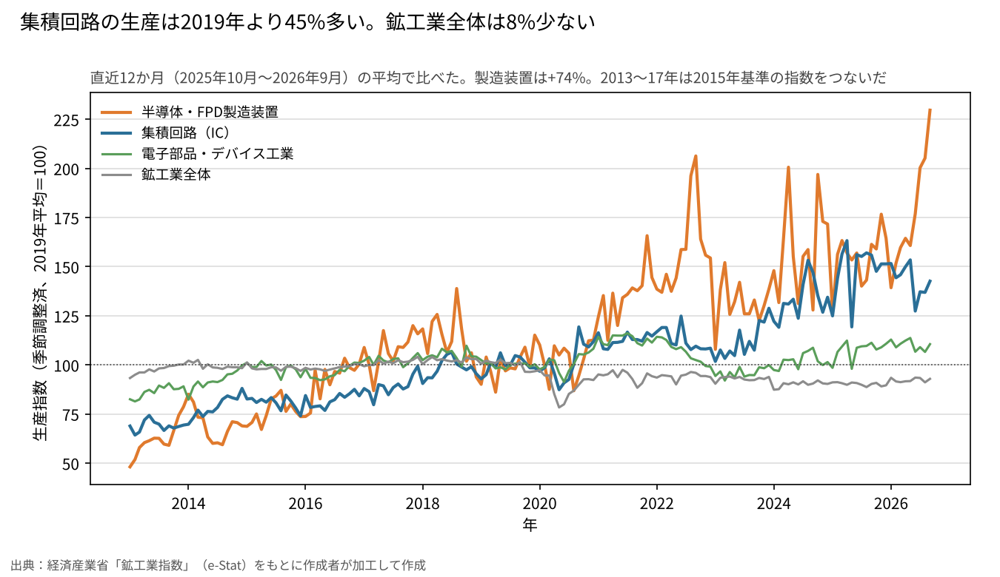
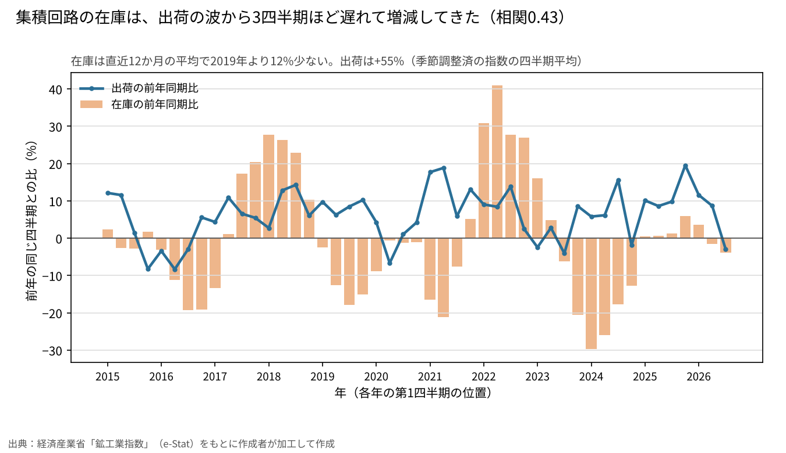
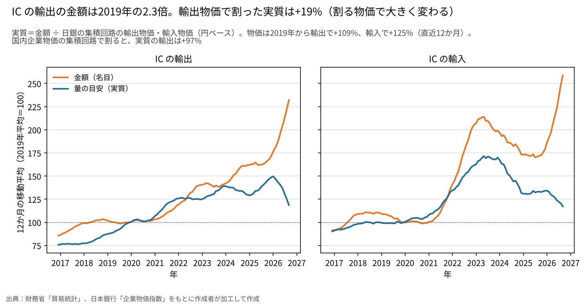
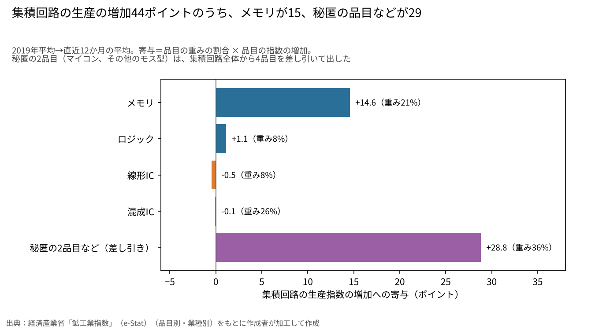

# F409 半導体の国内生産は、増えているのか？ 直近12か月で集積回路の生産は2019年より45%多く、製造装置は74%多い。同じ間に鉱工業全体は8%少ない

## 結論（先に）

- 経済産業省の鉱工業指数（工場の生産量の指数）で、集積回路（IC）の生産は、直近12か月（2025年10月〜2026年9月）の平均が2019年の平均より44.95%多くなりました。2013年と比べると約2倍（+110.3%。基準のつなぎ方を変えると+91.4%）です。同じ期間に鉱工業全体は2019年より8.36%少なく、ICは全体が縮む中で伸びました。
- 半導体・FPD（フラットパネルディスプレイ）製造装置の生産は、同じ比べ方で+73.98%でした。ICより伸びは大きいのですが、2025年の暦年で比べると差は6.3ポイントに縮みます。装置の差の多くは2026年に入ってからの急な伸びです。
- ICの生産の増加（指数で44.0ポイント）のうち、メモリが14.6ポイント（33.1%）、秘匿（X、公表されていない）のマイコンと「その他のモス型」の2品目などが28.8ポイント（65.5%）でした。線形IC・混成ICはほぼ横ばいです（問い直し）。
- ICの輸出額は2019年の2.3倍（年2兆8,361億円→6兆5,819億円）ですが、日銀の輸出物価（円ベース）で割った実質では+18.65%です。国内企業物価の集積回路で割ると+97.13%になり、実質の伸びは割る物価で大きく変わります。実質の輸出とICの出荷の前年同月比の相関は0.42で、弱いつながりでした。
- 世界の値動きの目安（メモリの輸出物価・ドル建てなどの契約通貨ベース）と、日本のメモリの生産の前年同月比の相関は、どのずれ（0〜12か月）でも最大0.22で、はっきりした連動は見えませんでした。

## 問い

政府は半導体の工場の誘致に大きな補助金を出しています。経済産業省の「半導体・デジタル産業戦略」（2023年改定）は、2030年に国内で半導体を生産する企業の売上高（半導体関連）を合計で15兆円超にする目標を掲げ、2020年はおよそ5兆円だったと書いています。新しい工場が動き出したという報道がある一方で、「国内の生産はまだ増えていない」という見方もあります。

そこで、製造業・部品・素材の仕事をする人や、地域の産業の記事を書く人、景気の統計を読む人に向けて、公式の統計で「国内の半導体の生産は増えたのか」を確かめます。生産だけでなく、出荷・在庫、輸出入（実質）、世界の値動きとの連動も並べます。特定の会社・工場の良し悪し、補助金の是非、投資の判断は扱いません。

関連する記事：368（輸出の主役の入れ替わり）、F282（円安と輸出の数量・価格）、F289、F85。この記事は、半導体の国内生産そのものを出荷・在庫・輸出入と並べる点が違います。

## データ（出典）

| データ | 使った部分 | ファイル |
|---|---|---|
| 経済産業省「鉱工業指数」2020年基準（e-Stat） | 業種別・品目別の月次の季節調整済指数（生産・出荷・在庫）、2018年1月〜2026年9月 | data/raw/iip2020_gyoshu_sa.xlsx、iip2020_hinmoku_sa.xlsx |
| 同 2015年基準（e-Stat） | 業種別の月次の季節調整済指数、2013年1月〜2023年4月（2017年以前をつなぐのに使う） | data/raw/iip2015_gyoshu_sa.xlsx |
| 財務省「貿易統計」輸出入額の推移 世界 月別 主要商品別 | IC、半導体等電子部品、半導体等製造装置の輸出入額（千円） | data/raw/customs_export_monthly.csv、customs_import_monthly.csv |
| 日本銀行「企業物価指数」 | 集積回路の輸出物価（円・契約通貨）、輸入物価（円）、メモリの輸出物価（契約通貨）、国内企業物価の集積回路 | data/raw/boj_price_ic.csv |

取得日と URL は [data/raw/SOURCES.md](data/raw/SOURCES.md) にあります。経産省のサイトは 403 のため e-Stat の掲載分を使いました。世界の半導体の売上（業界団体の WSTS）は、再配布の扱いがはっきりしないため使っていません。

## 事前の計画

計画は [PLAN.md](PLAN.md) に、集計の前に書きました。PLAN.md の中の作成時刻「08:10」は誤りで、ファイルの最終更新は2026-11-18 08:00:53です（02_build.py が data の CSV を作った 08:01 より前。レビューで確かめた）。表の形を確かめるときに、ICの指数の最初の月（2018年1月 88.6）と最後の月（2026年9月 139.6）、製造装置（115.7→224.6）などを見ていたので、「ICの生産が2018年初めより増えた」ことは計画の前にほぼ分かっていました（H1 の確かめの意味はそのぶん小さい）。2019年の平均との比、輸出入、相関は計画の後に計算しました。

| 仮説 | 外れの基準 | 結果 | 判定 |
|---|---|---|---|
| H1 ICの生産は、直近12か月の平均が2019年の平均を10%以上上回る | 10%未満なら外れ | +44.95% | 支持 |
| H2 半導体・FPD製造装置の伸びはICより大きい | 小さければ外れ | +73.98%（ICより29.0ポイント大きい） | 支持（ただし2025年の暦年では差6.3ポイント） |
| H3 ICの実質輸出と出荷の前年同月比の相関が0.5以上 | 0.3未満なら外れ。0.3〜0.5は弱く支持 | 0.422（129か月） | 弱く支持 |
| H4 メモリの生産と世界の値動きの相関が、ずれ0〜12か月のどこかで0.4以上 | どのずれでも0.2未満なら外れ | 最大0.216（ずれ3か月） | 判定できず（基準の間） |

## やったこと

1. 鉱工業指数の2015年基準を2018年の平均の比で2020年基準につなぎ、2013年1月〜2026年9月の月次にしました（製造装置の在庫は公表なし）。
2. 直近12か月の平均と2019年の平均を比べました。
3. ICの輸出入額を日銀の集積回路の物価で割って実質にし、前年同月比どうしの相関をとりました。
4. メモリの生産とメモリの輸出物価（契約通貨ベース）の前年同月比の相関を、ずれ0〜12か月で見ました。
5. ICの出荷と在庫の前年同期比のずれの相関を見ました。
6. 問い直しとして、ICの増加を品目の寄与に分けました。

## 分かったこと

### 図1 ICと製造装置は伸び、鉱工業全体は縮んだ



- ICの生産指数（2020年＝100）の年の平均は、2013年 67.47、2019年 97.91、2025年 145.41、直近12か月 141.92でした。12か月の平均の最高は2026年5月までの12か月で、直近はそこから4.4%低い水準です。2026年9月の単月（139.6）は前の年の同じ月（152.6）より8.5%低くなっています。
- 製造装置は直近12か月が170.18で、12か月の平均として最高の水準です。
- 電子部品・デバイス工業全体は+9.89%で、ICほどは伸びていません。鉱工業全体は2018年11月までの12か月が最高で、直近は−8.36%（2019年比）です。

### 図2 ICの在庫は出荷から3四半期ほど遅れて増減してきた



- ICの出荷は直近12か月で2019年より+55.19%、在庫は−11.6%でした。出荷が増えても在庫は積み上がっていません。
- 四半期の前年同期比で、在庫は出荷から3四半期遅れたときの相関が0.43と最も高く、同じ時期では0.075でした。2022年に在庫が前年比で3〜4割ほど増え、2024年に2〜3割減った波が見えます。

### 図3 輸出の金額は2.3倍、実質は割る物価で+19%〜+97%



- ICの輸出額は年2兆8,361億円（2019年）から6兆5,819億円（直近12か月）へ+132.08%、輸入額は2兆83億円から5兆1,925億円へ+158.56%でした。
- 同じ期間に集積回路の輸出物価（円ベース）は+109.27%、輸入物価は+124.55%上がっています。物価で割った実質は輸出+18.65%、輸入+17.19%です。円ベースの値上がりには円安の分も入っています（契約通貨ベースでは輸出+50.71%）。
- 実質の輸出（12か月の移動平均）は2026年1月までの12か月で2019年の1.50倍になったあと、物価が急に上がった2026年に下がりました。物価が品質の変化などを十分にとらえていない可能性があります（推測）。国内企業物価で割ると+97.13%で、物差しで答えが大きく変わります。

### H4 世界の値動きとの連動は弱い

- メモリの輸出物価（契約通貨ベース）は2019年から+79.73%で、直近の2026年9月が最も高い月でした。日本のメモリの生産も+83.01%です。
- ただ月ごとの前年同月比の相関は、ずれ3か月で0.216が最大でした。12か月ずらすと−0.251です（results/h4_memory_price_lag.csv）。長い目で見ると両方とも上がっていますが、月ごとの波はそろっていません。

## 問い直し（結果を見てから足した）

ICの生産が45%増えたと分かったので、「どの品目が押し上げたのか」を足しました。ICの指数の増加44.0ポイントを、品目の付加生産ウエイト（重み）の割合 × 品目の指数の増加で分けました。マイコンと「その他のモス型」は2020年の途中から秘匿なので、ICの全体から4品目を差し引いた残りとして出しています（季節調整を品目ごとにかけているため、残りには足し算の誤差も入ります）。



| 品目 | 重みの割合 | 品目の伸び（2019→直近12か月） | 寄与（ポイント） | 増加に占める割合 |
|---|---|---|---|---|
| メモリ | 21.1% | +83.0% | +14.6 | 33.1% |
| ロジック | 8.2% | +12.5% | +1.1 | 2.6% |
| 線形IC | 8.5% | −5.4% | −0.5 | −1.0% |
| 混成IC | 26.2% | −0.3% | −0.1 | −0.1% |
| 秘匿の2品目など（差し引き） | 36.0% | — | +28.8 | 65.5% |

増加の3分の2は、公表されていない2品目の側で起きています。「その他のモス型」には画像センサーなどが入ると考えられます（推測。品目の中身は確かめていません）。品目別の半導体製造装置（FPD製造装置を除く）は+101.87%で、業種の+74%より大きく伸びていました。

## 頑健性

| 確かめ | やり方 | 値 | 結論は変わったか |
|---|---|---|---|
| H1 | 基本：直近12か月 ÷ 2019年 | +44.95% | — |
| H1 | 2025年1〜12月 ÷ 2019年 | +48.51% | 変わらない |
| H1 | 直近12か月 ÷ 2018年 | +47.51% | 変わらない |
| H1（2013年比） | 2018年の平均でつなぐ（基本） | +110.33% | — |
| H1（2013年比） | 重なる全期間（2018年1月〜2023年4月）の平均でつなぐ | +91.44% | 大きさが変わる（約2倍→約1.9倍） |
| H1 | 電子部品・デバイス工業の全体で | +9.89% | 10%にわずかに届かない |
| H2 | 基本（ポイント差） | +29.03 | — |
| H2 | 2025年 ÷ 2019年 | +6.34 | 向きは同じ、差は小さい |
| H2 | 直近12か月 ÷ 2018年 | +5.53 | 向きは同じ、差は小さい |
| 実質の輸出 | 国内企業物価の集積回路で割る | +97.13%（基本 +18.65%） | 大きく変わる |
| H3 | コロナの時期（2020〜21年）を除く | 0.360 | 弱く支持のまま |
| H3 | 国内企業物価で割る | 0.492 | 弱く支持のまま |
| H3 | 出荷ではなく生産と | 0.402 | 弱く支持のまま |
| H4 | コロナの時期を除く | 最大0.296 | 判定できずのまま |

## 言えないこと

- 指数は付加価値の重みをつけた「量」の指数で、売上高（15兆円の目標の物差し）とは違います。目標に近づいたかどうかは、この記事からは言えません。
- 個々の工場の稼働の影響は分けられません。増加の3分の2は秘匿の品目の側にあり、その中身は見えません。
- 実質の輸出入は、どの物価で割るかで+19%にも+97%にもなります。輸出の「量」が増えたかどうかは、物差しに強くよります。
- 相関は因果ではありません。世界の値動きが日本の生産を動かしたとも、動かしていないとも言い切れません。
- 貿易統計のICと鉱工業指数の集積回路は範囲がそろっていません（輸入品の再輸出なども含みます）。
- 2017年以前の値は、基準のつなぎ方で1割ほど変わります。

## 仕事で使うなら

- 「半導体の生産が増えた」と書くときは、IC（+45%）、電子部品・デバイス全体（+10%）、装置（+74%）を分けて示すと誤解が減ります。
- 輸出額の伸びは価格の上がり（円安を含む）の分が大きいので、金額と実質を並べて読むのが安全です。

## 計画からの変更

- H1 の頑健性に予定した「つなぎ方を変える」は、2019年と直近12か月がどちらも2020年基準の期間なので結果に影響しませんでした。代わりに2013年との比でつなぎ方を変えました。
- 出荷と在庫のずれの相関（四半期、0〜4期）は計画になく、図2の見出しを確かめるために足しました。
- 実質の輸出の伸びそのものの物差しの違い（輸出物価と国内企業物価）を頑健性の表に足しました。

## 再現のしかた

```sh
pip install -r requirements.txt   # numpy・pandas・matplotlib・openpyxl
sh src/run_all.sh                 # オフラインで 02 → 03 → 03b → 04（所要 数秒）
# 元データを取り直すときだけ（ネットにつなぐ）：python3 src/01_fetch.py
```

| ファイル | 中身 |
|---|---|
| src/01_fetch.py | e-Stat・財務省・日銀から6ファイルを取る（run_all.sh からは呼ばない） |
| src/02_build.py | 指数・貿易・物価を data/ の CSV にする |
| src/03_analysis.py | H1〜H4、在庫の波、頑健性 → results/main.json ほか |
| src/03b_requestion.py | 問い直し（品目の寄与）→ results/requestion.json、requestion_items.csv |
| src/04_figures.py | 図4枚 → figures/ |

確かめ：`results/repro_check.txt` のとおり、/tmp に写して 02 以降が作るファイルを消し、`sh src/run_all.sh` を流し直して、`cmp` でバイト単位の一致を確かめました。

## レビューで直したこと

| # | 指摘 | 直し方 |
|---|---|---|
| 1 | 題名に「ICの輸出は物価で割ると19%増」が入っていたが、実質の伸びは割る物価で+19%〜+97%と動き、題名で1つの数字に言い切れない。題名も長かった | 題名から輸出の部分を外し、比べた期間（直近12か月）を足した。status と note の1行目もそろえた |
| 2 | 結論・図3・note で「実質は+19%にとどまる」と書き、物差しによる幅が見えにくかった | 結論・図3の題と補足・note の見出しと太字に、国内企業物価で割ると+97%になることを並べて書いた |
| 3 | PLAN.md の作成時刻（08:10）が、ファイルの最終更新（08:00:53）や結果の作成（08:04）より後の時刻になっていた | PLAN.md は書き換えず、「事前の計画」に正しい順序を注記した |

独立レビューで数字の照合・再実行・図を確かめました。上のほかに直すところはありませんでした。

## 出典

- 経済産業省「鉱工業指数」（e-Stat の一覧）：https://www.e-stat.go.jp/stat-search/files?layout=dataset&toukei=00550300
  - 2020年基準 業種別 月次 季節調整済：https://www.e-stat.go.jp/stat-search/file-download?statInfId=000040172363&fileKind=0
  - 2020年基準 品目別 月次 季節調整済：https://www.e-stat.go.jp/stat-search/file-download?statInfId=000040172367&fileKind=0
  - 2015年基準 業種別 月次 季節調整済：https://www.e-stat.go.jp/stat-search/file-download?statInfId=000032122500&fileKind=0
- 財務省「貿易統計」輸出入額の推移：https://www.customs.go.jp/toukei/suii/html/time.htm
- 日本銀行「企業物価指数」（時系列統計データ検索サイト）：https://www.stat-search.boj.or.jp/
- 経済産業省「半導体・デジタル産業戦略」（2023年6月改定）：https://www.meti.go.jp/policy/mono_info_service/joho/conference/semicon_digital/0011/handejisetr.pdf

（いずれも経済産業省「鉱工業指数」、財務省「貿易統計」、日本銀行「企業物価指数」をもとに作成者が加工して作成）
