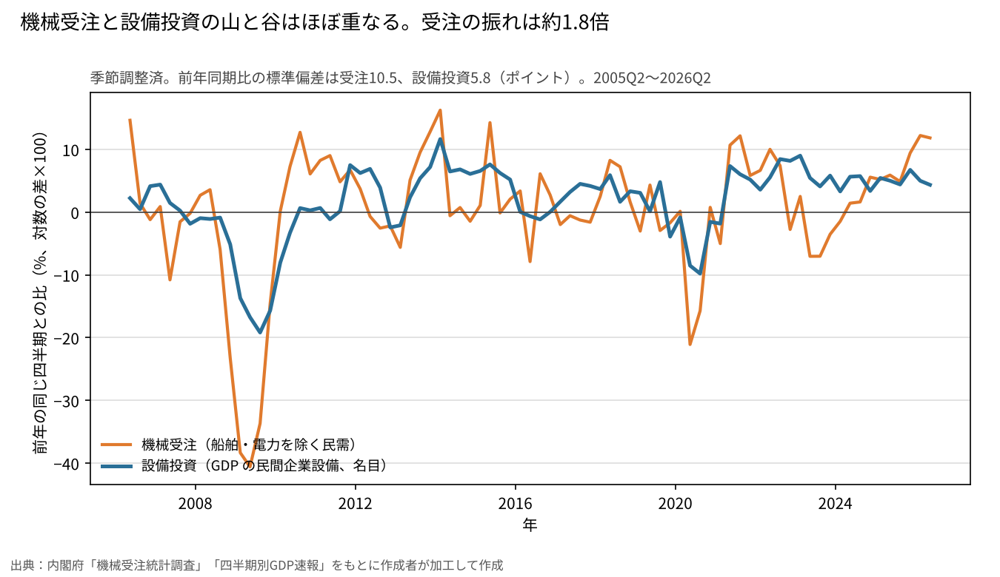
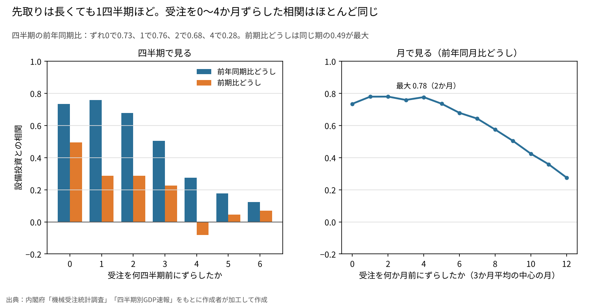
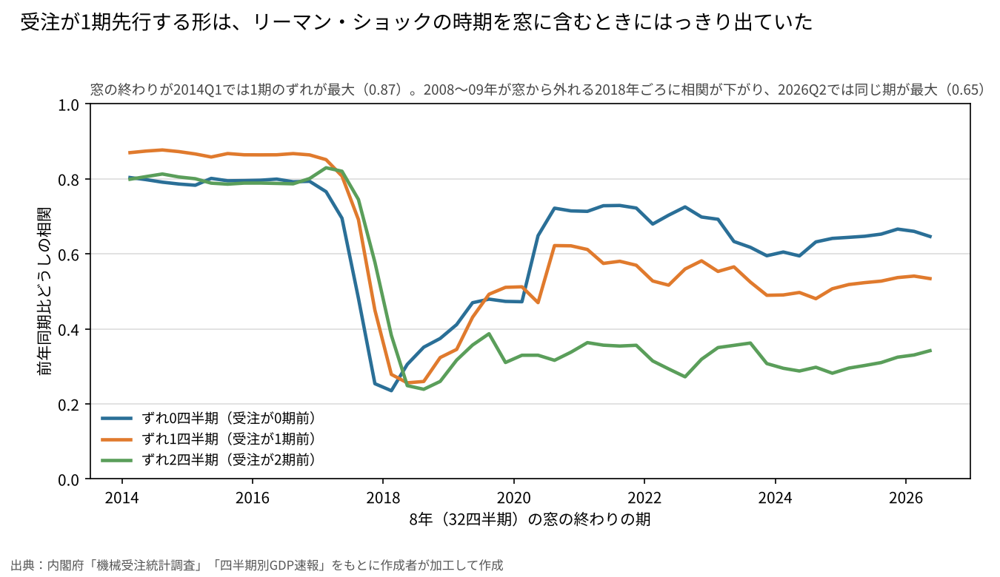
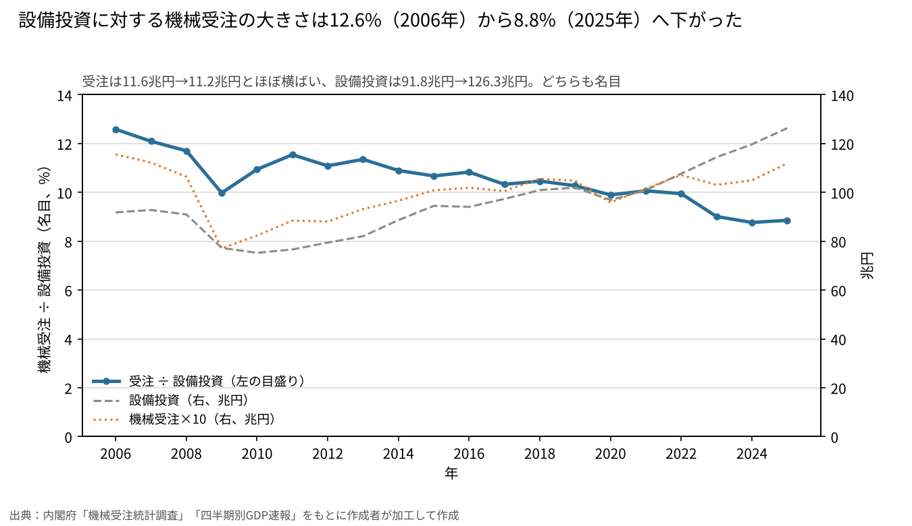

# F410 機械受注は、設備投資を何か月先取りするのか？ 相関は1四半期前0.76、同じ期0.73でほぼ同じ。2016年以降は同じ期が最大で、受注を足しても2期先の予測は良くならなかった

## 結論（先に）

- 機械受注（船舶・電力を除く民需、季節調整済）と、GDP 速報の民間企業設備（名目）の前年同期比の相関は、受注を1四半期前にずらしたときが最も高く0.76でした。ただ同じ期どうしでも0.73で、2期前は0.68、4期前は0.28です。月で見ると、0〜4か月のずれの相関はどれも0.73〜0.78で、最大は2か月（0.78）でした。先取りは「長くても1四半期ほど」です。
- 2005〜2015年は1期前が0.84と最も高く、2016〜2026年は同じ期（0.61）が最も高くなりました。8年の窓をずらして見ると、1期の先行がはっきりしていたのは、リーマン・ショック（2008〜09年）を窓に含むときでした。
- 2四半期先の設備投資の伸びを予測すると、設備投資自身の伸びだけを使った式の誤差（RMSE）3.82に対し、受注を足した式は4.24で、誤差は10.9%増えました（2012〜2026年の逐次予測、57回）。この期間では、受注を足しても予測はよくなりませんでした。
- 受注は振れが大きく、前期比の標準偏差は4.87%で、設備投資（2.30%）の2.1倍でした。月ごとでは前月比が±5%を超える月が37.7%あります。
- 結果を見てから足した問い：設備投資（名目）に対する機械受注の大きさは、2006年の12.6%から2025年の8.8%に下がりました。受注は年11兆円ほどで横ばい、設備投資は92兆円から126兆円に増えています。

## 問い

機械受注統計は、機械メーカーが受けた設備用の機械の注文の額を毎月まとめた統計で、設備投資を早くつかむ数少ない指標とされています。内閣府の解説は、船舶と電力からの受注は不規則で額が大きく、完成までの期間も長いため、「2ないし3期先」の自律的な設備投資の動きを見るには向かない場合があるとして、「船舶・電力を除く民需」を別に示しています。報道でも、この系列が「設備投資の先行指標」として扱われます。

では、その系列は GDP 統計の設備投資を、実際に何四半期（何か月）先取りしているのでしょうか。景気の統計を読む人、機械・部品の仕事で受注の先行きを見る人、経済の記事を書く人に向けて、ずれの長さ、振れの大きさ、予測にどれだけ役立つかを確かめます。投資の判断や景気の見通しそのものは書きません。

関連する記事：F18（20の月次統計で GDP をナウキャストする）は機械受注を材料の1つとして使いますが、受注と設備投資のずれそのものは扱っていません。

## データ（出典）

| データ | 使った部分 | ファイル |
|---|---|---|
| 内閣府「機械受注統計調査」長期系列(1) | 船舶・電力を除く民需、製造業、非製造業（船舶・電力を除く）、販売額・受注残高（船舶を除く）。季調の月次・四半期、2005年4月〜2026年8月 | data/raw/juchu_chouki1_2608.xlsx |
| 内閣府「四半期別GDP速報」2026年7-9月期 1次速報（2026年11月16日公表） | 民間企業設備の名目・実質（季節調整、年率）とデフレーター、1994年1-3月期〜 | data/raw/qe_nominal_sa_2631.csv、qe_real_sa_2631.csv、qe_deflator_sa_2631.csv |

取得日と URL は [data/raw/SOURCES.md](data/raw/SOURCES.md) にあります。受注の四半期は2005年4-6月期〜2026年4-6月期の85期です（7-9月期は8月分までしかないので使いません）。

## 事前の計画

計画は [PLAN.md](PLAN.md) に、集計の前に書きました。PLAN.md の中の作成時刻「08:15」は誤りで、ファイルの最終更新は2026-11-18 08:09:31です（02_build.py の 08:09:56、03_analysis.py の 08:12:55 より前。レビューで確かめた）。表の形を確かめるときに、受注の最初と最後の月の値と、設備投資のいくつかの期の値を見ましたが、相関やずれは計算していませんでした。「半年ほど先行する」という通説は知っていました。

| 仮説 | 外れの基準 | 結果 | 判定 |
|---|---|---|---|
| H1 前年同期比の相関が最大になるずれは1〜3四半期 | 0または4以上なら外れ | 1四半期（0.76。0期は0.73） | 支持（ただし差は小さく、2016年以降は0期） |
| H2 前期比どうしの相関はどのずれでも0.4未満 | 0.4以上があれば外れ | 同じ期で0.49 | 外れ |
| H3 受注の前期比の標準偏差は設備投資の2倍以上 | 2倍未満なら外れ | 2.12倍 | 支持 |
| H4 受注を足すと2期先の予測の RMSE が10%以上減る | 減らなければ外れ | 10.9%増えた | 外れ |

## やったこと

1. 受注（3か月の合計）と設備投資（名目）を四半期でそろえ、前年同期比と前期比（対数の差×100）を出しました。
2. 受注を0〜6四半期前にずらして、設備投資との相関をとりました。月でも、受注の3か月平均（中心の月に置く）を0〜12か月ずらして見ました。
3. 2012年1-3月期から、その時点までのデータだけで回帰式を推定し、2四半期先の設備投資の前年同期比を予測しました。設備投資の伸びだけの式と、受注の伸びを足した式の誤差を比べました。
4. 受注残高 ÷ 月の販売額（手持ち月数）を出しました。
5. 問い直しとして、8年の窓をずらした相関と、受注 ÷ 設備投資の比を見ました。

## 分かったこと

### 図1 山と谷はほぼ重なり、受注のほうが大きく振れる



- 前年同期比の標準偏差は、受注10.5、設備投資5.8（ポイント）です。いちばん深い落ち込みは、受注が−40.6（2009年4-6月期）、設備投資が−19.2（2009年7-9月期）で、受注の底が1期早く来ました。
- 前期比の標準偏差は受注4.87、設備投資2.30で、2.12倍です（H3 支持）。

### 図2 先取りは長くても1四半期ほど



- 前年同期比の相関は、ずれ0で0.735、1で0.759、2で0.679、3で0.504、4で0.276でした。1期前が最大ですが、同じ期との差は0.02です。
- 月で見ると、0〜4か月の相関は0.735〜0.780で、最大は2か月（0.780）でした。5か月から下がり、12か月では0.276です。
- 前期比どうしでは同じ期の0.49が最大で、1期前は0.29でした（H2 外れ）。四半期ごとの動きも、ずらさないほうが合います。
- 手持ち月数（受注残高 ÷ 月の販売額、船舶を除く合計）は平均11.75か月で、2005年4-6月期の8.63か月から2026年4-6月期は14.16か月に延びています。受注残は外需も含むので、民需の受注が何か月で設備投資になるかとは別の物差しです。

### H4 受注を足しても予測はよくならなかった

- 2四半期先の予測の RMSE は、設備投資の伸びだけで3.82、受注を足すと4.24（+10.9%）でした。受注を足したときの誤差の増え方は、1期先で0.5%、3期先で10.4%、4期先で8.6%で、どの先でも減りませんでした（results/main.json の H4_rmse_cut_pct_h1〜h4。負の値が「誤差が増えた」ことを表します）。
- 設備投資の伸びは前の期の伸びとよく似ているので、それに受注の情報を足しても、この期間ではうまく上乗せできませんでした。

## 問い直し（結果を見てから足した）

2005〜2015年と2016〜2026年でずれが違ったので、「先取りの長さは期間で変わったのか」と「受注で見える範囲は狭くなったのか」を足しました。

### 図3 1期の先行は、リーマン・ショックを含む窓ではっきりしていた



- 8年（32四半期）の窓をずらすと、窓の終わりが2014年1-3月期のときは1期前が最大（0.87）でした。2008〜09年が窓から外れる2018年ごろに相関は0.2〜0.4に下がり、その後は同じ期が最大になりました（2026年4-6月期の窓で0.65、1期前は0.53）。
- 50の窓のうち、同じ期が最大の窓は60%、1〜3期前が最大の窓は40%でした。大きな落ち込みのときに受注が先に落ちたことが、全期間の「1期先行」を作っている面があります（推測。リーマン後とコロナの期を除くと、最大は2期前の0.49に下がりました）。

### 図4 設備投資に対する機械受注の大きさは12.6%から8.8%へ



- 受注（年の合計）は2006年11.6兆円、2025年11.2兆円とほぼ横ばいで、設備投資（名目）は91.8兆円から126.3兆円に増えました。比は12.6%→10.3%（2019年）→8.8%です。
- 設備投資にはソフトウェアや研究開発、建物も入ります。受注で見える「機械」の部分が設備投資の中で小さくなったことが、先行のしかたが変わった理由の1つかもしれません（推測。内訳の時系列は確かめていません）。

## 頑健性

| 確かめ | やり方 | 最大のずれ | 値 | 判定 |
|---|---|---|---|---|
| H1 | 基本：名目、全期間 | 1期 | 0.759 | 支持 |
| H1 | 実質（受注を設備投資のデフレーターで割る） | 1期 | 0.707 | 支持 |
| H1 | リーマン後（2008年10-12月期〜2009年）とコロナ（2020年）を除く | 2期 | 0.492 | 支持（相関は下がる） |
| H1 | 2005〜2015年 | 1期 | 0.837 | 支持 |
| H1 | 2016〜2026年 | 0期 | 0.605 | 外れ |
| H1 | 製造業の受注 | 1期 | 0.727 | 支持 |
| H1 | 非製造業（船舶・電力を除く）の受注 | 0期 | 0.533 | 外れ |
| H2 | 実質 | 0期 | 0.464 | 外れ |
| H2 | リーマン後・コロナを除く | 0期 | 0.238 | 支持 |
| H4 | 実質（RMSE の減り） | — | −7.3% | 外れ |
| H4 | 予測の始まりを2016年に | — | −12.9% | 外れ |

H1 は全期間では支持ですが、近い期間・非製造業では外れで、結論は期間と業種に左右されます。

## 言えないこと

- 機械受注は主な機械メーカーへの注文で、設備投資の一部です。建物・ソフトウェア・研究開発は入りません。
- 相関は因果ではありません。受注が設備投資を「起こす」のではなく、同じ景気の動きを両方が映していると考えるのが自然です。
- GDP 速報は改定され、季節調整も公表のたびにかけ直されます。値は2026年11月16日公表の時点のものです。
- 1期前（0.759）と同じ期（0.735）の相関の差は0.02で、差があるかの検定はしていません。「1期先行」は「同じ期とほぼ同じ」と読むのが安全です。
- 予測の比較は単純な回帰2つだけです。月次の受注を使った別の予測のしかたでは結果が変わるかもしれません。
- 受注 ÷ 設備投資の比が下がった理由（内訳の変化）は、このデータでは確かめていません。

## 仕事で使うなら

- 機械受注は「数か月先の設備投資」より、「今の四半期の設備投資の向き」を早く知る材料として読むほうが、この期間のデータには合っています。
- 月々の受注は前月比±5%を超える月が4割近くあるので、3か月の平均や前年同期比で読むと振れに惑わされにくくなります。

## 計画からの変更

- 月のずれは、計画では「3か月移動平均」とだけ書いていました。後ろ3か月の平均だとずれが1か月ずれて見えるので、中心の月に置く平均にしました。
- 予測の比較で、計画の2期先に加えて1・3・4期先も見ました。
- 問い直しで、8年の窓の相関を足しました（計画の候補は受注 ÷ 設備投資の比だけでした）。

## 再現のしかた

```sh
pip install -r requirements.txt   # numpy・pandas・matplotlib・openpyxl
sh src/run_all.sh                 # オフラインで 02 → 03 → 03b → 04（所要 数秒）
# 元データを取り直すときだけ（ネットにつなぐ）：python3 src/01_fetch.py
```

| ファイル | 中身 |
|---|---|
| src/01_fetch.py | 内閣府から4ファイルを取る（run_all.sh からは呼ばない） |
| src/02_build.py | 受注（月・四半期）と設備投資を data/ の CSV にする |
| src/03_analysis.py | ずれの相関、振れ、予測の比較、手持ち月数、頑健性 → results/main.json ほか |
| src/03b_requestion.py | 問い直し（8年の窓、受注 ÷ 設備投資）→ results/requestion.json ほか |
| src/04_figures.py | 図4枚 → figures/ |

確かめ：`results/repro_check.txt` のとおり、/tmp に写して 02 以降が作るファイルを消し、`sh src/run_all.sh` を流し直して、`cmp` でバイト単位の一致を確かめました。

## レビューで直したこと

| # | 指摘 | 直し方 |
|---|---|---|
| 1 | 題名が長く（100字ほど）、「誤差は11%増えた」は単純な回帰2つ・1つの期間の結果としては強めだった | 題名を「相関は1四半期前0.76、同じ期0.73でほぼ同じ。2016年以降は同じ期が最大で、受注を足しても2期先の予測は良くならなかった」に縮めた。status と note の1行目もそろえた（数字は本文に残した） |
| 2 | H4 の1・3・4期先の値を「−0.5%」などと書き、誤差が減ったのか増えたのかが読み取りにくかった | 「誤差の増え方は0.5%・10.4%・8.6%」と書き直し、main.json の符号の意味を添えた |
| 3 | 1期前と同じ期の相関の差（0.02）を検定していないことが「言えないこと」になかった | README と note の「言えないこと」に足した |
| 4 | note の図1の節で「2.1倍」（前期比）と書き、図1の題の「約1.8倍」（前年同期比）と食い違って見えた | note に両方の物差しを書き分けた |
| 5 | PLAN.md の作成時刻（08:15）が、記事の完成（08:14）より後の時刻になっていた | PLAN.md は書き換えず、「事前の計画」に正しい順序を注記した |

独立レビューで数字の照合・再実行・図を確かめました。上のほかに直すところはありませんでした。

## 出典

- 内閣府 経済社会総合研究所「機械受注統計調査」長期系列：https://www.esri.cao.go.jp/jp/stat/juchu/juchu.html
- 同 調査の解説（船舶・電力を除く民需の説明）：https://www.esri.cao.go.jp/jp/stat/juchu/juchu_kaisetu.html
- 内閣府「四半期別GDP速報」2026年7-9月期 1次速報 統計表一覧：https://www.esri.cao.go.jp/jp/sna/data/data_list/sokuhou/files/2026/qe263/gdemenuja.html

（いずれも内閣府「機械受注統計調査」「四半期別GDP速報（国民経済計算）」をもとに作成者が加工して作成）
