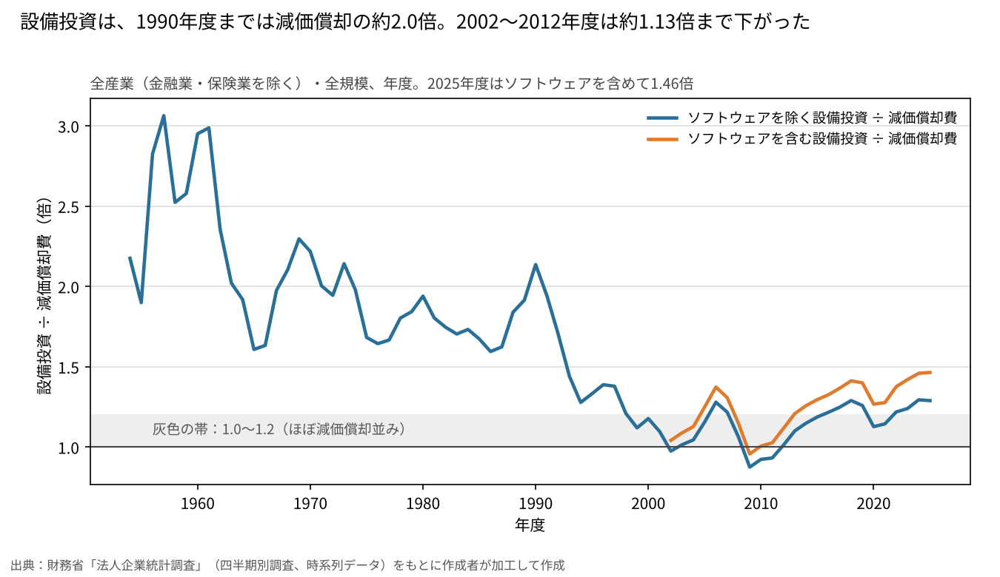
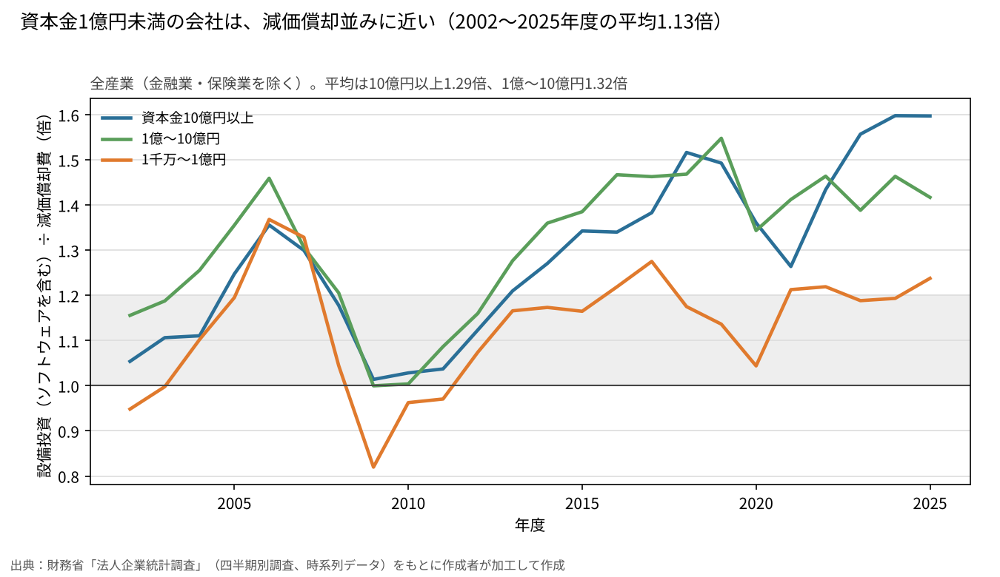
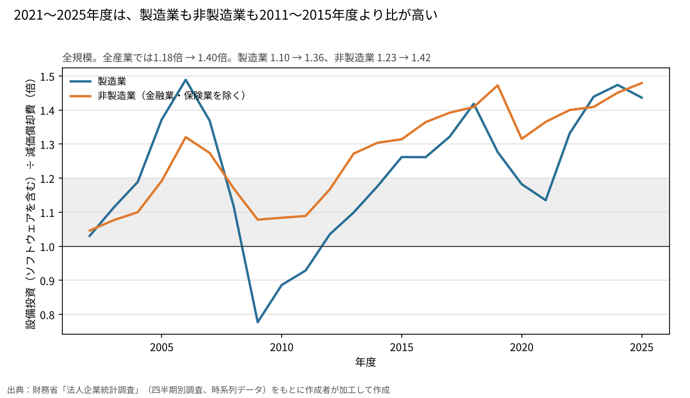
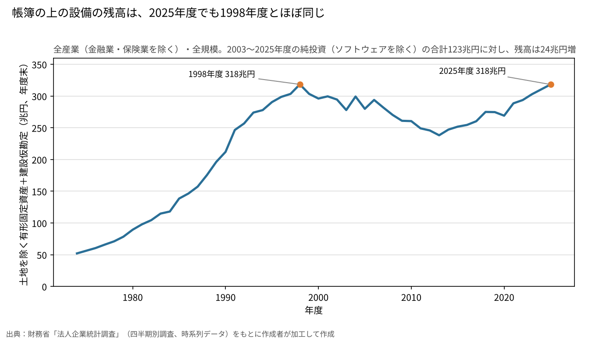

# F411 「日本企業の設備投資は減価償却の範囲にとどまる」は本当か？ 2002〜2012年度は平均1.13倍でほぼその通り。2025年度は1.46倍まで上がったが、帳簿の設備の残高は1998年度とほぼ同じ

## 結論（先に）

- 法人企業統計（季報）で、設備投資（ソフトウェアを含む）÷ 減価償却費（以下「比」）は、全産業（金融業・保険業を除く）・全規模で2002〜2012年度の平均1.13倍でした。この時期は「減価償却の範囲にとどまる」がほぼ当てはまります。1を下回ったのは2009年度（0.96倍）だけです。
- 2013〜2025年度の平均は1.35倍で、2025年度は1.46倍（設備投資60.8兆円、減価償却費41.5兆円）でした。2002〜2025年度の24年のうち16年は1.2倍以上です。近年については「範囲にとどまる」とは言えません。
- 長い目で見ると、ソフトウェアを除く比は1954〜1990年度の平均2.04倍から、2002〜2025年度の1.14倍に下がりました（差0.91）。下がったのは主に1990年代です。
- 会社の規模で違います。資本金1千万〜1億円の会社は2002〜2025年度の平均1.13倍で、10億円以上（1.29倍）、1億〜10億円（1.32倍）より低く、2021〜2025年度も1.21倍にとどまります。
- 結果を見てから足した問い：帳簿の上の設備（土地を除く有形固定資産と建設仮勘定）の年度末の残高は、1998年度の318.4兆円が最大で、2025年度は318.2兆円でした。2003〜2025年度の純投資（ソフトウェアを除く設備投資 − 減価償却費）の合計123兆円に対し、残高は2002年度から24兆円しか増えていません。

## 問い

「日本企業は稼いでも投資しない」「設備投資は古くなった設備の目減り（減価償却）を埋める程度で、資本が増えていない」という見方は、報道や調査機関のレポートでよく見ます。内閣府「日本経済レポート（2023年度）」は、過去30年、経常利益の増え方に比べて設備投資の伸びが抑えられてきたと書いています。大和総研のレポート（2016年1月）は、減価償却を引いた純設備投資が長く下がってきたことを、資本ストックの伸び悩みの背景に挙げています。

では、法人企業統計の数字で、設備投資は減価償却費にどれだけ近いのか。いつからそうなのか。規模や業種で違うのか。企業の財務の統計を読む人、設備投資の記事を書く人、自社の投資の水準を全体と比べたい人に向けて確かめます。投資をどうすべきか、税制をどうすべきかは書きません。

関連する記事：F410（機械受注と設備投資のずれ）は GDP の設備投資の時間のずれを見ていて、減価償却との比は扱っていません。jodn 212（労働分配率）は減価償却費を付加価値の一部として使うだけです。

## データ（出典）

| データ | 使った部分 | ファイル |
|---|---|---|
| 財務省「法人企業統計調査」四半期別調査の時系列データ（全項目） | 設備投資（ソフトウェアを除く、1954年4-6月期〜）、ソフトウェア（2001年7-9月期〜）、減価償却費、土地を除く有形固定資産、建設仮勘定。全産業（金融業・保険業を除く／含む）、製造業、非製造業。全規模と資本金3区分。億円、原数値 | data/raw/mof_ssc_quarterly_all.xls |

取得日と URL は [data/raw/SOURCES.md](data/raw/SOURCES.md) にあります。4〜3月の4期を足して年度にしました（1954〜2025年度。ソフトウェアを含む設備投資は2002年度から）。資本金の区分は、10億円以上と1億〜10億円が1960年度からです。

## 事前の計画

計画は [PLAN.md](PLAN.md) に、年度の集計の前に書きました。PLAN.md の中の作成時刻「10:20」は誤りで、ファイルの最終更新は2026-11-18 10:14:43です（02_build.py の最初の実行で作った data/ の CSV の 10:15:01、results/main.json の 10:15:47 より前）。シートの形を確かめるときに、2001〜2003年の四半期の設備投資と、2025〜2026年の四半期の減価償却費を見ていました。

| 仮説 | 外れの基準 | 結果 | 判定 |
|---|---|---|---|
| H1 2002〜2025年度の比（ソフトウェアを含む）の平均は1.0以上1.3未満 | 1.3以上か1.0未満なら外れ | 1.25 | 支持（ただし前半1.13、後半1.35で、平均は二つの時期を混ぜた値） |
| H2 ソフトウェアを除く比は、1990年度以前の平均が2002年度以降より0.4以上高い | 差が0.4未満なら外れ | 2.04 − 1.14 ＝ 0.91 | 支持 |
| H3 資本金1千万〜1億円の比は10億円以上より低い | 高ければ外れ | 1.13 と 1.29 | 支持 |
| H4 2021〜2025年度の比は2011〜2015年度より高い | 低ければ外れ | 1.40 と 1.18 | 支持 |

## やったこと

1. 四半期の値を年度に足し、比と純投資（設備投資 − 減価償却費）を出し、5つの時期（1954〜1973、1974〜1990、1991〜2001、2002〜2012、2013〜2025年度）ごとに平均しました。
2. 規模（資本金3区分）と業種（製造業・非製造業）で同じ比を出しました。
3. 問い直しとして、年度末の帳簿の設備の残高を見ました。

## 分かったこと

### 図1 1990年度までは減価償却の約2倍。2000年代にほぼ1倍まで下がった



- ソフトウェアを除く比は、最大が1957年度の3.06倍で、1990年度も2.14倍ありました。1990年代に下がり、初めて1を下回ったのは2002年度（0.97倍）です。2002〜2025年度に1を下回った年度は4つでした。
- ソフトウェアを含む比は、2002〜2012年度の平均1.13倍、2013〜2025年度の平均1.35倍、2025年度1.46倍です。24年度のうち、1未満が1年度（2009年度）、1.0〜1.2倍が7年度、1.2倍以上が16年度でした。
- 設備投資に占めるソフトウェアの割合は、2002年度の6.4%から2025年度の12.0%に上がりました。ソフトウェアを入れるかどうかで、近年の比は0.1〜0.2ほど変わります。
- 2013年度以降の比の上昇には、減価償却費が2007年度の42.4兆円から2013年度の32.2兆円まで減っていたことも効いています（2025年度は41.5兆円）。

### 図2 資本金1億円未満の会社は、減価償却並みに近い



- 2002〜2025年度の平均は、資本金10億円以上1.29倍、1億〜10億円1.32倍、1千万〜1億円1.13倍でした（H3 支持）。
- 2021〜2025年度は、10億円以上1.49倍、1億〜10億円1.43倍、1千万〜1億円1.21倍で、差は開いています。
- 1千万〜1億円の会社は、設備投資に占めるソフトウェアの割合も低く（2021〜2025年度の平均7.0%、10億円以上は13.2%）、ソフトウェアを除いても比は低いままです（2002〜2025年度1.08倍）。

### 図3 製造業も非製造業も、直近は2011〜2015年度より高い



- 2011〜2015年度 → 2021〜2025年度で、製造業は1.10倍 → 1.36倍、非製造業は1.23倍 → 1.42倍でした（H4 支持）。
- 製造業はリーマン・ショックのあとの2009年度に0.78倍まで落ち、2009〜2011年度は1を下回りました。非製造業は2002年度以降、1を下回った年度がありません。

## 問い直し（結果を見てから足した）

比は2013年度から1.2倍を超えています。それなら、帳簿の上の設備は増えているのか、を足しました。

### 図4 帳簿の設備の残高は、2025年度でも1998年度とほぼ同じ



- 土地を除く有形固定資産と建設仮勘定の年度末の残高は、1974〜1990年度に平均で年9.6%増え、1998年度の318.4兆円が最大でした。そのあと最も低かったのは2013年度の238.2兆円で、2025年度は318.2兆円です。
- 2003〜2025年度の純投資（ソフトウェアを除く）の合計は123.2兆円ですが、残高は2002年度の294.5兆円から23.7兆円しか増えていません。差の約100兆円は、設備の売却・除却・減損や、海外への移転、調査の標本の入れ替えなどで説明されるはずですが、このデータでは内訳を分けられません（推測）。
- 2002年度 → 2025年度の残高の増え方は、製造業 +17.9%、非製造業 +4.6%、資本金10億円以上 +12.4%、1千万〜1億円 −12.4%でした。
- 「資本が増えていない」という見方は、近年の比よりも、この残高の動きのほうに表れています。

## 頑健性

| 確かめ | やり方 | 値 | 判定 |
|---|---|---|---|
| H1 | 基本：ソフトウェアを含む、2002〜2025年度の平均 | 1.25 | 支持 |
| H1 | ソフトウェアを除く設備投資で | 1.14 | 支持 |
| H1 | 金融業・保険業を含む全産業（2008〜2025年度。データがこの期間のみ） | 1.27 | 支持 |
| H1 | 同じ2008〜2025年度の、金融業・保険業を除く全産業 | 1.27 | 支持 |
| H1 | 2008・2009・2020年度を除く | 1.27 | 支持 |
| H1 | 平均の代わりに中央値 | 1.27 | 支持 |
| H1 | 4四半期の移動合計の比が1を下回った四半期の割合（97四半期） | 8.2% | 参考 |
| H2 | 比べる時期を1974〜1990年度だけに | 差0.65 | 支持 |
| H2 | 中央値どうしの差 | 0.79 | 支持 |
| H3 | 製造業で（1千万〜1億円 − 10億円以上） | −0.11 | 支持 |
| H3 | 非製造業で（同） | −0.20 | 支持 |
| H3 | ソフトウェアを除く設備投資で（同） | −0.07 | 支持 |
| H4 | 2010〜2014年度と2022〜2025年度で比べる | +0.31 | 支持 |
| H4 | ソフトウェアを除く設備投資で | +0.16 | 支持 |
| H4 | 製造業で／非製造業で | +0.26／+0.19 | 支持 |

結論はどの確かめでも変わりませんでした。ただし H1 は性格の違う二つの時期（1.13倍と1.35倍）の平均です。

## 言えないこと

- 法人企業統計の季報は資本金1千万円以上の営利法人の標本調査で、標本は毎年4月に入れ替わります。年度末の残高の前年比には、標本の入れ替えによる段差が入ります（2004年度 +7.7%、2005年度 −6.5% など）。
- 減価償却費は取得したときの値段で計算した帳簿の値で、設備投資はその年の値段です。物価が上がった時期は比が高めに出ます。物価を除いた比は計算していません。
- 季報の減価償却費に、ソフトウェア（無形固定資産）の償却が入っているかは確かめていません。入っていれば、ソフトウェアを除く比は低めに出ます。そのため両方の比を並べました。
- 国内の法人の帳簿なので、海外の子会社の投資は入りません。海外へ移した投資は見えません。
- 比が1に近いことは、「投資が足りない」ことを意味しません。必要な投資の量は、このデータからは分かりません。
- 残高と純投資の差（約100兆円）の内訳（売却・除却・減損・標本など）は、このデータでは分けられません。

## 仕事で使うなら

- 「設備投資は減価償却並み」と書くときは、どの年度のことかを添えると誤解が減ります（2000年代には当てはまり、2013年度以降は当てはまりにくい）。
- 投資の量を比べるときは、比（フロー）と帳簿の設備の残高（ストック）を並べ、ソフトウェアを含めるかの定義もそろえます。

## 計画からの変更

- 問い直しの残高を、規模・業種別にも出しました（計画は全体だけ）。
- 金融業・保険業を含む全産業はデータが2008年度からなので、その期間で比べました。
- H1 は基準どおり「支持」としましたが、時期で値が違うことを結論に書き足しました。

## 再現のしかた

```sh
pip install -r requirements.txt   # numpy・pandas・matplotlib・xlrd（openpyxl は入っていても使わない）
sh src/run_all.sh                 # オフラインで 02 → 03 → 03b → 04（所要 約4秒）
# 元データを取り直すときだけ（ネットにつなぐ）：python3 src/01_fetch.py
```

| ファイル | 中身 |
|---|---|
| src/01_fetch.py | 財務省から時系列の Excel を取る（run_all.sh からは呼ばない） |
| src/02_build.py | 使う6項目を四半期の縦長 CSV（data/quarterly_long.csv）と年度の CSV（data/fiscal_year.csv）にする |
| src/03_analysis.py | 比・純投資、時期・規模・業種の比較、仮説の判定、頑健性 → results/main.json ほか |
| src/03b_requestion.py | 問い直し（年度末の残高）→ results/requestion.json、requestion_stock.csv |
| src/04_figures.py | 図4枚 → figures/ |

確かめ：`results/repro_check.txt` のとおり、/tmp に写して 02 以降が作るファイルを消し、`sh src/run_all.sh` を流し直して、`cmp` でバイト単位の一致を確かめました。

## レビューで直したこと

| # | 指摘 | 直し方 |
|---|---|---|
| 1 | 図4の節の「2012年度は245.8兆円まで減り」は、いちばん低い年が2012年度のように読めるが、実際の底は2013年度（238.2兆円） | 03b_requestion.py に1998年度より後の最小の年と値を足し（requestion.json の stock_min_after_peak_fy・stock_min_after_peak_tril）、README と note の文を「最も低かったのは2013年度の238.2兆円」に直した |

## 出典

- 財務省 財務総合政策研究所「法人企業統計調査」時系列データ（四半期別調査）：https://www.mof.go.jp/english/pri/reference/ssc/historical.htm
- 内閣府「日本経済レポート（2023年度）」第3章第1節：https://www5.cao.go.jp/keizai3/2023/0213nk/n23_3_1.html
- 大和総研「設備投資が伸び悩む原因（1）」（2016年1月27日）：https://www.dir.co.jp/report/research/economics/japan/20160127_010573.html

（いずれも財務省「法人企業統計調査」をもとに作成者が加工して作成）
