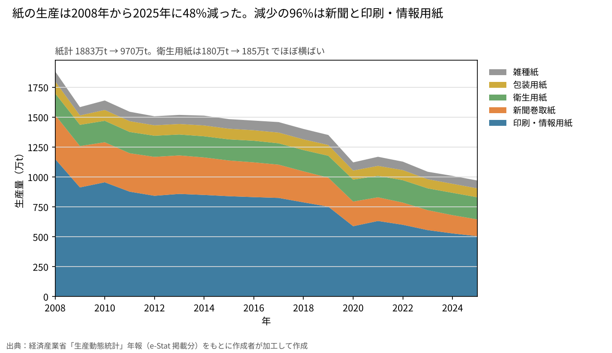
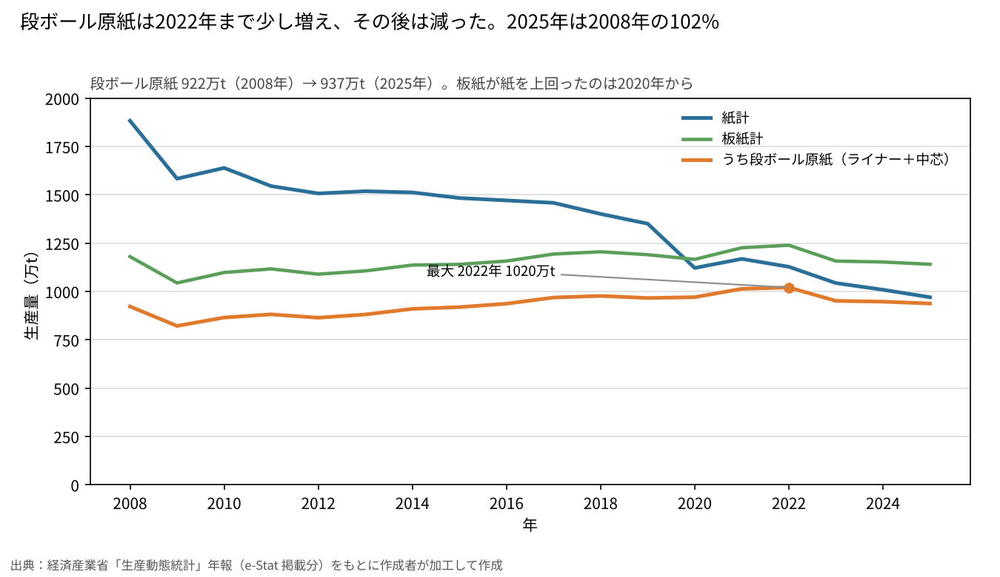
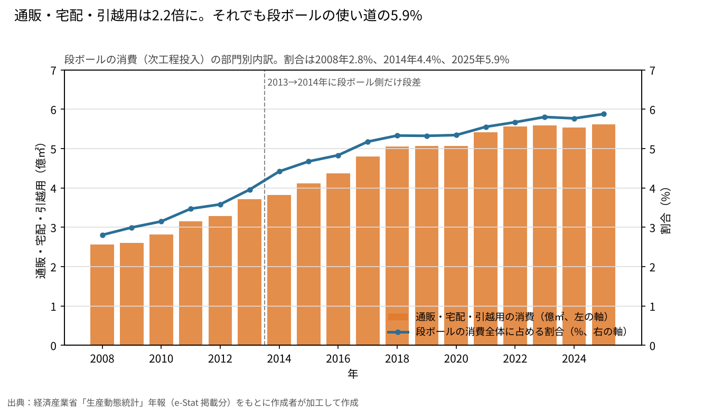
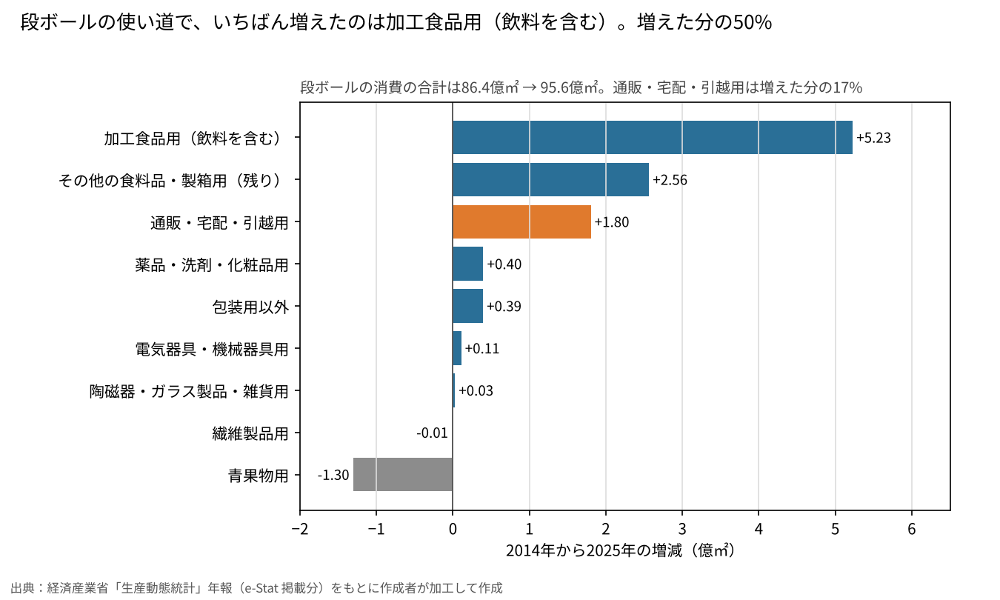

# F412 「紙は減ったが段ボールは増えた」は、どこまで本当か？ 紙は2008年から48%減った。段ボール原紙は2%増にとどまり、2022年が最大。通販向けは2.2倍でも使い道の6%

## 結論（先に）

- 「紙は減った」は本当です。紙（新聞・印刷・衛生用などの合計）の生産は、2008年の1,883万tから2025年の970万tへ48%減りました。減った913万tのうち96%は、新聞巻取紙（−228万t）と印刷・情報用紙（−646万t）です。衛生用紙は180万t → 185万tで、ほぼ横ばいでした。
- 「段ボールは増えた」は、言いすぎです。段ボール原紙（ライナーと中芯原紙）は922万t → 937万tで、2008年比+2%でした。2022年の1,020万tが最大で、2025年はそこから8%少ない量です（H3 外れ）。販売数量で見ると2008年比99%で、増えていません。
- 段ボールの使い道のうち「通販・宅配・引越用」は、2.56億㎡ → 5.62億㎡と2.2倍になりました。ただ、段ボールの消費全体に占める割合は2.8% → 5.9%で、まだ1割に届きません。
- 結果を見てから足した問い：2014〜2025年に段ボールの消費が増えた分のうち、50%は加工食品用（飲料を含む）で、通販・宅配・引越用は17%でした。
- 紙と板紙を合わせた量は3,063万t → 2,110万tで31%減りました。板紙が紙を上回ったのは2020年からです。

## 問い

「ペーパーレスで紙は減ったが、ネット通販のおかげで段ボールは増えた」という言い方は、製紙の話題でよく見ます。日刊工業新聞のニュースサイト（ニュースイッチ、2020年10月1日）は、経済産業省の分析をもとに、リーマン・ショックのあと紙の生産が下がり、新聞巻取紙や印刷用紙の落ち込みが大きい一方、EC の成長を背景に段ボール原紙などの板紙が伸びた、と伝えています。

では、品種別の生産量で見て、紙はどれだけ減り、その減少はどこから来たのか。段ボールは本当に増えたのか、いつまで増えたのか。通販向けはどれだけの大きさなのか。紙・包装・物流の仕事の人、ペーパーレスや通販の影響を記事にする人に向けて確かめます。値段や投資の判断は書きません。

既存の看板記事とその元の記事に、紙・板紙・段ボールの生産を扱ったものは見つかりませんでした。

## データ（出典）

| データ | 使った部分 | ファイル |
|---|---|---|
| 経済産業省「生産動態統計」年報 2012・2017・2020年版（紙・パルプ統計） | 製品時系列表の年計：紙の品種（2008〜2020年）、板紙の品種、段ボール（シート）、段ボールの消費（次工程投入）の部門別内訳 | data/raw/nenpo2012_paper.xls、nenpo2017_paper.xls、nenpo2020_paper.xls |
| 同 年報 2021〜2025年版（全品目の実数表） | 紙月報・板紙月報・段ボール月報の品目。2021〜2023年版は暦年の列、2024・2025年版は12か月の合計 | data/raw/nenpo2021.xlsx 〜 nenpo2025.xlsx |

取得日と URL は [data/raw/SOURCES.md](data/raw/SOURCES.md) にあります。経済産業省のサイトは 403 を返したため、同じ年報を e-Stat から取りました。2021年以降は、年報の品目を2020年以前と同じまとまり（新聞巻取紙、印刷・情報用紙、包装用紙、衛生用紙、雑種紙、段ボール原紙、紙器用板紙、雑板紙）に足し上げました。紙は t、段ボールは㎡です。

## 事前の計画

計画は [PLAN.md](PLAN.md) に、年の系列を組み立てる前に書きました。表の形を確かめるときに2020年の年計や2008・2009年の紙計などを見ていたので、PLAN.md に書き出してあります。

| 仮説 | 外れの基準 | 結果 | 判定 |
|---|---|---|---|
| H1 紙計の2025年は2008年の70%以下 | 70%超なら外れ | 51.5% | 支持 |
| H2 段ボール原紙の2025年は2008年以上 | 下回れば外れ | 101.7% | 支持（ただし販売数量では99.4%で外れ） |
| H3 段ボール原紙の最大の年は2017〜2021年 | それ以外なら外れ | 2022年 | 外れ |
| H4 通販・宅配・引越用の割合が2008→2025年に3ポイント以上上がる | 3未満なら外れ | +3.07ポイント | 支持（ただし2014年からは+1.46で外れ） |
| H5 紙の減少の80%以上は新聞巻取紙と印刷・情報用紙 | 80%未満なら外れ | 95.7% | 支持 |

## やったこと

1. 2008〜2020年は3つの版の製品時系列表から、2021〜2025年は全品目の年報から、品種別の年の生産・販売数量と段ボールの消費の内訳を取り出しました。2016・2017年は2017年版と2020年版の両方にあり、60の値がすべて一致しました。
2. 2008年から2025年の増減、最大の年、紙の減少の品種別の内訳を出しました。
3. 段ボールの消費に占める通販・宅配・引越用の割合を出しました。
4. 問い直しとして、2014〜2025年の段ボールの使い道ごとの増減を見ました。

## 分かったこと

### 図1 紙は半分近くまで減り、減ったのはほぼ新聞と印刷・情報用紙



- 紙計は1,883万t → 970万t（2008年比51.5%）。新聞巻取紙は368万t → 140万t（38%）、印刷・情報用紙は1,150万t → 504万t（44%）です。
- 2019年（1,350万t）から2020年（1,121万t）に一度に17%減り、その後も戻っていません。
- 衛生用紙は180万t → 185万t（102%）で、2022年が最大でした。包装用紙は74%、雑種紙は79%に減りました。

### 図2 段ボール原紙は2022年まで少し増え、その後は減った



- 段ボール原紙は2009年の821万tから2022年の1,020万tまで増え、2025年は937万tです。2008年比で+2%、2010年比で+8%、最大の年からは−8%です。
- 板紙計は1,180万t → 1,140万t（97%）。段ボール原紙以外の紙器用板紙（80%）・雑板紙（74%）は減りました。
- 紙と板紙を合わせた量に占める板紙の割合は38.5%から54.0%に上がり、2020年から板紙が紙を上回っています。「段ボールが増えた」というより、「紙が減って、相対的に段ボールが大きくなった」と言うほうがデータに合います。

### 図3 通販・宅配・引越用は2.2倍。それでも使い道の6%



- 通販・宅配・引越用の消費は2.56億㎡ → 5.62億㎡で、2025年が最大です。割合は2008年2.8%、2014年4.4%、2020年5.3%、2025年5.9%でした。
- 2013年から2014年に、段ボールの生産（シート）が−11.8%、消費の合計が−8.0%と一度に減りました。同じ年に段ボール原紙は+3.3%なので、段ボール側の調査の範囲が変わった段差とみられます（推測。公式の説明は確かめていません）。段差のあとの2014年からの割合の上がり方は+1.46ポイントで、H4 の基準（3ポイント）に届きません。

## 問い直し（結果を見てから足した）

通販向けの割合が小さかったので、「段ボールの量を動かしたのは、どの使い道か」を足しました。段差を避けて2014年からの変化で比べます。

### 図4 増えた分の半分は加工食品用（飲料を含む）



- 段ボールの消費の合計は86.4億㎡ → 95.6億㎡（+11%）。増えた使い道の合計（10.5億㎡）のうち、加工食品用（飲料を含む）が+5.23億㎡で50%、通販・宅配・引越用が+1.80億㎡で17%でした。
- 加工食品用は消費全体の44.0%（2025年）を占めるいちばん大きな使い道です。青果物用は−1.30億㎡で減りました。
- 加工食品や飲料の箱も、通販で届くことがあります。区分は段ボール工場が出荷先の使い道で分けたもので、「通販で使われた箱」の全部ではありません。

## 頑健性

| 確かめ | やり方 | 値 | 判定 |
|---|---|---|---|
| H1 | 基準を2010年に | 59.2% | 支持 |
| H1 | 端を3年平均に（2023〜25年 ÷ 2008〜10年） | 59.2% | 支持 |
| H1 | 販売数量で | 51.6% | 支持 |
| H2 | 基準を2010年に | 108.4% | 支持 |
| H2 | 端を3年平均に | 108.7% | 支持 |
| H2 | 販売数量で | 99.4% | 外れ |
| H2 | 段ボール（シート、㎡）で2025÷2008（段差を含む） | 89.7% | 外れ |
| H2 | 段ボール（シート）で2025÷2014（段差のあと） | 102.5% | 支持 |
| H3 | 3年移動平均・販売数量・段ボール（シート、2014年以降）の最大の年 | いずれも2022年 | 外れ |
| H4 | 2014年からの差 | +1.46ポイント | 外れ |
| H4 | 端を3年平均に | +2.83ポイント | 外れ |
| H5 | 基準を2010年に／販売数量で | 96.4%／97.0% | 支持 |
| 全体 | 2016・2017年の値の、2017年版と2020年版の違い（60の値） | 最大0.0% | 参考 |

H1・H5 はどの確かめでも変わりません。H2 は基準の年と物差しで判定が分かれ、「増えた」と言える幅は小さいです。H3 はどの物差しでも2022年が最大でした。H4 は2008年を基準にしたときだけ支持で、段差のあとでは外れです。

## 言えないこと

- 生産動態統計は一定の規模以上の事業所を対象にした調査です。段ボールの2013→2014年の段差のように、対象の範囲が変わると水準が動きます。
- 通販・宅配・引越用は段ボール工場が出荷先の使い道を分けた値で、ネット通販の量そのものではありません。通販の売上との関係は、この記事では確かめていません。
- ペーパーレスやスマートフォンが紙を減らした、といった因果はこのデータでは確かめられません。
- 生産量には輸出入や在庫の動きも入ります。国内で使われた量（需要）とは同じではありません。
- 2024・2025年は月次の合計で、年報の暦年の値として公表された数字ではありません（秘匿の月はなく、全月がそろっていることは確かめました）。

## 仕事で使うなら

- 「段ボールは増えた」と書くときは、基準の年と物差し（原紙の重さか、段ボールの面積か、販売か）を添えると誤解が減ります。2008年比ではほぼ横ばい、2022年からは減っています。
- 通販の影響を見るときは、通販・宅配・引越用だけでなく、加工食品用など大きな使い道の動きも並べると、全体の量の動きが説明しやすくなります。

## 計画からの変更

- たたき台にあった「ネット通販の売上との関係」は、経済産業省の電子商取引の市場調査のページが 403 で取れなかったため、段ボールの消費の内訳（通販・宅配・引越用）で代えました。
- 2013→2014年の段差に気づいたので、H2・H4 の頑健性に「2014年から」を足しました。
- 問い直しは、計画の候補のうち「どの使い道が段ボールの量を動かしているか」を選びました。「紙全体」は結論と図2に入れました。

## 再現のしかた

```sh
pip install -r requirements.txt   # numpy・pandas・matplotlib・xlrd・openpyxl
sh src/run_all.sh                 # オフラインで 02 → 03 → 03b → 04（所要 約12秒）
# 元データを取り直すときだけ（ネットにつなぐ）：python3 src/01_fetch.py
```

| ファイル | 中身 |
|---|---|
| src/01_fetch.py | e-Stat から年報8ファイルを取る（run_all.sh からは呼ばない） |
| src/02_build.py | 版ごとの値（data/series_by_source.csv）と年の系列（data/annual.csv）をつくる |
| src/03_analysis.py | 品種別の増減、紙の減少の内訳、通販向けの割合、仮説の判定、頑健性 → results/main.json ほか |
| src/03b_requestion.py | 問い直し（使い道ごとの増減）→ results/requestion.json、requestion_use_change.csv |
| src/04_figures.py | 図4枚 → figures/ |

確かめ：`results/repro_check.txt` のとおり、/tmp に写して 02 以降が作るファイルを消し、`sh src/run_all.sh` を流し直して、`cmp` でバイト単位の一致を確かめました。

## レビューで直したこと

独立レビューで数字の照合・再実行・図を確かめ、直すところはなかった。

## 出典

- 経済産業省「生産動態統計」年報（e-Stat）：https://www.e-stat.go.jp/stat-search/files?toukei=00550200&tstat=000001022932
- ニュースイッチ（日刊工業新聞社）2020年10月1日の記事：https://newswitch.jp/p/24000

（いずれも経済産業省「生産動態統計」をもとに作成者が加工して作成）
