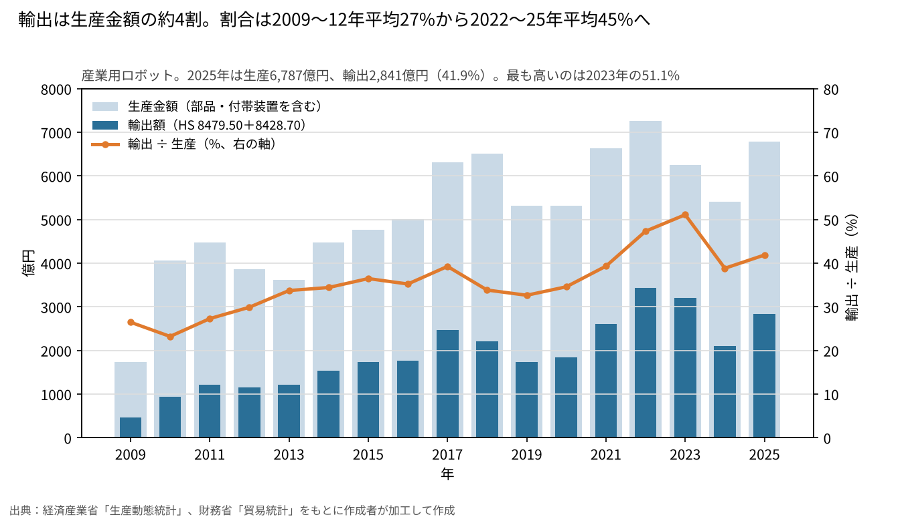
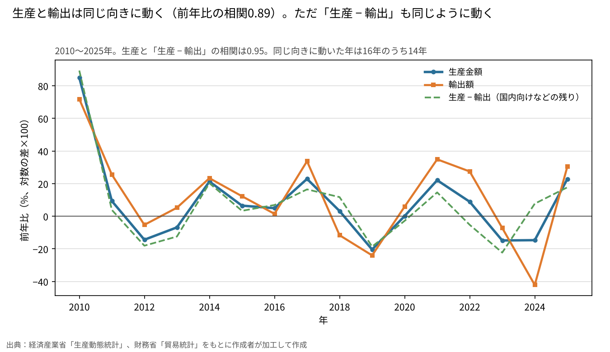
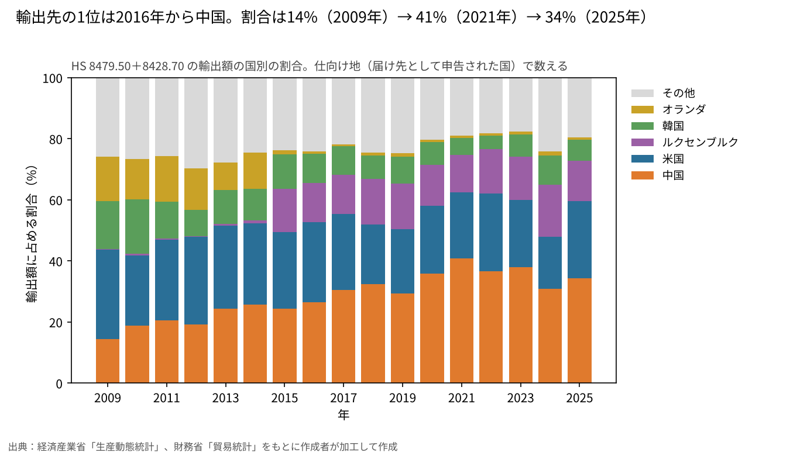
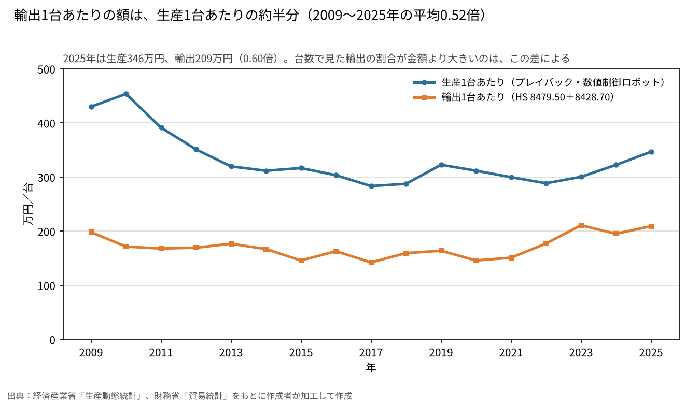

# F413 産業用ロボットの生産は、輸出が支えているのか？ 輸出は生産金額の42%（2025年）で、2009〜12年の平均27%から上がった。増減は輸出と一緒に動くが、残りの国内向けなども同じように動いた

## 結論（先に）

- 政府の統計だけで見ると、産業用ロボットの輸出額（貿易統計の HS 8479.50＋8428.70）は、2025年に2,841億円で、生産金額（生産動態統計）6,787億円の41.9%でした。この2つの項で数えた金額では、2025年は5割に届きません（H1 外れ。5割を超えたのは2023年の51.1%だけ）。ほかの項に入るロボットの輸出は数えていないので、この割合は小さめに出ている可能性があります（推測）。
- ただ割合は上がっています。2009〜2012年の平均26.7%から、2022〜2025年の平均44.8%へ18ポイント上がり、2023年は51.1%でした。2012→2025年の生産の増加（+2,921億円）のうち、58%（+1,685億円）は輸出の増加でした。
- 生産と輸出の前年比の相関は0.89（2010〜2025年）で、16年のうち14年は同じ向きに動きました。ただ、生産から輸出を引いた残り（国内向けなど）と生産の相関も0.95で、向きがそろった年も16年のうち13年でした。輸出だけが山と谷を作っているとは言えません（残りは生産の約6割なので、生産との相関は高く出やすい点に注意が要ります）。
- 輸出先の1位は2016年から中国で、割合は2009年14%、2021年41%、2025年34%でした。2015年までは米国が1位です。
- 結果を見てから足した問い：台数で見ると輸出は生産の76%（2025年）と大きく見えます。これは、輸出1台あたりの額（209万円）が、生産1台あたり（プレイバック・数値制御ロボット、346万円）の0.60倍しかないためです。

## 問い

日本は産業用ロボットの大きな生産国で、業界団体の統計では出荷の大半が輸出だと紹介されることが多く、中国向けの増減がロボットの生産の山と谷を決める、という報道もよく見ます。

では、政府の統計（経済産業省の生産動態統計と財務省の貿易統計）だけで見て、輸出は生産のどれくらいの大きさなのか。その割合は上がってきたのか。生産の増減は輸出と一緒に動いているのか。輸出先はどこなのか。機械・部品の仕事の人、製造業の統計を読む人、ロボットや自動化の記事を書く人に向けて確かめます。投資や輸出の判断は書きません。業界団体の数字は使っていません。

既存の看板記事（F409 半導体の国内生産、F410 機械受注、F133・F282 輸出全体）とは別の問いです。

## データ（出典）

| データ | 使った部分 | ファイル |
|---|---|---|
| 経済産業省「生産動態統計」年報（e-Stat） | 産業用ロボットの生産金額（シーケンス・プレイバック・数値制御・知能ロボットと部品・付帯装置の合計、百万円）と、プレイバック・数値制御ロボットの生産台数・金額。2008〜2012年は2012年版、2013〜2017年は2017年版、2016〜2020年は2020年版の時系列表、2021〜2025年は全品目の年報 | data/raw/mach2012_ts1.xls ほか2つ、nenpo2021.xlsx〜nenpo2025.xlsx |
| 財務省「貿易統計」品別国別表（輸出、確定、e-Stat） | HS 8479.50（産業用ロボット（他の項に属しないもの））と、2022年に新設された HS 8428.70（産業用ロボット（持ち上げ・荷扱い用））の国別の金額・台数、2009〜2025年 | data/raw/customs_export_robots.csv（元の CSV 17年分 約100MB から抜き出し） |
| 財務省 税関の国コードの表 | 国コードと国名・地域 | data/raw/customs_country_code_e.htm |

取得日と URL、元の CSV の sha256 は [data/raw/SOURCES.md](data/raw/SOURCES.md) にあります。元の品別国別表は大きいので同梱せず、`src/01b_extract.py` で産業用ロボットの行だけを抜き出しました。期間は輸出の取れる2009〜2025年です。2016・2017年は生産の2017年版と2020年版の両方にあり、同じ値でした。

## 事前の計画

計画は [PLAN.md](PLAN.md) に、年の系列をそろえる前に書きました。表の形を確かめるときに生産金額の合計（2008〜2012年、2016〜2020年）と、2009・2025年の韓国・中国向けの輸出額を見ていたので、PLAN.md に書き出してあります。

| 仮説 | 外れの基準 | 結果 | 判定 |
|---|---|---|---|
| H1 2025年の輸出額は生産金額の50%以上 | 50%未満なら外れ | 41.9% | 外れ（台数では75.5%で支持） |
| H2 輸出の割合は2009〜12年平均より2022〜25年平均が10ポイント以上高い | 10未満なら外れ | +18.1ポイント | 支持（台数では+5.7で外れ） |
| H3 生産と輸出の前年比の相関は0.8以上 | 0.8未満なら外れ | 0.89 | 支持 |
| H4 2025年の輸出先の1位は中国で30%以上 | 1位でないか30%未満なら外れ | 中国 34.4% | 支持 |

## やったこと

1. 生産金額と輸出額（億円）を年でそろえ、輸出 ÷ 生産を出しました。
2. 前年比（対数の差×100）の相関を、生産と輸出、生産と「生産 − 輸出」の両方でとりました。
3. 輸出先の国別・地域別の割合を出しました。
4. 問い直しとして、1台あたりの額を生産と輸出で比べました。

## 分かったこと

### 図1 輸出は生産金額の約4割。割合は上がってきた



- 生産金額は2009年の1,737億円から2025年の6,787億円へ3.9倍、輸出額は460億円から2,841億円へ6.2倍になりました。どちらも2022年が最大です（生産7,255億円、輸出3,433億円）。
- 輸出の割合は2009年26.5%、2012年29.9%、2017年39.2%、2022年47.3%、2025年41.9%でした。
- 2012→2025年で、生産は1.76倍、輸出は2.46倍です。生産から輸出を引いた残りも2,711億円から3,946億円に増えています。

### 図2 生産と輸出は同じ向きに動く。ただ残りも同じように動く



- 前年比の相関は0.89で、同じ向きに動いた年は16年のうち14年でした。2024年は生産−14.7、輸出−42.1、2025年は生産+22.8、輸出+30.4（いずれも対数の差×100）で、輸出のほうが大きく振れます。
- 生産と「生産 − 輸出」の相関は0.95で、輸出との相関より高いくらいです。国内向けの設備投資も、海外向けと同じ景気の波に乗っていると考えられます（推測）。
- 年によって、動かした側も違います。2023年の生産の減少（−1,001億円）は主に残り（−763億円、輸出は−237億円）、2024年の減少（−852億円）は輸出（−1,099億円、残りは+246億円）でした。2022年の増加（+619億円）も輸出（+825億円）によるものです。
- 残りは生産の約6割を占めるので、生産との相関は輸出より高く出やすくなります。相関の大小だけで、どちらが波を作ったかは決められません。
- 中国向けの前年比と生産の相関は0.86、中国以外向けとの相関は0.89でした。中国向けだけが生産の波を決めているわけではありません。

### 図3 輸出先の1位は2016年から中国



- 2015年までは米国が1位で、2016年に中国（26.5%）が米国（26.1%）をわずかに上回りました。中国の割合は2021年の40.8%が最大で、2025年は34.4%です。
- 2025年の上位は、中国34.4%、米国25.2%、ルクセンブルク13.1%、韓国7.0%、インド5.3%でした。ルクセンブルクは、欧州向けの物流の拠点として届け先に申告されているとみられます（推測）。
- アジア向けの割合は2009年43.4%から2025年53.5%に上がりました。

## 問い直し（結果を見てから足した）

金額で見た割合（42%）と、台数で見た割合（76%）が大きく違ったので、「輸出しているのは安いロボットなのか」を足しました。

### 図4 輸出1台あたりの額は、生産1台あたりの約半分



- 生産1台あたり（プレイバック・数値制御ロボット）は2009年430万円、2025年346万円、輸出1台あたりは198万円、209万円でした。比は2009〜2025年の平均0.52倍（0.38〜0.70倍）で、2025年は0.60倍です。
- 2025年の輸出1台あたりは、中国向け155万円、米国向け306万円、ルクセンブルク向け296万円、韓国向け194万円でした。
- 差の理由として、小型のロボットの輸出が多いこと、溶接ロボットなど高いロボットが別の HS の項に入ること、制御装置が別の項で申告されること、などが考えられますが、このデータでは分けられません（推測）。

## 頑健性

| 確かめ | やり方 | 値 | 判定 |
|---|---|---|---|
| H1 | 生産金額から部品・付帯装置を除く | 44.2% | 外れ |
| H1 | HS 8479.50 だけ（8428.70 を足さない） | 39.4% | 外れ |
| H1 | 台数で（輸出台数 ÷ プレイバック・数値制御ロボットの生産台数） | 75.5% | 支持 |
| H1 | 2022〜2025年の平均 | 44.8% | 外れ |
| H2 | 基準を2010〜12年に（2009年を除く） | +18.0 | 支持 |
| H2 | 台数で | +5.7 | 外れ |
| H2 | HS 8479.50 だけで | +15.4 | 支持 |
| H3 | 2020・2021年を除く | 0.89 | 支持 |
| H3 | 順位相関（スピアマン） | 0.92 | 支持 |
| H3 | 2010年（リーマン後の戻り）を除く | 0.87 | 支持 |
| H3 | 部品を除く生産で（2011〜2025年） | 0.87 | 支持 |
| H3 | 生産と「生産 − 輸出」の向きがそろった年（レビューで追加） | 16年のうち13年 | 参考 |
| H4 | 2024年 | 中国 30.8% | 支持 |
| H4 | 中国＋香港（2025年） | 34.4% | 支持 |
| H4 | 中国の割合の2021〜2025年の平均 | 36.1% | 支持 |

H3・H4 はどの確かめでも変わりません。H1 は金額では外れ、台数では支持で、物差しで答えが逆になります。H2 も台数では外れで、「割合が上がった」のは主に金額の上での話です。

## 言えないこと

- 溶接ロボットや塗装ロボットなど、特定の作業のためのロボットは、貿易統計では溶接機などの項に入ることがあり、HS 8479.50 には入りません。輸出額は「ロボットの輸出の全部」より小さく出ている可能性があります。
- 生産動態統計の生産金額と、貿易統計の輸出額（本船渡しの価格）は、値の付け方が違います。比はおおよその大きさとして読んでください。
- 生産台数はプレイバック・数値制御ロボットだけです（シーケンス・知能ロボットは秘匿の年があるため除きました）。台数の比は、輸出の台数の数え方とそろっている保証がありません。
- 海外の工場で作られた日本メーカーのロボットは、どちらの統計にも入りません。
- 相関は因果ではありません。「輸出が生産を支えた」とは、輸出が生産の増加の6割近くを占め、増減が一緒に動いた、というところまでしか言えません。

## 仕事で使うなら

- 「ロボットは大半が輸出」と書くときは、金額か台数か、どの統計かを添えると誤解が減ります。政府の統計の2つの項（HS 8479.50・8428.70）で数えた金額では4割前後、台数では7〜8割です。
- 生産の先行きを見るときは、中国向けだけでなく、米国・欧州向けと国内向けも並べると、波の大きさの違いが見えます。

## 計画からの変更

- 輸出先の1位の年は、図を作るときに「2013年から」と書きかけましたが、計算で確かめると2016年からだったので、main.json の値を使うようにしました。
- 問い直しは、計画の候補のうち「1台あたりの額の違い」を選び、国別の1台あたりの額も足しました。
- 中国向け・中国以外向けと生産の相関を、H3 の補足として足しました。

## 再現のしかた

```sh
pip install -r requirements.txt   # numpy・pandas・scipy・matplotlib・xlrd・openpyxl
sh src/run_all.sh                 # オフラインで 02 → 03 → 03b → 04（所要 約12秒）
# 元データを取り直すときだけ（ネットにつなぐ）：python3 src/01_fetch.py && python3 src/01b_extract.py
```

| ファイル | 中身 |
|---|---|
| src/01_fetch.py | e-Stat から年報8ファイルと品別国別表17年分（data/cache/、同梱しない）、税関の国コードの表を取る（run_all.sh からは呼ばない） |
| src/01b_extract.py | data/cache/ の品別国別表から HS 8479.50・8428.70 の行を抜き出し、data/raw/customs_export_robots.csv にする（sha256 で元のファイルを確かめる） |
| src/02_build.py | 生産（data/production_annual.csv）、輸出の国別（data/exports_by_country.csv）、国コード（data/country_codes.csv）などをつくる |
| src/03_analysis.py | 輸出 ÷ 生産、相関、輸出先の割合、仮説の判定、頑健性 → results/main.json ほか |
| src/03b_requestion.py | 問い直し（1台あたりの額）→ results/requestion.json、requestion_unit_value.csv |
| src/04_figures.py | 図4枚 → figures/ |

確かめ：`results/repro_check.txt` のとおり、/tmp に写して 02 以降が作るファイルを消し、`sh src/run_all.sh` を流し直して、`cmp` でバイト単位の一致を確かめました。

## レビューで直したこと

| # | 指摘 | 直し方 |
|---|---|---|
| 1 | 結論の「金額では言えません」が、ほかの項のロボットを数えていないことに比べて強い | 「2つの項で数えた金額では5割に届かない」と範囲を書き、2023年の51.1%と、小さめに出ている可能性（推測）を足した |
| 2 | 生産と「生産 − 輸出」の相関0.95は、残りが生産の約6割を占めるので高く出やすい（部分と全体の相関） | 03_analysis.py に、向きがそろった年数（13/16）と2022〜2024年の前年差の内訳を足し、図2の節と頑健性の表に書いた |
| 3 | 「仕事で使うなら」の「政府の統計の金額では4割前後」が範囲を示していない | 2つの項で数えた値だと書き足した |

## 出典

- 経済産業省「生産動態統計」年報（e-Stat）：https://www.e-stat.go.jp/stat-search/files?toukei=00550200&tstat=000001022932
- 財務省「貿易統計」品別国別表（e-Stat）：https://www.e-stat.go.jp/stat-search/files?toukei=00350300&tstat=000001013141
- 財務省 税関「Country code list」：https://www.customs.go.jp/toukei/sankou/code/country_e.htm

（いずれも経済産業省「生産動態統計」、財務省「貿易統計」をもとに作成者が加工して作成）
