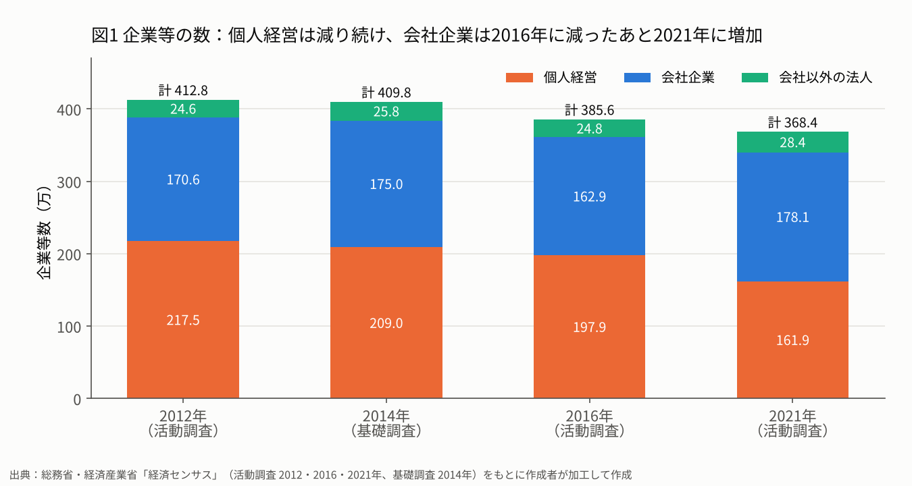
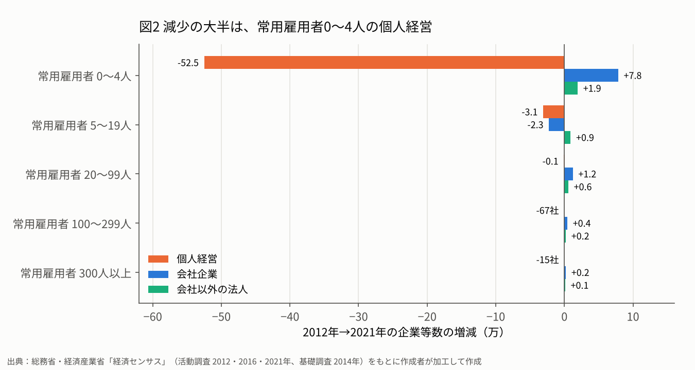
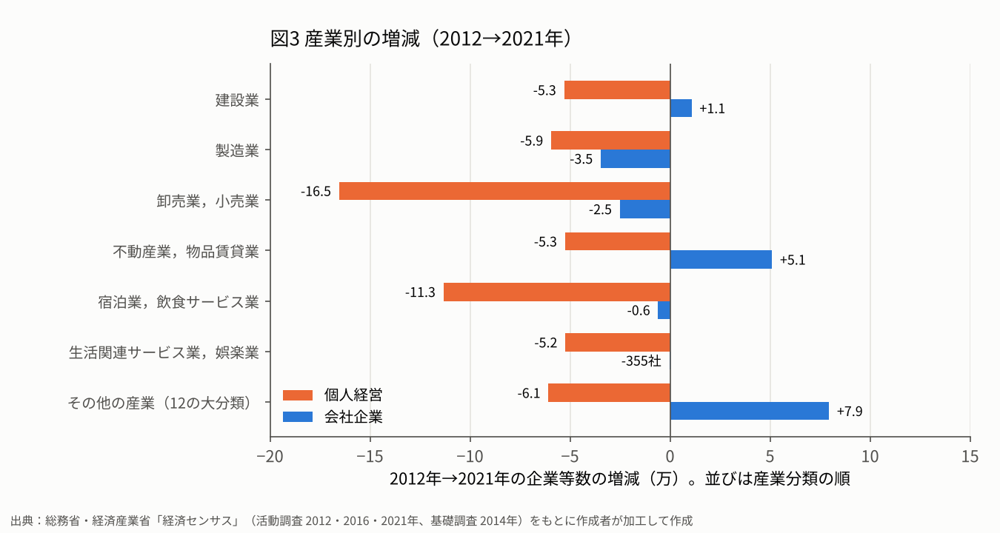
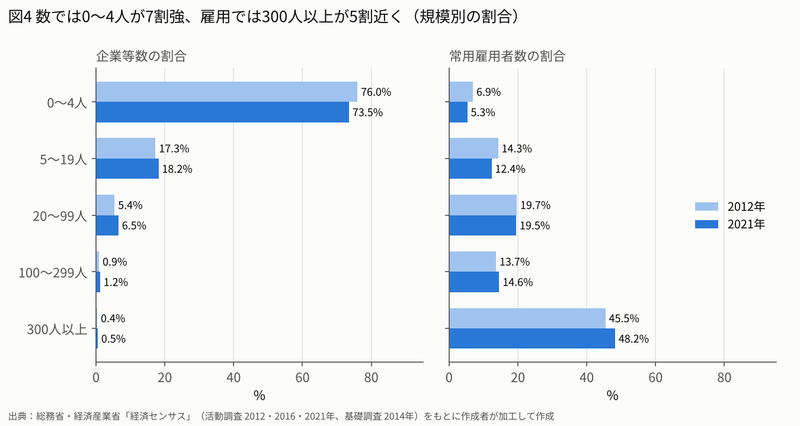

# F414 中小企業の数は、どの規模でどれだけ減ったのか？ 2012→2021年に企業等は44.4万減り、減ったのは個人経営（55.7万減）。常用雇用者0〜4人の区分が減少の96%

## 結論（先に）
- 経済センサスの企業等の数は、2012年の412.8万から2021年の368.4万へ **44.4万（10.8%）** 減りました。
- 減ったのは個人で営む企業（個人経営）で、**55.7万（25.6%）** 減りました。全体の減少より大きく、会社企業は **7.5万（4.4%）** 増え、会社以外の法人も3.8万増えました。
- 規模（常用雇用者の数）で見ると、0〜4人の区分が42.7万減り、全体の減少の **96.2%** でした。常用雇用者100人以上の企業等は、9,824（18.4%）増えています。
- 個人経営の減少のうち、計画で決めた3つの産業（卸売業・小売業16.5万、宿泊業・飲食サービス業11.3万、建設業5.3万）で59.6%でした。製造業（5.9万）も建設業より多く減っています。
- 減った区分の企業が雇っていた人は多くありません。常用雇用者のうち0〜4人の企業等で働く人の割合は、6.9%から5.3%になりました。300人以上の企業等の割合は45.5%から48.2%に上がりました。

## 問い
「中小企業の数が減っている」という見出しはよく見ます。中小企業庁は、経済センサスをもとに、中小企業の数が2016年の357.8万者から2021年の336.5万者に減ったと公表しました（2023年12月）。取引先や地域の企業の変化を数字で確かめたい人にとって、知りたいのは「どこが減ったのか」です。小さな会社が減ったのか、個人の店がやめたのか、どの産業か。この記事では、経済センサスの全国の表から、減った分を規模・経営の形・産業に分けます。減ったことの良し悪しや、政策の評価は扱いません。

## データ（出典）
- 総務省・経済産業省「経済センサス」の企業等に関する集計、全国の表「企業産業（中分類）、企業常用雇用者規模（11区分）、経営組織（5区分）別 企業等数」：2012年・2016年・2021年（活動調査）、2014年（基礎調査）。
- 2024年（基礎調査）の同じ表は「雇用者のいない個人経営の企業を除く」ので、会社企業だけを比べる参考に使いました。
- 企業等は、会社企業・会社以外の法人（社団法人など）・個人経営の企業を合わせたものです。規模は常用雇用者（期間を定めずに雇われている人など）の数で分けました。中小企業庁の「中小企業」の定義（資本金と従業員数、業種で違う）とは同じではありません。農林漁業の個人経営は調査に入っていません。
- 5年分すべてで、規模の合計と経営組織の合計が総数と一致することを確かめました（`src/02_build.py`）。

## 事前の計画
[PLAN.md](PLAN.md) に、集計の前（2026-11-18 11:05）に問い・仮説・頑健性を書きました。

| 仮説 | 外れの基準 | 結果 | 判定 |
|---|---|---|---|
| H1 減少の80%以上は個人経営 | 80%未満 | 125.3%（個人経営の減少が全体の減少より大きい） | 支持 |
| H2 0〜4人の区分が減少の90%以上 | 90%未満 | 96.2% | 支持 |
| H3 会社企業は ±5% 以内、個人経営は25%以上減 | どちらかを満たさない | 会社 +4.4%、個人 −25.6% | 支持（どちらも基準の近く） |
| H4 個人経営の減少の50%以上が卸売・小売、宿泊・飲食、建設 | 50%未満 | 59.6% | 支持 |

## やったこと
1. 5年分の表から、全産業と18の大分類について、規模（11区分）×経営組織の企業等数と常用雇用者数を取り出し、1つの表にしました。
2. 本線は活動調査どうしの2012→2021年です。規模は5つ（0〜4人、5〜19人、20〜99人、100〜299人、300人以上）にまとめ、経営組織×規模の15の区分ごとに増減を出しました。
3. 全体の増減に対する各区分の増減の割合を出しました。増えた区分があるので、減った区分の割合は100%を超えることがあります。
4. 産業（大分類）別に、個人経営と会社企業の増減を出しました。

## 分かったこと

### 1. 減ったのは個人経営（図1）

個人経営は2012年217.5万、2014年209.0万、2016年197.9万、2021年161.9万と減り続けました。会社企業は2016年に162.9万まで減ったあと、2021年は178.1万でした。2016→2021年の会社企業の +9.3% には、調査の名簿の整え方の違いも入っている可能性があります（推測。このデータでは確かめられません）。

### 2. 減少の96%は常用雇用者0〜4人の区分（図2）

個人経営の0〜4人の区分だけで52.5万減り、全体の減少の118%にあたります。それ以外の区分を合わせると8.1万の増加でした。会社企業では、0〜4人が7.8万（7.9%）増え、5〜19人は2.3万（4.6%）減りました。20人以上の区分は、会社企業も会社以外の法人も増えています。

### 3. 個人経営は小売・飲食・建設・製造で減り、会社企業は不動産などで増えた（図3）

個人経営の減少は、卸売業・小売業が16.5万（33.9%減）、宿泊業・飲食サービス業が11.3万（25.4%減）、製造業が5.9万（38.1%減）、建設業が5.3万（32.3%減）、不動産業・物品賃貸業が5.3万でした。会社企業は、不動産業・物品賃貸業で5.1万（30.1%）増え、製造業で3.5万（12.6%）、卸売業・小売業で2.5万（5.8%）減りました。

## 問い直し（結果を見てから足した）

### 企業の数は減ったが、雇用はどの規模にあるのか（図4）

減ったのが小さな区分に集中していたので、雇われている人の側から見直しました。常用雇用者の合計は4,522万から4,989万に増えました。0〜4人の企業等は数では73.5%（2012年は76.0%）を占めますが、常用雇用者では5.3%（同6.9%）です。300人以上の企業等は数では0.5%なのに、常用雇用者の48.2%（同45.5%）を占めます。数の減少の大半は、雇用の小さな部分で起きていました。ただし、個人経営の事業主や家族の働き手は常用雇用者に入らないので、働く人全体の割合とは違います。

## 頑健性

| 確かめたこと | 期間 | 企業等の増減 | 個人経営の割合 | 0〜4人の割合 | 会社企業の増減 |
|---|---|---|---|---|---|
| 本線（活動調査どうし） | 2012→2021 | −44.4万 | 125.3% | 96.2% | +7.5万（+4.4%） |
| 前半 | 2012→2016 | −27.2万 | 72.2% | 104.3% | −7.7万（−4.5%） |
| 後半 | 2016→2021 | −17.2万 | 209.1% | 83.2% | +15.2万（+9.3%） |
| 会社以外の法人を除く | 2012→2021 | −48.2万 | 115.5% | 92.7% | +7.5万 |
| 始まりを2014年（基礎調査）に | 2014→2021 | −41.4万 | 113.7% | 81.4% | +3.1万（+1.8%） |

- 規模を0〜9人までまとめると、その区分が減少の105.4%でした。
- 会社企業だけを2021→2024年で比べると、178.1万から176.5万へ0.9%の減少で、どの規模も ±2% 以内でした（2024年は国内の常用雇用者で規模を分けています）。
- 前半（2012→2016年）は H1 の基準（80%）に届きません。この期間は会社企業も減っていたためです。個人経営が減り続けたことと、0〜4人の区分に集中したことは、どの期間でも同じでした。

## 言えないこと
- 区分ごとの増減は「差し引き」です。廃業・開業・規模の移り（成長して上の区分へ移る、会社にする）を分けられません。個人経営の減少の一部は、会社にしたことによる可能性もあります。
- 調査の方法（活動調査・基礎調査）や名簿の整え方の違いで、年の間に段差がありえます。
- 常用雇用者の数で分けた規模で、中小企業の法律上の定義とは違います。
- 減った理由（後継ぎ・人手・売上など）は、このデータでは確かめられません。
- 減ったことの良し悪しは扱いません。

## 仕事で使うなら
「中小企業の数が減った」という数字を見たら、個人経営と会社、規模の区分に分けて確かめると、減った中身が見えます。取引先の数の見通しを考える材料として、産業ごとの個人経営の減り方の表（results/change_by_industry_2012_2021.csv）が使えます。

## 計画からの変更
- 問い直し（規模別の常用雇用者の割合）を、結果を見てから足しました。
- 産業別の図は、主な6産業のほかを「その他の産業」にまとめました。

## 再現のしかた
```
sh src/run_all.sh
```
ネットにつながず、data/raw の5つの表から data/firms_long.csv・results・figures を作ります（約4秒）。取り直しは `python3 src/01_fetch.py`。Python 3.13、requirements.txt の版で確かめました。

| ファイル | 中身 |
|---|---|
| src/02_build.py | 5年分の表を1つの長い表に（data/firms_long.csv）。合計の一致を確かめる |
| src/03_analysis.py | 増減の分解、産業別、頑健性、問い直し（results/） |
| src/04_figures.py | 図4枚（figures/） |
| results/main.json | 本文の数字のもと |

repro_check：/tmp/rep_F414 に写し、02 以降が作るファイルを消して流し直し、12ファイルが cmp で一致しました（results/repro_check.txt）。

## 関連する記事
- F313（町の小さな店）：商業統計で小売の店の数を、店の売場の広がりと比べた記事です。この記事は全産業の企業等を、規模と経営組織に分けています。
- F317（開業率の数え方）：雇用保険の開業率の記事です。この記事は開業・廃業ではなく、企業等の数の差し引きを見ています。
- F318（ひとりで働く人）：労働力調査で働く人の側から「雇人のない業主」を数えた記事です。この記事は企業の側の数です。

## レビューで直したこと

| # | 指摘 | 直し方 |
|---|---|---|
| 1 | 結論の産業別の行が、計画で決めた3産業を「減った上位3つ」のように読めた（製造業5.9万は建設業5.3万より多い） | 計画で決めた3つと明記し、製造業の減少を書き足した。note の見出しも合わせた |
| 2 | 図1の題「会社企業は横ばいから増加」が、2012→2016年の −4.5% と合わない | 「2016年に減ったあと2021年に増加」に直した |
| 3 | 似た問いの記事との違いが書かれていなかった | 「関連する記事」を足した |
| 4 | results の産業別 CSV と main.json に「医療，福祉」の行がある | 産業分類の全18行の表の1行で、本文・図・note では扱っていないため残した（図3では「その他の産業」に含まれる） |

独立レビューで、数字の照合（題名・README・note と results）、/tmp での再実行、図4枚を確かめました。

## 出典
- 総務省・経済産業省「経済センサス‐活動調査」（e-Stat）：2012年 https://www.e-stat.go.jp/stat-search/file-download?statInfId=000023603914&fileKind=1 、2016年 https://www.e-stat.go.jp/stat-search/file-download?statInfId=000031721990&fileKind=1 、2021年 https://www.e-stat.go.jp/stat-search/file-download?statInfId=000040067954&fileKind=0
- 同「経済センサス‐基礎調査」（e-Stat）：2014年 https://www.e-stat.go.jp/stat-search/file-download?statInfId=000031332527&fileKind=0 、2024年 https://www.e-stat.go.jp/stat-search/file-download?statInfId=000040389342&fileKind=0
- 中小企業庁「中小企業・小規模事業者の数（2021年6月時点）の集計結果を公表します」（2023年12月13日）：https://www.chusho.meti.go.jp/koukai/chousa/chu_kigyocnt/2023/231213chukigyocnt.html

（いずれも 総務省・経済産業省「経済センサス」をもとに作成者が加工して作成）
