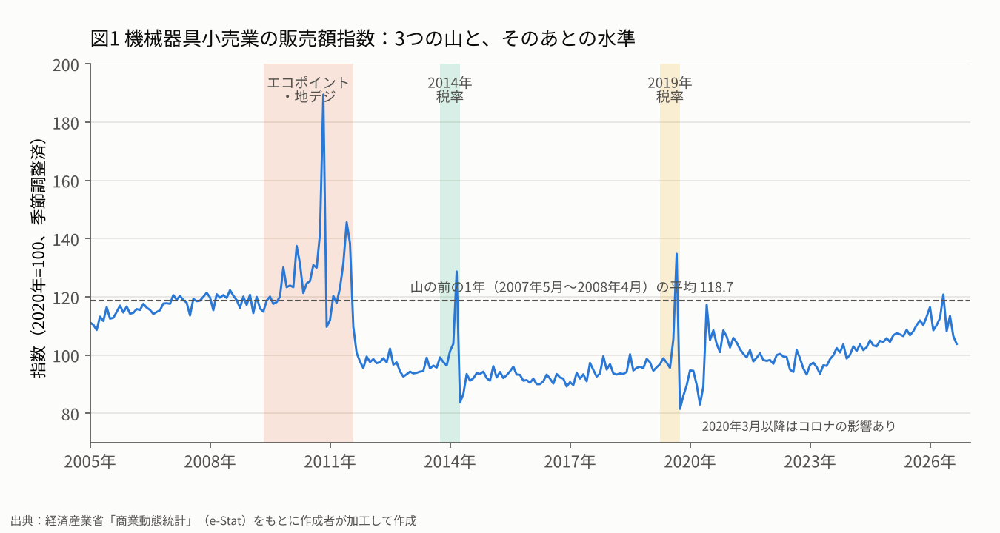
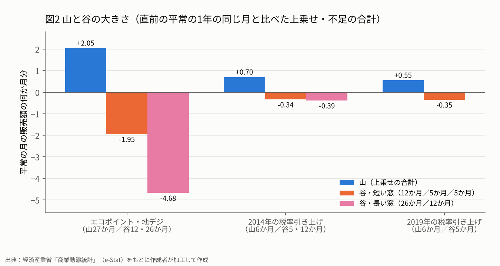
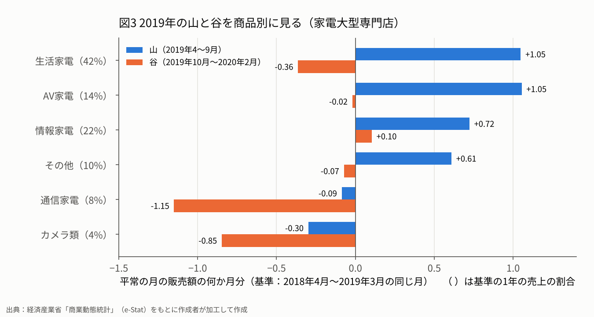
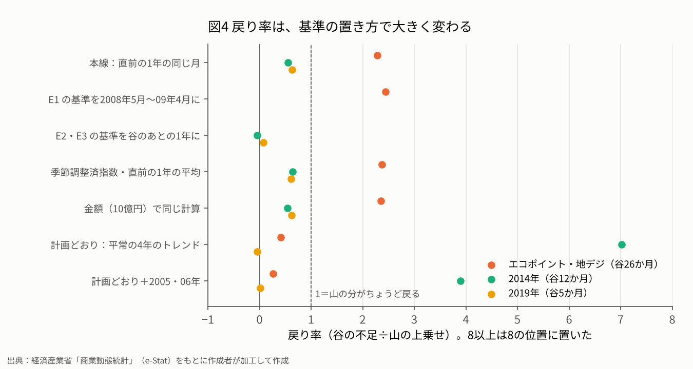

# F415 家電の販売の山のあとに、谷はどれだけ深かったのか？ エコポイント・地デジの山は平常の2.05か月分で、2012〜2019年の販売は山の前の77〜82%にとどまった。税率の2回の谷は、基準の置き方で山のほぼ0倍から7倍まで動いた

## 結論（先に）
- 家電などを売る店（機械器具小売業）の販売額を、山の直前の平常の1年の同じ月と比べました。エコポイントと地デジの山（2009年5月〜2011年7月）の上乗せは、平常の月の **2.05か月分** でした。最大はポイントが減る前の2010年11月（+46.6%）です。
- この山は、測り方を変えても1.92〜5.15か月分でした。3つの山を同じ方法で測った5通り（計画の方法を含む）のすべてで、税率の2回の山の合計（1.10〜1.26か月分）より大きくなりました。
- そのあと販売は元に戻りませんでした。季節調整済指数の年平均は、2012〜2019年に山の前の1年の **77〜82%** でした。直前の1年と比べた谷は26か月で −4.68か月分（戻り率2.29）ですが、計画の方法では戻り率0.42です。谷というより水準が一段下がったと読む方が近く、その分を前倒しの反動とは言い切れません。
- 消費税率の引き上げの山は2014年が **0.70か月分**、2019年が **0.55か月分**。直前の1年と比べると、5か月の谷は −0.34と −0.35で、山の約5〜6割（戻り率0.49・0.63）でした。
- ただし、税率の2回の谷の深さ（戻り率）は「平常」の置き方で **−0.05〜7.02**（山のほぼ0倍から7倍）と大きく変わり、1つの値には決められません。
- 2019年の山の59%は生活家電でした（家電大型専門店）。AV家電は山が1.05か月分あったのに、谷はほぼありませんでした。

## 問い
家電の販売の月次の数字には、制度の締め切りの前に大きな山ができます。読む側が迷うのは、そのあと数字が落ちたときです。「前倒しの反動」なのか「需要が弱い」のかを見分けたい、家電や小売の販売データを月次で追う人に向けて、3つの山のあとの谷の深さと長さを比べます。税率や政策の良し悪し、買う時期の判断には触れず、販売の数字の読み方までにします。

家電エコポイントについて、担当の3省は薄型テレビ・エアコン・冷蔵庫の販売を約2.6兆円押し上げたと推計しています（2011年6月の資料）。この資料に、終わったあとの反動の大きさは書かれていません。家計の側の消費税の駆け込みと反動は既存の F11（家計調査）で扱いました。この記事は売る店の側の数字で、エコポイントと地デジの山も含めて比べます。

## データ（出典）
- 経済産業省「商業動態統計」業種別商業販売額指数（2020年=100、2002年1月〜2026年9月）の機械器具小売業。原指数と季節調整済指数を使います。2014年12月以前は接続係数でつないだ値です。機械器具小売業は家電・パソコン・カメラなどを売る店で、自動車小売業は別です。
- 同「家電大型専門店販売額」商品別（2014年1月〜、百万円）。2017年以前の値には、表の注にあるリンク係数（商品販売額0.9977、通信家電0.9754）をかけて2018年以降とつなぎました。
- 同「業種別商業販売額」（10億円）は照合用。
- どれも e-Stat の掲載ファイルです（経済産業省のサイトは403を返したため）。

## 事前の計画
[PLAN.md](PLAN.md) に、集計の前（2026-11-18 10:10）に問い・窓・仮説・頑健性を書きました。窓（山と谷の期間）は計画のまま使っています。

計画では、平常の4年（2007・2016〜2018年）のトレンドと月のダミー（季節の型）で「山も谷もなかった場合」を作る予定でした。ところが販売額は2011年8月に約2割下がったまま戻らず、1本のトレンドでは2013年の平常が高く置かれ、2014年の山がほぼ消えました（0.14か月分）。そこで本線を「直前の平常の1年の同じ月と比べる」方法に変え、計画の方法は頑健性に残しました。

| 仮説 | 外れの基準 | 計画どおりの方法 | 本線（直前の1年） |
|---|---|---|---|
| H1 エコポイント・地デジの山は、2回の税率の山の合計より大きい | 合計以下 | 支持（4.32 対 1.10） | 支持（2.05 対 1.25） |
| H2 その谷（26か月）は山の半分以上 | 戻り率0.5未満 | 外れ（0.42） | 支持（2.29） |
| H3 2014年の谷（12か月）は山より深い | 戻り率1未満 | 支持（7.02） | 外れ（0.55） |
| H4 2019年の山は2014年の山の半分未満 | 半分以上 | 外れ（7.04倍） | 外れ（0.79倍） |

H1・H4 は両方で同じ判定、H2・H3 は方法で入れ替わるため「判定できず」とします。

## やったこと
1. 各山の直前の平常の1年を決めました。エコポイント・地デジは2007年5月〜2008年4月（リーマン・ショックの前）、2014年は2012年10月〜2013年9月、2019年は2018年4月〜2019年3月です。
2. 窓の各月の値を、平常の1年の同じ月の値で割り、1を引いて「上乗せ（マイナスなら不足）」としました。窓の中で足した値が「平常の月の何か月分」です。
3. 戻り率＝谷の不足÷山の上乗せ。1なら前倒しの分がちょうど戻った、1より大きければ谷が山より深い、です。
4. 2019年は家電大型専門店の商品別にも計算しました（2014年は表が2014年1月からで、直前の1年が取れません）。
5. 2019年の谷は2020年2月までの5か月です（3月以降はコロナと統計の段差）。

## 分かったこと

### 1. 3つの山と、そのあとの水準（図1）

季節調整済の指数は、2007年5月〜2008年4月の平均が118.7でした。山のあと、2012年の平均はその81.7%、2016年は76.9%です。税率の2つの山は、下がった水準の上に1か月だけ立っています。

### 2. エコポイント・地デジの谷は山より深く、税率の谷は山の半分ほど（図2）

- エコポイント・地デジ：山は27か月で +2.05か月分でした。その中身は、2010年4〜10月が +0.82、2010年11月の1か月が +0.47、地デジの終了前の2011年4〜7月が +0.64 です。ポイントが減った2010年12月から制度が終わる2011年3月までは −0.21 で、平常を下回っていました（2011年3月には東日本大震災がありました）。谷は12か月で −1.95（1か月あたり −16.2%）、26か月で −4.68 でした。
- 2014年：山は +0.70か月分で、2014年3月だけで +37.4% でした。谷は5か月で −0.34、12か月で −0.39 です。最低は4月の −11.8% です。
- 2019年：山は +0.55か月分で、9月が +37.8% でした。谷は5か月で −0.35、最低は10月の −14.8% です。

### 3. 2019年の山は生活家電が中心。テレビなどは谷がほぼなかった（図3）

家電大型専門店の計は、山 +0.75か月分、谷 −0.26か月分（戻り率0.35）でした。山の上乗せの59%は生活家電（売上の42%）で、9月は平常より71.2%多く売れました。AV家電は山が +1.05か月分なのに谷は −0.02 でした。情報家電（パソコンなど）は谷がプラスで、2020年1月の古い基本ソフトのサポート終了による買い替えが重なった可能性があります（推測。データでは確かめていません）。通信家電とカメラ類は山がなく谷だけでした。

## 問い直し（結果を見てから足した）

### 家電の店の販売は、エコポイントの前の水準に戻ったのか
季節調整済指数で、2011年8月以降に山の前の平均（118.7）以上になった月は、2014年3月・2019年9月・2026年5月の3か月だけでした。年平均は2016年の76.9%が底で、2019年は82.4%、2025年は91.4%、直近の12か月（2026年9月まで）は93.8%です。エコポイントのあとの「谷」は、少なくとも名目の販売額では15年たっても埋まっていません。テレビの値下がり、通販（別の業種）への移り、コロナの影響なども混じり、この差の全部を反動とは言えません。

## 頑健性


| 確かめたこと | E1 山 | E1 戻り率 | E2 山 | E2 戻り率 | E3 山 | E3 戻り率 |
|---|---|---|---|---|---|---|
| 本線：直前の1年の同じ月（原指数） | 2.05 | 2.29 | 0.70 | 0.55 | 0.55 | 0.63 |
| E1 の基準を2008年5月〜2009年4月に | 1.92 | 2.45 | — | — | — | — |
| E2・E3 の基準を谷のあとの1年に | — | — | 0.83 | −0.05 | 0.80 | 0.08 |
| 季節調整済指数・直前の1年の平均 | 1.99 | 2.37 | 0.61 | 0.64 | 0.56 | 0.61 |
| 金額（10億円）で同じ計算 | 2.00 | 2.35 | 0.70 | 0.54 | 0.55 | 0.62 |
| 計画どおり：平常の4年のトレンド | 4.32 | 0.42 | 0.14 | 7.02 | 0.97 | −0.05 |
| 計画どおり＋2005・2006年 | 5.15 | 0.26 | 0.22 | 3.89 | 0.89 | 0.02 |

E1＝エコポイント・地デジ（谷26か月）、E2＝2014年（谷12か月）、E3＝2019年（谷5か月）。山は平常の月の何か月分。

- 直前の1年を基準にする方法の中では、季節調整済指数でも金額でも数字はほぼ同じでした。
- 税率の山はどの方法でも +0.14〜+0.97か月分、戻り率は −0.05〜7.02 と大きく動きます。山のあとに水準が下がったのか、平常そのものが下がったのか、見分けにくいためです。
- 2019年の家電大型専門店の計（山 +0.75、戻り率0.35）も同じ向きでした。

## 言えないこと
- 「平常」の置き方で、とくに谷の深さが変わります。戻り率は幅で読む必要があります。
- 販売額は金額で、値下がりと台数の動きを分けられません。
- エコポイントの谷には、震災のあとの消費の動き、買い替えの周期、値下がり、通販への移りなど、制度以外の理由も混じります。
- 機械器具小売業には家電以外（パソコン・携帯電話など）も入ります。
- 2014年は商品別の直前の1年が取れず、商品別に比べられるのは2019年だけです。
- 税率の引き上げや政策の良し悪しは扱いません。

## 仕事で使うなら
締め切りのある制度の前後は、前年同月比だけでは反動と需要の弱さを分けにくいです。直前の平常の1年と比べた値と、基準を変えた値を並べると、言える幅が見えます。

## 計画からの変更
- 本線の方法を、計画の「平常の4年のトレンドと月のダミー」から「山の直前の平常の1年の同じ月が基準」に変えました。計画の方法では2011年の水準の下がりがトレンドに吸い込まれ、2014年の山がほとんど消えたためです。計画の方法の結果は、頑健性の表と仮説の表に残しました。
- 商品別の2014年（計画では参考）は、不自然な値（谷がプラス）が出たため本文で使わず、`results/goods_planned_reference.csv` に残しました。
- 問い直し（山の前の水準に戻ったか）を、結果を見てから足しました。

## 再現のしかた
```
sh src/run_all.sh
```
ネットにつながず、data/raw の Excel 3本から data の中間ファイル2本・results・figures を作ります（約3秒）。取り直しは `python3 src/01_fetch.py`。Python 3.13、requirements.txt の版で確かめました。

| ファイル | 中身 |
|---|---|
| src/02_build.py | Excel から月次の表（data/ の csv 2本） |
| src/03_analysis.py | 山・谷・戻り率、頑健性、商品別、問い直し（results/） |
| src/04_figures.py | 図4枚（figures/） |
| results/main.json | 本文の数字のもと |

repro_check：/tmp/rep_F415 に写し、02 以降が作るファイルを消して流し直し、13ファイルが cmp で一致しました（results/repro_check.txt）。

## レビューで直したこと

| # | 指摘 | 直し方 |
|---|---|---|
| 1 | 題名の「山の2.3倍の不足」は、計画の方法では戻り率0.42で、水準の段差も混じる。本文でも「水準が一段下がった」と書いており、題名だけ強かった | 題名の結果を、どの測り方でも変わらない「山は2.05か月分」と「2012〜2019年は山の前の77〜82%」に替えた |
| 2 | 題名の「税率の谷は山の5〜6割」は本線の値で、基準の置き方で −0.05〜7.02 と動く | 題名・結論・note で「山のほぼ0倍から7倍まで動く」と幅で書き、5〜6割は「直前の1年と比べると」と条件をつけた |
| 3 | 題名・結論に使う幅（2012〜2019年の比、全ての確かめでの H1 と税率の戻り率の幅）が results にまとまっていなかった | `src/03_analysis.py` で main.json の `requestion.ratio_2012_2019_min/max` と `across_checks` に出すようにした |

H2・H3 を「判定できず」とした扱い、計画からの変更の書き方は妥当と判断し、そのままにしました。家計の側の駆け込みと反動は既存の F11（家計調査）で、この記事は売る店の側とエコポイント・地デジを含む点で違います（「問い」に記載済み）。

## 出典
- 経済産業省「商業動態統計」時系列データ（e-Stat）：業種別商業販売額指数 https://www.e-stat.go.jp/stat-search/file-download?statInfId=000031387999&fileKind=0 、家電大型専門店販売額 https://www.e-stat.go.jp/stat-search/file-download?statInfId=000031387996&fileKind=0 、業種別商業販売額 https://www.e-stat.go.jp/stat-search/file-download?statInfId=000031387992&fileKind=0
- 環境省・経済産業省・総務省「家電エコポイント制度の政策効果等について」（2011年6月14日）：https://www.env.go.jp/content/900519904.pdf （制度の期間、ポイントの見直し、販売の押し上げの推計）
- 総務省「地上デジタル放送に関するQ&A」：https://www.soumu.go.jp/main_sosiki/joho_tsusin/dtv/QA/QA1.html （アナログ放送の終了は2011年7月24日。岩手・宮城・福島は2012年3月31日）

（いずれも 経済産業省「商業動態統計」をもとに作成者が加工して作成）
