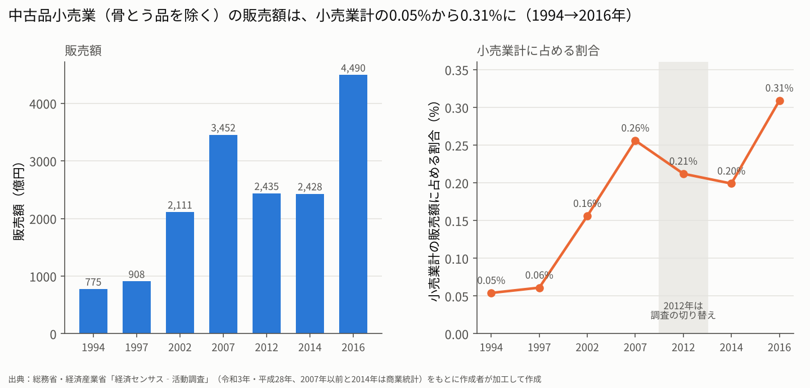
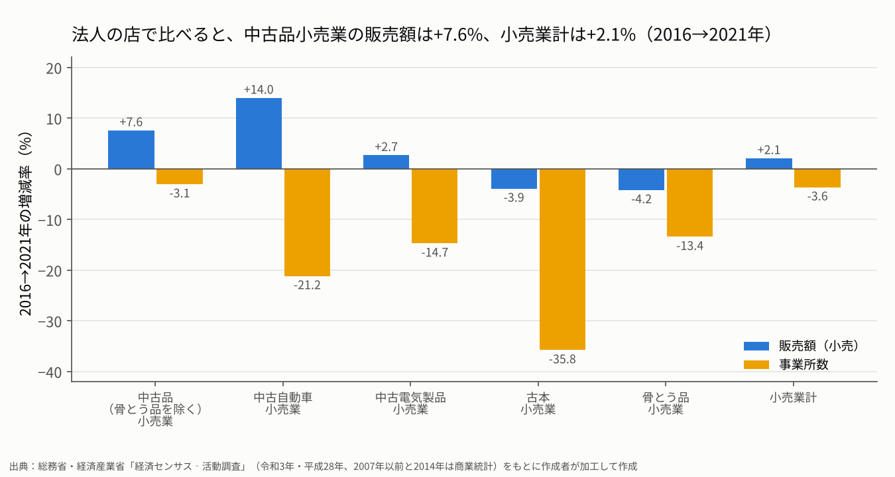
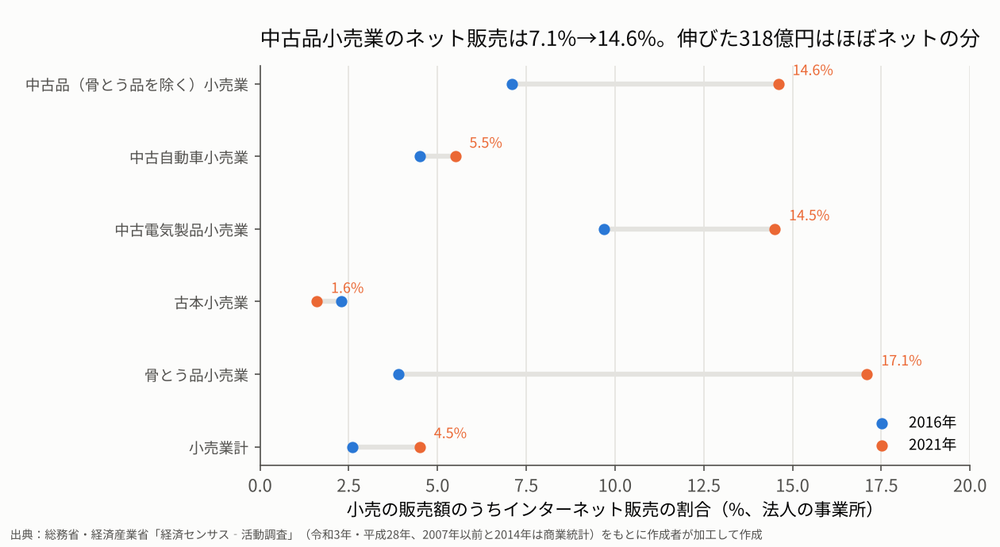
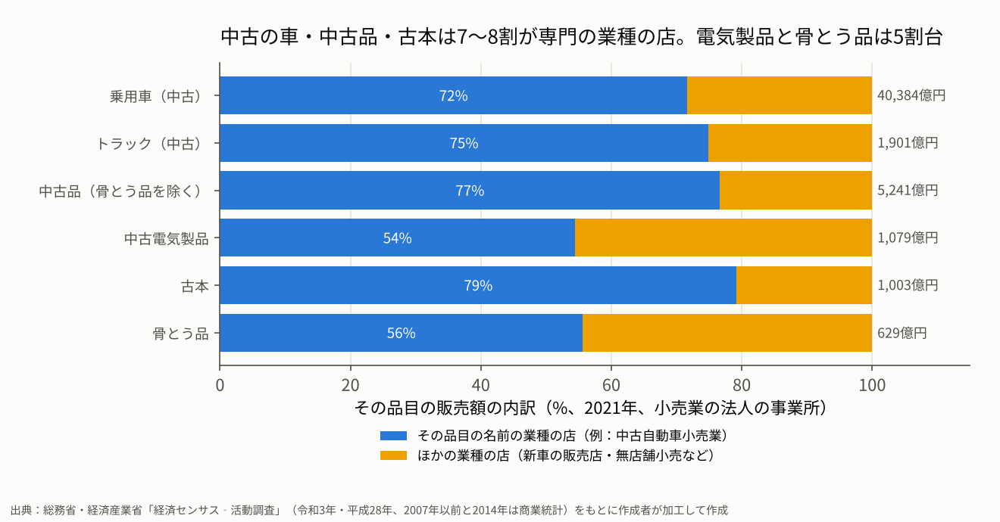

# F416 中古品を売る店の売上は、伸びているのか？ 小売全体に占める割合は1994→2016年に0.05%から0.31%へ。2016→2021年（法人の店）は+7.6%で、伸びはほぼネット販売の分

## 結論（先に）
- 中古品小売業（骨とう品を除く。リユースショップなど）の販売額は、1994年の775億円から2016年の4,490億円になりました。小売業計に占める割合は **0.054%から0.309%**（5.7倍）です。小売業計の販売額は同じ期間に143兆円から145兆円で、ほぼ横ばいでした。
- 2016→2021年は、調査の範囲がそろう法人の店だけで比べると、中古品小売業の販売額は **+7.6%**（4,176億円→4,494億円）、小売業計は **+2.1%** でした。事業所数は −3.1% で、1店あたりが大きくなっています。
- 中古品小売業の2016→2021年の増加（318億円）は、ほぼ **インターネット販売の増加（+363億円）** で、店頭の販売は −27億円（−0.7%）でした。ネット販売の割合は7.1%から14.6%になりました。
- 中古自動車小売業は規模が大きく（2016年に3.4兆円）、1994年からの伸びは+7.7%と小売業計並みでした。2016→2021年（法人）は+14.0%です。古本（−3.9%）と骨とう品（−4.2%）は減りました。
- 2021年に小売の店で売られた中古の品目は合わせて5.16兆円（小売の商品販売額の3.87%）で、8割は中古の乗用車です。中古品（骨とう品を除く）の77%、中古の乗用車の72%は、その品目を専門に売る業種の店で売られていました。

## 問い
「リユース（中古品）の市場は広がっている」とよく言われます。環境省の調査では、2024年のリユース市場規模は自動車・バイクを含めて3兆4,986億円、除くと1兆2,813億円で、そのうちリユースショップなどの店頭が4,468億円と推計されています。フリマアプリなど、個人どうしの売買も含めた推計です。

では、公的な統計の上で「中古品を売る店」の売上は伸びているのか。新品も含めた小売全体と比べてどうか。品目でどう違い、どんな店で売られているのか。リユースの店の出店や仕入れの数字を見る人、小売の業界の数字を追う人に向けて、経済センサスと商業統計で確かめます。価格や店の選び方の助言はしません。

## データ（出典）
- 総務省・経済産業省「令和3年経済センサス‐活動調査」卸売業，小売業 産業編（総括表）**第1表**：産業分類細分類別、年次別の事業所数（法人・個人別）、従業者数、年間商品販売額（1994〜2021年。2007年以前と2014年は商業統計）。中古自動車小売業・中古電気製品小売業・古本小売業・骨とう品小売業・中古品小売業（骨とう品を除く）と小売業計を使いました。
- 同 **第9表**（2021年）と「平成28年経済センサス‐活動調査」産業編（総括表）**第9表**（2016年）：細分類別・商品販売形態別（店頭・インターネットなど）の販売額。どちらも **法人の事業所** の値です。
- 「令和3年経済センサス‐活動調査」**品目編 第2表**（商品分類別の販売額、全国）と **第4表**（産業分類細分類×商品分類）。
- **注意**：2021年は、個人経営の事業所の販売額を調べていないため、細分類の値は法人の事業所だけです。2016年までは個人経営を含みます。また2012年は経済センサスへの切り替えで、小売業計の販売額が2007年の134.7兆円から114.9兆円に下がる段差があります。

## 事前の計画
[PLAN.md](PLAN.md) に、比率や伸び率を計算する前（2026-11-18 11:50）に計画を書きました。元の表の値の一部は下見で見ていたため、H1・H2 は確かめの意味が強く、H3・H4 は下見で見ていない表（品目編 第4表）についての仮説です。

| 仮説 | 外れの基準 | 結果 | 判定 |
|---|---|---|---|
| H1 中古品小売業の小売業計に占める割合は、1994→2016年に3倍以上 | 3倍未満 | 5.72倍（0.054%→0.309%） | 支持 |
| H2 2016→2021年（法人）の中古品小売業の伸びは、小売業計より大きい | 小売業計以下 | +7.6% 対 +2.1% | 支持 |
| H3 品目「中古品（骨とう品を除く）」の3割以上は、中古品小売業以外の店で売られる | 3割未満 | 23.3% | 外れ |
| H4 品目「乗用車（中古）」の4割以上は、中古自動車小売業以外の店で売られる | 4割未満 | 28.4%（新車の販売店が27.4%） | 外れ |

## やったこと
1. 第1表から、中古関連の5つの細分類と小売業計の推移を取り出し、小売業計に占める販売額の割合、1事業所あたりの販売額・従業者数を計算しました。1999・2004年は細分類が取れない年があるため除きました。
2. 2016→2021年は、第9表（法人の事業所）で販売額を比べました。事業所数は第1表の法人の事業所数で比べました。
3. 第9表の商品販売形態別で、インターネット販売の割合と、増減の内訳（店頭とネット）を見ました。
4. 品目編 第4表で、中古の6品目のそれぞれが、どの業種の店で売られたかを計算しました（小売業の事業所の分）。

## 分かったこと

### 1. 小売全体に占める割合は0.05%から0.31%に（図1）

- 中古品小売業の販売額は、1994年775億円、2002年2,111億円、2007年3,452億円、2016年4,490億円でした。
- 2012・2014年は約2,430億円と低く出ていますが、2012年は調査の切り替えで小売業計も下がった年です。割合で見ると2007年0.256%、2012年0.212%、2016年0.309%でした。
- 事業所数は1994年3,469から2016年5,627（+62%）、従業者数は8,677人から39,969人（+361%）でした。1事業所あたりの販売額は22.3百万円から79.8百万円、従業者は2.5人から7.1人で、店が大きくなりました。

### 2. 2016→2021年（法人の店）は+7.6%（図2）

- 中古品小売業 +7.6%、中古自動車小売業 +14.0%、中古電気製品小売業 +2.7%、古本小売業 −3.9%、骨とう品小売業 −4.2%、小売業計 +2.1% でした（販売額、法人の事業所）。
- 法人の事業所数は、中古品小売業 −3.1%、中古自動車小売業 −21.2%、古本小売業 −35.8% でした。中古品小売業の1事業所あたりの販売額は129.7百万円から136.2百万円になりました。

### 3. ネット販売の割合が倍に（図3）

- 小売の販売額のうちインターネット販売の割合は、中古品小売業で7.1%→14.6%、骨とう品小売業で3.9%→17.1%、中古電気製品小売業で9.7%→14.5%でした。小売業計は2.6%→4.5%です。
- 古本小売業は2.3%→1.6%と下がりました。

### 4. 中古の品目は、主に専門の業種の店で売られる（図4）

- 2021年に小売の店（卸売の店の小売分を含む）で売られた中古の6品目は5.16兆円で、小売の商品販売額133.3兆円の3.87%でした。中古の乗用車が4兆1,568億円で、車を除くと8,080億円です。
- 小売業の店で売られた分のうち、その品目を専門に売る業種以外の店の割合は、乗用車（中古）28.4%（ほとんどが新車の販売店）、中古品（骨とう品を除く）23.3%、古本20.8%、中古電気製品45.6%、骨とう品44.4%でした。中古電気製品は、ネット通販などの無店舗小売業（機械器具）が16.1%を売っています。

## 問い直し（結果を見てから足した）

### 中古品小売業の伸びは、店頭とネットのどちらから来たか
2016→2021年（法人）で、中古品小売業の小売の販売額は318億円増えました。内訳は、インターネット販売が294億円から658億円へ +363億円、店頭販売が3,831億円から3,804億円へ −27億円（−0.7%）、訪問販売などその他の形態が −18億円でした。この5年の伸びはほぼネット販売の分で、店頭の販売は横ばいでした。中古自動車小売業は逆に、店頭が +4,195億円（+16.7%）、ネットが +540億円で、店頭の伸びが中心です。小売業計は、店頭 +2,515億円、ネット +25,160億円でした。

## 頑健性

| 確かめたこと | 中古品小売業 | 中古自動車小売業 | 小売業計 |
|---|---|---|---|
| 販売額 1994→2016年 | +479.3% | +7.7% | +1.2% |
| 販売額 2007→2016年（2012年の段差をまたぐ） | +30.1% | +7.2% | +7.7% |
| 販売額 2012→2016年（同じ経済センサスどうし） | +84.4% | +45.6% | +26.3% |
| 販売額 2016→2021年（法人だけ、第9表） | +7.6% | +14.0% | +2.1% |
| 販売額 2016→2021年（第1表。2021年は法人だけ） | +0.5% | 秘匿 | −4.8% |
| 事業所数 1994→2016年 | +62.2% | +38.8% | −34.0% |
| 従業者数 1994→2016年 | +360.6% | +27.9% | +3.7% |

- どの期間・指標でも、中古品小売業は小売業計より伸びていました。2016→2021年を法人だけでそろえずに比べると、中古品小売業は +0.5% で、個人経営の分が抜けた段差に左右されます。
- 環境省の推計（2024年）では、自動車・バイクを除くリユース市場のうち店頭の販売は4,468億円でした。経済センサスの中古品小売業（2021年、法人）の4,494億円と近い大きさですが、年も定義も違うので、参考の照合にとどめます。

## 言えないこと
- フリマアプリやネットオークションなど、個人どうしの売買はこの統計に入りません。リユース市場の全体ではありません。
- 2012年（経済センサスへの切り替え）と2021年（個人経営の販売額を調べない）に段差があり、長い推移は割合や法人どうしの比較で読む必要があります。
- 販売額は名目で、物価の動きを除いていません。
- 新品と中古品を両方売る店は、主な業種で分類されます。中古品を売る新品の店の分は、品目編でしか見えません。
- 中古自動車小売業の事業所数の減り方（−21.2%）が、店が減ったのか、業種の格付けが変わったのかは分かりません。
- 1994〜2016年の間には日本標準産業分類の改定もありました。中古品小売業の範囲が改定で変わったかは確かめていません。1997→2002年の大きな伸び（908億円→2,111億円）の一部が分類の変更による可能性があります（**推測**）。
- 価格や店の選び方は扱いません。地域の比較もしていません。

## 仕事で使うなら
中古品の店の数字を見るときは、2012年と2021年の調査の段差に注意し、小売業計との比や法人どうしで比べると読み違えが減ります。近年の伸びがネット販売か店頭かは、商品販売形態別の表で分けて確かめられます。

## 計画からの変更
- 問い直し（伸びは店頭かネットか）を、結果を見てから足しました。
- 事業所数の2016→2021年は、第9表ではなく第1表の法人の事業所数を使いました（第9表は販売額のない事業所を含まないため、事業所数が少し小さく出ます）。

## 再現のしかた
```
sh src/run_all.sh
```
ネットにつながず、data/raw の Excel 5本から、data の中間ファイル4本・results・figures を作ります（約3秒）。取り直しは `python3 src/01_fetch.py`。Python 3.13、requirements.txt の版で確かめました。

| ファイル | 中身 |
|---|---|
| src/02_build.py | 第1表・第9表・品目編を縦長の表に（data/） |
| src/03_analysis.py | 推移、割合、法人の比較、ネット販売、品目と売る店、頑健性、問い直し（results/） |
| src/04_figures.py | 図4枚（figures/） |
| results/main.json | 本文の数字のもと |

repro_check：/tmp/rep_F416 に写し、02 以降が作るファイルを消して流し直し、results と figures のファイルが cmp で一致しました（results/repro_check.txt）。

## レビューで直したこと

| # | 指摘 | 直し方 |
|---|---|---|
| 1 | 題名が長く、主語が「中古品小売業の販売額は…小売全体の0.05%」とねじれていた | 「小売全体に占める割合は1994→2016年に0.05%から0.31%へ」に縮めた（status・note の1行目も同じに） |
| 2 | 問い直しの内訳（ネット +363億円、店頭 −27億円）が合計の318億円と合わず、残りの説明がなかった | 訪問販売などその他の形態の −18億円を足した（data/form_2016_2021.csv から計算） |
| 3 | 1994〜2016年の長い比較で、産業分類の改定の影響に触れていなかった | 「言えないこと」に、分類の改定で範囲が変わった可能性（推測）を足した |
| 4 | 環境省の推計値は手入力 | 概要版 PDF で 34,986億円・12,813億円・店頭4,468億円を確かめ、一致した（直しなし） |

## 出典
- 総務省・経済産業省「令和3年経済センサス‐活動調査」（e-Stat）：https://www.e-stat.go.jp/stat-search/files?toukei=00200553&tstat=000001145590
- 総務省・経済産業省「平成28年経済センサス‐活動調査」（e-Stat）：https://www.e-stat.go.jp/stat-search/files?toukei=00200553&tstat=000001095895 （個別の URL は data/raw/SOURCES.md）
- 環境省「令和6年度リユース市場規模調査報告書（概要版）」（2025年6月）：https://www.env.go.jp/content/000321557.pdf （リユース市場規模と販売経路別の推計。比べ先としてだけ使った）

（いずれも 総務省・経済産業省「経済センサス‐活動調査」をもとに作成者が加工して作成）
