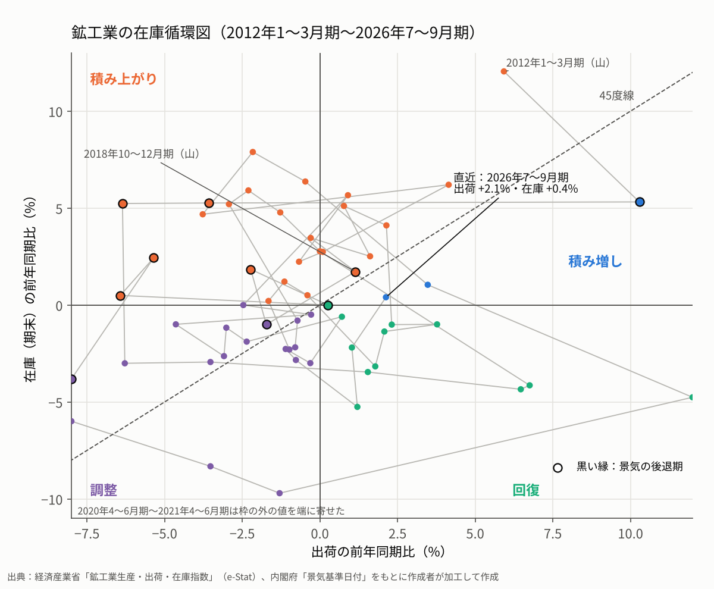
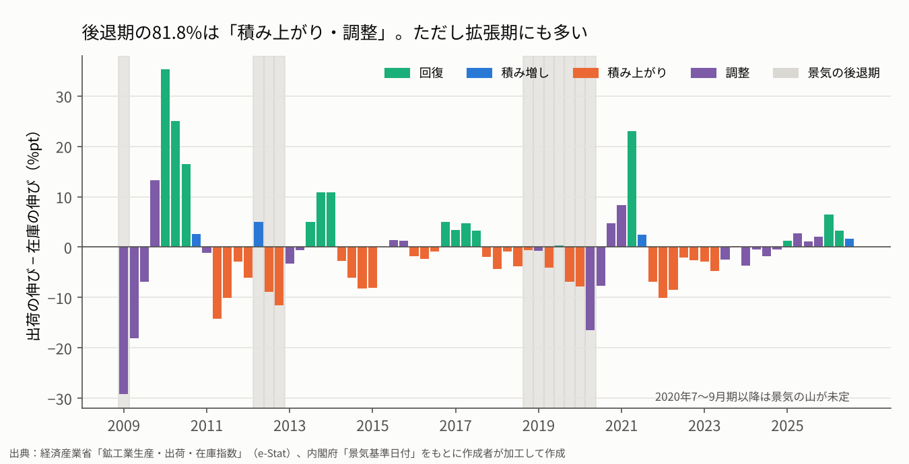
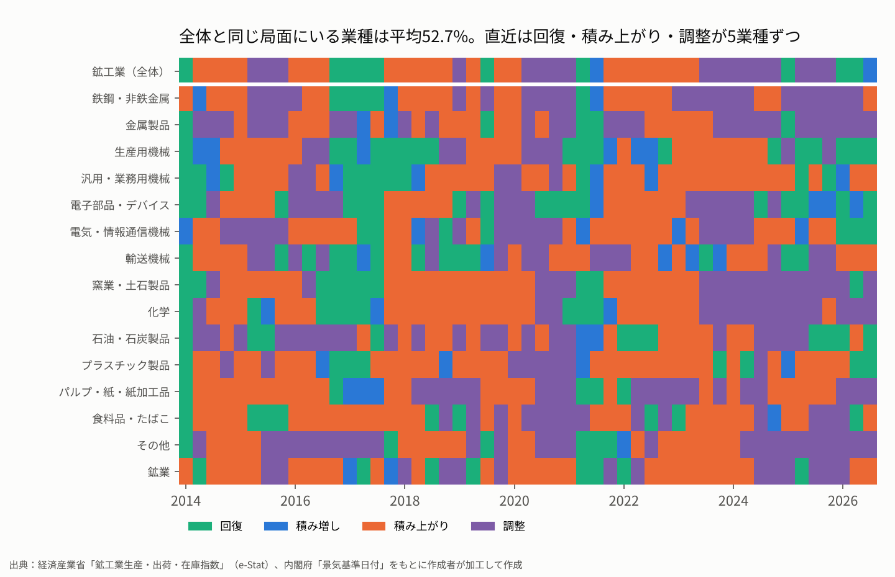
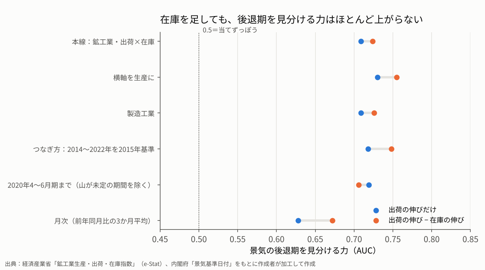

# F417 在庫循環図で、製造業の景気の位置は分かるのか？ 後退期の81.8%は「積み上がり・調整」にいたが、拡張期の69%も同じ側にいた。2026年7〜9月期は「積み増し」

## 結論（先に）
- 鉱工業の出荷と在庫（期末）の前年同期比で在庫循環図を描き、2009年1〜3月期〜2026年7〜9月期の71四半期を4つの局面に分けました。景気の後退期（内閣府の山・谷で11四半期）のうち **81.8%** は「積み上がり」か「調整」にいました。
- ところが、山・谷が決まっている拡張期の35四半期では、「回復」か「積み増し」にいたのは **31.4%** だけでした。拡張期の中にも、在庫の積み上がりと調整の小さな波が何度もありました（2014〜2016年、2011年など）。図の局面は「製造業の在庫の位置」で、景気全体の位置とは一致しません。
- 「積み上がり」が3四半期以上続いた4回のうち、景気の山が近くに来たのは2回（2012年・2018年）でした。2014〜2015年と2016年は山になりませんでした。
- 後退期を見分ける力（AUC）は、出荷の伸びだけで0.709、在庫を足した「出荷の伸び − 在庫の伸び」で0.724 と、ほとんど同じでした。確かめ方によっては逆転します。
- 2026年7〜9月期は出荷 +2.1%、在庫 +0.4% で「積み増し」でした。ただし15業種の局面は、回復・積み上がり・調整が5業種ずつに分かれていて、全体と同じ「積み増し」の業種はありませんでした。

## 問い
鉱工業指数の在庫循環図は、横軸に出荷（または生産）の前年同期比、縦軸に在庫の前年同期比をとった図です。経済産業省の解説では、景気の局面に合わせて「意図せざる在庫減（回復）→ 在庫積み増し → 在庫積み上がり → 在庫調整」と反時計回りに回るとされます。月例経済報告の資料にも、景気の後退期に色をつけた在庫循環図が載っています。

月次の鉱工業指数を読む人や、製造業の取引先の在庫・受注を見ている人は、「今は在庫調整の局面か」をこの図で判断しがちです。この図で景気の位置がどこまで分かるのかを、内閣府の景気の山・谷と照らし合わせて確かめます。景気の予測や投資の判断は扱いません。

## データ（出典）
- 経済産業省「鉱工業生産・出荷・在庫指数」業種別・原指数（四半期・月次）。2010年基準（2008〜2018年）、2015年基準（2013〜2023年）、2020年基準（2018年〜2026年9月）。出荷・在庫（期末）・生産。e-Stat の掲載ファイル（経済産業省のサイトは 403 を返したため）。
- 内閣府経済社会総合研究所「景気基準日付」：山は2008年2月・2012年3月・2018年10月、谷は2009年3月・2012年11月・2020年5月。2020年5月の谷のあとの山はまだ決められていません。

## 事前の計画
[PLAN.md](PLAN.md) に、指数の値を集計する前（2026-11-18 12:05）に、局面の分け方・景気の局面の決め方・仮説・頑健性を書きました。

| 仮説 | 外れの基準 | 結果 | 判定 |
|---|---|---|---|
| H1 後退期の75%以上が「積み上がり・調整」 | 75%未満 | 81.8%（11四半期のうち9） | 支持 |
| H2 拡張期（2020年4〜6月期まで）の60%以上が「回復・積み増し」 | 60%未満 | 31.4%（35四半期のうち11） | 外れ |
| H3 後退期を見分ける力は「出荷 − 在庫」の方が「出荷だけ」より高い | AUC が出荷だけ以下 | 0.724 対 0.709 | 判定できず（本線は基準を満たすが、山・谷が決まった2020年4〜6月期までに限ると0.706 対 0.719 で逆転） |
| H4 平均して半分以上の業種が全体と同じ局面 | 平均50%未満 | 52.7% | 支持（境目に近い） |

## やったこと
1. 各基準の原指数から前年同期比を計算し、2009〜2013年は2010年基準、2014〜2018年は2015年基準、2019年以降は2020年基準でつなぎました（基準の中だけで前年と比べる）。
2. 局面（x＝出荷の伸び、y＝在庫の伸び）：回復は x > 0・y ≤ 0、積み増しは x > 0・y > 0・x ≥ y（45度線の下）、積み上がりは y > 0・y > x（45度線の上）、調整は x ≤ 0・y ≤ 0。
3. 景気の局面：山の翌月から谷の月までを後退とし、3か月のうち2か月以上が後退の四半期を後退期にしました。2020年7〜9月期以降は「拡張（山が未定）」です。
4. AUC：後退期の四半期と拡張期の四半期を1組ずつ比べ、後退期の方を「悪い」と正しく並べられる割合。0.5なら当てずっぽう、1なら完全です。本線の AUC は、山が未定の2020年7〜9月期以降の25四半期も「後退期でない」側に入れて計算しています（山・谷が決まった期間だけの値は頑健性の表）。
5. 業種別：区分がそろう2014年以降の15業種で、各四半期に全体と同じ局面にいる業種の割合を数えました。

## 分かったこと

### 1. 図はおおむね反時計回りに回るが、形はいびつ（図1）

- 連続する2四半期の動きのうち、反時計回りだったのは70.0%でした。
- 「出荷の伸び − 在庫の伸び」は、生産の伸びと同じ四半期での相関がいちばん強く（0.82）、1四半期先とは0.76、2四半期先とは0.46でした。生産の動きより早く動く指標とは言えません。

### 2. 後退期はたいてい「積み上がり・調整」。でも拡張期にも多い（図2）


| 局面 | 拡張期 | 後退期 |
|---|---|---|
| 回復 | 14 | 1 |
| 積み増し | 3 | 1 |
| 積み上がり | 22 | 6 |
| 調整 | 21 | 3 |

（四半期の数。拡張期には山が未定の2020年7〜9月期以降の25四半期を含む）

- 山・谷が決まっている拡張期で「積み上がり・調整」にいた24四半期のうち、17四半期は生産も前年より減っていました。
- 2009年4〜12月期は、谷（2009年3月）のあとの拡張期なのに「調整」でした。前年同期比は前の年の高い水準と比べるため、谷のあとしばらくは悪く出ます。
- 山が未定の2020年7〜9月期以降の25四半期では、調整が12、積み上がりが7でした。製造業の在庫の波は、景気全体の拡張・後退とは別に動いています。

### 3. 業種の局面はばらばら（図3）

- 全体と同じ局面にいる業種の割合は、平均52.7%、最大86.7%、最小は2026年7〜9月期の0%でした。
- 全体と同じ局面だった割合は、鉄鋼・非鉄金属（74.5%）、窯業・土石製品（72.5%）で高く、汎用・業務用機械（35.3%）、生産用機械（41.2%）で低めでした。

### 4. 在庫を足しても、見分ける力はほとんど変わらない（図4）

- 本線の AUC は、出荷だけ0.709、出荷 − 在庫0.724、在庫だけ0.616でした。
- 2020年4〜6月期までに限ると、出荷だけ0.719、出荷 − 在庫0.706 と逆になりました。

## 問い直し（結果を見てから足した）

### 「積み上がり」が続いたあとに、景気の山は来たのか
拡張期に「積み上がり」が多いことが分かったので、「積み上がりが続いたら山が近い」と読めるかを確かめました。3四半期以上続いた時期は次のとおりです（山の1期前から終わりの2期後までに山があれば「山あり」）。

| 時期 | 長さ | 景気の山 |
|---|---|---|
| 2011年4〜6月期〜2012年1〜3月期 | 4期 | あり（2012年3月） |
| 2014年4〜6月期〜2015年1〜3月期 | 4期 | なし |
| 2016年1〜3月期〜7〜9月期 | 3期 | なし |
| 2017年10〜12月期〜2018年10〜12月期 | 5期 | あり（2018年10月） |
| 2021年10〜12月期〜2023年4〜6月期 | 7期 | 山が未定の期間 |

山・谷が決まっている4回のうち、山が来たのは2回でした。2011年は東日本大震災で出荷が落ちた時期、2014年は消費税率の引き上げの反動の時期と重なります（経済産業省の解説も、2014年の動きを特殊な「逆走」としています）。2021〜2023年の7期は、山が決まっていないため判定できません。「積み上がりが続く」ことは山の手がかりの1つにはなりますが、それだけで山が近いとは言えません。

## 頑健性

| 確かめたこと | 後退期のうち積み上がり・調整 | 拡張期のうち回復・積み増し | AUC 出荷だけ | AUC 出荷−在庫 |
|---|---|---|---|---|
| 本線：鉱工業・出荷×在庫 | 81.8% | 31.4% | 0.709 | 0.724 |
| 横軸を生産に | 90.9% | 31.4% | 0.730 | 0.755 |
| 製造工業 | 81.8% | 31.4% | 0.709 | 0.726 |
| つなぎ方：2014〜2022年を2015年基準 | 90.9% | 31.4% | 0.718 | 0.748 |
| 2020年4〜6月期まで | 81.8% | 31.4% | 0.719 | 0.706 |
| 月次（前年同月比の3か月平均） | 82.1% | 35.2% | 0.628 | 0.672 |

H1（後退期は積み上がり・調整）と H2 の外れ（拡張期も半分以上が積み上がり・調整）は、どの確かめでも同じでした。H3 は差が小さく、向きが入れ替わる確かめがあります。月次では在庫の伸びだけの AUC が0.725 と最も高く、何を足すとよいかは確かめ方で変わります。

## 言えないこと
- 景気の山・谷は製造業だけで決まるものではありません。製造業の在庫で景気全体の位置が分かるとは言えません。
- 後退期は2009年以降の3回（11四半期）だけで、割合や AUC の幅は大きいです。
- 前年同期比は、前の年の動き（震災・税率の引き上げ・2020年の落ち込み）の影響を受けます。谷のあとしばらくは「調整」に見えます。
- 在庫は量の指数で、在庫を持つ理由（先を見た積み増しか、売れ残りか）は分かりません。
- 2020年5月の谷のあとの山は決まっておらず、2020年7〜9月期以降の局面が景気のどこに当たるかは分かりません。
- 景気の予測や投資の判断はしません。

## 仕事で使うなら
在庫循環図の局面は「製造業の在庫がどこにあるか」を示すもので、景気全体の局面と1対1には対応しません。業種で局面が分かれることも多いので、全体の図と、自分が見ている業種の図を並べて読むと読み違えが減ります。

## 関連する記事
- F174（景気動向指数の一致系列から隠れマルコフモデルで局面を推定）、F35（CI一致指数からマルコフ切り替えモデルで山・谷を推定）、F18（20の月次統計から GDP をナウキャスト）：いずれもモデルで景気そのものを推定します。この記事は、在庫循環図という1つの図が景気の局面とどれだけ対応するかを確かめる点が違います。

## 計画からの変更
- 問い直し（積み上がりが続いたあとに山が来たか）を、結果を見てから足しました。
- 図1は、2009〜2011年の大きな値で枠が広がるため、2012年以降を描きました（計算は2009年からです）。

## 再現のしかた
```
sh src/run_all.sh
```
ネットにつながず、data/raw の Excel 6本と景気基準日付の HTML から、data の中間ファイル3本・results・figures を作ります（約4秒）。取り直しは `python3 src/01_fetch.py`。Python 3.13、requirements.txt の版で確かめました。

| ファイル | 中身 |
|---|---|
| src/02_build.py | 指数を縦長の表に、山・谷を表に（data/） |
| src/03_analysis.py | 前年同期比、局面、照合、先行・遅行、業種別、頑健性、問い直し（results/） |
| src/04_figures.py | 図4枚（figures/） |
| results/main.json | 本文の数字のもと |

repro_check：/tmp/rep_F417 に写し、02 以降が作るファイルを消して流し直し、results と figures のファイルが cmp で一致しました（results/repro_check.txt）。

## レビューで直したこと

| # | 指摘 | 直し方 |
|---|---|---|
| 1 | 本線の AUC は、山が未定の2020年7〜9月期以降を「後退期でない」側に入れて計算している。山・谷が決まった期間だけでは H3 が逆転するのに「支持」としていた | H3 の判定を「判定できず」に改め、やったことの4に AUC の数え方を書き足した |
| 2 | 景気の局面を扱う既存の記事（F174・F35・F18）への言及がなかった | 「関連する記事」を足し、違いを1文で書いた |
| 3 | 「言えないこと」で感染症の名前を例に使っていた | 「2020年の落ち込み」に言い換えた（note も同じ） |

## 出典
- 経済産業省「鉱工業生産・出荷・在庫指数」（e-Stat）：https://www.e-stat.go.jp/stat-search/files?toukei=00550300&tstat=000001022877 （個別の URL は data/raw/SOURCES.md）
- 内閣府経済社会総合研究所「景気基準日付」：https://www.esri.cao.go.jp/jp/stat/di/hiduke.html
- 経済産業省「『逆走している』在庫循環図ですが、一昨年比で見てみると」（2015年10月20日）：https://www.meti.go.jp/statistics/toppage/report/minikaisetsu/hitokoto_kako/20151020hitokoto.html （4つの局面と反時計回りの説明、2014年の動き）
- 内閣府「月例経済報告 主要経済指標」（在庫循環図の例）：https://www5.cao.go.jp/keizai3/getsurei/2010/09shihyou/shihyou1-7.pdf

（いずれも 経済産業省「鉱工業生産・出荷・在庫指数」をもとに作成者が加工して作成）
