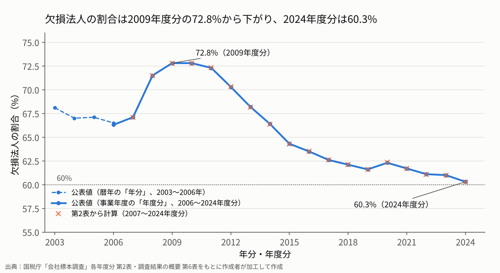
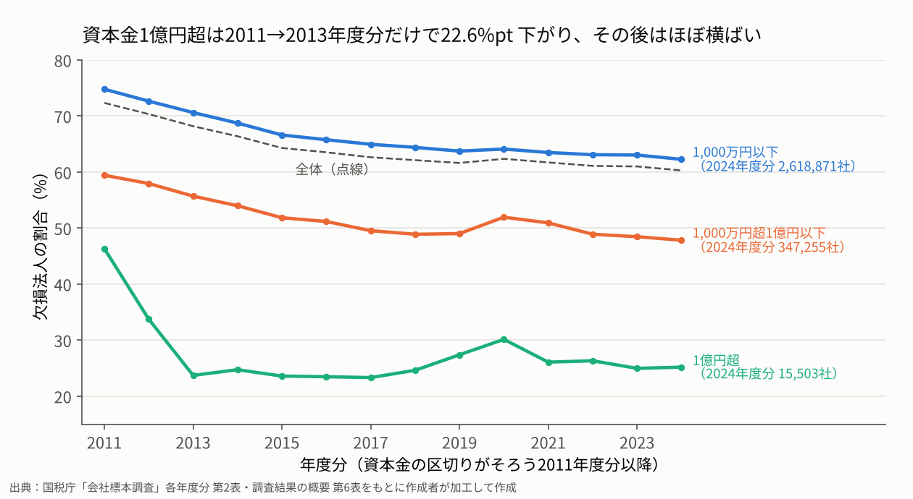
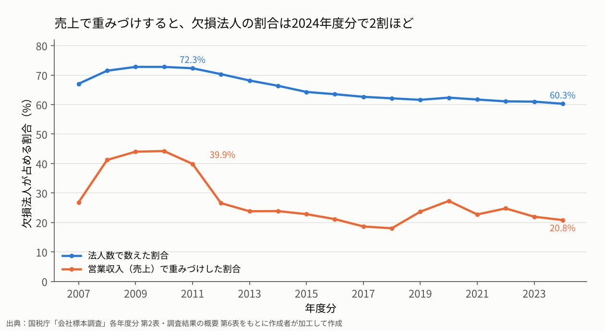
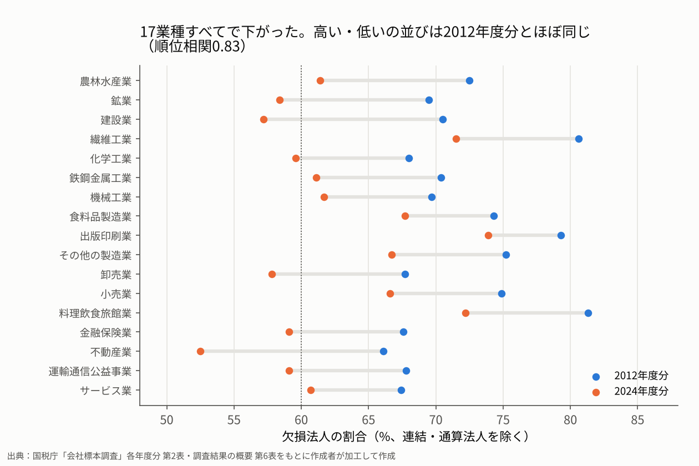

# F418 「会社の6割以上は赤字」は、法人の統計でどう見えるか？ 欠損法人は2024年度分で60.3%と、2009年度分の72.8%から12.5%pt下がった。売上で重みづけすると20.8%

## 結論（先に）
- 国税庁「会社標本調査」の欠損法人（税法上の所得が負か0の法人）の割合は、2024年度分で **60.3%**（299万9,680社のうち180万7,925社）でした。2007〜2024年度分の18年すべてで60%以上でしたが、ピークの **72.8%**（2009年度分）から **12.5%pt** 下がっています。
- 下がったのは、欠損法人が減ったからというより、利益を出す法人が増えたからです。2011→2024年度分で、利益計上法人は **+67.5%**、欠損法人は **−2.7%** でした。
- 規模で差が大きく、2024年度分は資本金1,000万円以下が **62.3%**、1,000万円超1億円以下が **47.8%**、1億円超が **25.2%** です。全法人の87.3%が1,000万円以下なので、全体の6割はほぼ小さい会社の数字です。
- 売上（営業収入）で重みづけすると、欠損法人が占める割合は2024年度分で **20.8%** です。「6割」は会社の数で数えた割合で、経済の規模の6割ではありません。
- 欠損法人には、過去の赤字（繰越欠損金）を差し引いて所得が0になった法人も入ります。その年の決算の赤字の割合とは違います。

## 問い
「日本の会社の6割以上は赤字」という言い方をよく見ます。もとは国税庁の会社標本調査で、令和6年度分の公表値は60.3%です。国税庁の別の統計（統計年報）からは、2024年度の「赤字法人率」64.1%も報じられています（東京商工リサーチ、2026年4月）。

この「6割」は何を数えた数字で、規模・業種・売上の重みで見るとどう変わるのか。取引先や業界の数字を見る人、ニュースの数字の読み方を知りたい人に向けて、統計の定義と読み方までをまとめます。税や会計の扱い（どうすれば税が減るかなど）には触れません。

## データ（出典）
- 国税庁「会社標本調査」各年度分の **第2表「資本金、営業収入、申告所得」**（Excel、2007〜2024年度分）。合計と17業種のシートに、利益計上法人・欠損法人の資本金階級別の法人数・事業年度数・営業収入金額があります。
- 同 **調査結果の概要の第6表**（PDF。2003年分〜2024年度分の推移）。公表値との照合に使いました。
- 欠損法人は「所得金額が負又は0（繰越欠損金を控除した結果0になった場合を含む）」の法人です（用語の説明）。所得金額は、決算の当期損益に税法上の加算・減算をした金額です。標本からの推計値です。

## 事前の計画
[PLAN.md](PLAN.md) に、第2表を集計する前（2026-11-18 11:35）に計画を書きました。公表の全体と業種の割合は計画の前に見ていたため（PLAN.md「取得前に見たもの」）、仮説は規模・売上の重み・景気に置きました。

| 仮説 | 外れの基準 | 結果 | 判定 |
|---|---|---|---|
| H1 1億円超の割合は、1,000万円以下より毎年20%pt 以上低い（2011〜2024年度分） | 差が20%pt 未満の年がある | 差は最小28.4%pt（2011年度分）、最大46.9%pt | 支持 |
| H2 2011→2024年度分の低下は、1,000万円以下がいちばん大きい | ほかの階級の低下が大きい | 1,000万円以下 −12.5、1,000万円超1億円以下 −11.6、1億円超 −21.2%pt | 外れ |
| H3 売上で重みづけした割合は、どの年も法人数の割合の半分未満 | 半分以上の年がある | 2008〜2011年度分は半分以上（最大0.61倍）。2012年度分以降は半分未満 | 外れ |
| H4 割合の前年度差は、営業収入の前年度比と負の相関（r < −0.5） | r ≥ −0.5 | r = −0.53（17組、p = 0.028） | 支持（境目に近い） |

## やったこと
1. 18年分の第2表から、業種・資本金階級・利益と欠損別の法人数、事業年度数、営業収入金額を取り出しました。
2. 欠損法人の割合＝欠損法人数÷全法人数。合計の行（連結・通算法人を含む）を本線にしました。
3. 規模は、区切りがそろう2011年度分以降で3つに分けました（2010年度分までは「1,000万円未満・以上」で、資本金1,000万円ちょうどの会社の入る階級が違う）。
4. 売上の重み＝欠損法人の営業収入金額÷全体の営業収入金額。景気は、営業収入の前年度比と割合の前年度差の相関で見ました。
5. 業種は2012年度分と2024年度分を比べました（2011年度分までは「その他の法人（企業組合など）」が17業種の外にあるため）。

## 分かったこと

### 1. 18年すべてで6割以上。ただしピークから12.5%pt 下がった（図1）

- 第2表から計算した割合は、公表の第6表と18年すべてで小数第1位まで一致しました。
- 2007年度分67.1%から2009・2010年度分に72.8%まで上がり、そのあとはおおむね下がりました（2020年度分は62.3%と一度上昇）。
- 法人の数は2011年度分の257万社から300万社に増え、増えた分はほぼ利益計上法人（71万社→119万社）でした。

### 2. 6割は小さい会社の数字。1億円超は2013年度分までに急に下がった（図2）

- 2024年度分の資本金1,000万円以下は62.3%（262万社）、1,000万円超1億円以下は47.8%（35万社）、1億円超は25.2%（1万5,503社）でした。
- 細かい階級では、200万円超500万円以下（114万社）が64.5%、100億円超が19.6%でした。
- 資本金1億円超は、2011→2013年度分の2年で −22.6%pt（46.3%→23.7%）下がり、そのあとは23〜30%の間でした。ほかの2つは同じ2年で −4.2・−3.7%pt で、そのあとも少しずつ下がりました（「問い直し」を参照）。

### 3. 売上で重みづけすると2割（図3）

- 欠損法人が営業収入に占める割合は、2011年度分39.9%から2024年度分20.8%に下がりました（最低は2018年度分の18.0%）。
- 法人数の割合の半分以上だったのは2008〜2011年度分だけです。欠損法人の多くは売上の小さい会社です。

### 4. 業種の差は大きいが、並びは変わらない（図4）

- 2012→2024年度分で、17業種すべてで割合が下がりました。下がり方は不動産業の −13.7%pt が最大、出版印刷業の −5.4%pt が最小です。
- 2024年度分は52.5%（不動産業）から73.9%（出版印刷業）までの幅で、順位は2012年度分とほぼ同じでした（順位相関0.83）。

### 5. 景気との関係
- 営業収入が前年度より1%増えると、割合は平均0.115%pt 下がる関係でした（r = −0.53）。2008年度分（営業収入 −9.2%）は +4.43%pt でした。
- 2012〜2019年度分は営業収入の伸びが小さい年も割合は下がり続けていて、景気だけでは低下の全部を説明できません。規模別の相関は、1,000万円以下が −0.16、1億円超が −0.48 でした。

## 問い直し（結果を見てから足した）

### (1) 低下は、業種や規模の構成が変わったからか
2012→2024年度分の低下（17業種の合計で −9.94%pt）を、業種の構成の変化と業種の中の変化に分けました（中点の重みを使うシフト・シェア分解）。構成の変化は −0.45%pt、業種の中の変化は −9.50%pt でした。業種の中の変化で大きいのは建設業（−2.13）、サービス業（−1.90）、不動産業（−1.63）です。資本金の階級で分けても、2011→2024年度分の −11.94%pt のうち構成の変化は −0.01%pt でした。低下は「欠損の少ない業種・規模の会社が増えたから」ではなく、どの業種・規模の中でも起きていました。

### (2) 資本金1億円超の急な低下は、制度の変更と時期が重なるか
2011→2013年度分の1億円超の −22.6%pt は、ほかの規模（−4.2・−3.7%pt）より大きく、そのあとは下がっていません。平成23年12月の税制改正で、資本金1億円超などの法人（中小法人等以外）は、繰越欠損金を差し引ける上限が所得の80%に縮められました（国税庁の資料）。上限は今は50%で、中小法人等は100%差し引けます（経済産業省の資料）。上限があると、過去の赤字が残る会社でも所得が0になりにくく、欠損法人に数えられにくくなります。時期は重なりますが、第2表からは確かめられません（**推測**）。正しければ、低下の一部は会社のもうけではなく、税法上の所得の数え方の変化です。

## 頑健性

| 確かめたこと | 2011年度分 | 2024年度分 | ピーク（年度分） |
|---|---|---|---|
| 本線：全体（連結・通算を含む）、法人数 | 72.3% | 60.3% | 72.8%（2009） |
| 連結・通算法人を除く | 72.3% | 60.4% | 72.8%（2009） |
| 事業年度数で数える | 72.3% | 60.3% | 72.8%（2009） |
| 売上（営業収入）で重みづけ | 39.9% | 20.8% | 44.2%（2010） |
| 公表の第6表（PDF） | 72.3% | 60.3% | 72.8%（2009） |

- 連結・通算の扱いや事業年度数での数え方では、結論は変わりませんでした（連結・通算法人だけでは2024年度分41.4%、全体の0.6%）。
- H4 は2020・2021年度分を除いても r = −0.52 でした。細かい資本金階級では、すべての階級で2011→2024年度分に下がりました。
- 2010年度分（区切りが未満・以上）も、1,000万円未満77.1%、1億円以上50.1%で、規模の差の向きは同じでした。

## 言えないこと
- 欠損法人には、繰越欠損金を差し引いて所得が0になった法人も入ります。その年の決算が赤字だった会社の割合ではありません。第2表からは、その内訳の法人数は分かりません。
- 所得は税法上の金額で、決算書の利益とは違います。役員報酬の決め方など、所得が小さくなる事情はいろいろあり、このデータでは分けられません。
- 標本調査の推計値で、誤差があります。国税庁の統計年報（法人税）では、2024年度の割合は64%台と報じられていて、統計によって数字が違います。
- 休業中の会社や設立したばかりの会社がどれだけ含まれるか、1億円超の急な低下が制度の変更によるものかは分かりません。
- 税や会計の扱いの良し悪し、どうすべきかは扱いません。地域の比較もしていません。

## 仕事で使うなら
「会社の6割は赤字」を資料で使うときは、税法上の所得で数えた会社の数の割合であること、1,000万円以下の会社が9割近いこと、売上で重みづけすると2割ほどになることを添えると誤解が減ります。業界の比較では規模をそろえた割合を使います。

## 計画からの変更
- 業種の比較の基準の年を2011年度分から2012年度分に変えました。業種の中身がそろわないことを集計の途中で見つけたためです（2011年度分基準の順位相関は0.82でほぼ同じ）。
- 問い直しを2つ足しました。

## 再現のしかた
```
sh src/run_all.sh
```
ネットにつながず、`data/raw` の Excel 18本と `data/kekka_*.txt`（PDF を文字にしたもの）から、data の中間ファイル2本・results・figures を作ります（約6秒）。取り直しは `python3 src/01_fetch.py`（ネットと `pdftotext` を使う）。Python 3.13、requirements.txt の版で確かめました。

| ファイル | 中身 |
|---|---|
| src/01_fetch.py | 国税庁のサイトから Excel・PDF を取り、PDF を文字にする（run_all では呼ばない） |
| src/02_build.py | 第2表を縦長の表に、第6表を年ごとの表に（data/） |
| src/03_analysis.py | 割合・規模・売上の重み・景気・業種・分解・頑健性（results/） |
| src/04_figures.py | 図4枚（figures/） |
| results/main.json | 本文の数字のもと |

repro_check：/tmp/rep_F418 に写し、02 以降が作るファイルを消して流し直し、results と figures のファイルが cmp で一致しました（results/repro_check.txt）。

## レビューで直したこと

| # | 指摘 | 直し方 |
|---|---|---|
| 1 | 題名の「下がり続けた」は、2020年度分の上昇（61.6%→62.3%）と合わない | 「2009年度分の72.8%から12.5%pt下がった」に改めた（status・note の1行目も同じに）。本文の「下がり続けました」も「おおむね下がりました」に |
| 2 | 図4の題が右で切れていた | 題を2行にして描き直した（src/04_figures.py） |
| 3 | 「コロナの年」と感染症の名前を例に使っていた | 年度だけの書き方に改めた（note も同じ） |

## 出典
- 国税庁「会社標本調査（税務統計から見た法人企業の実態）」：https://www.nta.go.jp/publication/statistics/kokuzeicho/kaishahyohon/toukei.htm （各年度分の第2表、令和6年度分・平成25年度分の調査結果の概要、用語の説明。個別の URL は `data/raw/SOURCES.md`）
- 国税庁 法人税の法令解釈通達に関する説明資料（2012年）：https://www.nta.go.jp/law/joho-zeikaishaku/hojin/120912/pdf/02.pdf （中小法人等以外の法人の繰越欠損金の控除限度を所得の80%にした改正）
- 経済産業省 繰越欠損金の控除上限の特例の説明資料：https://www.meti.go.jp/policy/economy/kyosoryoku_kyoka/kurikoshi.pdf （控除の上限は所得の50%、中小法人等は対象外）
- 東京商工リサーチ「TSRデータインサイト」（2026年4月23日）：https://www.tsr-net.co.jp/data/detail/1202773_1527.html （統計年報の法人税による2024年度の赤字法人率の報道。数字の比べ先としてだけ使った）

（いずれも 国税庁「会社標本調査」をもとに作成者が加工して作成）
