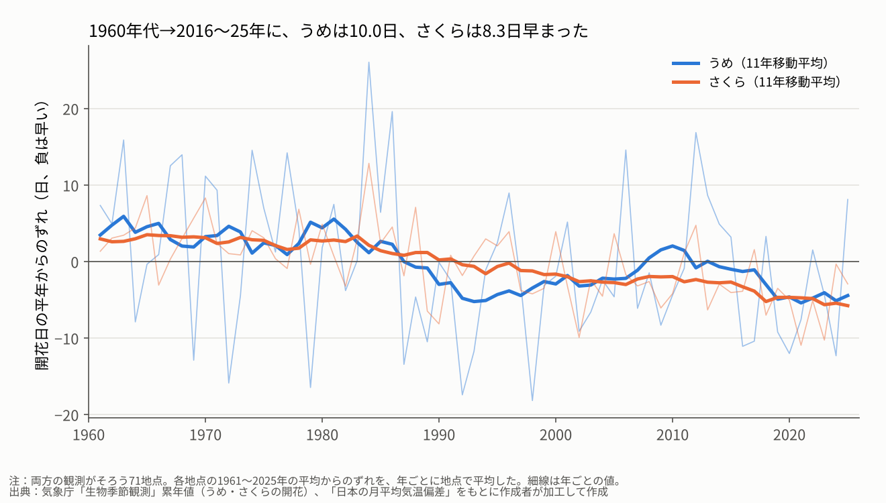
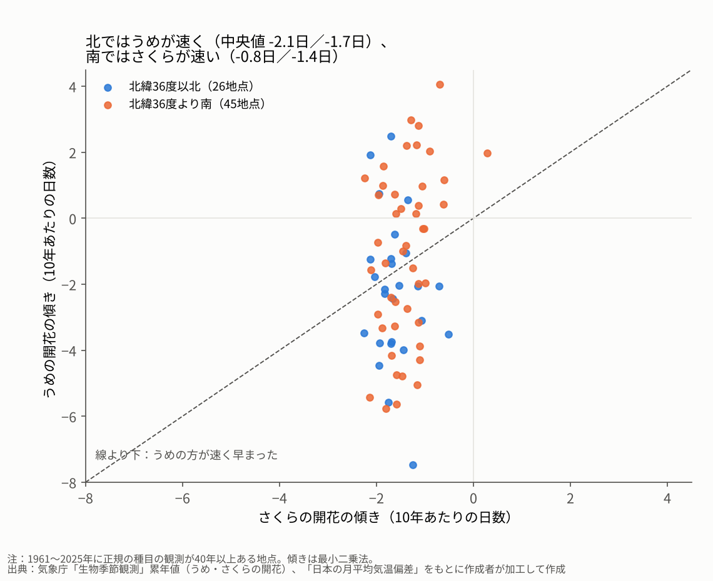
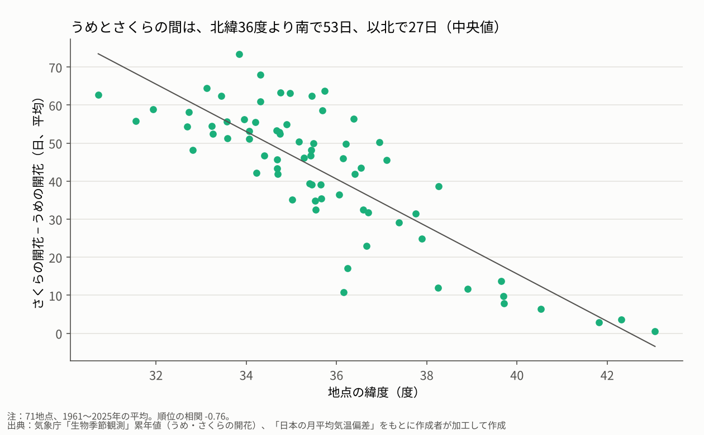
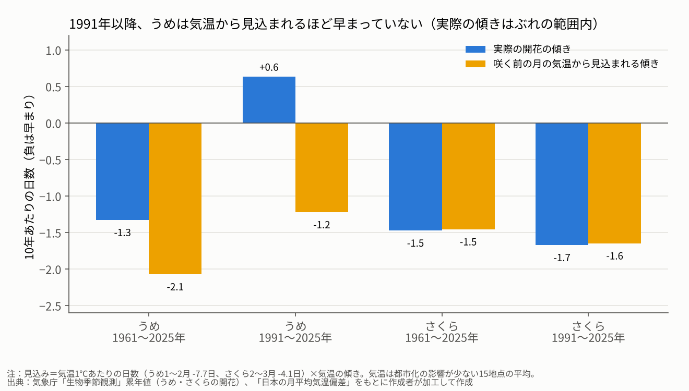

# F419 うめの開花は、さくらより速く早まっているのか？ 1961〜2025年は10年で約1.6日とほぼ同じ。ただし1991年以降は、さくらが10年で1.7日早まった一方、うめは早まりが止まった（+0.6日、ぶれの範囲内）

## 結論（先に）
- 気象庁の生物季節観測で、うめとさくらの開花がどちらも40年以上そろう71地点を比べました。1961〜2025年の早まりは、地点の傾きの中央値で、うめが10年あたり1.57日、さくらが1.58日です。速さはほぼ同じでした。
- 違うのは、地点ごとのそろい方です。さくらは74地点のうち99%で早まったのに対し、うめは72地点のうち68%でした。うめは年ごとのぶれも大きく、傾きを除いた残りの標準偏差は中央値で12.9日（さくらは4.8日）です。
- 北緯36度以北ではうめの方が速く（中央値 −2.1日／10年、さくらは −1.7日）、南ではさくらの方が速い（うめ −0.8日、さくら −1.4日）。
- 問い直し：1991〜2025年に限ると、さくらは10年で1.7日早まったのに、うめは早まりが止まりました（両方そろう地点の平均で10年あたり+0.6日、95%区間は−2.1〜+3.4日。地点の中央値では+0.9日）。「遅くなった」と言えるほどの差ではありません。1〜2月の気温は上がっているので、気温だけから見込むと、うめも早まるはずでした。この食い違いの理由は、このデータだけでは分かりません。

## 問い
「桜の開花が早くなった」はよく言われます。では、冬の終わりに咲くうめも同じように早まっているのでしょうか。梅まつり・桜まつりなど、花の時期に合わせて催しや仕入れの日取りを決める人や、季節の話題を書く人が知りたいことです。うめは1〜2月、さくらは3〜4月に咲くので、冬と春の暖まり方が違えば、二つの花の早まり方も違うはずです。

## データ（出典）
- 気象庁「生物季節観測」累年値：うめの開花、さくらの開花（地点別、1953〜2025年）。リマーク（rm）が8・9の値（正規の種目。うめ、さくらはソメイヨシノ）だけを使いました。6・7は代わりの種目です。
- 冬・春の種目を前の年の12月に観測した値は、翌年の欄に「1215」のように入ります（気象庁「表の見方」）。この値は、1月1日より前の日数（負の値）として扱いました。
- 気象庁「日本の月平均気温偏差」（都市化の影響が少ない15地点の平均）。
- 地点の緯度は、気象庁のアメダス観測所一覧（気象台など）から地点名で引きました。

## 事前の計画
[PLAN.md](PLAN.md)（2026-11-16 12:40、集計の前に作成）。下見では CSV の形と、那覇のうめに12月の値があることだけを見ました。

| 仮説 | 外れの基準 | 結果 | 判定 |
|---|---|---|---|
| H1 うめもさくらも早まった | どちらかの傾きの中央値が0以上 | うめ −1.54日、さくら −1.56日（10年あたり） | 支持 |
| H2 同じ地点で比べると、うめの方が速く早まった | うめの方が速い地点が半分以下 | 71地点のうち49%（符号検定 p=1.0） | 外れ |
| H3 うめは年ごとのぶれが大きい | ぶれの中央値がさくら以下 | 12.9日 対 4.8日（全71地点でうめの方が大きい） | 支持 |
| H4 うめとさくらの間隔は南ほど長い | 緯度との相関が0以上 | 順位の相関 −0.76 | 支持 |

## やったこと
1. うめとさくらの累年値を、地点×年×種目の表にしました（02_build.py）。
2. 1961〜2025年に正規の種目の値が40年以上ある地点（うめ72、さくら74、両方71）で、開花日（1月1日からの日数）を年に回帰し、10年あたりの傾きを出しました。年ごとのぶれ、うめとさくらの間隔、緯度との関係も見ました（03_analysis.py）。
3. 結果を見てから、咲く前の月の気温との関係を足しました（03b_requestion.py）。

## 分かったこと

### 1. 長い目で見ると、うめもさくらも約10日早まった（図1）

両方そろう71地点で、各地点の平均からのずれを年ごとに平均しました。1961〜70年と2016〜25年を比べると、うめは10.0日、さくらは8.3日早まっています。さくらの線はなめらかに下がるのに対し、うめの線は上下に大きくぶれ、1990年代前半にいったん早まったあと、2000年代後半から2010年代前半にかけて戻っています。

### 2. 北ではうめ、南ではさくらが速く早まった（図2）

さくらの傾きは −2.3〜+0.3日の狭い範囲に集まり、ほとんどの地点で早まりました。うめの傾きは −7.5〜+4.1日と広く、早まっていない地点も3割あります。北緯36度以北の26地点ではうめの中央値が −2.1日（さくら −1.7日）、南の45地点では −0.8日（さくら −1.4日）でした。

### 3. うめとさくらの間は、南ほど長い（図3）

平均の間隔は全体の中央値で46.7日です。北緯36度より南では53日、以北では27日で、北海道ではほぼ同じ時期に咲きます。

## 問い直し（結果を見てから足した）

### うめの早まりが1990年代から止まったのは、気温のせいか（図4）

図1でうめの線が1990年代から下がらなくなったので、咲く前の月の気温と比べました。年ごとの開花のずれを気温の偏差に回帰すると、うめは1〜2月が1℃高いと7.7日早く（相関 −0.77）、さくらは2〜3月が1℃高いと4.1日早く咲きます（相関 −0.88）。

| | 気温の傾き（℃／10年） | 気温から見込む開花の傾き | 実際の開花の傾き |
|---|---|---|---|
| うめ 1961〜2025年 | +0.27（1〜2月） | −2.1日 | −1.3日 |
| うめ 1991〜2025年 | +0.16（1〜2月） | −1.2日 | +0.6日 |
| さくら 1961〜2025年 | +0.36（2〜3月） | −1.5日 | −1.5日 |
| さくら 1991〜2025年 | +0.40（2〜3月） | −1.6日 | −1.7日 |

さくらは、気温から見込む傾きと実際の傾きがほぼ一致します。うめは1991年以降、気温から見込むと10年で1.2日早まるはずなのに、実際は+0.6日でした（95%区間 −2.1〜+3.4日で、遅くなったとまでは言えません。始まりを1995年にすると −0.7日、1986年にすると +0.2日）。気温から見込む −1.2日もこの区間に入るので、見込みとの食い違いも、はっきりしたものとは言えません。1〜2月の気温の上がり方が2〜3月より小さいことは、さくらとの差の一部しか説明しません。（推測）落葉する木は、冬に一定の寒さにあたらないと眠りから覚めにくいと言われます。冬が暖かいと、それが遅れの側に働いているのかもしれません。このデータでは確かめていません。

## 頑健性

| 確かめ方 | 両方そろう地点 | うめの傾き（中央値） | さくらの傾き（中央値） | 差の中央値（うめ−さくら） | うめの方が速い地点の割合 |
|---|---|---|---|---|---|
| 本線 1961〜2025年、最小二乗 | 71 | −1.57 | −1.58 | +0.27 | 49% |
| 1971〜2025年 | 49 | −1.40 | −1.75 | +0.53 | 45% |
| 1991〜2025年（30年以上） | 47 | +0.87 | −1.69 | +1.93 | 23% |
| （レビューで追加）両方そろう地点の平均の系列、始まりを1986／1991／1995年に | — | +0.2／+0.6／−0.7（95%区間の半幅 2.4〜3.3） | −1.4／−1.7／−1.5（同 1.1〜1.5） | — | — |
| Theil-Sen の傾き | 71 | −1.59 | −1.52 | −0.05 | 52% |
| 代わりの種目も含める | 73 | −1.57 | −1.58 | +0.08 | 48% |
| 地点の固定効果つき回帰 | 71 | −1.51 | −1.55 | +0.04 | — |

単位は10年あたりの日数。長い期間ではどの方法でも「ほぼ同じ速さ」で、うめが速いとは言えません。期間を最近にするほど、さくらの方が速くなります。

## 言えないこと
- 早まりの原因（地球全体の温暖化、都市化、観測する木の植え替え）は、この表だけでは分けられません。
- 標本木の植え替えや観測場所の移転の影響は除いていません。うめのぶれが大きい理由の一部は、これかもしれません（推測）。
- 1991年以降にうめの早まりが止まった理由は分かりません。うめは年ごとのぶれが大きく、30年あまりの傾きは始まりの年で符号が変わります。冬の寒さの不足という説明は推測です。
- 2021年に生物季節観測の種目と地点が減ったため、最近の年は観測が続く地点だけの値です。
- 花の時期の予想や、催しの日取りについての助言はしません。

## 仕事で使うなら
- 「桜が早まった」と同じ速さで梅も早まっていると考えると、南の地点や最近の年では外れやすいです。うめは年ごとのぶれが大きく（標準偏差で約2週間）、過去の平均からの読みの幅が広いことを前提にすると読み違えにくいです。
- 地点ごとの傾きは results/station_trends.csv にあります。

## 計画からの変更
- 計画では1961〜2026年としていましたが、累年値の表は2025年までだったので、1961〜2025年にしました。
- 地点の緯度は計画どおりアメダス観測所一覧から引けたので、地方別でなく緯度で比べました。北と南の区切り（北緯36度）は結果を見る前に決めた値ではなく、関東の北の端あたりで分けたものです。
- 問い直し（気温との関係）は結果を見てから足しました。

## 再現のしかた
```
sh src/run_all.sh        # オフライン。所要約4秒
python3 src/01_fetch.py  # 元データを取り直すときだけ（ネットを使う）
```

| ファイル | 中身 |
|---|---|
| src/02_build.py | 累年値 CSV と観測所一覧から data/bloom_long.csv・data/stations.csv を作る |
| src/03_analysis.py | 地点の傾き・ぶれ・間隔・仮説・頑健性 → results/main.json・station_trends.csv・robustness.csv・yearly_mean.csv |
| src/03b_requestion.py | 問い直し（気温との関係） → results/requestion.json・temp_months.csv |
| src/04_figures.py | 図4枚 |

repro_check：/tmp/rep_F419 に写して流し、12ファイル（results 6、figures 4、data の CSV 2）がすべて cmp で一致（results/repro_check.txt）。乱数は使っていません。

## レビューで直したこと

独立レビュー（2026-11-17）で次を直しました。直したあと /tmp で流し直し、results・figures・data の CSV が一致することを確かめています。

| # | 指摘 | 直し方 |
|---|---|---|
| 1 | 題名・結論の「1991年以降、うめは0.9日遅くなった」は、傾きの95%区間（−2.1〜+3.4日／10年）が0をまたぎ、始まりの年を1995年にすると符号が変わるので言い過ぎ | 03b に始まりの年を変えた傾きと95%区間の計算を足し（results/requestion.json）、題名・結論・問い直し・note を「早まりが止まった（+0.6日、ぶれの範囲内）」に弱め、頑健性の表に1行足した。status の title もそろえた |
| 2 | 図4の題「気温から見込まれる早まりと逆に遅くなった」も同じ言い過ぎ | 図4の題を「気温から見込まれるほど早まっていない（実際の傾きはぶれの範囲内）」に直し、note の見出しもそろえた |

## 出典
- 気象庁「生物季節観測」累年値（うめの開花・さくらの開花）：https://www.data.jma.go.jp/sakura/data/index.html
- 気象庁「生物季節観測 表の見方」：https://www.data.jma.go.jp/sakura/data/pdf/mikata.pdf
- 気象庁「日本の月平均気温偏差」：https://www.data.jma.go.jp/cpdinfo/temp/list/csv/mon_jpn.csv
- 気象庁 アメダス観測所一覧：https://www.jma.go.jp/jma/kishou/know/amedas/ame_master.zip

（いずれも 気象庁「生物季節観測」「日本の月平均気温偏差」「アメダス観測所一覧」をもとに作成者が加工して作成）
