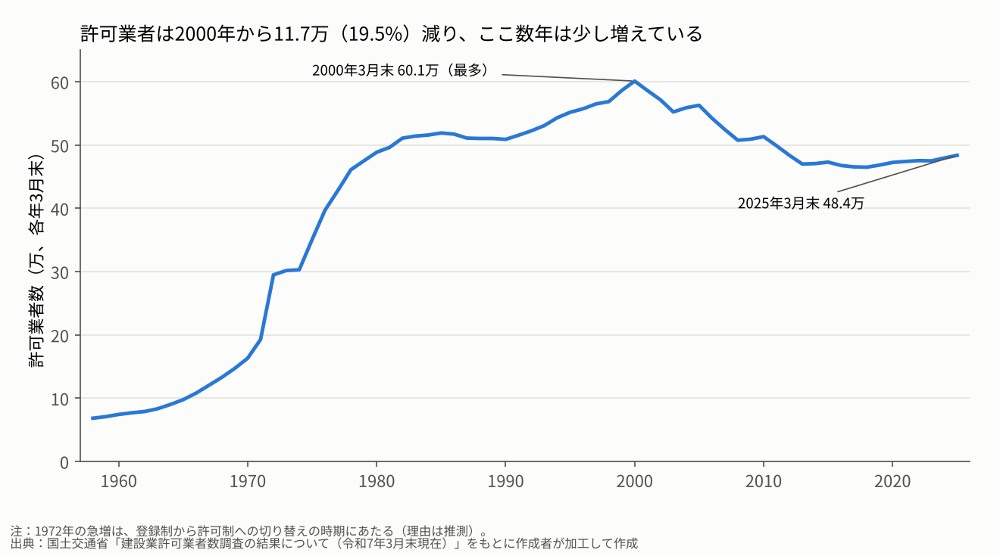
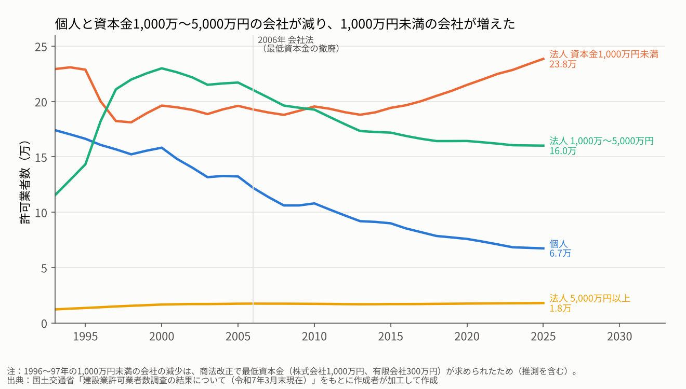
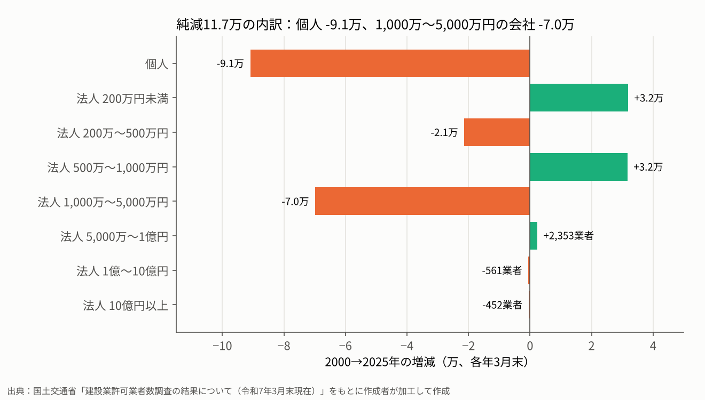
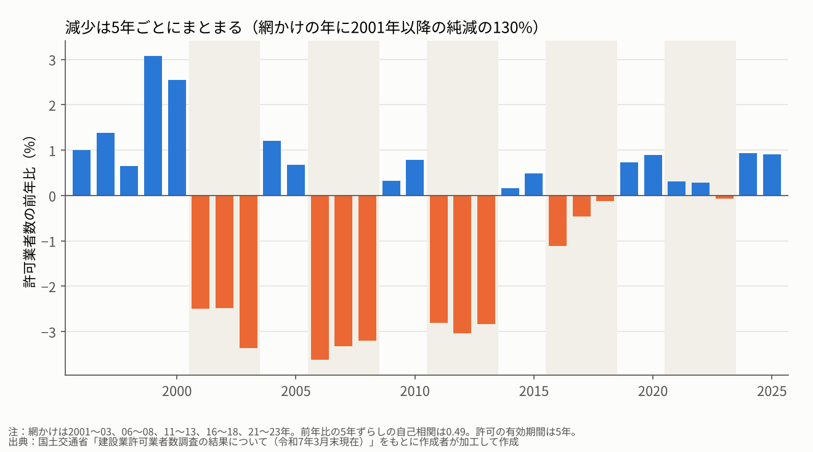

# F420 建設業の許可業者は、どの規模でどれだけ減ったのか？ 2000→2025年の11.7万減は、個人の9.1万減と資本金1,000万〜5,000万円の会社の7.0万減。減少は5年おきの波に集まる

## 結論（先に）
- 建設業の許可業者は、2000年3月末の60.1万（最多）から2025年3月末の48.4万へ、11.7万（19.5%）減りました。
- 減ったのは主に二つの階層です。個人の事業者が9.1万減（−57.5%）、資本金1,000万〜5,000万円の会社が7.0万減（−30.4%）。二つを足すと16.1万で、純減より大きい分は、資本金1,000万円未満の会社の増加（＋4.2万）で埋まっています。資本金5,000万円以上の会社はほとんど変わりません（＋0.1万）。
- 減り方は毎年なだらかではありません。前年比の減少は2001〜03、06〜08、11〜13、16〜18年と5年おきにまとまり、前年比の「5年ずらし」の自己相関は0.49でした。許可の有効期間（5年）の周期と重なります。
- 問い直し：その「波の年」15年分に、個人の減少（2001〜25年）の97%、資本金1,000万〜5,000万円の会社の減少の95%が集まっていました。
- 業者は減っても、業種別の許可の合計は139.2万から176.6万へ増え、1業者あたりの許可の業種数は2.32から3.65に増えました。

## 問い
「建設業者はピークから2割減った」とよく言われます。では、減ったのは個人の事業者なのか、中くらいの会社なのか、大きな会社なのか。減り方は毎年なだらかなのか、ある年にまとまって起きるのか。建設の仕事を発注する人、協力会社を探す人、地域の建設業の話題を書く人のために、国土交通省の許可業者数調査の長い表で確かめます。

## データ（出典）
- 国土交通省「建設業許可業者数調査の結果について（令和7年3月末現在）」（2025年5月公表、PDF）の表－１（総数、1958〜2025年）、表－３（業種別、2000年と2011〜2025年）、表－５（資本金階層別、1993〜2025年）。
- 許可業者数は、建設業法の許可を受けた業者の数です（各年3月末）。許可のいらない小さな工事だけをする事業者は入りません。
- PDF の表は src/01b_extract.py で CSV に抜き出し、階層の合計＝総数、表－１と表－５の総数の一致、29業種の和＝合計を確かめてから使いました。

## 事前の計画
[PLAN.md](PLAN.md)（2026-11-16 13:05、集計の前に作成）。表が文字として取り出せるかを確かめるために表の行を見ていたので、階層ごとの水準は分析の前に見ています。H1・H2 は確認の性格が強く、H3・H4 は計算していない段階で立てました。

| 仮説 | 外れの基準 | 結果 | 判定 |
|---|---|---|---|
| H1 純減は個人と資本金1,000万〜5,000万円の会社でほぼ全部（90%以上）説明できる | 90%未満 | 二つで純減の137% | 支持 |
| H2 会社法（2006年）の後の資本金200万円未満の会社の増加は、個人の減少の半分に届かない | 半分以上 | ＋3.16万 対 −5.46万（58%） | 外れ |
| H3 減少は5年ごとにまとまる（5年ずらしの自己相関0.3以上） | 0.3未満 | 0.49（ラグ1〜7で最大） | 支持 |
| H4 1業者あたりの業種数が1以上増えた | 増加が1未満 | 2.32→3.65（＋1.33） | 支持 |

## やったこと
1. PDF から3つの表を抜き出し、検算しました（01b_extract.py、run_all.sh の外）。
2. 年×階層の表と、総数の前年比、1業者あたりの業種数を作りました（02_build.py）。
3. 2000→2025年の階層ごとの増減と、純減に対する寄与、前年比の自己相関（1996〜2025年）を出しました（03_analysis.py）。
4. 結果を見てから、5年ごとの「波の年」とそれ以外の年で、階層ごとの増減を分けました（03b_requestion.py）。

## 分かったこと

### 1. 2000年をピークに2割減り、ここ数年は少し増えている（図1）

許可業者は1990年代に増え続け、2000年3月末の60.1万が最多でした。2025年3月末は48.4万です。2019年以降は前年比で小さく増える年が多くなっています。

### 2. 減ったのは個人と、資本金1,000万〜5,000万円の会社（図2・図3）


2000→2025年の増減は、個人 −9.1万、資本金200万〜500万円の会社 −2.1万、1,000万〜5,000万円の会社 −7.0万です。増えたのは、200万円未満の会社（＋3.2万）と500万〜1,000万円の会社（＋3.2万）、5,000万〜1億円の会社（＋2,353）です。個人の割合は26.3%から13.9%に下がりました。資本金200万円未満の会社は2006年の1,047から2025年の32,618へ増え、最低資本金がなくなった後に小さな資本金で始める会社が増えたことと合います（理由は推測）。

### 3. 減少は5年ごとにまとまる（図4）

前年比が −1%を下回った年は、2001・02・03・06・07・08・11・12・13・16年でした。前年比の自己相関は、ラグ5が0.49でラグ1〜7の中で最大です。許可の有効期間は5年なので、（推測）2000年前後にまとめて許可を取った業者が、5年ごとの更新の時期に更新しないで抜けている形に見えます。

## 問い直し（結果を見てから足した）

### 「波の年」に、どの階層が減っているのか
2001〜2025年を、波の年（2001〜03、06〜08、11〜13、16〜18、21〜23年の15年）とそれ以外（10年）に分けました。

| 階層 | 波の年の増減 | それ以外の年の増減 |
|---|---|---|
| 総数 | −152,756 | ＋35,476 |
| 個人 | −87,880 | −3,070 |
| 法人 1,000万〜5,000万円 | −66,519 | −3,324 |
| 法人 200万〜500万円 | −29,388 | ＋8,005 |
| 法人 200万円未満 | ＋18,291 | ＋13,602 |

個人と資本金1,000万〜5,000万円の会社の減少は、ほとんどが波の年に起きています。波以外の年は、総数がむしろ増えています。小さな資本金の会社は、波の年にもそれ以外の年にも増え続けています。2021〜23年の波は小さく、前年比はほぼ0でした。

## 頑健性

| 確かめ方 | 純減 | 個人 | 法人 1,000万円未満 | 法人 1,000万〜5,000万円 | 法人 5,000万円以上 |
|---|---|---|---|---|---|
| 起点 1993年 | −46,965 | −106,827 | ＋9,206 | ＋44,918 | ＋5,738 |
| 起点 2000年（本線） | −117,280 | −90,950 | ＋42,173 | −69,843 | ＋1,340 |
| 起点 2005年 | −78,961 | −64,970 | ＋42,407 | −56,973 | ＋575 |
| 起点 2010年 | −29,496 | −40,643 | ＋42,982 | −32,545 | ＋710 |

| 自己相関の期間 | ラグ1 | ラグ5 | 最大のラグ |
|---|---|---|---|
| 1996〜2025年（本線） | 0.44 | 0.49 | 5 |
| 2001〜2025年 | 0.41 | 0.65 | 5 |
| 1996〜2019年 | 0.40 | 0.44 | 5 |

- 個人の減少は、どの起点でも純減の中心です。資本金1,000万〜5,000万円の会社は、1993年起点では増えています（1996〜97年に最低資本金を満たすための増資が集まったため。推測）。2000年以降の起点では一貫して減っています。
- 1,000万円未満の会社を一つにまとめても、2005年以降の起点では＋4.2万前後でほぼ同じです。
- 5年の周期は、期間を変えても最大のラグが5のままでした。
- 解体工事業（2016年に新設）を除いても、1業者あたりの業種数は2025年に3.51で、2000年より1.19増えています。

## 言えないこと
- 許可業者数は「許可を持つ業者」の数で、実際に工事をしている会社の数や、働く人の数ではありません。
- 減った理由（廃業、合併、許可を取らなくなった）は、この表では分けられません。新規許可と廃業の年ごとの数は、PDF では図の中にしかないため使っていません。
- 個人から会社への切り替え（法人成り）は階層の間の移動として表に出ますが、その数は分かりません。
- 5年の周期が更新の時期によるという説明は推測です。業者ごとの許可の時期のデータでは確かめていません。
- 地域ごとの減り方は扱っていません（順位は出しません）。

## 仕事で使うなら
- 「業者が2割減った」という数字を読むときは、減ったのが主に個人と中くらいの会社で、資本金5,000万円以上の会社はほとんど変わっていないことを合わせて読むと誤解が少ないです。
- 年ごとの増減は5年ごとの波を含むので、1年だけの前年比で傾向を読むと振れやすいです。5年の合計で見ると波がならされます。
- 階層ごとの値は data/capital_long.csv、寄与は results/contrib.csv にあります。

## 計画からの変更
- 計画どおりに進めました。問い直し（波の年の階層別の増減）は結果を見てから足しました。
- 図2では、見やすさのために8階層を4つのまとまりにしました（計算は8階層のまま）。

## 再現のしかた
```
sh src/run_all.sh          # オフライン。所要約3秒
python3 src/01_fetch.py    # 元の PDF を取り直すときだけ（ネットを使う）
python3 src/01b_extract.py # PDF から表を抜き出し直すときだけ（pdftotext を使う）
```

| ファイル | 中身 |
|---|---|
| src/01b_extract.py | PDF の表－１・３・５を data/raw の CSV に抜き出し、検算する（run_all.sh の外） |
| src/02_build.py | data/capital_long.csv・total.csv・types_per_firm.csv を作る |
| src/03_analysis.py | 寄与・自己相関・仮説・頑健性 → results/main.json・contrib.csv・acf.csv・robustness.csv |
| src/03b_requestion.py | 問い直し → results/requestion.json・wave_by_class.csv |
| src/04_figures.py | 図4枚 |

repro_check：/tmp/rep_F420 に写して流し、results・figures・data の CSV がすべて cmp で一致（件数と所要時間は results/repro_check.txt）。乱数は使っていません。

## レビューで直したこと

独立レビュー（2026-11-17）で次を直しました。直したあと /tmp で流し直し、results・figures・data の CSV が一致することを確かめています。

| # | 指摘 | 直し方 |
|---|---|---|
| 1 | 結論と note の「二つを足すと14.1万」は計算の誤り（9.1万＋7.0万＝16.1万） | README・note とも16.1万に直した |

## 出典
- 国土交通省「建設業許可業者数調査の結果について－建設業許可業者の現況（令和7年3月末現在）－」：https://www.mlit.go.jp/report/press/content/001889275.pdf
- 報道発表のページ：https://www.mlit.go.jp/report/press/tochi_fudousan_kensetsugyo13_hh_000001_00296.html

（いずれも 国土交通省「建設業許可業者数調査」をもとに作成者が加工して作成）
