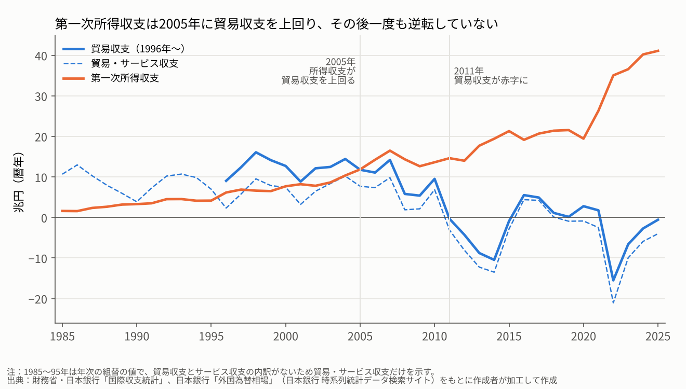
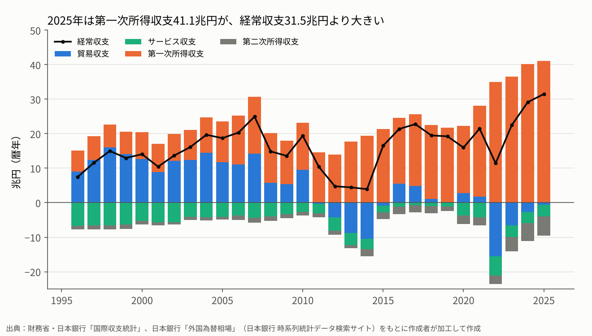
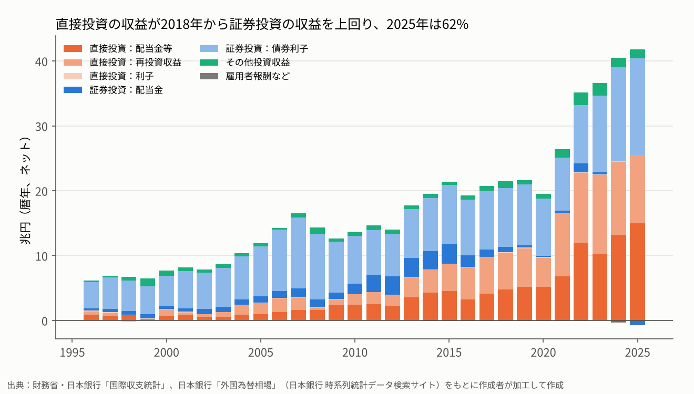
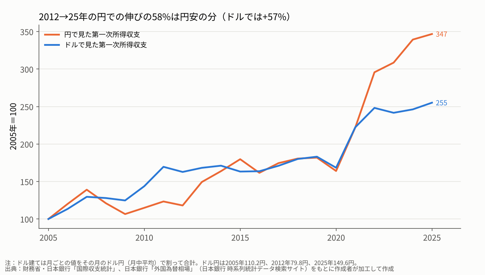

# F421 「貿易で稼ぐ国から投資で稼ぐ国へ」は、国際収支でいつ起きたのか？ 2005年に第一次所得収支が貿易収支を上回り、以後20年一度も逆転なし。2025年は41.1兆円で経常黒字31.5兆円より大きい

## 結論（先に）
- 第一次所得収支（海外への投資が生む利子・配当など）が貿易収支を初めて上回ったのは2005年でした（11.85兆円 対 11.77兆円）。月次の後ろ12か月の合計でも、最初は2005年12月です。
- それから2025年まで、貿易収支が第一次所得収支を上回った年は一度もありません。貿易収支は2011年に初めて赤字になりました。
- 2025年は、第一次所得収支41.1兆円が経常収支の黒字31.5兆円より大きく（130%）、貿易 −0.6兆円・サービス −3.4兆円・第二次所得 −5.6兆円の赤字を埋めています。
- 中身は証券投資から直接投資へ移りました。直接投資収益は2018年に証券投資収益を上回り、2025年は第一次所得収支の62%です。
- 問い直し：2012→2025年の円での伸び（＋194%）のうち58%はドル円の変化の分で、ドルで見た伸びは＋57%でした。

## 問い
「日本は貿易で稼ぐ国から、投資で稼ぐ国に変わった」と言われます。通商白書2025も、経常収支の黒字が第一次所得収支の増加で大きくなったことを取り上げています。では、その入れ替わりはいつ起きたのか。一度入れ替わったあと、戻ったことはあるのか。投資の収益の中身は何か。経済の解説を読む人、貿易や海外事業にかかわる人のために、国際収支統計で確かめます。

## データ（出典）
- 財務省・日本銀行「国際収支統計」（BPM6 基準）。日本銀行 時系列統計データ検索サイトの API で取得しました。
  - 月次 1996年1月〜2026年9月：経常収支、貿易収支、サービス収支、第一次所得収支（内訳つき）、第二次所得収支
  - 年次 1985〜2013年：（6版組替）主要項目。1985〜95年は貿易収支とサービス収支の内訳がなく、貿易・サービス収支だけがあります
- 日本銀行「外国為替相場」ドル円（東京市場17時、月中平均）
- 1996〜2025年は月次の合計で暦年の値を作りました。重なる1996〜2013年で、年次の組替の値と月次の合計は一致しました（差の最大 0.0億円）。

## 事前の計画
[PLAN.md](PLAN.md)（2026-11-16 13:35、値を集計する前に作成）。下見では系列の名前と期間だけを見ました。

| 仮説 | 外れの基準 | 結果 | 判定 |
|---|---|---|---|
| H1 所得収支が貿易収支を初めて上回ったのは2003〜07年 | その範囲の外 | 2005年 | 支持 |
| H2 その後、逆転した年はない | 1年でもある | なし | 支持 |
| H3 2025年の所得収支は経常収支より大きい | 経常収支以下 | 41.1兆円 対 31.5兆円 | 支持 |
| H4 2025年は直接投資収益が証券投資収益より大きい | 証券投資の方が大きい | 25.5兆円 対 14.2兆円 | 支持 |

## やったこと
1. 月次と年次の JSON から、月次の表と暦年の表（1985〜2025年、円とドル建て）を作りました（02_build.py）。
2. 所得収支が貿易収支を上回った最初の年と月、その後の逆転、2025年の構成、所得収支の内訳を出しました（03_analysis.py）。
3. 結果を見てから、円安の分と、2005→2025年の増加の内訳を足しました（03b_requestion.py）。

## 分かったこと

### 1. 2005年に入れ替わり、以後逆転はない（図1）

貿易収支の黒字は1998年の16.1兆円が最大で、2005年に所得収支（11.85兆円）が貿易収支（11.77兆円）をわずかに上回りました。2011年に貿易収支が赤字になってからは差が大きく開きました。

### 2. 2025年は所得収支が経常収支より大きい（図2）

2025年の経常収支31.5兆円は過去最大で、その中身は第一次所得収支41.1兆円と、貿易・サービス・第二次所得の赤字の合計 −9.6兆円です。第一次所得収支は2005年の3.5倍になりました。

### 3. 中身は証券投資から直接投資へ（図3）

1996年は証券投資収益4.4兆円、直接投資収益1.5兆円で、債券の利子が中心でした。直接投資収益は2018年に証券投資収益を上回り、2025年は25.5兆円（配当金等15.0兆円、再投資収益10.5兆円）です。再投資収益は、海外の子会社が稼いだ利益のうち配当せずに現地に残した分で、国内には戻っていません。

## 問い直し（結果を見てから足した）

### 増え方のうち、どれだけが円安の分か（図4）


| 期間 | 円での伸び | ドルでの伸び | 円での伸び（対数）のうち円安の分 |
|---|---|---|---|
| 2005→2025年 | ＋247% | ＋155% | 25% |
| 2012→2025年 | ＋194% | ＋57% | 58% |

2005→2025年の増加29.2兆円の内訳は、直接投資の配当金等 48%、再投資収益 30%、証券投資の債券利子 25%、証券投資の配当金 −6%、その他投資収益 3%です。増加の8割近くは直接投資収益でした。

## 頑健性

| 確かめ方 | 所得収支が初めて上回った時期 | その後の逆転 |
|---|---|---|
| 暦年・貿易収支（本線） | 2005年 | なし |
| 月次・後ろ12か月の合計 | 2005年12月 | なし（0か月） |
| 貿易・サービス収支と比べる | 1996年 | 1998・99年。2000年からは逆転なし |
| ドル建て | 2005年 | なし |
| 1996〜2013年の年次（組替）と月次の合計の差 | 最大 0.0億円 | — |

貿易収支と比べる限り、時期は2005年で変わりません。サービス収支（赤字）を含めると時期は早まり、2000年から入れ替わりが続いています。

## 言えないこと
- 第一次所得収支の黒字のうち、どれだけが実際に日本に戻ってきているかは、この記事では深く扱っていません（再投資収益は海外に残る）。
- 投資の収益が日本の家計や賃金にどう回るかは、国際収支だけでは分かりません。
- 1985〜95年は貿易収支の内訳がなく、貿易・サービス収支だけで比べています。基準の違う1985年より前とは比べていません。
- 所得収支が今後も大きいままかどうかは分かりません。円の水準しだいで円での大きさは大きく変わります。為替や投資の助言はしません。

## 仕事で使うなら
- 「経常収支は過去最大」という見出しは、中身が貿易ではなく第一次所得収支であること、そのうち再投資収益（2025年10.5兆円）は国内に戻らないことを合わせて読むと誤解が少ないです。
- 円で見た所得収支の伸びには円安の分が大きく入ります。比べるときはドル建て（results には annual.csv の _usd 列）でも見ると読み違えにくいです。

## 計画からの変更
- 計画どおりに進めました。問い直し（円安の分と増加の内訳）は結果を見てから足しました。

## 再現のしかた
```
sh src/run_all.sh        # オフライン。所要約3秒
python3 src/01_fetch.py  # 元データを取り直すときだけ（ネットを使う）
```

| ファイル | 中身 |
|---|---|
| src/02_build.py | JSON から data/monthly.csv・annual.csv・overlap_check.csv を作る |
| src/03_analysis.py | 入れ替わりの時期・構成・内訳・仮説・頑健性 → results/main.json・annual_table.csv・primary_breakdown.csv・robustness.csv |
| src/03b_requestion.py | 問い直し → results/requestion.json・growth_contrib.csv |
| src/04_figures.py | 図4枚 |

repro_check：/tmp/rep_F421 に写して流し、results・figures・data の CSV がすべて cmp で一致（件数と所要時間は results/repro_check.txt）。乱数は使っていません。

## レビューで直したこと

独立レビューで数字の照合・再実行・図を確かめ、直すところはなかった。

## 出典
- 財務省・日本銀行「国際収支統計」：日本銀行 時系列統計データ検索サイト https://www.stat-search.boj.or.jp/ （系列コードは src/01_fetch.py）
- 日本銀行「外国為替相場」ドル円（FXERM07）：同上
- 経済産業省「通商白書2025」第II部第3章第1節 国際収支構造：https://www.meti.go.jp/report/tsuhaku2025/pdf/2-3-1.pdf （問いの背景として参照）

（いずれも 財務省・日本銀行「国際収支統計」、日本銀行「外国為替相場」をもとに作成者が加工して作成）
