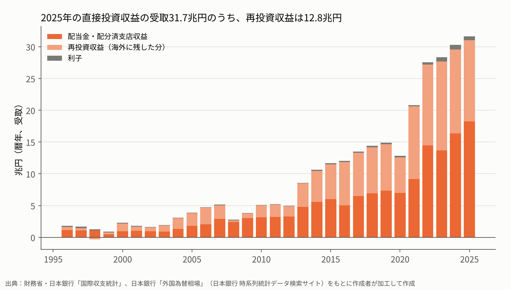
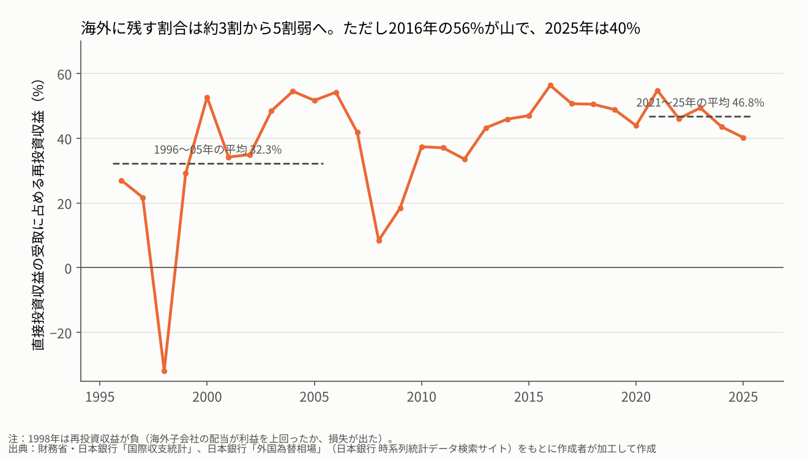
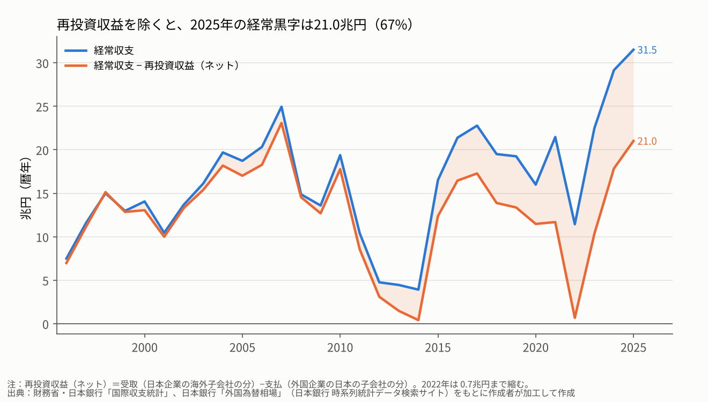
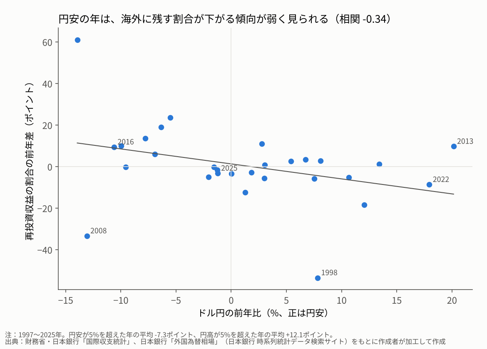

# F422 第一次所得収支の黒字は、どれだけ日本に戻ってきているのか？ 直接投資の収益のうち海外に残す再投資収益は約3割から5割弱に。除くと2025年の経常黒字は31.5兆円から21.0兆円（67%）に

## 結論（先に）
- 直接投資収益の受取に占める「再投資収益」（海外子会社が配当せずに現地に残した利益）の割合は、1996〜2005年の平均32.3%から2021〜25年の平均46.8%に上がりました。ただし山は2016年の56.4%で、2025年は40.3%です。
- 2025年の直接投資収益の受取31.7兆円のうち、配当金等が18.3兆円、再投資収益が12.8兆円でした。
- 経常収支から再投資収益（ネット10.5兆円）を除くと、2025年の黒字は31.5兆円から21.0兆円（67%）になります。2022年は11.4兆円が0.7兆円まで縮みます。
- 問い直し：再投資収益を除いた第一次所得収支が貿易収支を上回り続けるのは2006年からで、帳簿の上の値（2005年）より1年遅くなります。円安の年は、海外に残す割合が下がる傾向が弱く見られます（ドル円の前年比との相関 −0.34。29年分の相関で、はっきりした関係とまでは言えません）。

## 問い
日本の経常黒字の中心は第一次所得収支です。そのうち再投資収益は、国際収支では「受け取って、同じ額を海外に投資し直した」と記録されるだけで、お金としては日本に入っていません。通商白書2025も、第一次所得収支の増加の主因を直接投資収益としています。「経常収支は過去最大」という見出しを読む人のために、この戻らない分がどれだけあり、どう変わってきたかを確かめます。

## データ（出典）
- 財務省・日本銀行「国際収支統計」月次（1996年1月〜2026年9月、BPM6 基準）。日本銀行 時系列統計データ検索サイトの API で取得しました。直接投資収益の受取・支払の内訳（配当金・配分済支店収益、再投資収益、利子所得）、経常収支、貿易収支、第一次所得収支、金融収支の直接投資のうち収益の再投資（資産）。
- 日本銀行「外国為替相場」ドル円（月中平均）。
- 暦年は月次の合計。金融収支の「収益の再投資（資産）」は、第一次所得の再投資収益の受取と全年で一致しました（差の最大 0.0兆円）。

## 事前の計画
[PLAN.md](PLAN.md)（2026-11-16 14:00、値を集計する前に作成）。F421 の作業で2025年のネットの値（配当金等15.0兆円、再投資収益10.5兆円）は知っていました。

| 仮説 | 外れの基準 | 結果 | 判定 |
|---|---|---|---|
| H1 再投資の割合（受取）は2021〜25年平均が1996〜2005年平均より10ポイント以上高い | 差が10ポイント未満 | 32.3%→46.8%（＋14.5） | 支持 |
| H2 2009年度の制度変更のあと配当金の割合が上がった | 2010〜14年平均が2004〜08年平均以下 | 55.1%→59.4% | 支持（弱い。下の頑健性も参照） |
| H3 再投資を除いた第一次所得収支は2005年以降毎年、貿易収支より大きい | 1年でも貿易収支以下 | 2005年だけ下回る（10.1兆円 対 11.8兆円） | 外れ |
| H4 再投資を除いた2025年の経常収支は75%未満 | 75%以上 | 67% | 支持 |

## やったこと
1. 月次の JSON から月次の表と暦年の表を作りました（02_build.py）。
2. 直接投資収益の受取の内訳と割合、再投資収益を除いた第一次所得収支・経常収支を年ごとに出しました（03_analysis.py）。
3. 結果を見てから、再投資収益を除いたときの「入れ替わりの年」と、ドル円の動きとの関係を足しました（03b_requestion.py）。

## 分かったこと

### 1. 受取31.7兆円のうち12.8兆円は海外に残した分（図1）

再投資収益の受取は1996年0.5兆円、2005年2.0兆円、2025年12.8兆円です。第一次所得収支の受取全体に対しては、2025年に18.8%にあたります。

### 2. 海外に残す割合は約3割から5割弱へ（図2）

割合は2000年代半ばに5割前後まで上がり、2008〜09年の金融危機で8〜18%に下がりました。2010年代に再び上がって2016年に56.4%、その後は下がり、2025年は40.3%です。

### 3. 再投資収益を除くと経常黒字は3分の2（図3）

2025年は31.5兆円が21.0兆円（67%）になります。最新の12か月（2026年9月まで）では69%です。2013〜14年と2022年は、再投資収益を除くと黒字がほとんど残りません（2013年1.5兆円、2014年0.4兆円、2022年0.7兆円）。

## 問い直し（結果を見てから足した）

### 入れ替わりの年と、円安との関係（図4）

- 再投資収益を除いた第一次所得収支が、貿易収支を上回り続けるようになったのは2006年からでした（帳簿の上の値では2005年）。
- ドル円の前年比と、再投資の割合の前年差の相関は −0.34 です（弱い相関で、2008〜10年の金融危機の前後の大きな動きにも左右されます）。円安が5%を超えた10年は割合が平均7.3ポイント下がり、円高が5%を超えた9年は平均12.1ポイント上がりました。
- 2021年（109.8円）の54.8%から2025年（149.6円）の40.3%への低下も円安の時期に重なります。（推測）円安で、海外の利益を配当として受け取る動きが強まったのかもしれません。理由はこのデータでは分かりません。

## 頑健性

| 確かめ方 | 前の期間 | 後の期間 | 差（ポイント） |
|---|---|---|---|
| 受取の割合（本線）1996〜2005年 対 2021〜25年 | 32.3% | 46.8% | ＋14.5 |
| ネット（受取−支払）の割合 | 39.2% | 49.4% | ＋10.2 |
| 1996〜2000年 対 2021〜25年 | 19.8% | 46.8% | ＋27.1 |
| 2006〜10年 対 2016〜20年 | 32.1% | 50.1% | ＋18.0 |
| ドル建ての割合 | 32.4% | 46.9% | ＋14.5 |
| H2 配当金の割合 2003〜07年 対 2010〜14年（危機の年を除く） | 47.2% | 59.4% | ＋12.3 |
| 最新の12か月（2026年9月まで） | — | 40.5% | — |

どの比べ方でも、再投資の割合は1990年代後半〜2000年代前半より最近の方が10ポイント以上高いです。一方、最新の12か月は40.5%で、2016年の山からは下がっています。

## 言えないこと
- 配当として受け取ったお金も、外貨のまま海外で持ち続ければ円には換わりません。円に換えた額は国際収支からは分かりません。
- 証券投資の利子・配当がどれだけ国内に入ったかも分かりません。
- 再投資収益が多いことの良し悪しや、企業が海外に残す理由は分かりません。
- 2009年度の制度変更と配当の割合の関係は、時期が重なることを示しただけです。税や為替についての評価・助言はしません。

## 仕事で使うなら
- 「経常黒字○兆円」を読むときは、そのうち再投資収益（2025年は10.5兆円、ネット）が国内に入っていない帳簿の上の収益であることを合わせて読むと、実感とのずれを説明しやすいです。
- 年ごとの割合は results/annual_shares.csv にあります。

## 計画からの変更
- H2 の頑健性として、金融危機の2008〜09年を除いた比べ方（2003〜07年 対 2010〜14年）を足しました。
- 問い直し（入れ替わりの年、ドル円との関係）は結果を見てから足しました。

## 再現のしかた
```
sh src/run_all.sh        # オフライン。所要約3秒
python3 src/01_fetch.py  # 元データを取り直すときだけ（ネットを使う）
```

| ファイル | 中身 |
|---|---|
| src/02_build.py | JSON から data/monthly.csv・annual.csv を作る |
| src/03_analysis.py | 割合・除いた経常収支・仮説・頑健性 → results/main.json・annual_shares.csv・robustness.csv |
| src/03b_requestion.py | 問い直し → results/requestion.json |
| src/04_figures.py | 図4枚 |

repro_check：/tmp/rep_F422 に写して流し、results・figures・data の CSV がすべて cmp で一致（件数と所要時間は results/repro_check.txt）。乱数は使っていません。

## レビューで直したこと

独立レビュー（2026-11-17）で次を直しました。直したあと /tmp で流し直し、results・figures・data の CSV が一致することを確かめています。

| # | 指摘 | 直し方 |
|---|---|---|
| 1 | 問い直しの「円安の年は海外に残す割合が下がりやすい」は、相関 −0.34（29年分、1998・99年などの大きな動きに左右される）にしては強い言い方 | README・note・図4の題を「下がる傾向が弱く見られる」に弱め、はっきりした関係とまでは言えないことを追記 |

## 出典
- 財務省・日本銀行「国際収支統計」：日本銀行 時系列統計データ検索サイト https://www.stat-search.boj.or.jp/ （系列コードは src/01_fetch.py）
- 日本銀行「外国為替相場」ドル円（FXERM07）：同上
- 経済産業省「通商白書2025」第II部第3章第1節：https://www.meti.go.jp/report/tsuhaku2025/pdf/2-3-1.pdf （問いの背景）
- 国税庁「外国子会社から受ける配当等」（平成21年度改正の解説）：https://www.nta.go.jp/law/joho-zeikaishaku/hojin/091228/01_02.htm （制度の時期の確認のみ）

（いずれも 財務省・日本銀行「国際収支統計」、日本銀行「外国為替相場」をもとに作成者が加工して作成）
