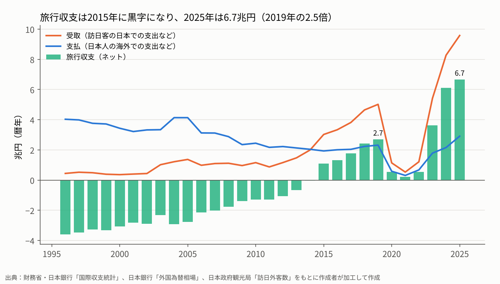
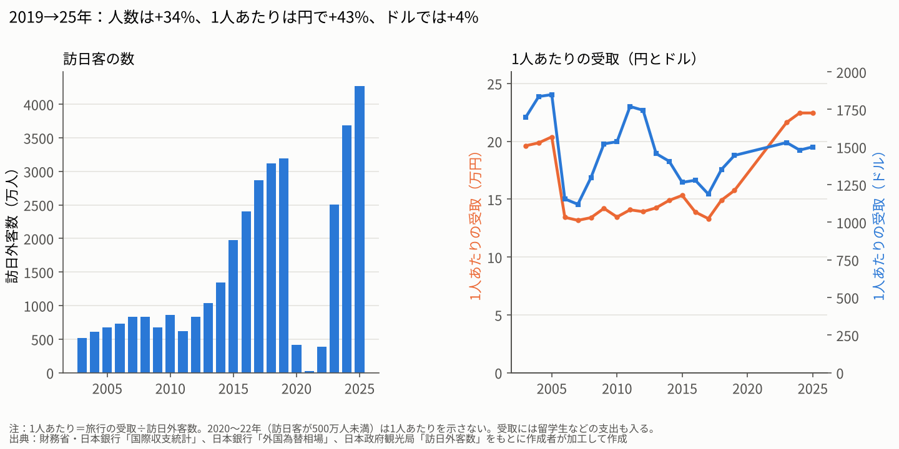
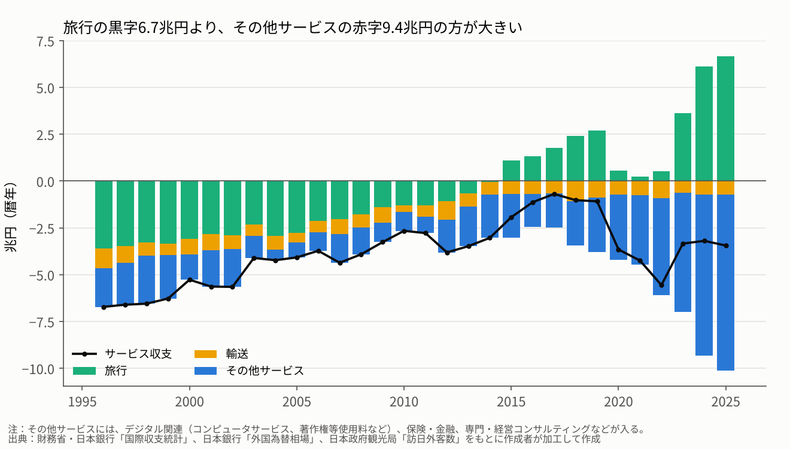
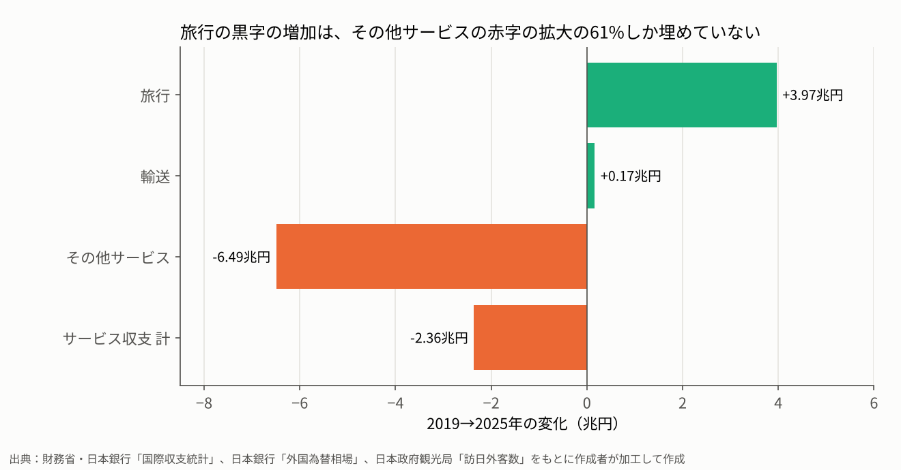

# F423 旅行収支の黒字は、どこまで大きくなったのか？ 2025年は6.7兆円で2019年の2.5倍。1人あたりの受取は円で+43%、ドルでは+4%。それでもその他サービスの赤字9.4兆円には届かない

## 結論（先に）
- 旅行収支（訪日客などが日本で使ったお金 − 日本人が海外で使ったお金）は2015年に黒字になり、2025年は6.7兆円でした。2019年（2.7兆円）の2.5倍です。
- 2019→2025年の受取の伸び（＋91%）のうち、1人あたりの受取の伸びが55%、訪日客数の伸びが45%でした。
- 1人あたりの受取は円で15.7万円→22.4万円（＋43%）ですが、ドルでは1,444ドル→1,501ドル（＋4%）で、ほぼ横ばいです。
- それでも2025年のサービス収支は −3.4兆円の赤字です。旅行を除くと −10.1兆円で、その他サービス（デジタル関連など）の赤字9.4兆円が旅行の黒字より大きい。
- 問い直し：2019→2025年に旅行の黒字は3.97兆円増えましたが、その他サービスの赤字は6.49兆円広がり、旅行はその61%しか埋めていません。

## 問い
訪日客が増え、国際収支の旅行は大きな黒字になったと報道されます。その黒字はどこまで大きくなったのか。増えたのは来た人の数のせいか、1人あたりの使う額のせいか。円安でどこまで膨らんで見えているのか。サービス収支のほかの赤字と比べてどのくらいの大きさなのか。観光・小売・宿泊の仕事をする人、経済の解説を読む人のために確かめます。

関連する記事：F270 は、観光庁の調査で訪日客の1人あたりの支出を円・実質・各国の通貨で見たものです。この記事は、国際収支の旅行の受取を訪日外客数で割った目安を使い、旅行の黒字がサービス収支全体の中でどれくらいの大きさかを主に見ます。F344 は、その他サービスのうちデジタル関連の赤字を詳しく見ています。

## データ（出典）
- 財務省・日本銀行「国際収支統計」月次（1996年1月〜2026年9月、BPM6 基準、日本銀行 時系列統計データ検索サイトの API）：サービス収支、輸送、旅行（受取・支払・ネット、業務・業務外）、その他サービス。
- 日本政府観光局（JNTO）「国籍/月別 訪日外客数（2003年～2026年）」の総数（月次）。
- 日本銀行「外国為替相場」ドル円（月中平均）。
- 暦年は月次の合計。1人あたりの受取＝旅行の受取 ÷ 訪日外客数。ドル建ては月ごとにドル円で割って合計しました。

## 事前の計画
[PLAN.md](PLAN.md)（2026-11-16 14:25、値を集計する前に作成）。下見では JNTO の Excel の形（2026年の表の先頭）だけを見ました。F421 で2025年のサービス収支（−3.4兆円）は知っていました。

| 仮説 | 外れの基準 | 結果 | 判定 |
|---|---|---|---|
| H1 2025年の旅行収支は2019年の1.5倍以上 | 1.5倍未満 | 2.47倍（6.67兆円 対 2.70兆円） | 支持 |
| H2 2019→25年の受取の伸びは、1人あたりの寄与が人数の寄与より大きい | 人数の寄与の方が大きいか同じ | 55% 対 45% | 支持 |
| H3 ドルで見た1人あたりの受取は10%以上増えていない | 10%以上増えた | ＋3.9% | 支持（基準を2018年にすると＋11%） |
| H4 旅行を除いたサービス収支の赤字は旅行の黒字より大きい | 旅行の黒字以下 | −10.1兆円 対 ＋6.7兆円 | 支持 |

## やったこと
1. 国際収支（サービス）と訪日外客数の月次をつなぎ、暦年の表を作りました（02_build.py）。
2. 旅行収支の推移、受取の伸びの分解（人数×1人あたり、円・ドル）、サービス収支の内訳を出しました（03_analysis.py）。
3. 結果を見てから、2019→2025年のサービス収支の変化を項目に分けました（03b_requestion.py）。

## 分かったこと

### 1. 旅行収支は2025年に6.7兆円（図1）

1996年は −3.6兆円の赤字でした。2014年はほぼ均衡（−0.04兆円）で、2015年に受取が支払を上回って黒字（1.1兆円）になりました。2020〜22年はほぼ0まで縮み、2023年から急に増えました。2025年は受取9.6兆円、支払2.9兆円です。

### 2. ドルで見た1人あたりはほぼ横ばい（図2）

訪日外客数は2019年3,188万人、2025年4,268万人（＋34%）です。1人あたりの受取は円で＋43%ですが、ドルでは＋4%で、この間にドル円は109.0円から149.6円になりました。（推測）円で見た1人あたりの増加の多くは、円安で円に換えたときの額が大きくなった分と考えられます。

### 3. 旅行の黒字があっても、サービス収支は赤字（図3）

2025年のサービス収支は、旅行 ＋6.7兆円、輸送 −0.7兆円、その他サービス −9.4兆円で、合計 −3.4兆円です。

## 問い直し（結果を見てから足した）

### 旅行の伸びは、その他サービスの赤字の拡大を埋めきれていない（図4）


| 項目 | 2019年 | 2025年 | 変化 |
|---|---|---|---|
| 旅行 | ＋2.70兆円 | ＋6.67兆円 | ＋3.97兆円 |
| 輸送 | −0.87兆円 | −0.71兆円 | ＋0.17兆円 |
| その他サービス | −2.91兆円 | −9.40兆円 | −6.49兆円 |
| サービス収支 計 | −1.08兆円 | −3.44兆円 | −2.36兆円 |

旅行の黒字の増加は、その他サービスの赤字の拡大の61%です。旅行の黒字が過去最大になった一方で、サービス収支は2019年より悪くなっています。

## 頑健性

| 確かめ方 | 受取の伸び | 人数の伸び | 1人あたり（円）の伸び | 1人あたりの寄与 | 1人あたり（ドル）の伸び |
|---|---|---|---|---|---|
| 2019→2025年（本線） | ＋91% | ＋34% | ＋43% | 55% | ＋4% |
| 2018→2025年 | ＋106% | ＋37% | ＋51% | 57% | ＋11% |
| 2015→2025年 | ＋217% | ＋116% | ＋46% | 33% | ＋19% |
| 業務外の受取だけ 2019→2025年 | ＋95% | ＋34% | ＋46% | 56% | — |

- 最新の12か月（2026年9月まで）でも、旅行収支は6.7兆円、旅行を除くサービス収支は −9.8兆円で、H1・H4 は変わりません。
- 2025年の月ごとの1人あたりの受取は20.5万〜23.9万円で、季節による差は小さいです。
- ドルで見た1人あたりの伸びは、基準の年によって4〜19%と幅があります。H3 の「10%以上増えていない」は2019年基準でだけ成り立ちます。

## 言えないこと
- 旅行の受取は訪日客などの支出の推計で、国籍別の内訳はありません。国籍の構成や滞在日数の変化がどれだけ1人あたりに効いているかは分けられません。
- 受取には留学生や長期滞在者の支出も入り、訪日外客数とは数え方が違います。1人あたりは目安です。
- 1人あたりの受取は2005→06年に大きく下がっています。推計の方法の変更によるかどうかは確かめていません。
- 円安の分を正確に分けるには、訪日客が自国の通貨でいくら使ったかが必要で、このデータにはありません。観光の政策や価格についての評価・助言はしません。

## 仕事で使うなら
- 「旅行収支は過去最大」を読むときは、円で見た1人あたりの伸びの多くが為替の分であること、サービス収支全体はむしろ悪くなっていることを合わせて読むと誤解が少ないです。
- 年ごとの値は results/annual_table.csv にあります。

## 計画からの変更
- 計画どおりに進めました。問い直し（サービス収支の変化の内訳）は結果を見てから足しました。

## 再現のしかた
```
sh src/run_all.sh        # オフライン。所要約3秒
python3 src/01_fetch.py  # 元データを取り直すときだけ（ネットを使う）
```

| ファイル | 中身 |
|---|---|
| src/02_build.py | JSON と JNTO の Excel から data/monthly.csv・annual.csv を作る |
| src/03_analysis.py | 推移・分解・内訳・仮説・頑健性 → results/main.json・annual_table.csv・robustness.csv |
| src/03b_requestion.py | 問い直し → results/requestion.json・services_change.csv |
| src/04_figures.py | 図4枚 |

repro_check：/tmp/rep_F423 に写して流し、results・figures・data の CSV がすべて cmp で一致（件数と所要時間は results/repro_check.txt）。乱数は使っていません。

## レビューで直したこと

独立レビュー（2026-11-17）で次を直しました。直したあと /tmp で流し直し、results・figures・data の CSV が一致することを確かめています。

| # | 指摘 | 直し方 |
|---|---|---|
| 1 | 既存の F270（訪日客の1人あたりの支出）と問いの一部が重なるのに触れていない | 「問い」に関連する記事として F270・F344 との違いを追記 |

## 出典
- 財務省・日本銀行「国際収支統計」：日本銀行 時系列統計データ検索サイト https://www.stat-search.boj.or.jp/ （系列コードは src/01_fetch.py）
- 日本銀行「外国為替相場」ドル円（FXERM07）：同上
- 日本政府観光局（JNTO）「国籍/月別 訪日外客数（2003年～2026年）」：https://www.jnto.go.jp/statistics/data/_files/20261021_1615-5.xlsx （掲載ページ https://www.jnto.go.jp/statistics/data/visitors-statistics/ ）

（いずれも 財務省・日本銀行「国際収支統計」、日本銀行「外国為替相場」、日本政府観光局「訪日外客数」をもとに作成者が加工して作成）
