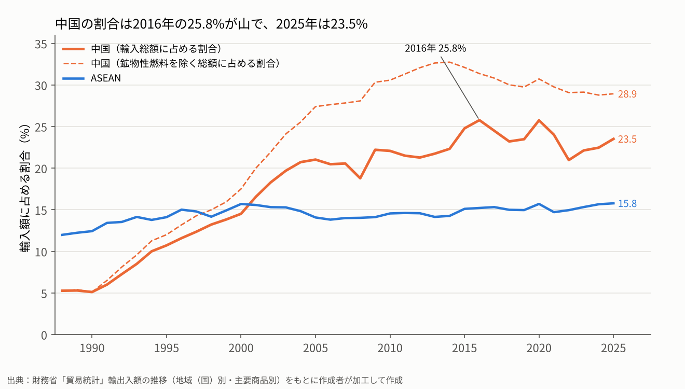
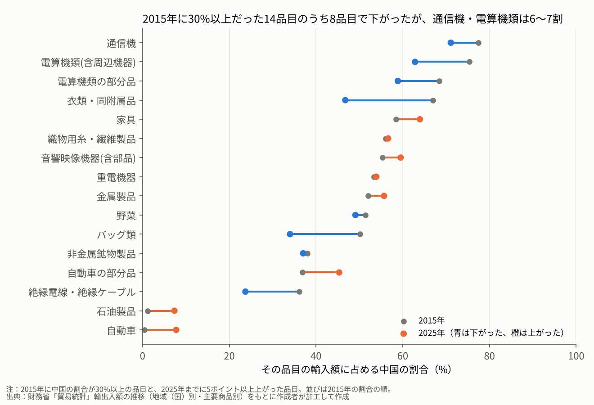
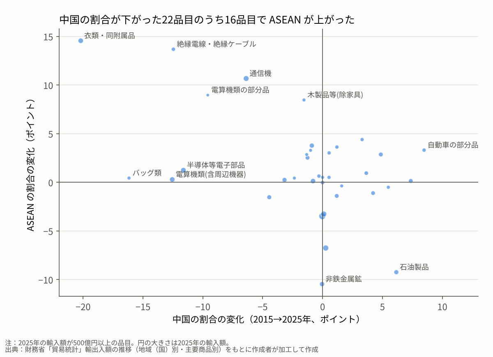
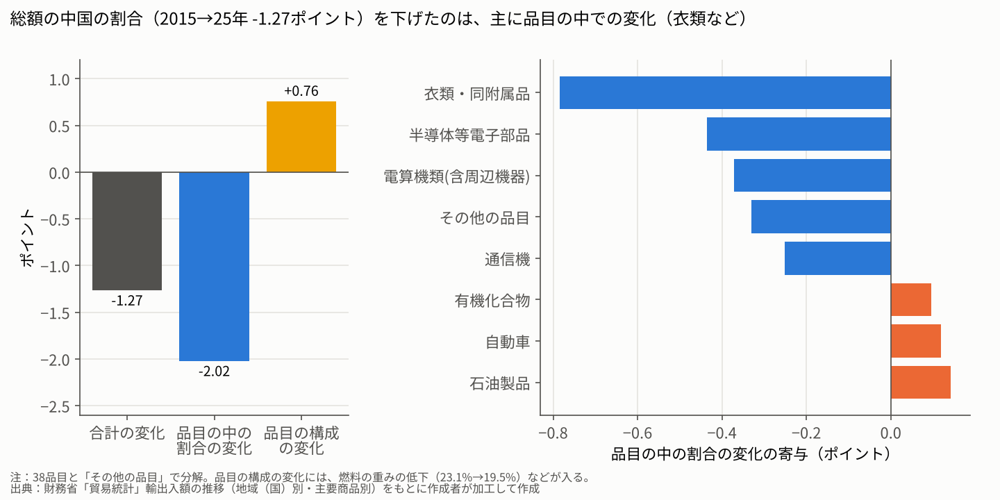

# F424 輸入で中国に頼る割合は、品目別に見て高まったのか？ 総額では2016年の25.8%が山で2025年は23.5%。30%以上の14品目のうち8品目で下がり、その多くで ASEAN が伸びた。通信機は71%と高いまま

## 結論（先に）
- 輸入総額に占める中国の割合は、1988年の5.3%から上がり、2016年の25.8%が山でした（2020年も25.7%）。2025年は23.5%です。鉱物性燃料を除いた総額では、2014年の32.7%が山で、2025年は28.9%です。
- 2015年に中国の割合が30%以上だった14品目のうち、8品目で2025年までに割合が下がりました（衣類 66.9%→46.8%、電算機類 75.4%→62.8% など）。家具・自動車の部分品などでは上がりました。
- 中国の割合が下がった22品目のうち16品目（73%）で、ASEAN の割合が上がりました。
- 通信機（71.1%、うち電話機88.3%）と電算機類（62.8%）は、2025年も中国の割合が6割を超えています。
- 問い直し：総額の割合の変化（2015→2025年 −1.27ポイント）は、品目の中での変化（−2.02ポイント）が主で、品目の構成の変化（燃料の重みの低下など）は逆に +0.76ポイントでした。

## 問い
部品や製品の調達先を中国以外にも広げる、と言われるようになって10年ほどたちます。では実際に、輸入の中国の割合は下がったのか。どの品目で下がり、どの品目で高いままなのか。下がった分はどこへ移ったのか。輸入の仕事をする人、調達先の分散の話題を読む人のために確かめます。

## データ（出典）
- 財務省「貿易統計」輸出入額の推移（地域（国）別・主要商品別）年別 輸入（1988〜2025年、概況品別の金額）。世界、中国、ASEAN、韓国、米国、EU、アジア、中東、ロシア。
- 品目は概況品のうち、階層が重ならない38品目（魚介類、肉類、…、電算機類、通信機、半導体等電子部品、自動車、衣類、家具、バッグ類など）を使いました。
- 割合＝相手からの輸入額 ÷ 世界からの輸入額。集中度（ハーフィンダール指数）は、中国・ASEAN・韓国・米国・EU・中東・ロシア・その他の8区分で計算しました（国単位ではない目安）。

## 事前の計画
[PLAN.md](PLAN.md)（2026-11-16 14:55、割合を集計する前に作成）。下見では CSV の見出しの形と、中国の1988〜90年の行の先頭だけを見ました。

| 仮説 | 外れの基準 | 結果 | 判定 |
|---|---|---|---|
| H1 中国の割合は2025年が最大ではない | 2025年が最大 | 山は2016年（25.8%）、2025年は23.5% | 支持 |
| H2 2015年に30%以上の品目の半分より多くで下がった | 半分以下 | 14品目中8品目（57%） | 支持 |
| H3 中国の割合が下がった品目の半分より多くで ASEAN が上がった | 半分以下 | 22品目中16品目（73%） | 支持 |
| H4 電算機類と通信機は2025年も40%以上 | どちらかが40%未満 | 62.8%、71.1% | 支持 |

## やったこと
1. 9つの CSV（cp932）から、年×相手×品目の金額の表を作りました。列は概況品コードの行で品目を決めました（02_build.py）。食料品＝食料品及び動物＋飲料及びたばこ、などの合計が合うことを確かめています。
2. 総額と品目ごとの割合、2015→2025年の変化、ASEAN の割合の変化、集中度を出しました（03_analysis.py）。
3. 結果を見てから、総額の割合の変化を品目の中の変化と構成の変化に分けました（03b_requestion.py）。

## 分かったこと

### 1. 総額では2016年が山（図1）

中国の割合は2000年14.5%、2016年25.8%、2025年23.5%です。ASEAN は15.1%（2015年）→15.8%（2025年）でほぼ横ばいでした。燃料の値段が上がった2022年は総額の割合が21.0%まで下がりましたが、燃料を除くと29.1%で、2014年の山から少しずつ下がる流れの中にあります。8区分の集中度は0.164（2015年）→0.172（2025年）で、ほとんど変わっていません。

### 2. 30%以上だった14品目のうち8品目で下がった（図2）

下がったのは、衣類（−20.2ポイント）、バッグ類（−16.2）、電算機類（−12.6）、絶縁電線・絶縁ケーブル（−12.5）、電算機類の部分品（−9.6）、通信機（−6.4）、野菜、非金属鉱物製品です。上がったのは、自動車の部分品（＋8.5）、家具（＋5.5）、音響映像機器（＋4.2）、金属製品などです。割合の低かった自動車（0.4%→7.8%）と石油製品（1.2%→7.3%）も上がりました。

### 3. 中国が下がった品目では ASEAN が伸びた（図3）

衣類は ASEAN が ＋14.6ポイント、通信機は ＋10.7ポイント、絶縁電線は ＋13.7ポイントでした。半導体等電子部品は中国が −11.6ポイントでも ASEAN は ＋1.2ポイントで、ほかの地域に移っています。

## 問い直し（結果を見てから足した）

### 総額の割合を下げたのは、品目の中での変化（図4）

38品目と「その他の品目」で、総額の中国の割合の変化を分けました（シフト・シェア分解）。

| 要素 | 寄与（ポイント） |
|---|---|
| 合計の変化（2015→2025年） | −1.27 |
| 品目の中での中国の割合の変化 | −2.02 |
| 輸入の品目の構成の変化 | ＋0.76 |

品目の中での変化では、衣類 −0.78、半導体等電子部品 −0.44、電算機類 −0.37 の寄与が大きく、石油製品・自動車・有機化合物はわずかに押し上げました。構成の変化がプラスなのは、中国の割合が0に近い燃料の重みが23.1%から19.5%に下がったことなどによります。

## 頑健性

| 確かめ方 | 30%以上の品目 | うち下がった | 中国が下がった品目 | うち ASEAN が上がった | 輸入額の重みつきの平均の変化 |
|---|---|---|---|---|---|
| 本線（2015年 対 2025年、30%） | 14 | 8（57%） | 22 | 16（73%） | −2.3ポイント |
| 3年平均（2014〜16年 対 2023〜25年） | 14 | 8（57%） | 23 | 15（65%） | −2.0 |
| しきい値20% | 18 | 10（56%） | 22 | 16（73%） | −2.3 |
| しきい値40% | 11 | 6（55%） | 22 | 16（73%） | −2.3 |
| 燃料の品目を除く | 14 | 8（57%） | 20 | 15（75%） | −3.4 |

どの比べ方でも、中国の割合が高かった品目で下がったのは半分を少し超える程度で、「下がった品目では ASEAN が伸びた」は65〜75%で成り立ちます。

## 言えないこと
- 原産地の統計なので、中国の部品を使って ASEAN で組み立てた製品は ASEAN からの輸入になります。中身まで中国に頼る度合いが下がったかは分かりません。
- 金額の割合なので、値段や為替の変化でも動きます。
- 概況品は大まかな分類で、細かい品目（HS の9けた）の動きは見ていません。
- 相手の地域は8区分で、国単位の集中度は測っていません。調達先についての助言はしません。

## 仕事で使うなら
- 「中国依存」を一つの数字で語ると、燃料の値段の上下で総額の割合が動くことに引っぱられます。燃料を除いた総額や、品目ごとの割合で見ると流れがつかみやすいです。
- 品目ごとの割合は results/item_shares.csv、分解は results/shift_share.csv にあります。

## 計画からの変更
- 計画どおりに進めました。問い直し（シフト・シェア分解）は結果を見てから足しました。図2には、計画の「30%以上の品目」に加えて、5ポイント以上上がった品目（自動車・石油製品）も載せました。

## 再現のしかた
```
sh src/run_all.sh        # オフライン。所要約3秒
python3 src/01_fetch.py  # 元データを取り直すときだけ（ネットを使う）
```

| ファイル | 中身 |
|---|---|
| src/02_build.py | 9つの CSV から data/imports_long.csv・items.csv を作る |
| src/03_analysis.py | 割合・変化・仮説・頑健性 → results/main.json・total_share.csv・item_shares.csv・robustness.csv |
| src/03b_requestion.py | 問い直し → results/requestion.json・shift_share.csv |
| src/04_figures.py | 図4枚 |

repro_check：/tmp/rep_F424 に写して流し、results・figures・data の CSV がすべて cmp で一致（件数と所要時間は results/repro_check.txt）。乱数は使っていません。

## レビューで直したこと

独立レビューで数字の照合・再実行・図を確かめ、直すところはなかった。

## 出典
- 財務省「貿易統計」輸出入額の推移（地域（国）別・主要商品別）：https://www.customs.go.jp/toukei/suii/html/time.htm （ファイルの URL は data/raw/SOURCES.md）

（いずれも 財務省「貿易統計」をもとに作成者が加工して作成）
