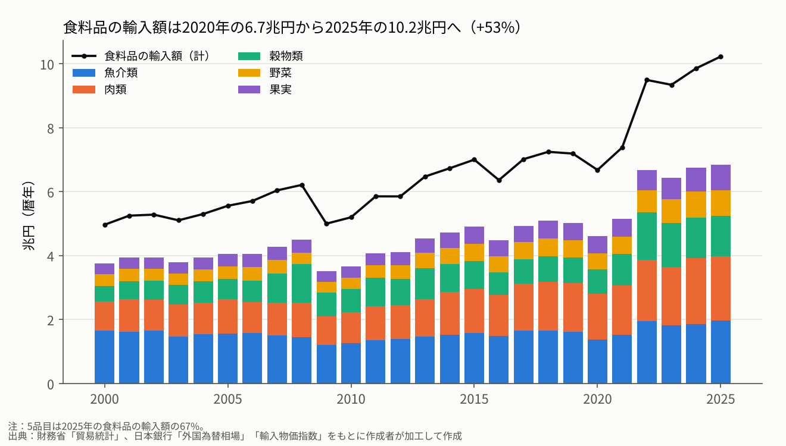
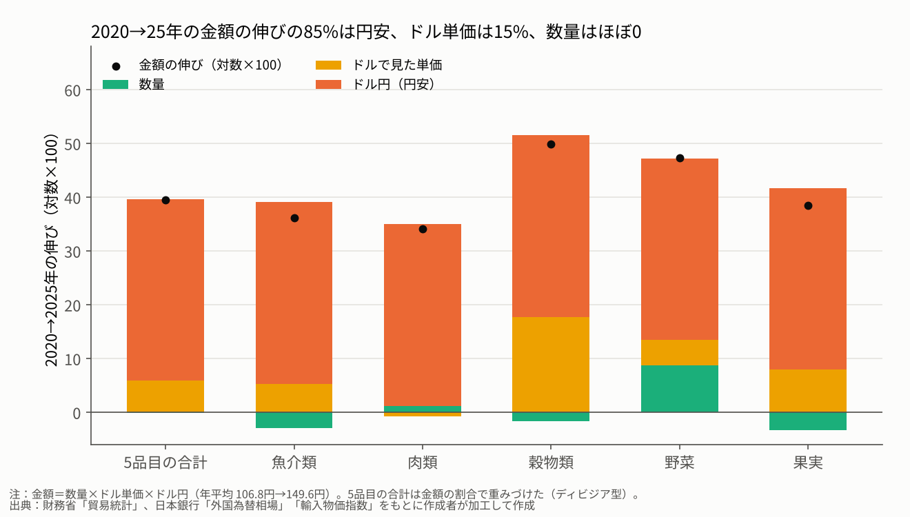
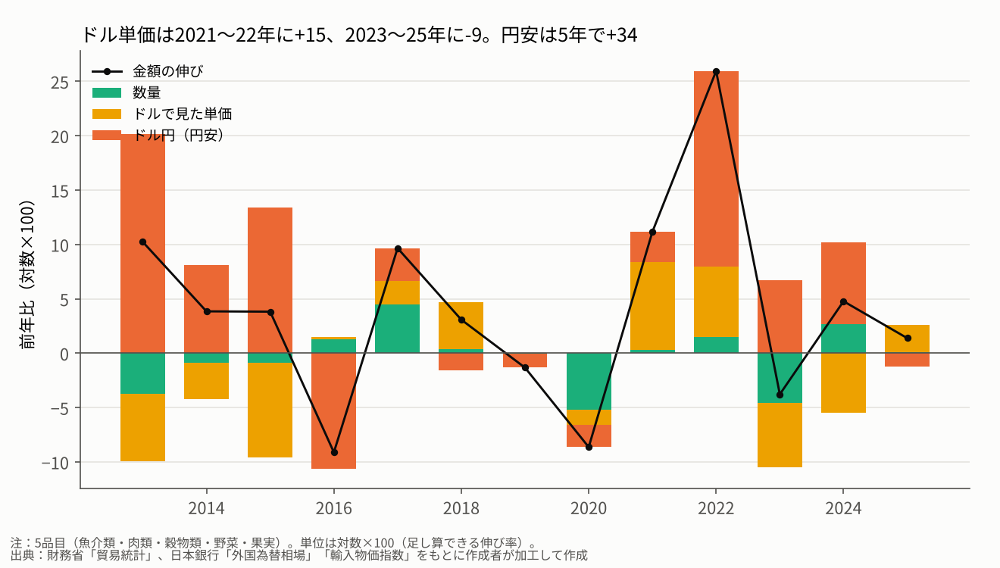
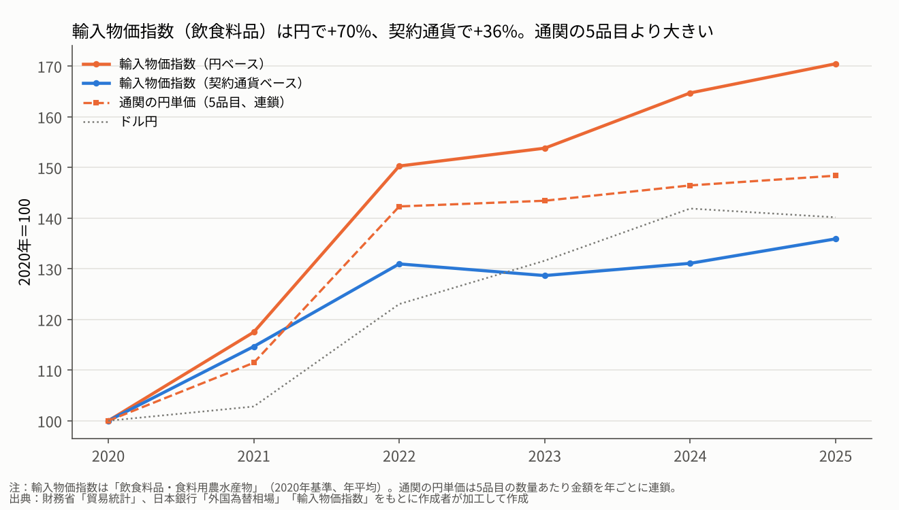

# F425 食料の輸入額が増えたのは、量が増えたからか、値段が上がったからか？ 2020→25年の5品目の伸び+48%のうち85%は円安。ドルで見た単価は+6%、数量はほぼ横ばい

## 結論（先に）
- 食料品の輸入額は2020年の6.7兆円から2025年の10.2兆円へ、53%増えました。
- 数量のわかる5品目（魚介類・肉類・穀物類・野菜・果実、2025年の食料品の輸入額の67%）では、2020→2025年の金額の伸び（+48.4%）のうち、ドル円の変化（106.8円→149.6円、+40.1%）が85%、ドルで見た単価の上昇（+6.1%）が15%でした。数量は −0.2%でほぼ横ばいです。
- 5品目のうち3品目（魚介類・穀物類・果実）で数量は減りました。
- 問い直し：ドル単価は2021〜22年に上がり（+14.5、対数×100）、2023〜25年に下がりました（−8.8）。円安はこの5年でほぼ毎年押し上げています（合計 +33.8）。
- 輸入物価指数（飲食料品・食料用農水産物）では円ベース +70%、契約通貨ベース +36%で、為替の分は42%でした。通関の5品目より値上がりが大きく見えます。

## 問い
食料の輸入額は近年大きく増えました。それは輸入する量が増えたからなのか、世界の食料の値段（ドル建て）が上がったからなのか、円安で円に換えた額が膨らんだからなのか。食品の仕入れや販売の仕事をする人、食料品の値上がりの話題を読む人のために、品目ごとに分けて確かめます。

## データ（出典）
- 財務省「貿易統計」輸出入額の推移 世界 年別 輸入 主要商品別（1988〜2025年）：食料品の金額、魚介類・肉類・穀物類（トン）、野菜・果実（kg をトンに換算）の金額と数量。
- 日本銀行「外国為替相場」ドル円（東京市場17時、月中平均の年平均）。
- 日本銀行「輸入物価指数」（2020年基準）飲食料品・食料用農水産物（円ベース・契約通貨ベース）。
- 分け方：金額＝数量×ドル単価×ドル円。対数の差で量・ドル単価・為替の寄与に分け、5品目の合計は金額の割合の平均で重みづけ（ディビジア型）しました。

## 事前の計画
[PLAN.md](PLAN.md)（2026-11-16 15:20、値を集計する前に作成）。d61ca.csv は F424 と同じファイルで、列の形は知っていました。

| 仮説 | 外れの基準 | 結果 | 判定 |
|---|---|---|---|
| H1 2020→25年の伸びのうち量の寄与は20%未満 | 20%以上 | −0.4% | 支持 |
| H2 円単価の伸びのうち、為替の分がドル単価の分より大きい | ドル単価の方が大きい | 為替 +40.1% 対 ドル単価 +6.1% | 支持 |
| H3 5品目の半分以上で数量が減った | 半分未満 | 3品目（魚介類・穀物類・果実） | 支持 |
| H4 輸入物価指数で円ベースの上昇の半分以上が為替 | 半分未満 | 42% | 外れ |

## やったこと
1. 貿易統計の CSV から5品目と食料品計の金額・数量を、日本銀行の JSON からドル円と輸入物価指数の年平均を作りました（02_build.py）。
2. 2020→2025年の伸びを、品目ごとと5品目の合計で、数量・ドル単価・為替に分けました（03_analysis.py）。
3. 結果を見てから、2013〜2025年の毎年の前年比を同じように分け、輸入物価指数と並べました（03b_requestion.py）。

## 分かったこと

### 1. 輸入額は5年で53%増えた（図1）

食料品の輸入額は2020年6.7兆円、2021年7.4兆円、2022年9.5兆円（前年比 +29%）、2025年10.2兆円です。

### 2. 伸びのほとんどは円安（図2）


| 品目 | 金額 | 数量 | ドル単価 | 円単価 |
|---|---|---|---|---|
| 魚介類 | +43.6% | −2.9% | +5.5% | +47.8% |
| 肉類 | +40.7% | +1.2% | −0.8% | +39.0% |
| 穀物類 | +64.7% | −1.6% | +19.4% | +67.4% |
| 野菜 | +60.4% | +9.2% | +4.8% | +46.9% |
| 果実 | +46.8% | −3.2% | +8.3% | +51.8% |
| 5品目の合計 | +48.4% | −0.2% | +6.1% | +48.7% |

どの品目でも、伸びのいちばん大きな部分はドル円の変化（+40.1%）です。ドル単価が大きく上がったのは穀物類だけでした。

## 問い直し（結果を見てから足した）

### 年ごとに見ると、ドル単価は上がって下がった（図3・図4）

5年まとめるとドル単価の寄与は小さいので、年ごとに分けました。ドル単価は2021年 +8.1、2022年 +6.5 と上がり、2023年 −5.9、2024年 −5.4 と下がりました（対数×100）。2022年の急増は、ドル単価の上昇と円安が重なった年でした。


輸入物価指数（契約通貨ベース）も2021〜22年に +27.0 上がりましたが、2023〜25年も +3.7 と下がっていません。通関の5品目と違うのは、指数には加工食品やコーヒーなど5品目以外の品目も入ること、品目の中の構成を固定して値段だけを見ていることなどによると考えられます（推測）。

## 頑健性

| 確かめ方 | 金額 | 数量 | ドル単価 | ドル円 | 円安の寄与 |
|---|---|---|---|---|---|
| 2020→2025年（本線） | +48.4% | −0.2% | +6.1% | +40.1% | 85% |
| 2019→2025年 | +36.1% | −5.2% | +4.6% | +37.3% | 103% |
| 2012→2025年 | +66.6% | −4.8% | −6.7% | +87.6% | 123% |
| 2020→2025年・年末のドル円 | +48.4% | −0.2% | −1.0% | +50.1% | 103% |
| 5品目の単純合計（トン） | +48.4% | −0.7% | +6.7% | +40.1% | 85% |
| 輸入物価指数（飲食料品・食料用農水産物） | — | — | +35.9%（契約通貨） | — | 42% |

通関の数量と金額で見る限り、どの比べ方でも数量の寄与はほぼ0かマイナスで、伸びの大部分は為替の変化です。ただし輸入物価指数で見ると、ドル建ての値上がりの分がもっと大きくなります。

## 言えないこと
- 単価は、品目の中の構成（高い肉と安い肉など）の変化でも動きます。品質の変化は分けられません。
- 円安や値上がりが国内の店頭の値段にどれだけ伝わったかは扱っていません。
- 5品目は食料品の輸入額の3分の2で、加工食品や飲料などは入っていません。
- ドル単価としていますが、実際の取引はドル以外の通貨のこともあります。価格や仕入れについての助言はしません。

## 仕事で使うなら
- 「輸入食料が高くなった」を説明するときは、5年で見ると為替の分が大きく、世界の値段（ドル建て）は2022年に上がったあと一部戻っている、と時期で分けると伝わりやすいです。
- 品目ごとの分解は results/decomp_items.csv、年ごとは results/yearly_decomp.csv にあります。

## 計画からの変更
- 計画にあった大豆は、食料品ではなく原料品に分類されるため、5品目の合計には入れませんでした（data/food_annual.csv には残しています）。
- 問い直し（年ごとの分解）は結果を見てから足しました。

## 再現のしかた
```
sh src/run_all.sh        # オフライン。所要約3秒
python3 src/01_fetch.py  # 元データを取り直すときだけ（ネットを使う）
```

| ファイル | 中身 |
|---|---|
| src/02_build.py | data/food_annual.csv・fx_prices_annual.csv を作る |
| src/03_analysis.py | 分解・仮説・頑健性 → results/main.json・decomp_items.csv・item_levels.csv・robustness.csv |
| src/03b_requestion.py | 問い直し → results/requestion.json・yearly_decomp.csv |
| src/04_figures.py | 図4枚 |

repro_check：/tmp/rep_F425 に写して流し、results・figures・data の CSV がすべて cmp で一致（件数と所要時間は results/repro_check.txt）。乱数は使っていません。

## レビューで直したこと

独立レビューで数字の照合・再実行・図を確かめ、直すところはなかった。

## 出典
- 財務省「貿易統計」輸出入額の推移（世界 年別 輸入 主要商品別）：https://www.customs.go.jp/toukei/suii/html/data/d61ca.csv
- 日本銀行「外国為替相場」（FXERM07）、「企業物価指数（輸入物価指数）」（PRCG20_2600120001 ほか）：日本銀行 時系列統計データ検索サイト https://www.stat-search.boj.or.jp/

（いずれも 財務省「貿易統計」、日本銀行「外国為替相場」「輸入物価指数」をもとに作成者が加工して作成）
