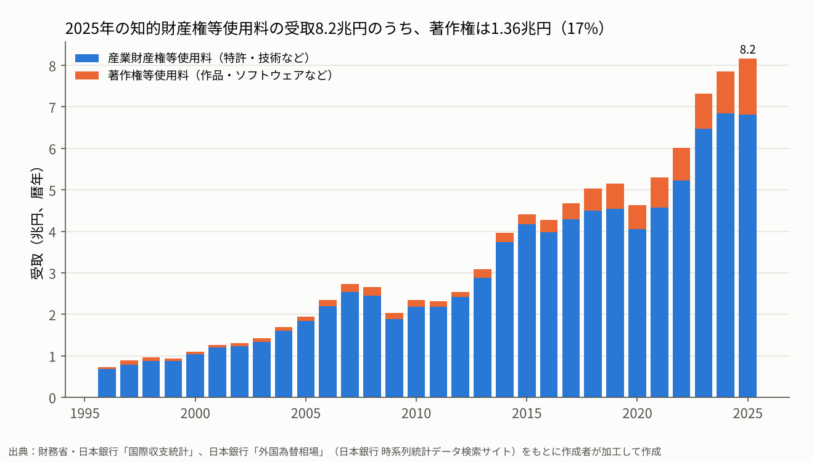
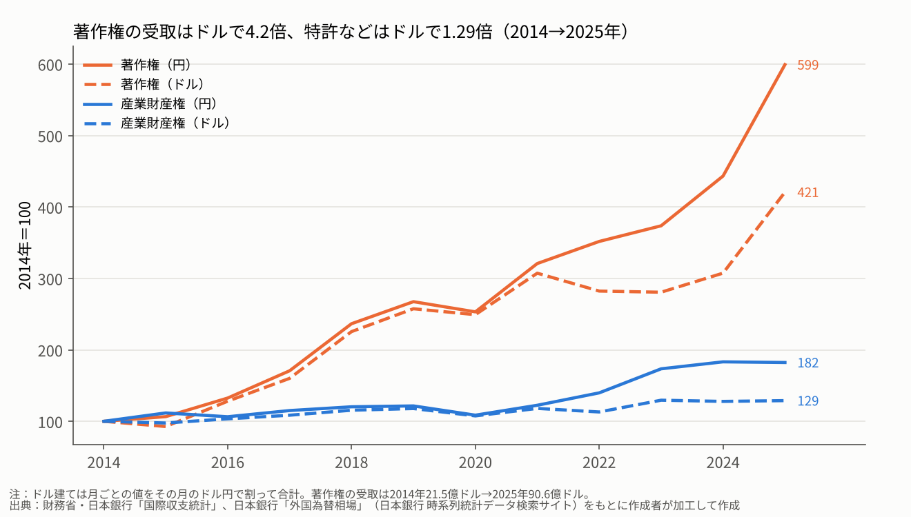
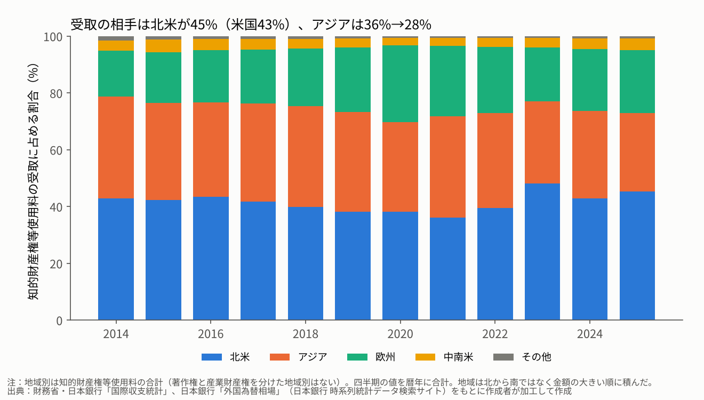
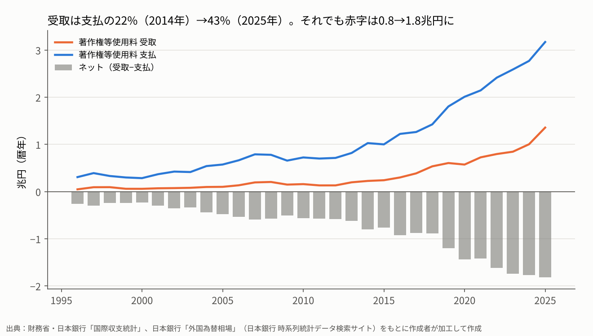

# F426 日本のアニメやゲームなどの使用料の受取は、どれだけ増えたのか？ 著作権等使用料の受取は2014→25年に0.23兆円から1.36兆円へ（ドルで4.2倍）。それでも知的財産の受取の83%は特許などで、著作権は赤字1.8兆円

## 結論（先に）
- 著作権等使用料（作品・ソフトウェア・キャラクターなどの使用料）の受取は、2014年の0.23兆円から2025年の1.36兆円へ、年率17.7%で増えました。ドルで見ても21.5億ドルから90.6億ドルへ4.2倍（年率14.0%）です。
- 産業財産権等使用料（特許・技術など）の受取は、同じ期間に3.7兆円から6.8兆円（年率5.6%）で、ドルでは1.29倍（年率2.3%）にとどまります。
- それでも2025年の知的財産権等使用料の受取8.2兆円のうち、83%は産業財産権です。著作権の割合は5.7%（2014年）から16.6%（2025年）に上がりました。
- 受取の相手は北米が45%（米国43%）で最も大きく、アジアは36%から28%に下がりました（著作権と産業財産権の合計）。
- 問い直し：著作権の受取は支払の22%から43%まで来ましたが、支払も3.1倍になり、赤字は0.8兆円から1.8兆円に広がりました。

## 問い
「アニメやゲームが海外で稼いでいる」とよく言われます。国際収支では、作品などの使用料は著作権等使用料、特許や技術の使用料は産業財産権等使用料として記録されます。著作権の受取はどれだけ増えたのか、特許などと比べてどれくらいの大きさなのか、どの地域から受け取っているのか。コンテンツ産業の話題を読む人、知的財産の仕事をする人のために確かめます。F344（デジタル赤字）は支払の側を見たので、ここでは受取の側を見ます。

## データ（出典）
- 財務省・日本銀行「国際収支統計」月次（1996年1月〜2026年9月、BPM6 基準）：知的財産権等使用料（受取・支払・ネット）、うち産業財産権等使用料、著作権等使用料。サービスの受取の合計。
- 同 四半期（2014年1-3月期〜2026年4-6月期）：知的財産権等使用料の受取の地域別。
- 日本銀行「外国為替相場」ドル円（月中平均）。
- 暦年は月次（地域別は四半期）の合計。ドル建ては月ごとにドル円で割って合計しました。

## 事前の計画
[PLAN.md](PLAN.md)（2026-11-16 15:55、値を集計する前に作成）。この番号のたたき台（農林水産物・食品の輸出）から予備 R45 に替えた理由も PLAN と REPLACED.md に書きました。

| 仮説 | 外れの基準 | 結果 | 判定 |
|---|---|---|---|
| H1 2014→25年に著作権の受取は産業財産権より速く伸びた | 速くない | 年率17.7% 対 5.6% | 支持 |
| H2 2025年も受取の3分の2以上は産業財産権 | 3分の2未満 | 83.4% | 支持 |
| H3 ドルで見ても著作権の受取は2倍以上 | 2倍未満 | 4.2倍 | 支持 |
| H4 2025年の受取の相手はアジアの方が北米より大きい | 北米の方が大きい | アジア27.7% 対 北米45.2% | 外れ |

## やったこと
1. 月次と四半期の JSON から、暦年の表（円・ドル）と地域別の表を作りました（02_build.py）。
2. 受取の伸び・構成・ドル建て・地域の割合を出しました（03_analysis.py）。
3. 結果を見てから、著作権の受取と支払を並べました（03b_requestion.py）。

## 分かったこと

### 1. 受取8.2兆円のうち、著作権は1.36兆円（図1）

知的財産権等使用料の受取は、サービスの受取全体の22%（2025年）にあたります。著作権の受取は1996年0.05兆円、2014年0.23兆円、2025年1.36兆円で、2025年は前年より35%増えました。

### 2. 著作権はドルでも4.2倍（図2）

産業財産権の受取は円では1.8倍ですが、ドルでは1.29倍です。円で見た伸びの多くは円安の分です。著作権の受取は、ドルで見ても4.2倍で、円安を除いても大きく伸びています。

### 3. 受取の相手は北米が45%（図3）

2025年の受取は、北米45.2%（米国43.5%）、アジア27.7%（中国8.0%、ASEAN 13.2%）、欧州22.2%（英国10.8%）でした。アジアの割合は2014年の35.9%から下がりました。地域別は著作権と産業財産権を合わせた値です。

## 問い直し（結果を見てから足した）

### 著作権は赤字が縮んだのか（図4）


| | 2014年 | 2019年 | 2025年 |
|---|---|---|---|
| 受取 ÷ 支払（カバー率） | 22% | 34% | 43% |
| 著作権のネット（兆円） | −0.80 | — | −1.81 |
| 著作権のネット（億ドル） | −76 | — | −122 |

受取は2014→2025年に円で6.0倍、支払は3.1倍になりました。受取の方が速く伸びていますが、支払の水準が大きいため、赤字の額は広がっています。産業財産権は2025年に4.8兆円の黒字です。

## 頑健性

| 確かめ方 | 著作権の受取（円、年率） | 産業財産権の受取（円、年率） | 著作権（ドル、年率） | 産業財産権（ドル、年率） |
|---|---|---|---|---|
| 2014→2025年 両端の比（本線） | 17.7% | 5.6% | 14.0% | 2.3% |
| 2014〜2025年 対数の傾き | 16.7% | 5.5% | 13.3% | 2.5% |
| 2005→2025年 両端の比 | 13.9% | 6.8% | 12.1% | 5.1% |
| 2019→2025年 両端の比 | 14.4% | 7.0% | 8.5% | 1.5% |

最新の12か月（2026年9月まで）でも、受取の83.6%は産業財産権でした。どの期間・どの通貨でも、著作権の方が速く伸びています。

## 言えないこと
- 著作権等使用料には、アニメ・ゲームのほか、ソフトウェア、音楽、映画、キャラクターなどが入り、アニメやゲームだけを取り出すことはできません。
- 日本企業の海外子会社から本社への使用料（企業グループの中の取引）も入ります。産業財産権の受取には、自動車などの海外子会社からの技術の使用料が多いと言われますが（推測）、このデータでは確かめていません。
- 作品ごと・企業ごとの内訳は分かりません。
- 地域別は著作権と産業財産権を合わせた値です。コンテンツや産業の政策についての評価・助言はしません。

## 仕事で使うなら
- 「コンテンツが海外で稼ぐ」を数字で示すときは、著作権の受取（2025年1.36兆円）と、特許などを含む知的財産全体（8.2兆円）を分けると、大きさの誤解が少ないです。
- 円で見た伸びには円安の分が入るので、ドル建て（results/annual_table.csv の _usd 列、億ドル）も合わせて見ると読み違えにくいです。

## 計画からの変更
- 計画どおりに進めました。問い直し（受取と支払のカバー率）は結果を見てから足しました。

## 再現のしかた
```
sh src/run_all.sh        # オフライン。所要約3秒
python3 src/01_fetch.py  # 元データを取り直すときだけ（ネットを使う）
```

| ファイル | 中身 |
|---|---|
| src/02_build.py | JSON から data/monthly.csv・annual.csv・region_annual.csv を作る |
| src/03_analysis.py | 伸び・構成・地域・仮説・頑健性 → results/main.json・annual_table.csv・region_shares.csv・robustness.csv |
| src/03b_requestion.py | 問い直し → results/requestion.json |
| src/04_figures.py | 図4枚 |

repro_check：/tmp/rep_F426 に写して流し、results・figures・data の CSV がすべて cmp で一致（件数と所要時間は results/repro_check.txt）。乱数は使っていません。

## レビューで直したこと

独立レビューで数字の照合・再実行・図を確かめ、直すところはなかった。

## 出典
- 財務省・日本銀行「国際収支統計」：日本銀行 時系列統計データ検索サイト https://www.stat-search.boj.or.jp/ （系列コードは src/01_fetch.py）
- 日本銀行「外国為替相場」ドル円（FXERM07）：同上

（いずれも 財務省・日本銀行「国際収支統計」、日本銀行「外国為替相場」をもとに作成者が加工して作成）
