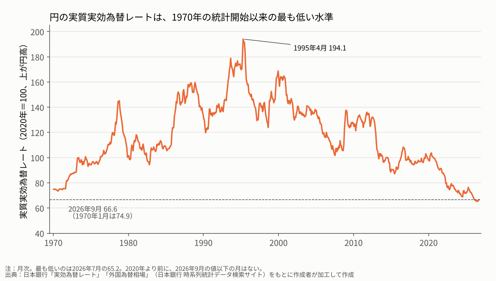
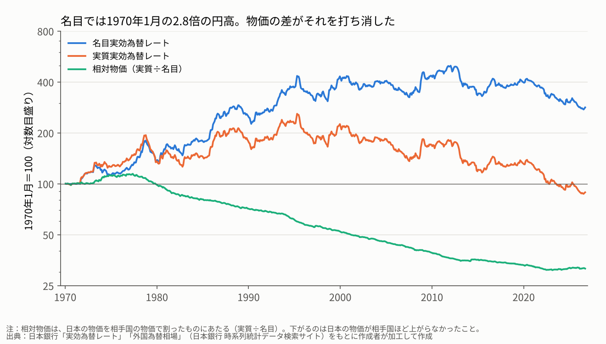
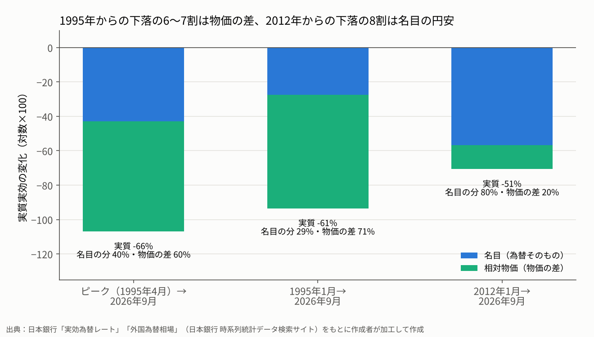
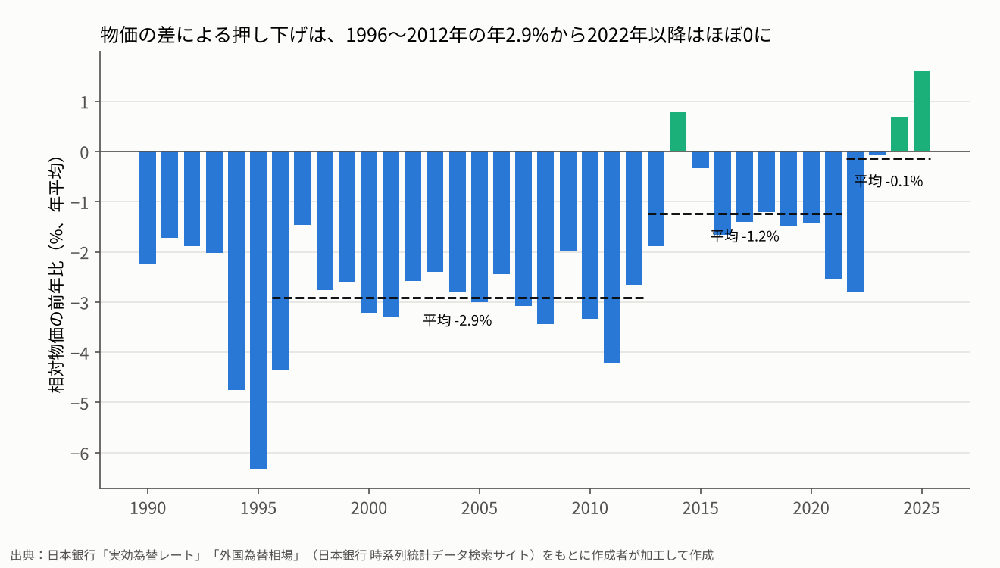

# F427 「円の実質実効為替レートは50年ぶりの低さ」は、どう計算され、何を意味するのか？ 2026年9月は66.6で1970年の統計開始以来の最低。1995年からの下落の6〜7割は物価の差、2012年からの8割は円安

## 結論（先に）
- 日本銀行の実質実効為替レートは、2026年9月に66.6（2020年＝100）でした。1970年1月の74.9より低く、2020年より前にこれ以下の月はありません。「50年ぶり」というより、統計のある1970年以来の最低です（最低は2026年7月の65.2）。
- 名目実効為替レートは1970年1月の2.8倍で、為替そのものは今も1970年より円高です。日本の物価が相手国ほど上がらなかったこと（相対物価の低下）が、それを打ち消しました。
- 1995年4月のピーク（194.1）からの下落（−66%）のうち、物価の差が60%、名目の円安が40%です。2012年1月からの下落（−51%）では、名目の円安が80%でした。
- 問い直し：物価の差による押し下げは、1996〜2012年の年 −2.9%から、2022〜2025年は年 −0.1%とほぼ止まりました。それでも名目が年5.3%下がり、実質は下がり続けました。

## 問い
報道や研究機関のレポートで、「円の実質実効為替レートは約50年ぶりの低さ」「1970年の統計開始以来の最低」と言われます（例：第一生命経済研究所のレポート）。実効為替レートとは何か、「実質」とは何を差し引いたものか、その低さはドル円の円安によるのか、物価の差によるのか。為替のニュースを読む人、海外との取引の値段を考える仕事の人のために確かめます。

## データ（出典）
- 日本銀行「実効為替レート」名目・実質（2020年＝100、月次、1970年1月〜2026年9月）。日本銀行 時系列統計データ検索サイトの API で取得しました。
- 同 更新停止の旧系列（1973年3月＝100、2010年1月まで）。
- 日本銀行「外国為替相場」ドル円（東京市場17時、月中平均）。
- 実効為替レートは、多くの相手国の通貨に対する円の強さを貿易の大きさで重みづけて平均したもの、実質はそこから相手国との物価の差を調整したものです。実質 ÷ 名目を「相対物価」とみなし、対数の差で実質の変化を名目と相対物価に分けました。

## 事前の計画
[PLAN.md](PLAN.md)（2026-11-16 16:20、値を集計する前に作成）。下見では系列の名前・単位・期間だけを見ました。

| 仮説 | 外れの基準 | 結果 | 判定 |
|---|---|---|---|
| H1 最新の値以下の月は1970年代前半より後にない | 1976年以降にある | 2020年より前には1か月もない（1970年1月も上） | 支持 |
| H2 1995年のピークからの下落の半分超は物価の差 | 名目の方が大きい | 物価の差60%、名目40% | 支持 |
| H3 2012年からの下落は名目の方が大きい | 物価の差の方が大きい | 名目80%、物価の差20% | 支持 |
| H4 旧系列とピークの時期・1995年/2007年の比が5%以内でそろう | 時期が違うか5%以上ずれる | 同じ1995年4月、比の差 4.9% | 支持（ぎりぎり） |

## やったこと
1. JSON から月次の表（名目・実質・相対物価・旧系列・ドル円）を作りました（02_build.py）。
2. 「いつ以来」、ピーク・1995年・2012年からの分解、旧系列との照合を出しました（03_analysis.py）。
3. 結果を見てから、相対物価の前年比を期間ごとに並べました（03b_requestion.py）。

## 分かったこと

### 1. 1970年の統計開始以来の最低（図1）

12か月平均（2025年10月〜2026年9月、67.0）で見ても統計開始以来の最低です。指数の基準の年（2020年＝100）は、全体を同じ数で割り直すだけなので、変えても「いつ以来」や比は変わりません。

### 2. 名目では円高、物価の差がそれを打ち消した（図2）

名目実効は1970年1月の2.8倍（円高）ですが、1995年の年平均と比べると28%低い水準です。相対物価は1970年代後半から下がり続けています。

### 3. 1995年からと2012年からで、下落の中身が違う（図3）


| 期間 | 実質 | 名目 | 相対物価 | 名目の分 | 物価の差の分 |
|---|---|---|---|---|---|
| 1995年4月（ピーク）→2026年9月 | −65.7% | −34.9% | −47.3% | 40% | 60% |
| 1995年1月→2026年9月 | −60.8% | — | −48.3% | 29% | 71% |
| 2012年1月→2026年9月 | −50.7% | −43.4% | −13.0% | 80% | 20% |

名目実効はドル円とよく連動します（1981〜2025年の前年比の相関 −0.92。ドル円は円安で数字が上がるため負）。

## 問い直し（結果を見てから足した）

### 物価の差による押し下げは止まったのか（図4）

相対物価の前年比（年平均）は、1996〜2012年が平均 −2.9%、2013〜2021年が −1.2%、2022〜2025年が −0.1%でした。1996年以降に相対物価が上がった年は2014・2024・2025年の3回で、2025年は +1.6%です。日本の物価の上がり方が相手国に近づいたためと考えられます（推測）。一方、2022〜2025年の名目実効は年平均 −5.3%で、実質の下落はこの時期ほぼ名目の円安によるものでした。

## 頑健性

| 確かめ方 | 結果 |
|---|---|
| 単月：2026年9月の値以下の月が最後にあった時点（2020年より前） | なし |
| 12か月平均：同上 | なし |
| 1995年1月→最新：物価の差の分 | 71% |
| 1995年4月（ピーク）→最新：物価の差の分 | 60% |
| 1995年1月→2007年1月の物価の差の分（旧系列 / 新系列） | 77% / 79% |
| ドル円と名目実効の前年比の相関（1981〜2025年） | −0.92 |

起点の選び方で物価の差の分は60〜71%と動きますが、1995年からの下落の主な理由が物価の差であることは変わりません。旧系列でも同じ結論です。

## 言えないこと
- 相手国の重み（貿易の割合）と物価の指数は日本銀行・BIS の作り方によります。重みの変え方で値は少し変わりますが、ここでは確かめていません。
- 「低い」ことの良し悪し（輸出の競争力、輸入の値段、旅行など）は、このデータだけでは評価できません。
- 物価の差の中身（どの国のどの物価か）は分かりません。
- 最近の月の値は今後の改定で少し動くことがあります。為替の見通しや取引についての助言はしません。

## 仕事で使うなら
- 「実質実効は統計開始以来の最低」を説明するときは、名目では1970年より円高で、長い期間の低下の多くは物価の差によること、2012年以降に限ると円安が主であることを分けて話すと誤解が少ないです。
- 月次の値は data/monthly.csv、分解は results/decomp.csv にあります。

## 計画からの変更
- 計画どおりに進めました。問い直し（相対物価の前年比）は結果を見てから足しました。H4 の差（4.9%）はしきい値（5%）に近く、旧系列とのそろい方は「おおむね」と読むのがよいです。

## 再現のしかた
```
sh src/run_all.sh        # オフライン。所要約3秒
python3 src/01_fetch.py  # 元データを取り直すときだけ（ネットを使う）
```

| ファイル | 中身 |
|---|---|
| src/02_build.py | JSON から data/monthly.csv を作る |
| src/03_analysis.py | 「いつ以来」・分解・旧系列との照合・仮説・頑健性 → results/main.json・decomp.csv・annual.csv・robustness.csv |
| src/03b_requestion.py | 問い直し → results/requestion.json・relprice_yoy.csv |
| src/04_figures.py | 図4枚 |

repro_check：/tmp/rep_F427 に写して流し、results・figures・data の CSV がすべて cmp で一致（件数と所要時間は results/repro_check.txt）。乱数は使っていません。

## レビューで直したこと

独立レビューで数字の照合・再実行・図を確かめ、直すところはなかった。

## 出典
- 日本銀行「実効為替レート（名目・実質）」（FX180110001、FX180110002、旧系列 FXCP7JP・FXCP8JP）、「外国為替相場」（FXERM07）：日本銀行 時系列統計データ検索サイト https://www.stat-search.boj.or.jp/
- 第一生命経済研究所のレポート（「統計開始以来の最低」という言い方の例）：https://www.dlri.co.jp/report/macro/285478.html

（いずれも 日本銀行「実効為替レート」「外国為替相場」をもとに作成者が加工して作成）
