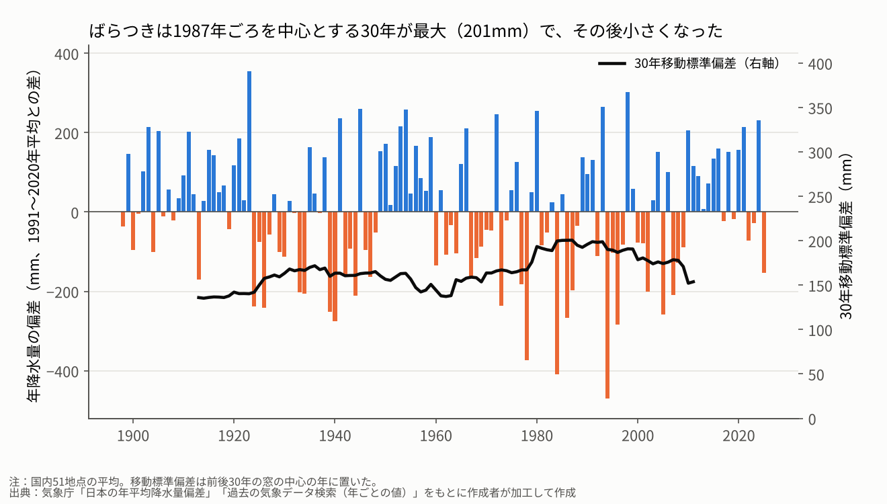
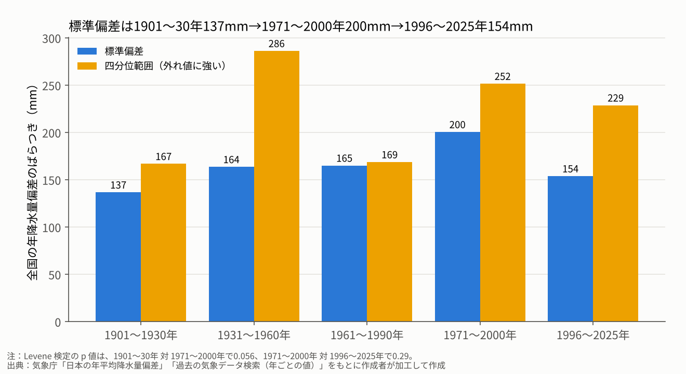
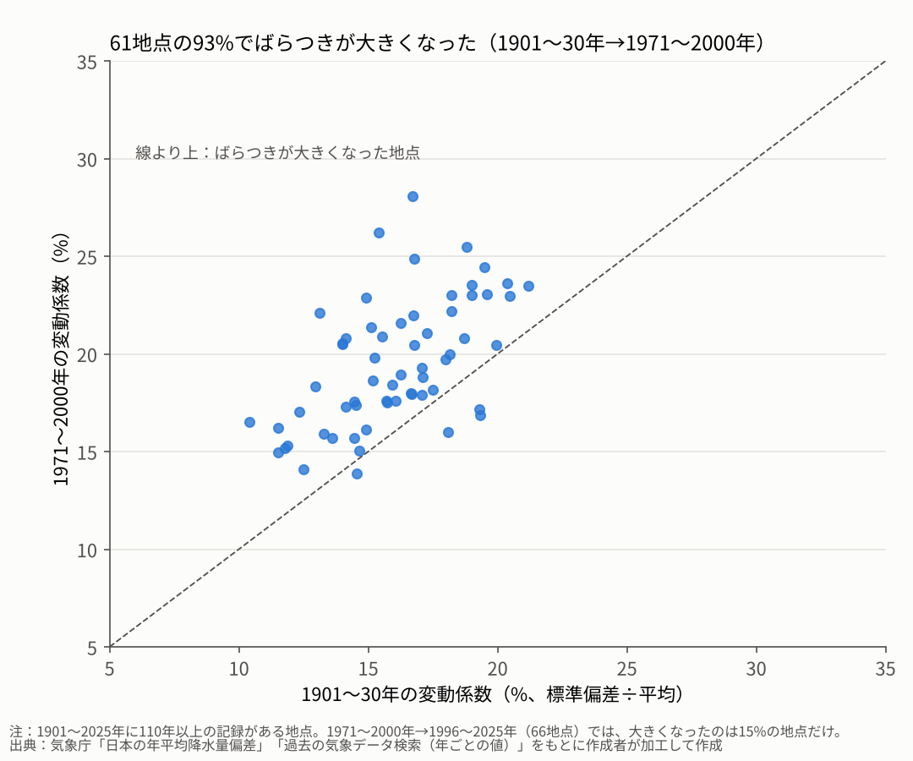
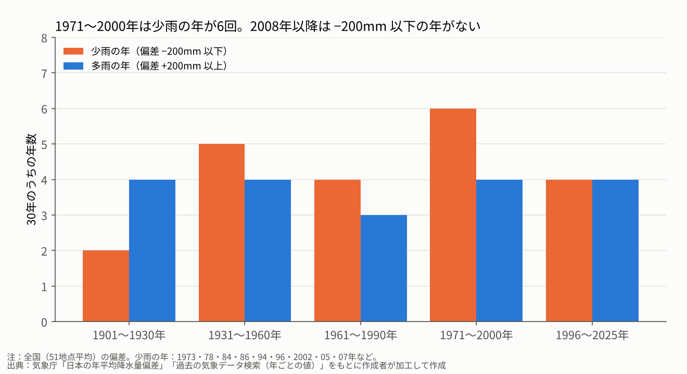

# F428 年ごとの雨の量のばらつきは、大きくなったのか？ 全国の年降水量の標準偏差は1901〜30年137mm→1971〜2000年200mmと大きくなり、最近30年は154mmに戻った。2008年以降、−200mm 以下の少雨の年はない

## 結論（先に）
- 気象庁の全国の年降水量偏差（51地点平均）の標準偏差は、1901〜30年137mm、1931〜60年164mm、1961〜90年165mm、1971〜2000年200mm、1996〜2025年154mmでした（全国の1本の系列では、30年どうしの差は検定でははっきりしない大きさです。Levene 検定 p=0.056、0.29）。気象庁の「1970〜2000年代は年々の変動が大きかった」と合います。
- 100年以上の記録がある61地点のうち93%で、1901〜30年→1971〜2000年に年降水量の変動係数が大きくなりました（中央値1.21倍）。
- ところが1971〜2000年→1996〜2025年では、大きくなった地点は66地点の15%だけで、ばらつきは小さくなっています。
- 問い直し：1971〜2000年は少雨の年（偏差 −200mm 以下）が6回と30年ごとで最も多く、標準偏差の大きさはこうした少雨の年に引っぱられた面が大きいとみられます（四分位範囲では1931〜60年のほうが大きい）。ただし回数はほかの30年でも2〜5回で、差は数回です。少雨の年は2007年が最後で、2008年以降はありません。
- 1901〜2025年の平均には、統計的にはっきりした増減はありません（10年あたり −2.7mm、p=0.51）。

## 問い
気象庁は「日本の年降水量には長期変化傾向は見られない」「1970年代から2000年代までは年々の変動が比較的大きかった」と書いています。平均は変わらなくても、ばらつきは大きくなったのか。それは今も続いているのか。地点ごとに見ても同じか。水の利用や農業、建設の計画で「多い年」「少ない年」の幅を気にする人のために確かめます。

## データ（出典）
- 気象庁「日本の年平均降水量偏差」（国内51地点の平均、1898〜2025年、1991〜2020年平均との差、mm）。一覧ページの表から取りました。
- 気象庁「過去の気象データ検索」年ごとの値（気象台・測候所など157地点）の「降水量 合計」。F331 と同じ日に同じ URL から取ったページ（HTML を gzip）です。「)」（準正常値）は使い、「]」（資料不足値）などは欠測にしました。2026年は途中なので使っていません。
- 地点の比較は、1901〜2025年に110年以上の記録があり、比べる二つの30年にそれぞれ25年以上の記録がある地点です。

## 事前の計画
[PLAN.md](PLAN.md)（2026-11-16 16:50、値を集計する前に作成）。全国の偏差の表は、ページの形を確かめるために一部の行（例：1994年 −470.0mm）を見ていました。

| 仮説 | 外れの基準 | 結果 | 判定 |
|---|---|---|---|
| H1 全国の標準偏差は1971〜2000年が1901〜30年より大きい | 大きくない | 200mm 対 137mm（Levene 検定 p=0.056） | 支持（差ははっきりとは言い切れない） |
| H2 1996〜2025年は1971〜2000年より小さい | 小さくない | 154mm 対 200mm（p=0.29） | 支持（同上） |
| H3 地点の半分より多くで1901〜30年→1971〜2000年に変動係数が大きくなった | 半分以下 | 61地点の93% | 支持 |
| H4 1901〜2025年の平均にはっきりした傾きはない | p<0.05 | −2.7mm/10年、p=0.51 | 支持 |

## やったこと
1. 地点の HTML から年降水量を、一覧ページから全国の偏差を取り出しました（02_build.py）。
2. 全国の30年移動標準偏差、30年ごとの標準偏差・四分位範囲、地点ごとの変動係数、平均の傾きを出しました（03_analysis.py）。
3. 結果を見てから、少雨の年と多雨の年の数を30年ごとに数えました（03b_requestion.py）。

## 分かったこと

### 1. ばらつきは1987年を中心とする30年が最大（図1）

前後30年の標準偏差は、1914年中心が最小（135mm）、1987年中心が最大（201mm）で、最新（2011年中心）は154mmです。

### 2. 30年ごとでは1971〜2000年が最大。ただし四分位範囲では1931〜60年（図2）

四分位範囲（真ん中の半分の幅）は1931〜60年が286mmで最大、1971〜2000年が252mmでした。標準偏差は極端な年に強く引っぱられるので、1971〜2000年の大きさは極端な少雨の年によるところが大きいと分かります。

### 3. 地点の9割でばらつきが大きくなり、その後は小さくなった（図3）

1901〜30年→1971〜2000年では61地点の93%で変動係数が大きくなりました（中央値1.21倍）。1971〜2000年→1996〜2025年では66地点の15%だけで（中央値0.84倍）、多くの地点で小さくなりました。

## 問い直し（結果を見てから足した）

### 少雨の年と多雨の年（図4）


| 30年 | 少雨の年（−200mm 以下） | 多雨の年（+200mm 以上） |
|---|---|---|
| 1901〜1930年 | 2 | 4 |
| 1931〜1960年 | 5 | 4 |
| 1961〜1990年 | 4 | 3 |
| 1971〜2000年 | 6 | 4 |
| 1996〜2025年 | 4 | 4 |

多雨の年の数はどの30年もほぼ同じで、違いは少雨の年の数です。少雨の年は1973・78・84・86・94・96・2002・05・07年で、2008年以降はありません。2010〜2025年の16年のうち11年は平年より多い年でした。

## 頑健性

| 確かめ方 | 値 |
|---|---|
| 全国の標準偏差の比（20年）1901〜20 → 1971〜90 | 1.84倍 |
| 全国の標準偏差の比（20年）1971〜90 → 2006〜25 | 0.70倍 |
| 全国の標準偏差の比（40年）1901〜40 → 1961〜2000 | 1.24倍 |
| 全国の標準偏差の比（40年）1961〜2000 → 1986〜2025 | 0.95倍 |
| 全国の四分位範囲の比 1901〜30 → 1971〜2000 | 1.51倍 |
| 全国の四分位範囲の比 1971〜2000 → 1996〜2025 | 0.91倍 |
| 地点（100年以上）：変動係数が大きくなった割合 | 93% |
| 地点（110年以上）：四分位範囲÷中央値で大きくなった割合 | 74% |
| 地点（110年以上）：傾きを除いてから変動係数が大きくなった割合 | 92% |

20世紀前半→後半の拡大は、区切り方や測り方を変えても続きます。最近の縮小は、20年で見ると大きく、40年で見ると小さくなります。

## 言えないこと
- 地点の観測場所の移転や測器の変更の影響は除いていません（地点のデータは均質化されていません）。
- 1年の合計のばらつきで、1日の強い雨が増えたかどうかとは別の話です。
- ばらつきが変わった原因（温暖化、自然の変動など）は分けられません。
- 全国の30年ごとの差は検定でははっきりしない大きさです（p=0.056、0.29）。水の利用などについての助言はしません。

## 仕事で使うなら
- 「最近は雨の年の差が大きい」と考える前に、ばらつきが最も大きかったのは1970〜2000年代で、2008年以降は大きな少雨の年が出ていないことを確かめておくと読み違えにくいです。
- 地点ごとの変動係数は results/station_cv.csv にあります。

## 計画からの変更
- 計画どおりに進めました。問い直し（少雨・多雨の年の数）は結果を見てから足しました。地点のデータは F331 と同じ日に同じ URL から取ったものを使いました。

## 再現のしかた
```
sh src/run_all.sh        # オフライン。所要約5秒
python3 src/01_fetch.py  # 元データを取り直すときだけ（ネットを使う、約3分）
```

| ファイル | 中身 |
|---|---|
| src/02_build.py | 地点の HTML と一覧ページから data/station_annual.csv・national.csv を作る |
| src/03_analysis.py | ばらつき・傾き・仮説・頑健性 → results/main.json・national_rolling.csv・periods.csv・station_cv.csv・robustness.csv |
| src/03b_requestion.py | 問い直し → results/requestion.json・extreme_years.csv |
| src/04_figures.py | 図4枚 |

repro_check：/tmp/rep_F428 に写して流し、results・figures・data の CSV がすべて cmp で一致（件数と所要時間は results/repro_check.txt）。乱数は使っていません。

## レビューで直したこと

独立レビュー（2026-11-17）で次を直しました。直したあと /tmp で流し直し、results・figures・data の CSV が一致することを確かめています。

| # | 指摘 | 直し方 |
|---|---|---|
| 1 | 結論に、全国の30年どうしの差が検定ではっきりしない（Levene 検定 p=0.056、0.29）ことが書かれていない | 結論の1点目に追記 |
| 2 | 問い直しの「ばらつきの大きさは少雨の年が6回と多かったためでした」は、ほかの30年（2〜5回）との差に比べて言い過ぎ | README・note とも「少雨の年に引っぱられた面が大きいとみられる」に弱め、回数の差は数回であることを追記 |

## 出典
- 気象庁「日本の年平均降水量偏差」：https://www.data.jma.go.jp/cpdinfo/temp/list/an_jpn_r.html （解説：https://www.data.jma.go.jp/cpdinfo/temp/an_jpn_r.html ）
- 気象庁「過去の気象データ検索」年ごとの値：https://www.data.jma.go.jp/stats/etrn/view/annually_s.php （地点ごとの URL は src/01_fetch.py）

（いずれも 気象庁「日本の年平均降水量偏差」「過去の気象データ検索」をもとに作成者が加工して作成）
