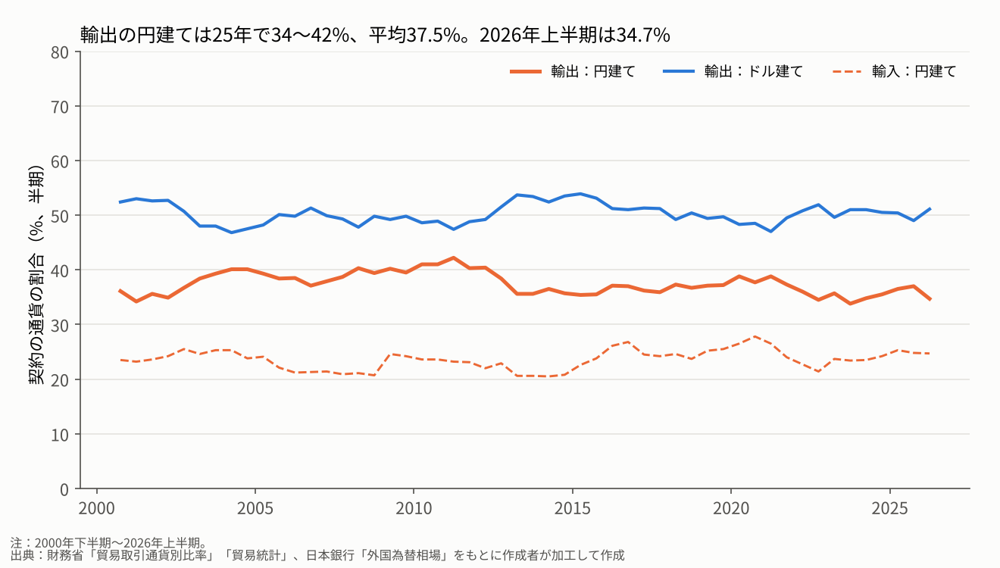
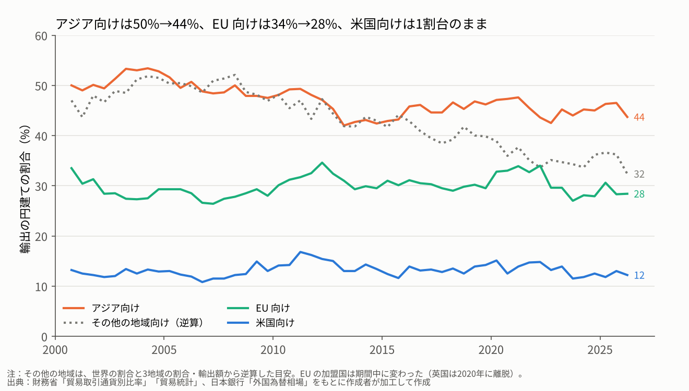
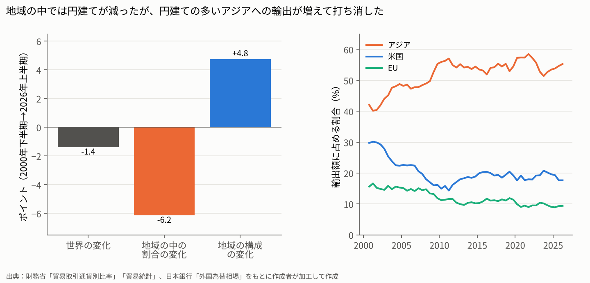
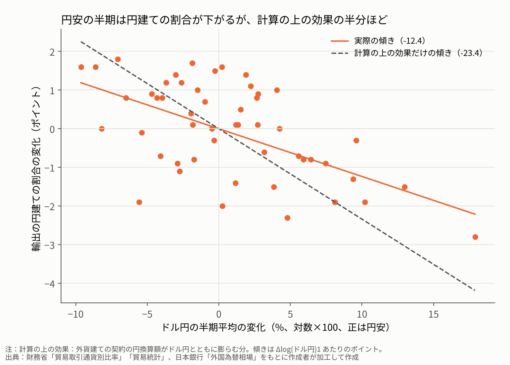

# F429 輸出の契約は、どれだけ円建てで行われているのか？ 25年間ずっと34〜42%（平均37.5%、2026年上半期34.7%）。地域ごとには円建てが減ったが、円建ての多いアジア向けが増えて打ち消した

## 結論（先に）
- 輸出の円建ての割合は、2000年下半期36.1%、2026年上半期34.7%で、25年間ずっと33.8〜42.2%（平均37.5%）の範囲でした。ドル建ては約5割のままです。
- 米国向けの円建ては1割台（13.2%→12.2%）、EU 向けは33.5%→28.4%、アジア向けは50.0%→43.7%でした。
- 世界の円建ての変化（−1.4ポイント）は、地域の中での減少（−6.2）を、円建ての多いアジア向けの輸出の増加（輸出額の42%→55%、構成の変化 +4.8）が打ち消した結果です。
- 円安の半期ほど円建ての割合は下がります（変化の相関 −0.58）。問い直し：その下がり方は、外貨建ての分が円換算で膨らむ「計算の上の効果」の半分ほど（傾き −12.4 対 −23.4）でした。
- 輸入の円建ては20.5〜27.8%で、どの半期も輸出より低いです。

## 問い
「円安になると輸出企業がもうかる」と言われますが、それは契約が外国の通貨で決まっている場合の話です。日本の輸出のうち円で契約している割合はどれくらいなのか、相手の地域でどう違い、25年でどう変わったのか。輸出入の仕事をする人、円安の影響の話題を読む人のために、財務省の貿易取引通貨別比率で確かめます。

## データ（出典）
- 財務省「貿易取引通貨別比率」時系列（輸出・輸入、半期、2000年下半期〜2026年上半期）：世界・米国・EU・アジアの上位5通貨とその他の割合。
- 財務省「貿易統計」輸出入額の推移 月別 輸出の総額（世界・米国・EU・アジア）を半期に合計し、地域の重みにしました。その他の地域＝世界−3地域。
- 日本銀行「外国為替相場」ドル円（月中平均の半期平均）。
- その他の地域の円建ての割合は、世界の割合と3地域の割合・輸出額から逆算した目安です。

## 事前の計画
[PLAN.md](PLAN.md)（2026-11-16 17:25、地域別や分解を集計する前に作成）。下見で、世界の円・ドルの割合を3年おきに見ていました（輸出の円建ては35〜40%ほど）。

| 仮説 | 外れの基準 | 結果 | 判定 |
|---|---|---|---|
| H1 世界の輸出の円建てはすべての半期で33〜42% | 範囲の外がある | 33.8〜42.2%（2011年上半期だけ42%を超える） | 外れ（わずかに） |
| H2 アジア向けの円建ては5ポイント以上下がった | 下がりが5ポイント未満 | 50.0%→43.7%（−6.3） | 支持 |
| H3 世界の変化は地域の中の変化の方が大きく説明する | 構成の変化の方が大きい | 地域の中 −6.2、構成 +4.8 | 支持 |
| H4 円の割合の変化とドル円の変化の相関は弱い（0.3未満） | 0.3以上 | −0.58 | 外れ |

## やったこと
1. 通貨別比率を長い形に、月別の輸出額を半期の地域別に、ドル円を半期平均にしました（02_build.py）。
2. 円建ての割合の推移、その他の地域の逆算、シフト・シェア分解、ドル円との相関を出しました（03_analysis.py）。
3. 結果を見てから、円安で円建ての割合が下がる分のうち、計算の上の効果を求めて比べました（03b_requestion.py）。

## 分かったこと

### 1. 輸出の円建ては25年間、34〜42%の範囲のまま（図1）

最も高いのは2011年上半期の42.2%、最も低いのは2023年下半期の33.8%です。ドル建ては52.4%→51.1%、輸入の円建ては23.5%→24.7%でした。

### 2. 地域で大きく違う（図2）

米国向けはほとんどドルで契約しています。アジア向けはドル建てが48.2%→48.6%でほぼ同じなので、円建ての減った分は現地の通貨などに移ったと考えられます（推測）。その他の地域向けは、逆算で47.0%→32.4%です（目安）。

### 3. 地域の中での減少を、構成の変化が打ち消した（図3）

輸出額に占める割合は、アジア向けが42.1%→55.3%、米国向けが29.7%→17.7%になりました。円建ての割合が高いアジア向けの重みが増えたことで、世界全体の円建ての割合はほとんど動きませんでした。

## 問い直し（結果を見てから足した）

### 円安で円建ての割合が下がるのは、計算の上の効果か（図4）

外貨で契約した分は、円安になると円に換えた額が膨らみます。契約が何も変わらなくても、円建ての割合は計算の上で下がります。その効果は −s(1−s)×Δlog(ドル円)（s は円建ての割合）です。

| | 傾き（Δlog ドル円 1 あたりのポイント） | 2000年下半期→2026年上半期の合計 |
|---|---|---|
| 実際の円建ての割合の変化 | −12.4 | −1.4ポイント |
| 計算の上の効果だけ | −23.4 | −8.4ポイント |
| 差（計算の上の効果で説明できない分） | — | +7.0ポイント |

実際の下がり方は計算の上の効果の半分ほどで、差は円安の半期ほど大きくなります（差とドル円の変化の相関 0.53）。（推測）円建ての契約の値段の引き上げや、円建ての取引の増加などが打ち消している可能性があります。この統計では確かめられません。

## 頑健性

| 確かめ方 | 世界の変化 | 地域の中 | 構成 | アジア向けの変化 |
|---|---|---|---|---|
| 2000年下半期→2026年上半期（本線） | −1.4 | −6.2 | +4.8 | −6.3 |
| 2001年上半期→2026年上半期 | +0.5 | −4.6 | +5.1 | −5.3 |
| 2012年下半期→2026年上半期 | −3.7 | −3.8 | +0.1 | −1.6 |
| 最初と最後の6半期の平均の差 | −0.6 | — | — | −5.4 |

- 相関は、水準どうし（円建ての割合と log ドル円）で −0.71、ドル円の変化と次の半期の割合の変化では 0.01 でした。
- 輸入の円建ては23.5%→24.7%（+1.2）、アジアからの輸入は −1.4 ポイントでした。
- アジアの重みが増えたのは主に2000年代で、2012年以降は構成の効果がほぼなくなり、地域の中での減少がそのまま表に出ています。

## 言えないこと
- 円で契約していても、値段の決め方（ドルの値段を見て円の値段を決めるなど）は分かりません。
- 企業の大きさや業種別の割合は、この統計では分かりません。
- その他の地域の割合は逆算した目安で、誤差があります。EU の加盟国は期間中に変わりました（英国は2020年に離脱）。
- 計算の上の効果の式は、円建ての契約の円の額が為替で動かないとした近似です。為替や契約のしかたについての助言はしません。

## 仕事で使うなら
- 「円安で輸出がもうかる」を考えるときは、輸出の約3分の1は円建てで、相手の地域によって割合が大きく違う（米国向け1割台、アジア向け4割台）ことを前提にすると、影響の大きさを読み違えにくいです。
- 半期ごとの割合は results/jpy_share.csv にあります。

## 計画からの変更
- 計画どおりに進めました。問い直し（計算の上の効果）は結果を見てから足しました。

## 再現のしかた
```
sh src/run_all.sh        # オフライン。所要約3秒
python3 src/01_fetch.py  # 元データを取り直すときだけ（ネットを使う）
```

| ファイル | 中身 |
|---|---|
| src/02_build.py | data/currency_long.csv・exports_half.csv・fx_half.csv を作る |
| src/03_analysis.py | 推移・逆算・分解・相関・仮説・頑健性 → results/main.json・jpy_share.csv・robustness.csv |
| src/03b_requestion.py | 問い直し → results/requestion.json |
| src/04_figures.py | 図4枚 |

repro_check：/tmp/rep_F429 に写して流し、results・figures・data の CSV がすべて cmp で一致（件数と所要時間は results/repro_check.txt）。乱数は使っていません。

## レビューで直したこと

独立レビュー（2026-11-17）で次を直しました。直したあと /tmp で流し直し、results・figures・data の CSV が一致することを確かめています。

| # | 指摘 | 直し方 |
|---|---|---|
| 1 | 題名・見出しの「ほぼ3割台後半」が、最新の34.7%・最低33.8%と合わない | 題名を「25年間ずっと34〜42%（平均37.5%、2026年上半期34.7%）」にし、status・note・README の見出しもそろえた |

## 出典
- 財務省「貿易取引通貨別比率」：https://www.customs.go.jp/toukei/shinbun/tuukahappyou.html （時系列 CSV：https://www.customs.go.jp/toukei/shinbun/tuuka/timeseriesSCT_e.csv ・ timeseriesSCT_i.csv）
- 財務省「貿易統計」輸出入額の推移（月別）：https://www.customs.go.jp/toukei/suii/html/time.htm
- 日本銀行「外国為替相場」ドル円（FXERM07）：https://www.stat-search.boj.or.jp/

（いずれも 財務省「貿易取引通貨別比率」「貿易統計」、日本銀行「外国為替相場」をもとに作成者が加工して作成）
