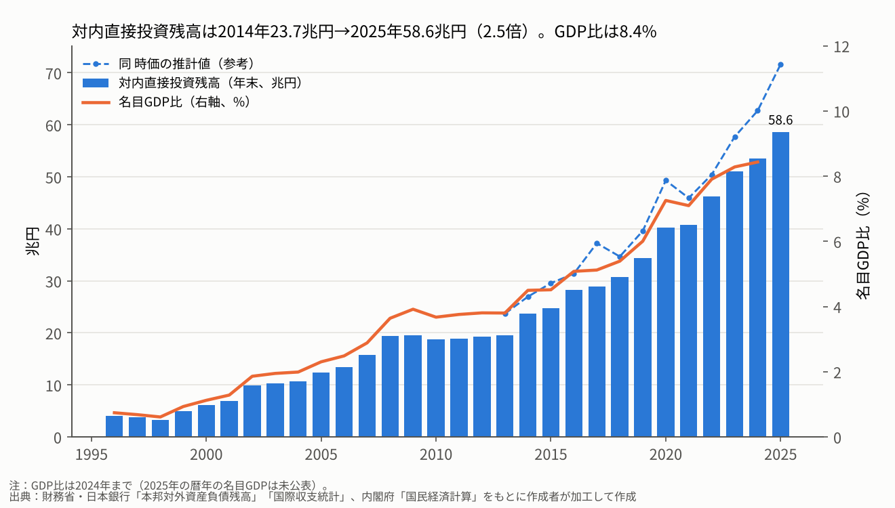
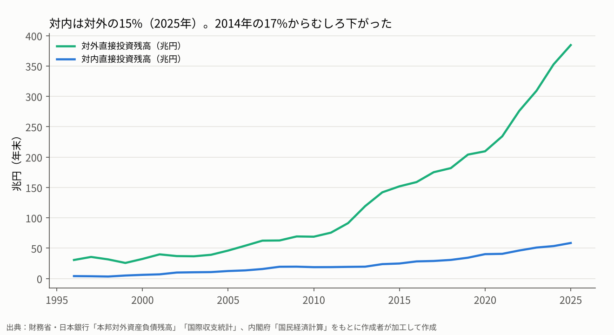
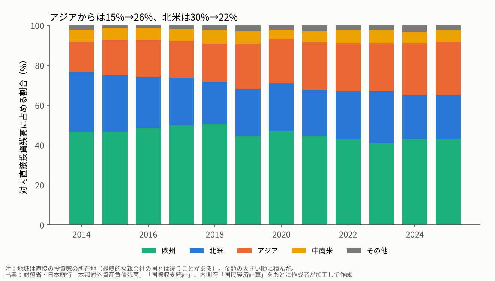
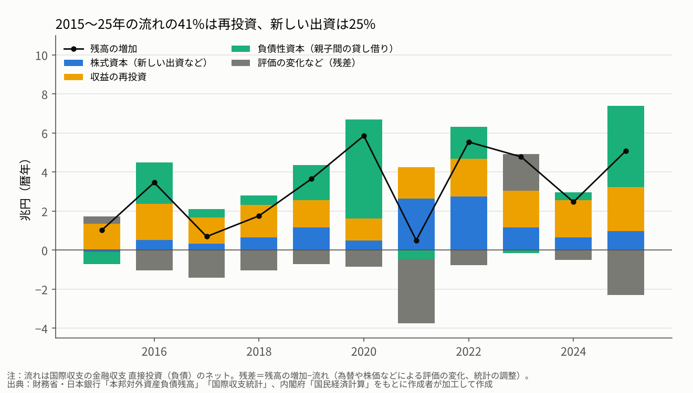

# F430 「日本への直接投資は少ない」は、残高で見てどれだけ増えたのか？ 対内直接投資残高は2014→25年に23.7兆円から58.6兆円へ2.5倍。それでもGDP比は8.4%、対外の15%で、増加の多くは再投資と親子間の貸し借り

## 結論（先に）
- 対内直接投資残高（外国企業が日本に持つ直接投資の残高）は、2014年末の23.7兆円から2025年末の58.6兆円へ2.5倍（年率8.6%）になりました。
- 名目GDP比は4.5%（2014年）から8.4%（2024年）に上がりましたが、日本から海外への直接投資残高（2025年末384.5兆円）に対しては15%で、2014年の17%より少し下がりました。
- 問い直し：2015〜25年の流れ（44.4兆円）のうち、日本にある外国企業の利益の再投資が41%、親子間の貸し借り（負債性資本）が33%、新しい出資などの株式資本は25%でした。流れの合計は残高の増加（34.8兆円）より大きく、差は評価の変化などです。
- 地域別の割合は、アジアが15%→26%に上がり、北米は30%→22%に下がりました（直接の投資家の所在地）。
- 政府目標（2030年に120兆円）に届くには、2025年から年率15.4%が必要で、これまでの約2倍です（目安。予測ではありません）。

## 問い
「日本は外国からの直接投資が少ない」とよく言われ、政府は「対日直接投資促進プログラム2025」で対内直接投資残高を2030年に120兆円、2030年代前半のできるだけ早期に150兆円とする目標を掲げています（前の目標は2030年に100兆円）。残高はどれだけ増えたのか、それは新しい投資によるのか、利益の再投資や評価の変化によるのか、どの地域からなのか。外国企業との取引や誘致にかかわる人、経済の解説を読む人のために確かめます。

## データ（出典）
- 財務省・日本銀行「本邦対外資産負債残高」（年末、1996〜2025年）：直接投資の負債（対内）・資産（対外）、負債の内訳（株式資本・収益の再投資・負債性資本）、時価に基づく直接投資残高の推計値（2013年〜、参考）。
- 同「直接投資残高地域別（負債）」（2014〜2025年）。
- 同「国際収支統計」金融収支 直接投資（負債）のネット（月次 1996〜2025年を暦年に合計）。
- 内閣府「四半期別GDP速報」名目暦年（2020年基準、2024年まで）。
- すべて日本銀行 時系列統計データ検索サイトの API と内閣府の CSV から取り、兆円にそろえました。

## 事前の計画
[PLAN.md](PLAN.md)（2026-11-16 17:55、値を集計する前に作成）。下見では系列の名前と期間だけを見ました。

| 仮説 | 外れの基準 | 結果 | 判定 |
|---|---|---|---|
| H1 2014〜2025年に2倍以上 | 2倍未満 | 2.47倍 | 支持 |
| H2 2024年の GDP 比は10%未満 | 10%以上 | 8.4%（時価の推計値では9.9%） | 支持 |
| H3 流れの合計が残高の増加の半分以上を説明 | 半分未満 | 128%（流れの方が大きい） | 支持 |
| H4 対外に対する対内の比は2025年も5分の1未満 | 5分の1以上 | 15% | 支持 |

## やったこと
1. 残高・地域別・流れ・GDP を年の表にしました（02_build.py）。
2. 残高の伸び、GDP 比、対外との比、増加の内訳（流れとそれ以外）、地域の割合を出しました（03_analysis.py）。
3. 結果を見てから、年ごとの流れの中身と残差を並べました（03b_requestion.py）。

## 分かったこと

### 1. 11年で2.5倍（図1）

1996年末は4.0兆円（GDP比0.7%）でした。2008年に19兆円台に増えたあと2013年まで横ばいで、2014年から再び増えています。2025年末の残高の内訳は、株式資本26.1兆円、収益の再投資9.8兆円、負債性資本22.7兆円です。

### 2. 対外の15%（図2）

対外直接投資残高は2014→2025年に2.7倍になり、対内（2.5倍）より速く増えました。対内÷対外は1996年13%、2014年17%、2025年15%です。

### 3. アジアからの割合が上がった（図4）

2025年は欧州43%（英国16.5%、オランダ7.5%）、アジア26%（シンガポール12.1%、香港6.2%、中国2.3%）、北米22%（米国20.1%）です。EU の割合は42%→20%ですが、これは2020年の英国の離脱による部分が大きいです。

## 問い直し（結果を見てから足した）

### 増加の中身は何か（図3）


| 2015〜2025年の合計 | 兆円 | 割合 |
|---|---|---|
| 株式資本（新しい出資など） | 11.3 | 25% |
| 収益の再投資 | 18.3 | 41% |
| 負債性資本（親子間の貸し借り） | 14.9 | 33% |
| 流れの合計 | 44.4 | 100% |
| 残高の増加 | 34.8 | — |
| 残差（評価の変化など） | −9.6 | — |

残差は11年のうち9年でマイナスでした（最も大きいのは2021年の −3.3兆円）。流れで入ってきた額ほどには残高が増えていません。2025年の流れ7.4兆円のうち4.1兆円は負債性資本でした。

## 頑健性

| 確かめ方 | 残高の増加（兆円） | 流れの合計（兆円） | 流れ÷増加 | 年率 |
|---|---|---|---|---|
| 2014→2025年（本線） | 34.8 | 44.4 | 128% | 8.6% |
| 2005→2025年 | 46.2 | 54.2 | 117% | 8.1% |
| 1996→2025年 | 54.5 | 62.2 | 114% | 9.7% |
| 時価の推計値 2014→2025年 | 44.7 | — | — | 9.3% |
| 2030年に120兆円に届く年率（2025年から、目安） | — | — | — | 15.4% |

どの起点でも、流れの合計が残高の増加を上回ります。時価で見ると伸びは少し大きくなります。

## 言えないこと
- 地域は直接の投資家の所在地で、最終的な親会社の国とは違うことがあります（シンガポール・香港・オランダなどを経由する投資）。
- 残高が増えたことの効果（雇用、賃金、技術）は、このデータでは分かりません。
- 他の国との比較はしていません。
- 残差（評価の変化など）の中身は分けられません。政策の評価や助言、目標に届くかの予測はしません。

## 仕事で使うなら
- 「対日投資が増えた」を読むときは、増えた額の4割は日本にある外国企業の利益の再投資で、新しい出資は4分の1であることを合わせて読むと、実感とのずれを説明しやすいです。
- 年ごとの値は results/annual_table.csv、流れは results/yearly_flows.csv にあります。

## 計画からの変更
- 計画どおりに進めました。問い直し（年ごとの流れの中身）は結果を見てから足しました。

## 再現のしかた
```
sh src/run_all.sh        # オフライン。所要約3秒
python3 src/01_fetch.py  # 元データを取り直すときだけ（ネットを使う）
```

| ファイル | 中身 |
|---|---|
| src/02_build.py | data/annual.csv・region.csv を作る |
| src/03_analysis.py | 伸び・GDP 比・分解・地域・仮説・頑健性 → results/main.json・annual_table.csv・region_shares.csv・robustness.csv |
| src/03b_requestion.py | 問い直し → results/requestion.json・yearly_flows.csv |
| src/04_figures.py | 図4枚 |

repro_check：/tmp/rep_F430 に写して流し、results・figures・data の CSV がすべて cmp で一致（件数と所要時間は results/repro_check.txt）。乱数は使っていません。

## レビューで直したこと

独立レビューで数字の照合・再実行・図を確かめ、直すところはなかった。

## 出典
- 財務省・日本銀行「本邦対外資産負債残高」「直接投資残高地域別」「国際収支統計」：日本銀行 時系列統計データ検索サイト https://www.stat-search.boj.or.jp/ （系列コードは src/01_fetch.py）
- 内閣府「四半期別GDP速報」2025年7-9月期2次速報 名目暦年：https://www.esri.cao.go.jp/jp/sna/data/data_list/sokuhou/files/2025/qe253_2/tables/gaku-mcy2532.csv
- 内閣府「対日直接投資促進プログラム2025」の目標（問いの背景）：https://www.businessinsider.jp/article/202506-foreign-direct-investment-by-2030-120-trillion/ （報道による要約。目標の本文は内閣府 対日直接投資推進会議 https://www.cao.go.jp/invest-japan/ ）

（いずれも 財務省・日本銀行「本邦対外資産負債残高」「国際収支統計」、内閣府「国民経済計算」をもとに作成者が加工して作成）
