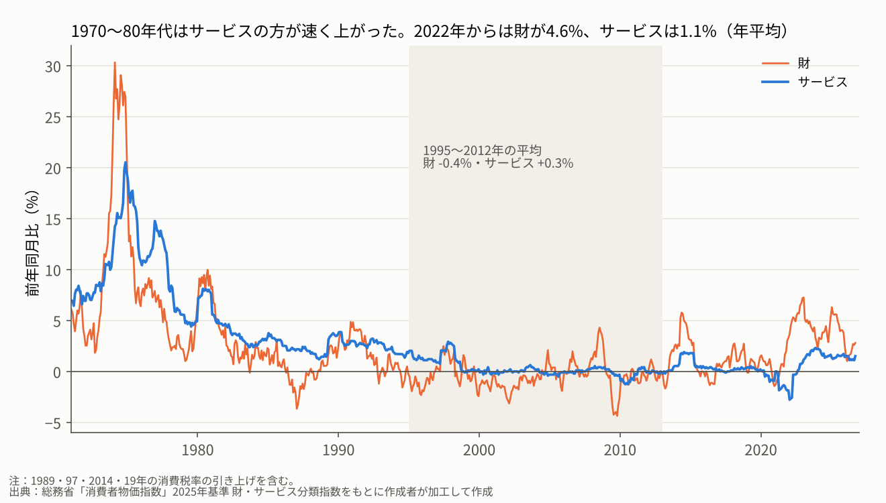
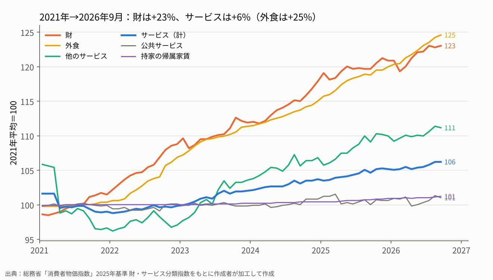
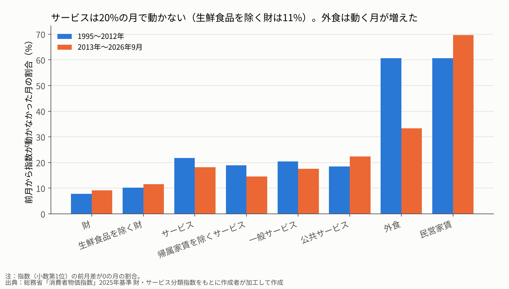
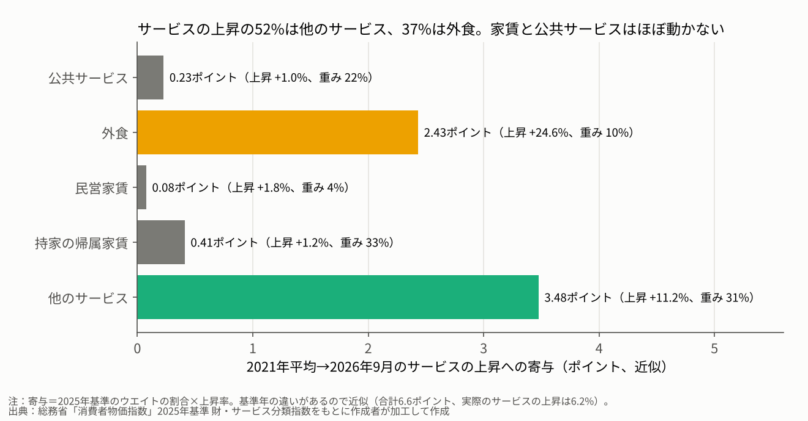

# F431 「サービスの値段は上がりにくい」は本当か？ 2021年→2026年9月に財は+23%、サービスは+6%。サービスは2割の月で指数が動かず、家賃と公共サービスはほぼ横ばい。外食だけは財並みの+25%

## 結論（先に）
- 2021年平均→2026年9月に、消費者物価の財は+23.1%、サービスは+6.2%でした（3.7倍の差）。生鮮食品を除く財（+22.2%）と持家の帰属家賃を除くサービス（+8.6%）でも2.6倍です。
- ただし「サービスは上がりにくい」は昔からではありません。1971〜90年の平均はサービスが年6.5%、財が5.0%で、サービスの方が速く上がっていました。1995〜2012年はサービス+0.3%、財 −0.4%で、どちらもほとんど上がっていません。
- 前月から指数が動かなかった月の割合は、サービス20%、生鮮食品を除く財11%（1995年〜2026年9月）。民営家賃は65%の月で動きません。外食は1995〜2012年の61%から2013年以降は33%に下がり、値段を変える月が増えました。
- 問い直し：2021年からのサービスの上昇は、他のサービス（52%）と外食（37%）でほぼ説明でき、重みの3分の1を占める持家の帰属家賃と、公共サービス・民営家賃はほとんど動いていません。

## 問い
日本銀行の説明や報道では「日本のサービスの値段は上がりにくい」と言われます。2022年からの物価の上昇で、サービスはどこまで上がったのか、財とサービスで値段の動く頻度はどれだけ違うのか。値付けや賃金、物価の解説を読む人のために確かめます。

## データ（出典）
- 総務省「消費者物価指数」2025年基準 財・サービス分類指数（全国、月次、1970年1月〜2026年9月、e-Stat の CSV）。
- 使った区分：総合、財、生鮮食品を除く財、工業製品、食料工業製品、サービス、持家の帰属家賃を除くサービス、公共サービス、一般サービス、外食、民営家賃、持家の帰属家賃、他のサービス。ウエイトは2025年基準の1万分比。
- 前年比は年平均どうし（期間の平均）と月次の前年同月比、「動かなかった月」は指数（小数第1位）の前月差が0の月です。

## 事前の計画
[PLAN.md](PLAN.md)（2026-11-16 18:20、値を集計する前に作成）。下見では見出しと1970年1〜6月・2026年8〜9月の行だけを見ました。

| 仮説 | 外れの基準 | 結果 | 判定 |
|---|---|---|---|
| H1 2021年→最新の上昇は財がサービスの2倍以上 | 2倍未満 | 23.1% 対 6.2%（3.7倍） | 支持 |
| H2 1995〜2012年のサービスの前年比は ±0.5%以内 | 範囲の外 | +0.27% | 支持 |
| H3 動かなかった月はサービスの方が多い | 少ないか同じ | 20.2% 対 10.8%（生鮮食品を除く財） | 支持 |
| H4 帰属家賃を除くサービスの2025年の前年比は2%超 | 2%以下 | 1.98% | 外れ（わずかに届かず） |

## やったこと
1. CSV から使う区分を取り出し、月次の表にしました（02_build.py）。
2. 期間ごとの前年比の平均、2021年からの上昇、動かなかった月の割合を出しました（03_analysis.py）。
3. 結果を見てから、サービスの上昇を5つの区分の寄与に分けました（03b_requestion.py）。

## 分かったこと

### 1. 昔はサービスの方が速く上がっていた（図1）


| 期間（年平均） | 財 | サービス | 外食 | 公共サービス |
|---|---|---|---|---|
| 1971〜1990年 | 5.0% | 6.5% | 6.5% | 6.4% |
| 1995〜2012年 | −0.4% | 0.3% | 0.4% | 0.3% |
| 2013〜2021年 | 1.0% | 0.2% | 1.3% | 0.6% |
| 2022〜2025年 | 4.6% | 1.1% | 4.3% | 0.2% |

財とサービスの差がはっきりしたのは2013年以降で、2022年からさらに開きました。2025年の前年比は財4.7%、サービス1.5%、帰属家賃を除くサービス1.98%です。

### 2. 2021年から財は+23%、サービスは+6%（図2）

外食（+24.6%）は財と同じくらい上がり、他のサービスは+11.2%でした。公共サービス+1.0%、民営家賃+1.8%、持家の帰属家賃+1.2%はほとんど動いていません。

### 3. サービスは動かない月が多い（図3）

1995年〜2026年9月に指数が前月から動かなかった月の割合は、財8%、生鮮食品を除く財11%、サービス20%、帰属家賃を除くサービス17%、民営家賃65%、外食49%です。外食は2013年以降に動く月が増えました（61%→33%）。

## 問い直し（結果を見てから足した）

### サービスの上昇の中身（図4）


| 区分 | 重み（サービスの中） | 2021年→最新の上昇 | 寄与（ポイント、近似） |
|---|---|---|---|
| 公共サービス | 22% | +1.0% | 0.23 |
| 外食 | 10% | +24.6% | 2.43 |
| 民営家賃 | 4% | +1.8% | 0.08 |
| 持家の帰属家賃 | 33% | +1.2% | 0.41 |
| 他のサービス | 31% | +11.2% | 3.48 |

寄与の合計は6.6ポイント（実際のサービスの上昇は6.2%。2025年基準のウエイトを使った近似のため）。他のサービスが52%、外食が37%です。他のサービスは2021年春に下がってから上がっていて、携帯電話の通信料の値下げが2021年平均を下げている分もあると考えられます（推測）。

## 頑健性

| 確かめ方 | 財 | サービス | 比 |
|---|---|---|---|
| 2021年平均→2026年9月（本線） | +23.1% | +6.2% | 3.7倍 |
| 2020年平均→2026年9月 | +23.9% | +4.9% | 4.9倍 |
| 2019年平均→2026年9月 | +24.5% | +4.4% | 5.6倍 |
| 生鮮食品を除く財 対 帰属家賃を除くサービス（2021年→） | +22.2% | +8.6% | 2.6倍 |

| 動かなかった月の割合 | 1995〜2012年 | 2013年〜2026年9月 | 消費税率の改定月を除く全期間 |
|---|---|---|---|
| 生鮮食品を除く財 | 10.2% | 11.5% | 10.8% |
| サービス | 21.8% | 18.2% | 20.4% |
| 帰属家賃を除くサービス | 19.0% | 14.5% | 17.2% |

## 言えないこと
- 指数は区分の平均で、店や品目ごとに値段をどれくらいの間隔で変えているかは分かりません。
- 公共サービスは制度で決まる値段が多く、市場の動きとは別に動きます。
- 持家の帰属家賃は実際に払う値段ではありません（推計）。
- 2021年からの比べ方には、携帯電話の通信料の値下げなど一度だけの変化も入ります。物価や値付けについての助言はしません。

## 仕事で使うなら
- 「サービスは上がりにくい」を一つの数字で語ると、外食のように財並みに上がった区分と、家賃や公共サービスのように動かない区分が混ざります。区分ごとに分けて見ると、どこで値段が動いているかが分かります。
- 期間ごとの値は results/periods.csv、動かなかった月の割合は results/zero_change.csv にあります。

## 計画からの変更
- 計画どおりに進めました。問い直し（サービスの上昇の寄与）は結果を見てから足しました。公共サービスの中の個別の区分は取り上げていません（サービス・公共サービスの合計には入っています）。

## 再現のしかた
```
sh src/run_all.sh        # オフライン。所要約3秒
python3 src/01_fetch.py  # 元データを取り直すときだけ（ネットを使う）
```

| ファイル | 中身 |
|---|---|
| src/02_build.py | CSV から data/cpi_monthly.csv を作る |
| src/03_analysis.py | 期間の平均・2021年からの上昇・動かなかった月・仮説・頑健性 → results/main.json・periods.csv・since2021.csv・zero_change.csv・yoy.csv・robustness.csv |
| src/03b_requestion.py | 問い直し → results/requestion.json・services_contrib.csv |
| src/04_figures.py | 図4枚 |

repro_check：/tmp/rep_F431 に写して流し、results・figures・data の CSV がすべて cmp で一致（件数と所要時間は results/repro_check.txt）。乱数は使っていません。

## レビューで直したこと

独立レビュー（2026-11-17）で次を直しました。直したあと /tmp で流し直し、results・figures・data の CSV が一致することを確かめています。

| # | 指摘 | 直し方 |
|---|---|---|
| 1 | 「計画からの変更」に扱わない話題の区分名が出ている | 「公共サービスの中の個別の区分」という言い方に替えた |

## 出典
- 総務省「消費者物価指数」2025年基準 財・サービス分類指数（全国、月次）：https://www.e-stat.go.jp/stat-search/file-download?statInfId=000040482946&fileKind=1

（いずれも 総務省「消費者物価指数」をもとに作成者が加工して作成）
