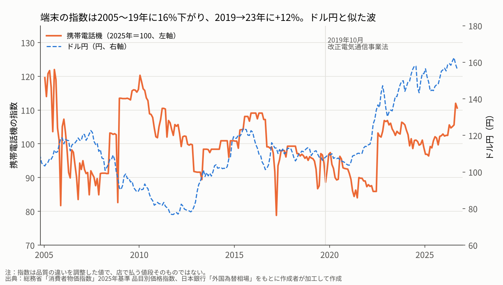
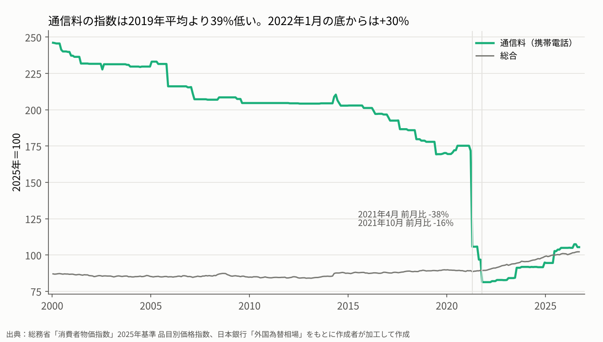
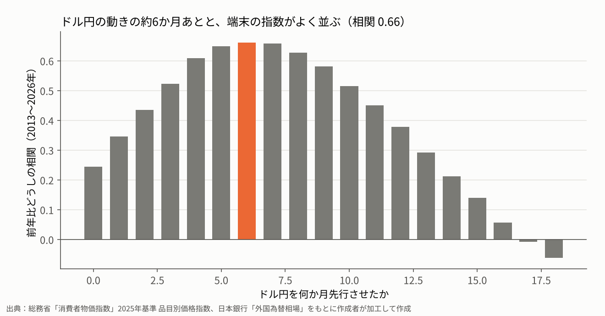
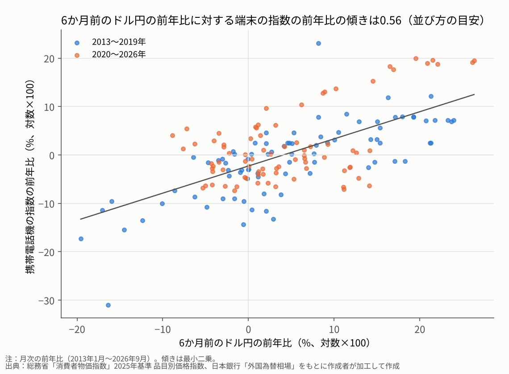

# F432 携帯電話の端末の値段は、指数でどう動いてきたのか？ 2005〜19年に16%下がり、2019→23年に+12%。ドル円の約6か月あとに並んで動く（傾き0.56）。通信料は2019年より39%低い

## 結論（先に）
- 消費者物価指数の携帯電話機（2025年＝100）は、2005年平均110.8→2019年平均93.2（−16%）→2021年平均88.0（最低）→2023年平均104.8（2019年比+12%）→2025年平均100.0でした。長く下がり続けた品目ではありません。
- 端末の指数の前年比は、約6か月前のドル円の前年比とよく並びます（相関0.66、同じ月どうしは0.25）。傾きは0.56で、ドル円の前年比が1%高い時期は、半年後の端末の前年比が約0.56%高いという並び方です（ずらす月数は結果を見てから選んだもので、前年比どうしの相関は高めに出やすい点に注意が要ります）。
- 通信料（携帯電話）の指数は、2021年4月に前月比 −38%、10月に −16%と下がり、2026年9月は2019年平均より39%低い水準です。2022年1月の底からは+30%上がりました。
- 問い直しで、ドル円を0〜18か月ずらした相関を並べ、6か月で最も強くなることを確かめました。

## 問い
携帯電話は、2019年10月の電気通信事業法の改正で通信料と端末代の分離や端末の値引きの上限が決まり、2021年春には大手の通信料が大きく下がりました。物価指数で見ると、端末と通信料はそれぞれどう動いたのか、端末の値段は円安とどう並ぶのか。スマートフォンを買う人、物価の解説を読む人のために確かめます。F483（家計の通信料の支出）とは別に、物価指数の側を見ます。関連する記事：F88 は、2021年の通信料の値下げが消費者物価をどれだけ下げたかを、値下げの前後の段差として推定したものです。この記事は通信料よりも端末の指数と為替との並びを主に見ます。

## データ（出典）
- 総務省「消費者物価指数」2025年基準 品目別価格指数（全国、月次、e-Stat の CSV）：携帯電話機（2005年1月〜）、通信料（携帯電話）（2000年1月〜）、通信料（固定電話）、通信、総合。
- 日本銀行「外国為替相場」ドル円（月中平均）。
- 前年比は対数の差（×100）または比で計算し、相関は2013年1月〜2026年9月の月次で出しました。

## 事前の計画
[PLAN.md](PLAN.md)（2026-11-16 18:50、集計の前に作成）。この番号のたたき台（卵と鳥インフルエンザ）から予備 R44 に替えた理由も PLAN と REPLACED.md に書きました。下見で、携帯電話機と通信料のいくつかの月の値を見ていました。

| 仮説 | 外れの基準 | 結果 | 判定 |
|---|---|---|---|
| H1 携帯電話機は2005→2019年に30%以上下がった | 30%未満 | −15.9% | 外れ |
| H2 2019→2023年に上がった | 上がっていない | +12.3% | 支持 |
| H3 前年比どうしの相関（同じ月、2013〜2026年）は0.3以上 | 0.3未満 | 0.25（6か月ずらすと0.66） | 外れ |
| H4 通信料は2026年9月に2019年平均より40%以上低い | 40%未満 | −39.1% | 外れ（わずかに届かず） |

## やったこと
1. 品目別価格指数から使う品目を取り出し、ドル円とつなぎました（02_build.py）。
2. 年平均、期間の変化、ドル円との相関、通信料の段差を出しました（03_analysis.py）。
3. 結果を見てから、ドル円をずらしたときの相関と傾きを並べました（03b_requestion.py）。

## 分かったこと

### 1. 端末の指数は下がり続けてはいない（図1）

2009〜10年、2015〜16年、2022〜23年に上がった時期があり、いずれもドル円が円安に動いたあとでした。2019→2023年は+12%、2019→2025年は+7%です。

### 2. 通信料は2021年に2度大きく下がった（図2）

2000年平均→2019年平均は −29%でした。2021年4月（−38%）と10月（−16%）の2度の段差のあと、2022年1月の81.3を底に上がっています。2019年平均から2026年9月までに総合は+14%上がりました。

## 問い直し（結果を見てから足した）

### 端末の指数は、ドル円の約6か月あとを追う（図3・図4）



| ドル円を先行させた月数 | 0 | 3 | 6 | 12 | 18 |
|---|---|---|---|---|---|
| 前年比どうしの相関 | 0.24 | 0.52 | 0.66 | 0.38 | −0.06 |
| 傾き（ドル円1%あたり） | 0.21 | 0.44 | 0.56 | 0.32 | −0.05 |

（推測）端末の多くは輸入品で、為替の変化が新しい機種の値段に少し遅れて反映されているのかもしれません。相関は関係の強さで、因果を確かめたものではありません。

## 頑健性

| 確かめ方 | 値 |
|---|---|
| 携帯電話機 2010→2019年 | −15.9% |
| 携帯電話機 2015→2019年 | −11.3% |
| 携帯電話機 2019→2024年 | +8.0% |
| 携帯電話機 2019→2025年 | +7.2% |
| 相関 2013〜2019年（同じ月） | 0.08 |
| 相関 2020〜2026年（同じ月） | 0.48 |
| 相関 2013〜2026年（ドル円を6か月先行） | 0.66 |
| 相関 2013〜2026年（12か月先行） | 0.37 |
| 12か月移動平均：2019年12月→2023年12月 | +12.3% |

## 言えないこと
- 指数は品質の違いを調整した値で、高い機種に買い替えれば実際の支出は増えます。
- 品質の調整の方法による動きは分けられません。
- 2019年の法改正がどれだけ値段に効いたかは、為替などほかの理由と分けられません（前後を比べただけです）。
- 相関は関係の強さを示すだけで、為替が原因だと確かめたわけではありません。購入や料金プランの助言はしません。

## 仕事で使うなら
- 端末の物価指数を見るときは、為替の動きの半年ほどあとに動く傾向があることを前提にすると、急な上昇を読み違えにくいです。
- 月次の値は data/monthly.csv、ずらした相関は results/lead_corr.csv にあります。

## 計画からの変更
- 計画どおりに進めました。問い直し（ずらした相関の並び）は結果を見てから足しました。

## 再現のしかた
```
sh src/run_all.sh        # オフライン。所要約3秒
python3 src/01_fetch.py  # 元データを取り直すときだけ（ネットを使う）
```

| ファイル | 中身 |
|---|---|
| src/02_build.py | 品目別の CSV と JSON から data/monthly.csv を作る |
| src/03_analysis.py | 年平均・変化・相関・仮説・頑健性 → results/main.json・annual.csv・robustness.csv |
| src/03b_requestion.py | 問い直し → results/requestion.json・lead_corr.csv |
| src/04_figures.py | 図4枚 |

repro_check：/tmp/rep_F432 に写して流し、results・figures・data の CSV がすべて cmp で一致（件数と所要時間は results/repro_check.txt）。乱数は使っていません。

## レビューで直したこと

独立レビュー（2026-11-17）で次を直しました。直したあと /tmp で流し直し、results・figures・data の CSV が一致することを確かめています。

| # | 指摘 | 直し方 |
|---|---|---|
| 1 | 「ドル円が1%上がると半年後に約0.56%上がる」は、結果を見て選んだずらし方の前年比どうしの相関を因果のように書いている | 題名・結論・note・図3/図4の題を「約6か月あとに並んで動く（傾き0.56）」に弱め、ずらす月数を結果を見て選んだ注意を追記。status の title もそろえた |
| 2 | 既存の F88（携帯料金の値下げと物価）に触れていない | 「問い」に関連する記事として違いを追記 |

## 出典
- 総務省「消費者物価指数」2025年基準 品目別価格指数（全国、月次）：https://www.e-stat.go.jp/stat-search/file-download?statInfId=000040482945&fileKind=1
- 日本銀行「外国為替相場」ドル円（FXERM07）：https://www.stat-search.boj.or.jp/

（いずれも 総務省「消費者物価指数」、日本銀行「外国為替相場」をもとに作成者が加工して作成）
