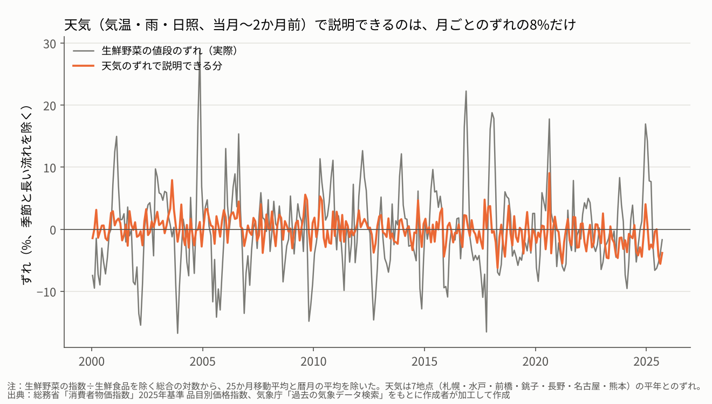
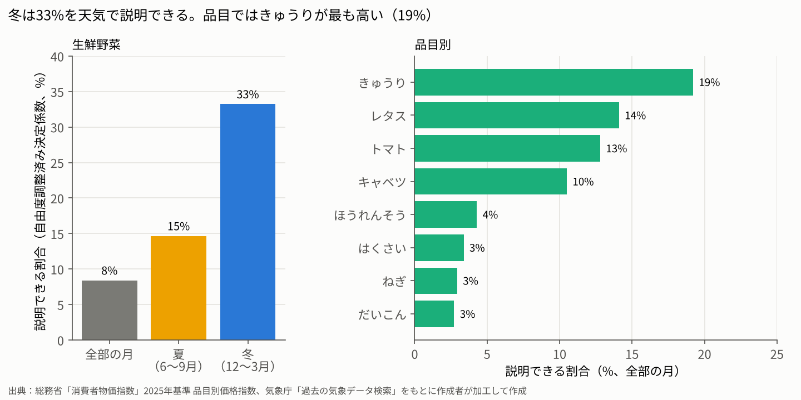
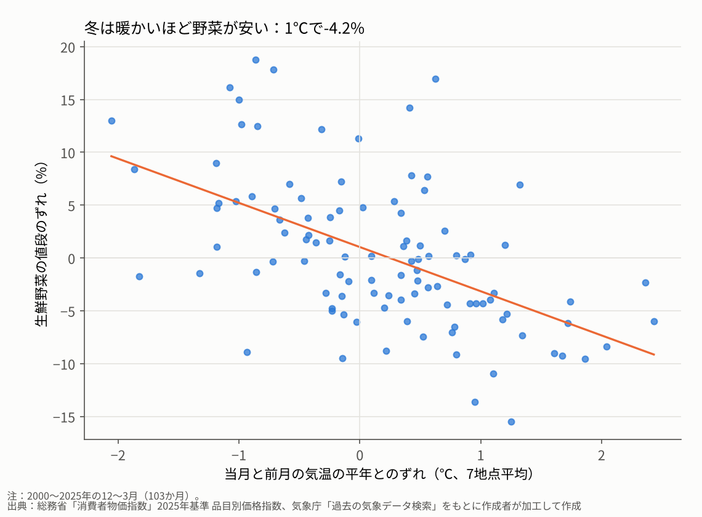
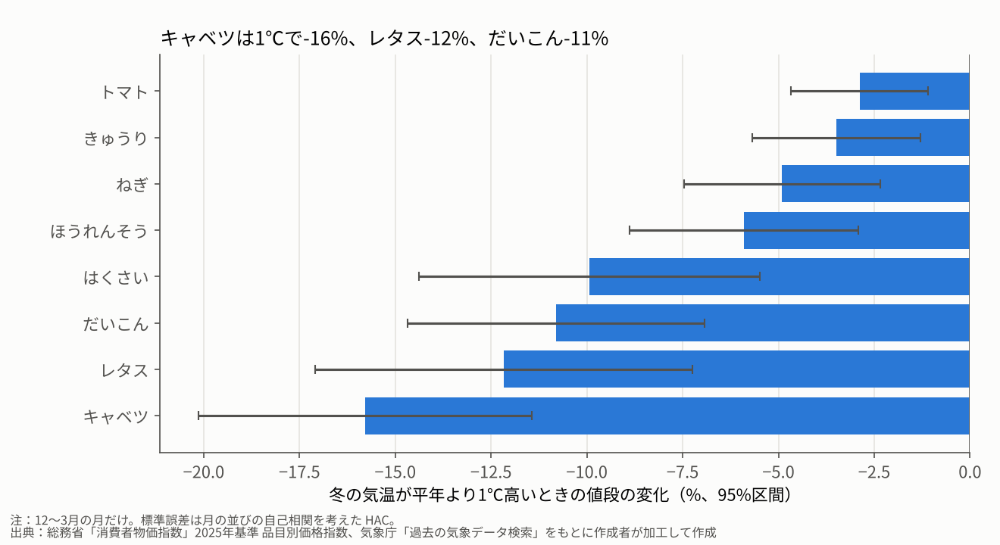

# F433 キャベツなど野菜の値段は、天気でどこまで決まるのか？ 月ごとの値段の上下のうち、気温・雨・日照で説明できるのは8%。ただし冬は33%で、冬が1℃暖かいとキャベツは16%安い

## 結論（先に）
- 2000年1月〜2025年9月の生鮮野菜の値段のずれ（物価全体に対する比から、長い流れと季節の決まった動きを除いたもの、標準偏差6.8%）のうち、7地点の気温・降水量・日照時間のずれ（当月〜2か月前）で説明できたのは8%（自由度調整済み決定係数）でした。
- 天気は1か月ほど遅れて値段に出る傾向があります（当月だけ3.5%、1か月前だけ6.4%、2か月前だけ0.1%）。
- 冬（12〜3月）に限ると説明できる割合は33%に上がり、問い直しで、冬の気温が平年より1℃高いと生鮮野菜は4.2%、キャベツは15.8%、レタスは12.2%、だいこんは10.8%安くなる関係が見えました。
- 2000〜2015年で当てはめた式で2016年以降を予測すると、実際との相関は0.14にとどまりました。

## 問い
「天候不順で野菜が高い」とよく報道されます。野菜の値段の月ごとの上下のうち、気温・雨・日照の平年とのずれで説明できるのはどのくらいか、天気が値段に出るまで何か月かかるのか。スーパーや外食で野菜を仕入れる人、家計の話題を書く人のために確かめます。

## データ（出典）
- 総務省「消費者物価指数」2025年基準 品目別価格指数（全国、月次）：生鮮野菜、キャベツ、はくさい、レタス、だいこん、きゅうり、トマト、ほうれんそう、ねぎ、生鮮食品を除く総合。
- 気象庁「過去の気象データ検索」月ごとの値（年×月の表）：札幌・水戸・前橋・銚子・長野・名古屋・熊本の月平均気温・月降水量・月日照時間（1991年1月〜2026年9月）。
- 値段のずれ：log（品目の指数÷生鮮食品を除く総合）×100 から、前後25か月の移動平均と暦月ごとの平均を除いた値。天気のずれ：7地点の平均の、1991〜2020年の同じ月の平均との差（気温は℃、降水量と日照は平年比の対数×100）。

## 事前の計画
[PLAN.md](PLAN.md)（2026-11-16 19:20、値を集計する前に作成）。下見では品目の列と気象庁の表の名前だけを見ました。

| 仮説 | 外れの基準 | 結果 | 判定 |
|---|---|---|---|
| H1 天気で説明できる割合は20%以上 | 20%未満 | 8.4% | 外れ |
| H2 雨が多い・日照が少ないと高い | どちらかが逆 | 降水量の係数の合計 +0.002（ほぼ0）、日照 −0.087 | 支持（雨の効き方は弱い） |
| H3 1か月前の天気の方が当月より説明力が大きい | 当月の方が大きいか同じ | 6.4% 対 3.5% | 支持 |
| H4 2016年以降の予測と実際の相関は0.3以上 | 0.3未満 | 0.14 | 外れ |

## やったこと
1. 物価指数の品目と、7地点の月の気温・降水量・日照を表にしました（02_build.py）。
2. 値段のずれを天気のずれ（当月〜2か月前の9変数）に回帰しました（標準誤差は HAC）。品目別、時期を分けた当てはめと予測、頑健性も出しました（03_analysis.py）。
3. 結果を見てから、冬の月だけで気温との関係を品目ごとに出しました（03b_requestion.py）。

## 分かったこと

### 1. 天気で説明できるのは8%（図1）

係数は、当月の気温 −0.90（%/℃、p=0.007）、前月の気温 −0.81（p=0.04）、前月の日照 −0.082（%/日照の平年比1%、p=0.006）が目立ち、降水量はどの遅れでもはっきりしませんでした。

### 2. 冬は33%、品目ではきゅうりが19%（図2）

品目別（全部の月）は、きゅうり19%、レタス14%、トマト13%、キャベツ10%、ほうれんそう4%、はくさい・ねぎ・だいこん3%でした。

## 問い直し（結果を見てから足した）

### 冬は暖かいほど安い（図3・図4）



| 品目 | 冬の気温1℃あたりの値段の変化 | 気温だけで説明できる割合 |
|---|---|---|
| 生鮮野菜 | −4.2% | 29% |
| キャベツ | −15.8% | 28% |
| レタス | −12.2% | 25% |
| だいこん | −10.8% | 29% |
| はくさい | −9.9% | 17% |
| ほうれんそう | −5.9% | 15% |
| ねぎ | −4.9% | 17% |
| きゅうり | −3.5% | 8% |
| トマト | −2.9% | 7% |

（冬＝12〜3月、2000〜2025年の103か月。気温は当月と前月の平均。）（推測）冬は気温が低いと露地の葉物や根菜の育ちが遅れ、出回る量が減るためと考えられます。ハウスで作ることの多いきゅうり・トマトは小さい傾向でした。出荷量のデータでは確かめていません。

## 頑健性

| 確かめ方 | 説明できる割合 | 降水量の係数の合計 | 日照の係数の合計 | 気温の係数の合計 |
|---|---|---|---|---|
| 本線（25か月の移動平均、7地点、2000年〜） | 8.4% | +0.002 | −0.087 | −0.92 |
| 13か月の移動平均 | 12.2% | −0.009 | −0.092 | −0.94 |
| 37か月の移動平均 | 8.2% | +0.002 | −0.102 | −0.78 |
| 関東の3地点だけ | 4.7% | −0.004 | −0.034 | −0.98 |
| 2010年以降 | 12.9% | −0.038 | −0.157 | −0.67 |
| 夏（6〜9月） | 14.7% | +0.031 | −0.170 | +1.40 |
| 冬（12〜3月） | 33.2% | −0.046 | −0.075 | −4.16 |

説明できる割合はどの方法でも5〜13%（季節に分けると15〜33%）で、「月ごとの上下の大部分は天気以外」は変わりません。気温の効き方は冬は負（暖かいと安い）、夏は正（暑いと高い）と季節で逆になります。雨の量は、どの方法でもはっきりした効き方が見えませんでした。

## 言えないこと
- 7地点の天気は産地そのものの天気ではなく目安です。
- 輸入や作付けの増減、燃料・肥料の値段、需要の変化は入れていません。
- 物価指数は店頭の値段で、卸売の値段より動きが遅いことがあります。
- 天気が値段を動かす仕組み（出回る量の変化）は確かめていません。仕入れや価格の助言はしません。

## 仕事で使うなら
- 野菜の値段の動きを天気で説明するときは、冬の気温（とくにキャベツ・レタス・だいこん）では関係がはっきりしている一方、1年を通して見ると天気で説明できるのは1割ほどであることを前提にすると、言いすぎを避けられます。
- 品目別の結果は results/items.csv、冬の結果は results/winter_temp.csv にあります。

## 計画からの変更
- 計画どおりに進めました。問い直し（冬の気温と品目）は結果を見てから足しました。移動平均で端の12か月が使えないため、回帰の期間は2025年9月までです。

## 再現のしかた
```
sh src/run_all.sh        # オフライン。所要約5秒
python3 src/01_fetch.py  # 元データを取り直すときだけ（ネットを使う）
```

| ファイル | 中身 |
|---|---|
| src/02_build.py | CSV と気象庁の HTML から data/cpi_veg.csv・weather.csv を作る |
| src/03_analysis.py | 回帰・品目別・予測・仮説・頑健性 → results/main.json・panel.csv・coefs.csv・items.csv・robustness.csv |
| src/03b_requestion.py | 問い直し → results/requestion.json・winter_temp.csv |
| src/04_figures.py | 図4枚 |

repro_check：/tmp/rep_F433 に写して流し、results・figures・data の CSV がすべて cmp で一致（件数と所要時間は results/repro_check.txt）。乱数は使っていません。

## レビューで直したこと

独立レビューで数字の照合・再実行・図を確かめ、直すところはなかった。

## 出典
- 総務省「消費者物価指数」2025年基準 品目別価格指数（全国、月次）：https://www.e-stat.go.jp/stat-search/file-download?statInfId=000040482945&fileKind=1
- 気象庁「過去の気象データ検索」月ごとの値：https://www.data.jma.go.jp/stats/etrn/view/monthly_s3.php （地点と表の URL は src/01_fetch.py）

（いずれも 総務省「消費者物価指数」、気象庁「過去の気象データ検索」をもとに作成者が加工して作成）
