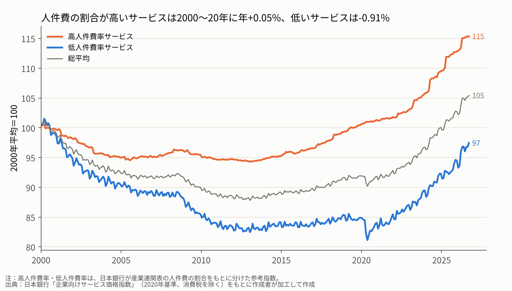
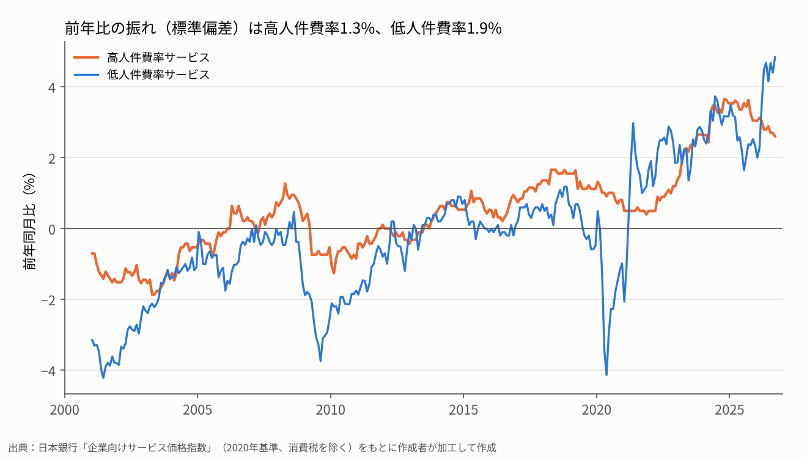
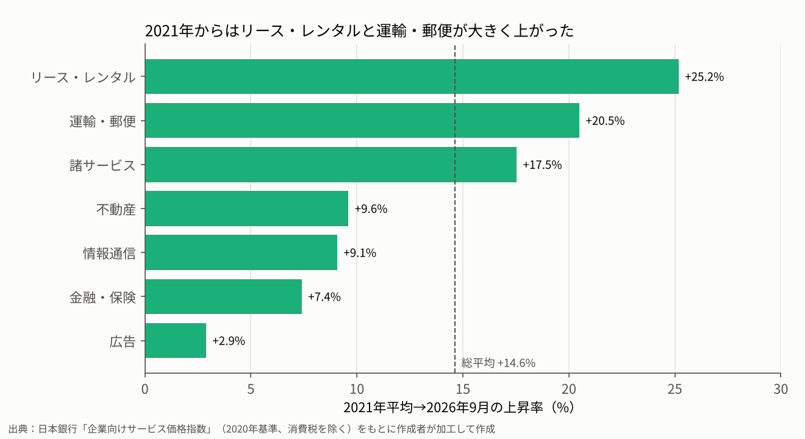
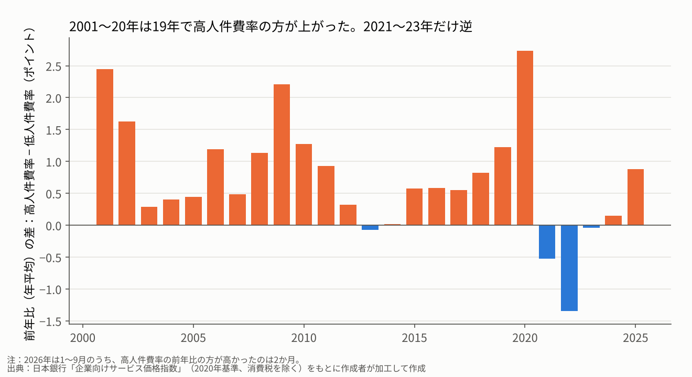

# F434 企業向けサービスの値段は、人件費の割合が高い業種ほど上がったのか？ 2001〜20年は20年中19年で高人件費率の方が上がった。だが2021年→26年9月は低人件費率が+15.9%で、高人件費率の+13.6%を上回る

## 結論（先に）
- 企業向けサービス価格指数（消費税を除く）で、2000〜2020年の年平均の上昇率は、高人件費率サービスが+0.05%、低人件費率サービスが −0.91%でした。年ごとに見ると、20年のうち19年で高人件費率の方が上がっています。
- ところが2021年平均→2026年9月は、低人件費率が+15.9%、高人件費率が+13.6%で、低い方が上回りました。2021〜23年の3年だけ低人件費率の方が上がり、2024・25年は再び高人件費率が上回りましたが、2026年は1〜9月の7か月で低人件費率の方が上がっています。
- 高人件費率は値段の動きがなめらかで、前年比の標準偏差は1.3%（低人件費率は1.9%）でした。
- 2021年からの上昇は、リース・レンタル（+25.2%）、運輸・郵便（+20.5%）、諸サービス（+17.5%）が大きく、広告（+2.9%）は小さくなりました。

## 問い
賃金が上がると、人の手がかかるサービスの値段が上がりやすいと考えられます。日本銀行は、企業向けサービス価格指数を人件費の割合で「高人件費率サービス」と「低人件費率サービス」に分けた参考の指数を公表しています。賃金が上がり始めた2022年ごろから、人件費の割合の高いサービスの値段は速く上がったのか、それはいつからか。業務の委託や清掃・警備・運送などのサービスを買う企業の人、物価と賃金の関係の解説を読む人のために確かめます。

## データ（出典）
- 日本銀行「企業向けサービス価格指数」2020年基準（日本銀行 時系列統計データ検索サイトの API、月次）。
  - 消費税を除く指数（2000年1月〜2026年9月）：総平均、総平均（除く国際運輸）、高人件費率サービス、低人件費率サービス、大類別7つ。
  - 消費税を含む指数（1985年1月〜2026年9月）：総平均、高人件費率サービス、低人件費率サービス。
- 高人件費率・低人件費率は、日本銀行が産業連関表の人件費の割合をもとに分けた参考指数です（区分のしきい値の細部はここでは確かめていません）。

## 事前の計画
[PLAN.md](PLAN.md)（2026-11-16 19:55、値を集計する前に作成）。下見では系列の名前と期間だけを見ました。

| 仮説 | 外れの基準 | 結果 | 判定 |
|---|---|---|---|
| H1 2021年→最新は高人件費率の方が上がった | 大きくない | +13.6% 対 +15.9% | 外れ |
| H2 2000〜20年は高人件費率の方が上がりにくかった | 高い方が上がった | 年+0.05% 対 −0.91% | 外れ（逆だった） |
| H3 高人件費率の前年比は振れが小さい | 小さくない | 標準偏差1.3% 対 1.9% | 支持 |
| H4 高人件費率の2025年の前年比は3%以上 | 3%未満 | 3.4% | 支持 |

## やったこと
1. JSON から消費税を除く・含む指数の月次の表を作りました（02_build.py）。
2. 期間の年率、2021年からの上昇、振れ、大類別の上昇を出しました（03_analysis.py）。
3. 結果を見てから、年ごとの差と、高人件費率の方が上がった月の数を数えました（03b_requestion.py）。

## 分かったこと

### 1. 長い間、高人件費率の方が上がってきた（図1）

2000年平均を100とすると、2026年9月は高人件費率115、低人件費率97、総平均105です。2013〜2020年の年率は高人件費率+0.95%、低人件費率+0.02%でした。

### 2. 高人件費率は値段の動きがなめらか（図2）

前月比の標準偏差も高人件費率0.23%、低人件費率0.64%でした。2026年9月の前年比は高人件費率2.6%、低人件費率4.8%です。（推測）低人件費率には、燃料などの値段に左右されやすいサービスが多いためと考えられます。

### 3. 2021年からはリース・レンタルと運輸・郵便（図4）

2021年平均→2026年9月：リース・レンタル+25.2%、運輸・郵便+20.5%、諸サービス+17.5%、不動産+9.6%、情報通信+9.1%、金融・保険+7.4%、広告+2.9%（総平均+14.6%）。

## 問い直し（結果を見てから足した）

### 低人件費率の方が上がったのは一時のことか（図3）


| 年 | 高人件費率の前年比 | 低人件費率の前年比 | 差 | 高の方が高かった月 |
|---|---|---|---|---|
| 2019年 | 1.26% | 0.04% | +1.22 | 12/12 |
| 2020年 | 0.97% | −1.77% | +2.74 | 12/12 |
| 2021年 | 0.50% | 1.02% | −0.52 | 3/12 |
| 2022年 | 0.87% | 2.22% | −1.35 | 0/12 |
| 2023年 | 2.20% | 2.24% | −0.04 | 5/12 |
| 2024年 | 3.23% | 3.08% | +0.15 | 8/12 |
| 2025年 | 3.41% | 2.53% | +0.88 | 12/12 |
| 2026年（1〜9月） | — | — | — | 2/9 |

2001〜2020年は20年のうち19年で高人件費率の方が上がりました。2021〜23年に逆になり、2024・25年に戻りましたが、2026年は再び低人件費率の方が上がる月が多くなっています。2023年平均→最新でも、高人件費率+10.2%、低人件費率+10.9%とほぼ同じです。

## 頑健性

| 確かめ方 | 高人件費率 | 低人件費率 |
|---|---|---|
| 消費税を除く：2021年平均→最新（本線） | +13.6% | +15.9% |
| 消費税を含む：2021年平均→最新 | +13.6% | +15.9% |
| 消費税を含む：1985→2020年の年率 | +0.81% | −0.38% |
| 消費税を除く：2019年平均→最新 | +15.3% | +15.0% |
| 消費税を除く：2022年平均→最新 | +12.7% | +13.4% |
| 前月比の標準偏差（2000〜2026年） | 0.23% | 0.64% |

2021年以降は消費税率の変更がないので、含む・除くで同じ値になります。基準を2019年にすると差はほぼなくなり、「2021年からは低人件費率の方が上がった」は基準の年の選び方に左右されます。長い期間で高人件費率の方が上がってきたことは、消費税を含む1985年からの比較でも変わりません。

## 言えないこと
- 人件費の割合で分けた区分の中身（どのサービスが入るか）は、一つずつ確かめていません。
- 値段が上がった理由が人件費かどうかは、この比較だけでは決められません（燃料、需要なども動きます）。
- 企業どうしの取引の値段で、消費者が払う値段ではありません。
- 2026年の動きは月の数が少なく、今後変わることがあります。値付けや価格交渉の助言はしません。

## 仕事で使うなら
- 「賃上げでサービスの値段が上がる」を確かめるときは、2021年以降は低人件費率サービスの方が上がった時期があること、どちらが上かは基準の年の選び方で変わることを合わせて見ると、読み違えにくいです。大類別ではリース・レンタルや運輸・郵便の上昇が大きいものの、大類別と人件費率の区分の対応はこの記事では確かめていません。
- 月次の値は data/extax.csv、年ごとの差は results/yearly_gap.csv にあります。

## 計画からの変更
- 計画どおりに進めました。問い直し（年ごとの差と月の数）は結果を見てから足しました。

## 再現のしかた
```
sh src/run_all.sh        # オフライン。所要約3秒
python3 src/01_fetch.py  # 元データを取り直すときだけ（ネットを使う）
```

| ファイル | 中身 |
|---|---|
| src/02_build.py | JSON から data/extax.csv・intax.csv を作る |
| src/03_analysis.py | 年率・上昇・振れ・仮説・頑健性 → results/main.json・annual.csv・yoy.csv・robustness.csv |
| src/03b_requestion.py | 問い直し → results/requestion.json・yearly_gap.csv |
| src/04_figures.py | 図4枚 |

repro_check：/tmp/rep_F434 に写して流し、results・figures・data の CSV がすべて cmp で一致（件数と所要時間は results/repro_check.txt）。乱数は使っていません。

## レビューで直したこと

独立レビュー（2026-11-17）で次を直しました。直したあと /tmp で流し直し、results・figures・data の CSV が一致することを確かめています。

| # | 指摘 | 直し方 |
|---|---|---|
| 1 | 「仕事で使うなら」で、リース・レンタルや運輸を「人件費の割合の低い分野」と書いているが、区分の中身は確かめていない（「言えないこと」と矛盾） | 大類別と人件費率の区分の対応は確かめていないと書き直し、基準の年で答えが変わることを書いた |
| 2 | note の見出し「2021〜23年だけ、低人件費率の方が上がった」が、2026年も低人件費率が上回る月が多いことと合わない | 見出しを「2021〜23年は低人件費率の方が上がり、2026年もそうした月が多い」に直した |

## 出典
- 日本銀行「企業向けサービス価格指数」（2020年基準）：日本銀行 時系列統計データ検索サイト https://www.stat-search.boj.or.jp/ （系列コードは src/01_fetch.py）

（いずれも 日本銀行「企業向けサービス価格指数」をもとに作成者が加工して作成）
