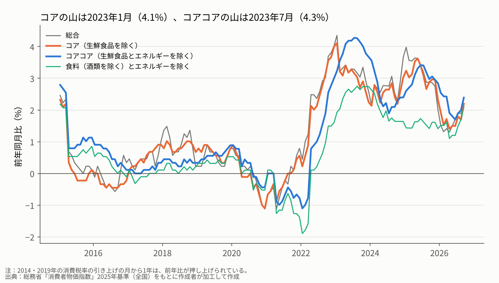
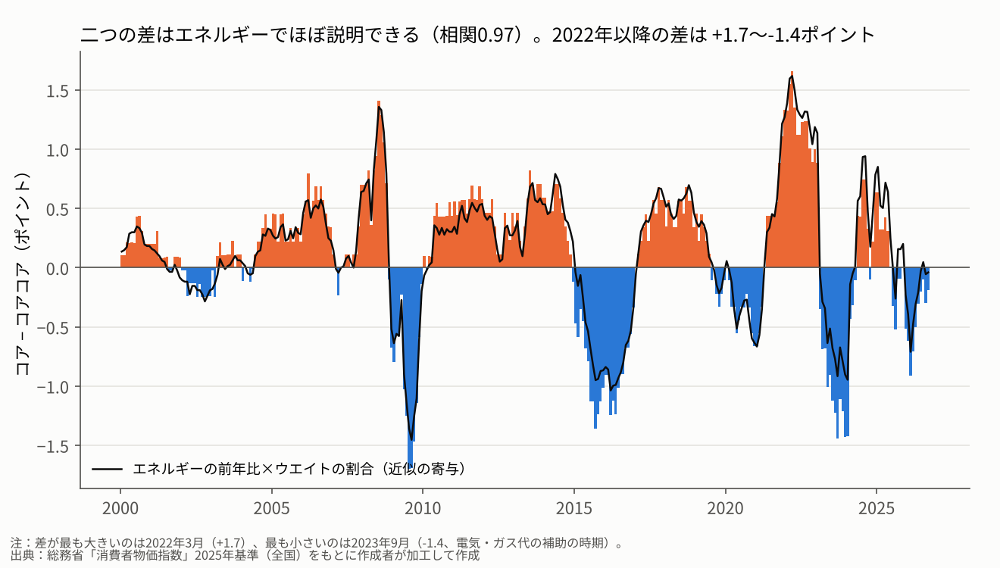
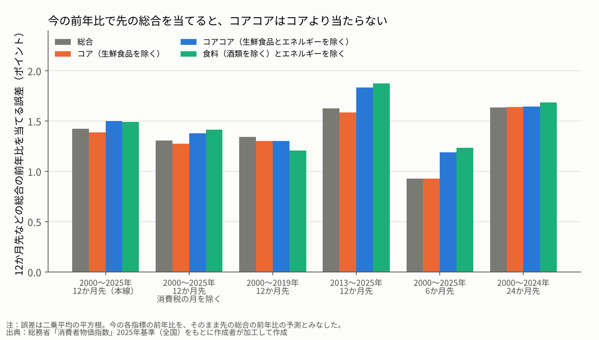
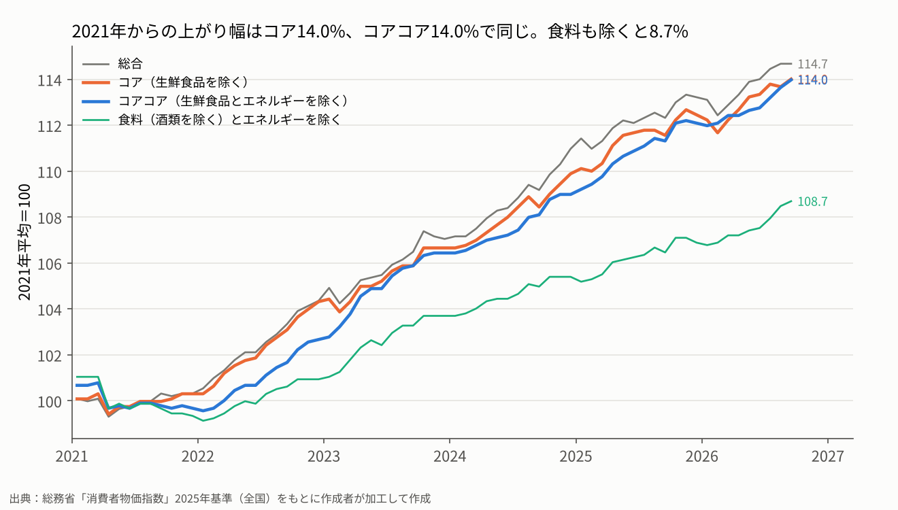

# F435 「生鮮食品を除く」と「生鮮食品とエネルギーを除く」は、物価の流れをどれだけ違って見せるのか？ 2022年からの前年比の差は平均0.7ポイント、最大で+1.7〜−1.4ポイント。だが2021年からの上がり幅はどちらも14.0%で同じ

## 結論（先に）
- 2022年1月〜2026年9月のコア（生鮮食品を除く総合）とコアコア（生鮮食品及びエネルギーを除く総合）の前年比の差は、絶対値の平均で0.70ポイント（2000〜2021年は0.43）。最大は2022年3月の+1.7、最小は2023年9月の −1.4でした。
- 差はエネルギーの近似の寄与とほぼ重なります（相関0.97）。2023〜24年は電気・ガス代の補助の時期で、24か月のうち16か月でコアがコアコアより低くなりました。
- 今の前年比で12か月先の総合の前年比を当てる誤差（2000〜2025年）は、コア1.39、コアコア1.50ポイントで、コアコアの方が当たるとは言えません。
- 問い直し：2021年平均→2026年9月の上がり幅は、コア14.0%、コアコア14.0%で同じでした。エネルギーの値上がりと補助の効果が打ち消し合いました。食料も除く指数は8.7%でした。

## 問い
物価のニュースでは「コア」と「コアコア」の両方が使われます。2022年からの値上がりや、2023年からの電気・ガス代の補助の時期に、二つの数字はどれだけ違ったのか、差は何から来て、長い目で見ると残るのか、どちらが先の物価をよく表すのか。物価のニュースを読む人、価格の見直しや賃金の話し合いに物価の数字を使う人のために確かめます。

## データ（出典）
- 総務省「消費者物価指数」2025年基準 品目別価格指数の CSV にある特殊分類（全国、月次、1970年1月〜2026年9月）：総合、生鮮食品を除く総合、生鮮食品及びエネルギーを除く総合、食料（酒類を除く）及びエネルギーを除く総合、エネルギー。
- エネルギーの近似の寄与＝エネルギーの前年比×（エネルギーのウエイト÷生鮮食品を除く総合のウエイト）（2025年基準のウエイト）。

## 事前の計画
[PLAN.md](PLAN.md)（2026-11-16 20:30、値を集計する前に作成）。下見では列の名前と1970年1月の値だけを見ました。

| 仮説 | 外れの基準 | 結果 | 判定 |
|---|---|---|---|
| H1 2022年以降の差の絶対値の平均は0.5ポイント以上 | 0.5未満 | 0.70 | 支持 |
| H2 前月比の振れはコアコアの方が小さい | 小さくない | 0.26 対 0.29 | 支持 |
| H3 12か月先の総合を当てる誤差はコアコアの方が小さい | 小さくない | 1.50 対 1.39 | 外れ |
| H4 2023〜24年はコアがコアコアより低い月が半分より多い | 半分以下 | 24か月中16か月 | 支持 |

## やったこと
1. CSV から特殊分類の指数とウエイトを取り出しました（02_build.py）。
2. 前年比、差、エネルギーの近似の寄与、前月比の振れ、先の総合を当てる誤差を出しました（03_analysis.py）。
3. 結果を見てから、差とエネルギーの関係、2021年からの累積の上がり幅を比べました（03b_requestion.py）。

## 分かったこと

### 1. 山の時期が半年ずれた（図1）

コアの山は2023年1月（4.1%）、コアコアの山は2023年7月（4.3%）でした。2022年1月〜2026年9月の平均はコア2.58%、コアコア2.54%で、ほとんど同じです。

### 2. 差はエネルギーでほぼ説明できる（図2）

差をエネルギーの近似の寄与に回帰すると、傾き1.08、決定係数0.94でした。

### 3. コアコアの方が先を当てるとは言えない（図3）

誤差（2000〜2025年、12か月先）は総合1.43、コア1.39、コアコア1.50、食料とエネルギーを除く指数1.49でした。前月比の標準偏差は総合0.31、コア0.29、コアコア0.26、食料とエネルギーを除く指数0.28です。

## 問い直し（結果を見てから足した）

### 長い目で見ると差は打ち消し合う（図4）


| 2021年平均→2026年9月 | 上がり幅 |
|---|---|
| 総合 | 14.7% |
| コア（生鮮食品を除く） | 14.0% |
| コアコア（生鮮食品とエネルギーを除く） | 14.0% |
| 食料（酒類を除く）とエネルギーを除く | 8.7% |
| エネルギー | 13.6% |

エネルギーは値上がりした時期と補助で下がった時期を合わせると、コア全体と同じくらい上がっていて、コアとコアコアの累積の差は残りませんでした。前年比の差は「いつ上がったか」の違いで、「どれだけ上がったか」の違いではなかったと言えます。

## 頑健性

| 確かめ方（総合の前年比を当てる誤差） | 総合 | コア | コアコア | 食料とエネルギーを除く |
|---|---|---|---|---|
| 2000〜2025年、12か月先（本線） | 1.43 | 1.39 | 1.50 | 1.49 |
| 同、消費税の月を除く | 1.31 | 1.28 | 1.38 | 1.42 |
| 2000〜2019年、12か月先 | 1.34 | 1.30 | 1.30 | 1.21 |
| 2013〜2025年、12か月先 | 1.63 | 1.59 | 1.83 | 1.87 |
| 2000〜2025年、6か月先 | 0.93 | 0.93 | 1.19 | 1.24 |
| 2000〜2024年、24か月先 | 1.64 | 1.64 | 1.65 | 1.69 |

コアコアが総合を当てる誤差は、どの期間・先の長さでもコアと同じか大きくなりました。2000〜2019年に限ると食料とエネルギーを除く指数が最も小さく、期間によって順番は変わります。

## 言えないこと
- どの指標が「正しい物価」かは決められません。目的によって使い分けるものです。
- エネルギーの寄与はウエイトを使った近似で、公式の寄与度とは少し違います。
- 予測のよさは期間に左右され、将来も同じとは限りません。ここでの予測は今の前年比をそのまま使う単純な方法です。
- 物価や金融政策の見通し・助言はしません。

## 仕事で使うなら
- 契約や賃金の話し合いで物価の数字を使うときは、コアとコアコアの前年比の差が1ポイント以上開く時期があること、ただし数年分の累積ではほぼそろうことを前提にすると、指標の選び方で結論が大きく変わるのを避けられます。
- 月次の前年比は results/yoy.csv にあります。

## 計画からの変更
- 計画どおりに進めました。問い直し（差とエネルギーの関係、累積の比較）は結果を見てから足しました。

## 再現のしかた
```
sh src/run_all.sh        # オフライン。所要約3秒
python3 src/01_fetch.py  # 元データを取り直すときだけ（ネットを使う）
```

| ファイル | 中身 |
|---|---|
| src/02_build.py | CSV から data/cpi.csv・weights.csv を作る |
| src/03_analysis.py | 差・振れ・予測の誤差・仮説・頑健性 → results/main.json・yoy.csv・forecast.csv・robustness.csv |
| src/03b_requestion.py | 問い直し → results/requestion.json |
| src/04_figures.py | 図4枚 |

repro_check：/tmp/rep_F435 に写して流し、results・figures・data の CSV がすべて cmp で一致（件数と所要時間は results/repro_check.txt）。乱数は使っていません。

## レビューで直したこと

独立レビュー（2026-11-17）で次を直しました。直したあと /tmp で流し直し、results・figures・data の CSV が一致することを確かめています。

| # | 指摘 | 直し方 |
|---|---|---|
| 1 | 題名・図2の題の「最大±1.5ポイント」が results（+1.66、−1.44）と合わない | 題名・status・note を「最大で+1.7〜−1.4ポイント」に、図2の題を main.json の値から作るように直した |

## 出典
- 総務省「消費者物価指数」2025年基準 品目別価格指数（全国、月次）：https://www.e-stat.go.jp/stat-search/file-download?statInfId=000040482945&fileKind=1

（いずれも 総務省「消費者物価指数」をもとに作成者が加工して作成）
