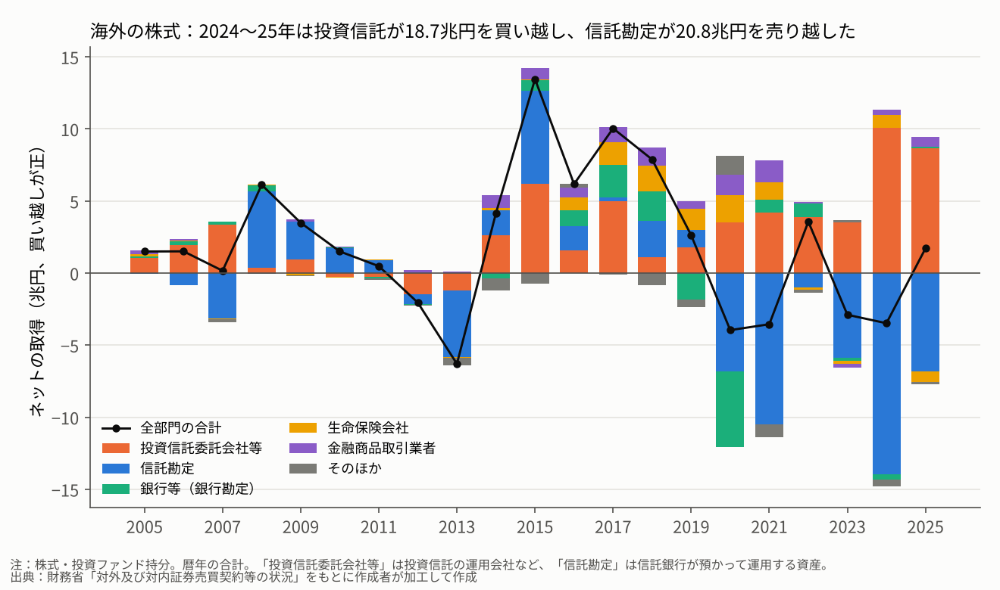
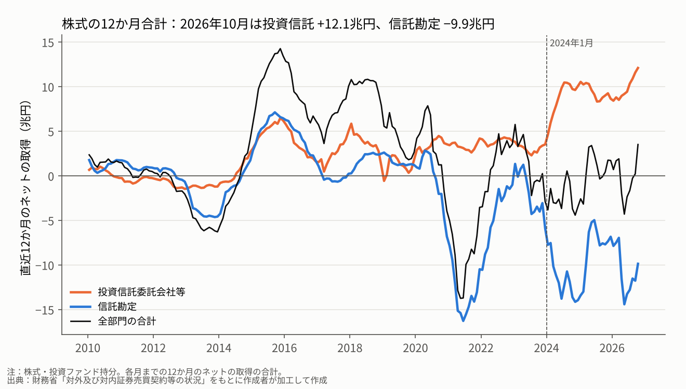
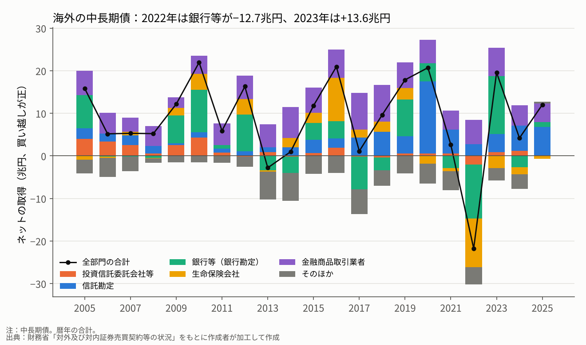
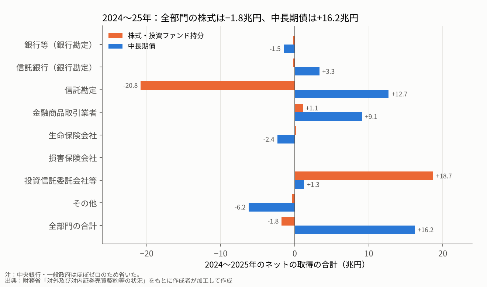

# F436 日本から海外の株や債券への投資は、どの投資家が増やしたのか？ 2024〜25年に投資信託は海外の株を18.7兆円買い越したが、信託勘定が20.8兆円売り越し、全体の株は−1.8兆円。増えたのは中長期債の16.2兆円

## 結論（先に）
- 2024〜2025年の2年間で、投資信託委託会社等（投資信託の運用会社など）は海外の株式・投資ファンド持分を18.7兆円買い越しました（2024年10.0兆円、2025年8.6兆円）。2023年の3.5兆円の約3倍のペースで、2024年1月から2025年12月まで24か月すべて買い越しでした。
- ところが同じ2年間に、信託勘定（信託銀行が預かって運用する資産）は20.8兆円を売り越し、全部門の合計では株式は−1.8兆円の売り越しでした。「日本全体で海外の株を大きく買い増した」とは、この統計からは言えません。
- 2024〜2025年に全部門で大きく増えたのは中長期債の買い越し（16.2兆円）で、信託勘定12.7兆円、金融商品取引業者9.1兆円が中心でした。
- 事前の4つの仮説は、3つが外れ、1つは判定できませんでした（全体が売り越しだったため）。
- 問い直し：2024年1月〜2026年10月まで伸ばしても、投資信託29.7兆円の買い越しに対して信託勘定28.7兆円の売り越しで、全体は2.0兆円でした。株式を売った信託勘定は同じ時期に中長期債を買っていて、資産の配分の調整に見えます（推測）。

## 問い
2024年に新しい NISA（少額投資非課税制度）が始まってから、「個人のお金が投資信託を通じて海外の株に流れている」と報道されました。日本から海外の株や債券への投資は、どの投資家が、株と債券のどちらを、いつから多く買っているのか。財務省の投資家部門別の統計で確かめます。資産運用や為替の話題を読む人、金融機関で働く人のための記事です。投資や為替の助言はしません。

## データ（出典）
- 財務省「対外及び対内証券売買契約等の状況」投資家部門別対外証券投資（月次、2005年1月〜2026年10月、億円）。合計、株式・投資ファンド持分、中長期債、短期債の4つの表を使いました。
- 部門：中央銀行、一般政府、銀行等（銀行勘定）、信託銀行（銀行勘定）、信託勘定、金融商品取引業者、生命保険会社、損害保険会社、投資信託委託会社等、その他。それぞれ取得、処分、ネット（取得超が正）があります。
- 投資信託委託会社等には資産運用会社（投資顧問など）も含まれます（ファイルの注記）。2007年9月より前は旧区分で集計されています。
- 年の値は月の値の合計で、2026年は10月までなので年の比較には使っていません。

## 事前の計画
[PLAN.md](PLAN.md)（2026-11-16 21:10、値を集計する前に作成）。下見では CSV の見出しと2005年1月の行の先頭だけを見ました。

| 仮説 | 外れの基準 | 結果 | 判定 |
|---|---|---|---|
| H1 投資信託の株式の買い越し、2024＋2025年は2014〜2023年の10年合計より大きい | 小さいか同じ | 18.7兆円 対 33.4兆円（56%） | 外れ |
| H2 2024〜25年の株式の買い越しの半分以上が投資信託 | 半分未満 | 全部門の合計が −1.8兆円の売り越しで、割合が意味を持たない | 判定できない |
| H3 銀行等（銀行勘定）は2022〜23年に中長期債を売り越した | 買い越した | 2022年 −12.7兆円、2023年 +13.6兆円、合計 +0.9兆円 | 外れ |
| H4 2024〜25年の全部門の中長期債の買い越しは株式より小さい | 大きいか同じ | 中長期債 +16.2兆円、株式 −1.8兆円 | 外れ |

H1 は、2年で10年分の半分を超えていて、ペースは大きく上がっています。ただ「10年分を超える」ほどではありませんでした。H2 は、買い越した部門だけを合計すると、その94%が投資信託でした（頑健性の表）。

## やったこと
1. 4つの CSV から、部門×資産×月のネットの取得を縦長の表にしました（02_build.py）。資産の合計と表の合計の差は最大3億円で、端数の範囲です。
2. 暦年に合計し、仮説を判定しました（03_analysis.py）。
3. 結果を見てから、2024〜25年の部門別の内訳、12か月合計の推移、投資信託と信託勘定の月ごとの関係を調べました（03b_requestion.py）。

## 分かったこと

### 1. 海外の株は、投資信託が買い、信託勘定が売った（図1）

投資信託委託会社等の株式の買い越しは、2014〜2023年は年1〜6兆円でしたが、2024年は10.0兆円、2025年は8.6兆円になりました。買いの総額（取得）でも、2023年の26.5兆円から2025年の42.9兆円に増えています。

一方、信託勘定は2020年から売り越しが多く、2024年は14.0兆円、2025年は6.8兆円の売り越しでした。全部門の合計は2024年 −3.5兆円、2025年 +1.7兆円です。2015年や2017年のように、投資信託と信託勘定がそろって買い越した年とは様子が違います。

### 2. 2024年から、投資信託の買いは途切れていない（図2）

直近12か月の合計で見ると、投資信託は2022〜23年は2〜4兆円台でしたが、2024年に入って10兆円前後に上がり、2026年10月までの12か月は12.1兆円で、2005年以降で最も大きくなりました。2024年1月から2025年12月まで、24か月すべて買い越しです。

信託勘定は同じ24か月のうち21か月で売り越し、2026年10月までの12か月は −9.9兆円でした。全部門の合計は −4兆円台から +4兆円弱の間を行き来していて、はっきりした増加の流れは見えません。

### 3. 中長期債は、銀行等が2022年に売り、2023年に買い戻した（図3）

2022年は全部門で中長期債を21.7兆円売り越し、そのうち銀行等（銀行勘定）が12.7兆円、生命保険会社が11.5兆円でした。海外の金利が急に上がった年です。ところが銀行等は2023年に13.6兆円を買い越し、2年の合計では +0.9兆円でした。2024〜25年は、信託勘定と金融商品取引業者の買い越しが中心です。

### 4. 2024〜25年の内訳（図4）


| 部門（2024〜25年、兆円） | 株式 | 中長期債 |
|---|---|---|
| 投資信託委託会社等 | +18.7 | +1.3 |
| 信託勘定 | −20.8 | +12.7 |
| 金融商品取引業者 | +1.1 | +9.1 |
| 信託銀行（銀行勘定） | −0.3 | +3.3 |
| 銀行等（銀行勘定） | −0.2 | −1.5 |
| 生命保険会社 | +0.2 | −2.4 |
| その他 | −0.4 | −6.2 |
| 全部門の合計 | −1.8 | +16.2 |

## 問い直し（結果を見てから足した）

### 投資信託の買いと信託勘定の売りは、同じお金の動きなのか
全部門の株式がほぼゼロになったのは、投資信託の買い（+18.7兆円）と信託勘定の売り（−20.8兆円）が同じくらいの大きさだったからです。では、片方が買った月にもう片方が売る、という対応があるのか、月次で調べました。

- 2014年1月〜2026年10月の154か月で、投資信託と信託勘定の株式のネットの相関は −0.12、2024年以降は +0.19 でした。月ごとに打ち消し合っているわけではありません。
- 信託勘定は、株式を20.8兆円売り越した2024〜25年に、中長期債を12.7兆円買い越しています。株式と債券の割合を決めて運用する年金などが、海外の株の値上がりで増えた分を売り、債券を買った、という資産の配分の調整に見えます（推測）。信託勘定の中身（どの年金や基金か）はこの統計では分かりません。
- 期間を2024年1月〜2026年10月に伸ばしても、投資信託 +29.7兆円、信託勘定 −28.7兆円、全体 +2.0兆円で、形は同じでした。

つまり「NISA で海外の株にお金が流れた」という話は、投資信託の部門だけを見れば数字に表れていますが、日本全体から海外の株への投資は、同じ時期の信託勘定の売りでほぼ打ち消されていました。

## 頑健性

| 確かめ方 | 値 |
|---|---|
| 株式 2024年1月〜2026年10月：投資信託委託会社等 | +29.7兆円 |
| 同：信託勘定 | −28.7兆円 |
| 同：全部門の合計 | +2.0兆円 |
| 株式の取得（買いの総額）投資信託委託会社等 2023年→2025年 | 26.5→42.9兆円 |
| 株式 2024〜25年：買い越した部門の合計に占める投資信託委託会社等の割合 | 94% |
| 全資産（株式・中長期債・短期債）投資信託委託会社等 2024〜25年 | +20.6兆円 |
| 株式 その他（事業会社・個人など）2024〜25年 | −0.4兆円 |

区切りを変えても、買いの総額で見ても、「投資信託が大きく買い、信託勘定が同じくらい売った」形は変わりませんでした。個人が直接買う分も入る「その他」は、株式ではほとんど動いていません。

## 言えないこと
- 投資信託の買いのうち、どれだけが個人の NISA の資金かは、この統計では分かりません。投資信託委託会社等には資産運用会社も含まれます。
- 信託勘定の売りが、どの年金や基金によるものかは分かりません。
- 円とドルなどの交換がどれだけ起きたか、為替への影響の大きさは、この数字だけでは決められません。
- 売買の契約の統計で、持っている額（残高）や値上がりの分は入っていません。
- 投資や為替の助言はしません。

## 仕事で使うなら
- 「海外の株への投資が増えた」という話を使うときは、投資信託の部門の数字なのか、全部門の数字なのかを分けて書くと、誤解を避けられます。2024〜25年は二つの答えが逆向きです。
- 部門×資産×年の表は results/annual_net.csv、12か月合計は results/rolling12.csv にあります。

## 計画からの変更
- H2 は、全部門の合計が売り越しになり、割合を判定できませんでした。代わりに「買い越した部門の合計に占める割合」を頑健性の表に足しました。
- 問い直し（投資信託と信託勘定の関係）は結果を見てから足しました。

## 再現のしかた
```
sh src/run_all.sh        # オフライン。所要数秒
python3 src/01_fetch.py  # 元データを取り直すときだけ（ネットを使う）
```

| ファイル | 中身 |
|---|---|
| src/02_build.py | 4つの CSV から data/flows_long.csv を作る |
| src/03_analysis.py | 年の合計・仮説・頑健性 → results/main.json・annual_net.csv・robustness.csv |
| src/03b_requestion.py | 問い直し → results/requestion.json・sector_2024_2025.csv・rolling12.csv |
| src/04_figures.py | 図4枚 |

repro_check：/tmp/rep_F436 に写して流し、results・figures・data の CSV がすべて cmp で一致（件数と所要時間は results/repro_check.txt）。乱数は使っていません。

## レビューで直したこと

独立レビューで数字の照合・再実行・図を確かめ、直すところはなかった。

## 出典
- 財務省「対外及び対内証券売買契約等の状況」投資家部門別対外証券投資（月次）：https://www.mof.go.jp/policy/international_policy/reference/itn_transactions_in_securities/ （monthb1〜monthb4.csv）

（いずれも 財務省「対外及び対内証券売買契約等の状況」をもとに作成者が加工して作成）
