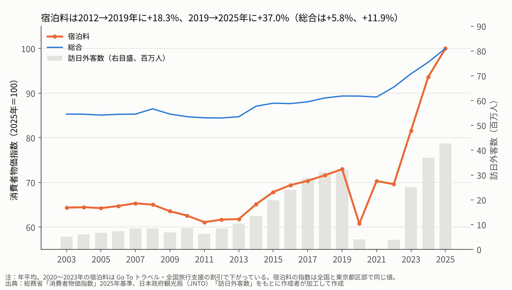
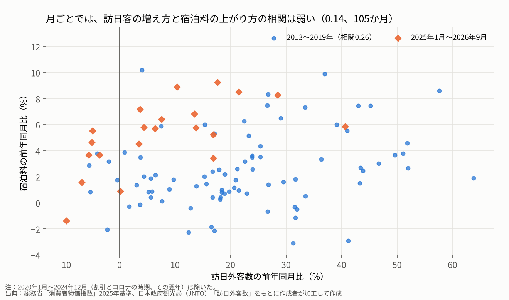
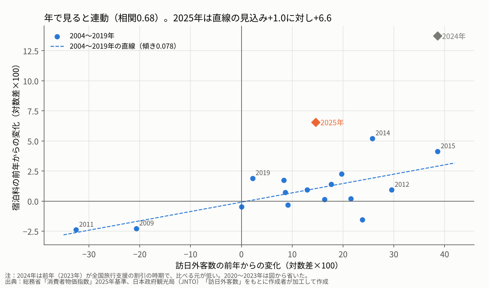
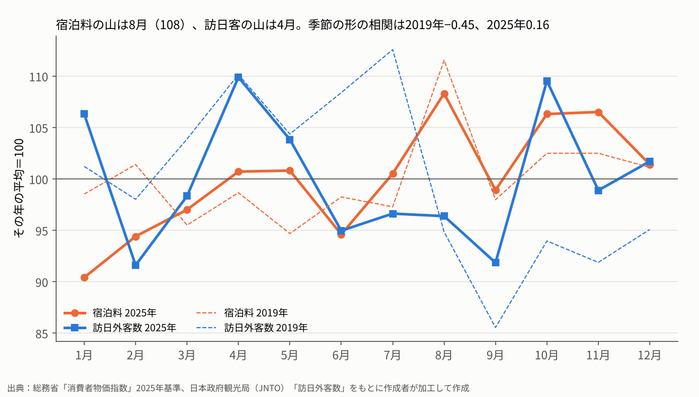

# F437 ホテル・旅館の宿泊料の上がり方は、訪日客の多さと関係があるのか？ 年で見ると連動し（相関0.68）、宿泊料は2019→2025年に37%上昇。ただ月ごとの連動は弱く、2025年の上がり方は過去の関係から見込める1.0に対し6.6だった

## 結論（先に）
- 消費者物価指数の宿泊料（年平均）は、訪日客が836万人から3,188万人に増えた2012→2019年に18.3%、2019→2025年（訪日客4,268万人）に37.0%上がりました。同じ時期の総合は5.8%、11.9%で、宿泊料の上がり方は物価全体の3倍前後でした。
- 年ごとの変化で見ると、2004〜2019年の訪日客の増え方と宿泊料の上がり方の相関は0.68で、訪日客が大きく増えた年（前年から +15 以上）は宿泊料が平均 +1.6、それ以外の年は平均0.0でした。
- ところが月ごとの前年同月比どうしでは、相関は2013〜2019年で0.26、2025年以降を合わせても0.14と弱く、事前の仮説（0.3以上）は外れました。
- 問い直し：2004〜2019年の関係を当てはめると、2025年の宿泊料は +1.0 の見込みでしたが、実際は +6.6 でした。2026年1〜9月は訪日客が前年を下回った月が6か月ありましたが、その6か月も宿泊料は前年より平均3.0%高くなっています。最近の宿泊料の上がり方は、訪日客の増え方だけでは説明できません。
- 消費者物価指数の宿泊料は、全国と東京都区部で1970年以降すべての月で同じ値でした。地域ごとの宿泊料の上がり方は、この統計では比べられません。

## 問い
訪日客が増えて「ホテル代が高くなった」とよく言われます。宿泊料の物価はいつ、どれだけ上がったのか、訪日客の増え方とどれだけ連動しているのかを、総務省の消費者物価指数と日本政府観光局（JNTO）の訪日外客数で確かめます。出張や旅行の費用を見積もる人、観光の統計を読む人、地域の観光の担当の人のための記事です。価格の良し悪しや見通しは扱いません。

## データ（出典）
- 総務省「消費者物価指数」2025年基準 品目別価格指数（月次）：宿泊料、総合。全国は1970年1月〜2026年9月、東京都区部は2026年10月まで。
- 日本政府観光局「国籍/月別 訪日外客数」（月次、2003年1月〜2026年9月）：総数。
- 2020年7〜12月の Go To トラベル、2022年10月から2023年まで続いた全国旅行支援の割引は、宿泊料の指数を大きく下げました。月ごとの相関では、2020年1月〜2024年12月（割引とコロナの時期、その時期を前年に持つ2024年）を除きました。
- 変化は「対数差×100」で表しています。小さい変化ではほぼ％と同じです。

## 事前の計画
[PLAN.md](PLAN.md)（2026-11-16 13:57、値を集計する前に作成）。下見では CSV の見出し、1970年1月と最後の月の値だけを見ました。

| 仮説 | 外れの基準 | 結果 | 判定 |
|---|---|---|---|
| H1 2019→2025年の宿泊料の上がり方は、東京都区部の方が全国より大きい | 区部が全国以下 | 全国と区部の宿泊料が全月で同じ値 | 判定できない |
| H2 2012→2019年に全国の宿泊料は10%以上上がった | 10%未満 | +18.3% | 支持 |
| H3 2013〜2019年の月次で、訪日客と宿泊料の前年同月比の相関は0.3以上 | 0.3未満 | 0.26 | 外れ |
| H4 2024〜25年の宿泊料の前年同月比の平均は、総合の2倍以上 | 2倍未満 | 11.3% 対 3.0% | 支持 |

H4 の2024年分は、前年の2023年が全国旅行支援の割引の時期で比べる元が低く、大きく出ています（2024年の平均15.7%、2025年は6.8%）。2025年だけでも総合（年平均3.2%前後）の2倍以上です。

## やったこと
1. CSV から宿泊料と総合の指数を取り出し、訪日外客数の総数と月次でつなぎました（02_build.py）。
2. 年平均の上がり方、月次の前年同月比どうしの相関（訪日客が0〜6か月先行する場合も）、仮説、頑健性を出しました（03_analysis.py）。
3. 結果を見てから、年ごとの変化の関係、季節の形、2026年の動きを調べました（03b_requestion.py）。

## 分かったこと

### 1. 宿泊料は物価全体の3倍前後上がった（図1）

宿泊料の年平均の指数（2025年＝100）は、2003〜2013年は61〜65の間で、ほとんど上がっていませんでした。訪日客が増えはじめた2014年から上がり、2019年は73.0になりました。2012→2019年は +18.3%（総合 +5.8%）、2019→2025年は +37.0%（総合 +11.9%）です。総合で割った実質の宿泊料も、2019→2025年に22.4%上がりました。

### 2. 月ごとでは連動が弱い（図2）

月次の前年同月比どうしの相関は、2013〜2019年が0.26、2025年1月〜2026年9月を合わせた105か月で0.14でした。訪日客の増え方を1〜6か月先にずらしても、相関は0.12〜0.20で、大きくはなりません。訪日客が前年より30〜50%増えた月でも、宿泊料が前年を下回った月がありました。

### 3. 年で見ると連動していた（図3）

年平均の変化では、2004〜2019年の相関は0.68でした。直線の傾きは0.078で、訪日客が10増えた年は宿泊料が約0.8上がる関係です。訪日客が前年から +15 以上増えた8年は宿泊料が平均 +1.6、それ以外の8年は平均0.0でした。2009年と2011年のように訪日客が大きく減った年は、宿泊料も下がっています。

## 問い直し（結果を見てから足した）

### 最近の上がり方は、訪日客だけでは説明できない
2004〜2019年の直線を2025年に当てはめると、訪日客の +14.6 から見込まれる宿泊料は +1.0 ですが、実際は +6.6 でした（図3）。2024年は +13.7 ですが、前年が割引の時期で比べる元が低いため、そのままは比べられません。

2026年1〜9月は、訪日客が前年同月を下回った月が9か月のうち6か月ありました。その6か月の宿泊料の前年同月比は平均 +3.0% で、訪日客が減っても宿泊料は上がり続けています。人手不足による人件費の上昇や、物価全体の上昇、日本人の旅行の需要なども、宿泊料を押し上げている可能性があります（推測）。この統計だけでは、それぞれの大きさは分けられません。

### 季節の形は、日本人の休みに沿っている（図4）

その年の平均を100として月ごとに見ると、2025年の宿泊料の山は8月（108）、谷は1月（90）でした。訪日客の山は4月と10月です。季節の形どうしの相関は2019年 −0.45、2025年 0.16で、宿泊料の季節の動きは、訪日客よりも夏休みや連休など日本の休みの時期に沿っています（推測）。

## 頑健性

| 確かめ方 | 相関 | 月・年の数 |
|---|---|---|
| 月次の前年同月比 2013〜2019年（本線） | 0.26 | 84か月 |
| 月次の前年同月比 2010〜2019年 | 0.32 | 120か月 |
| 月次の前年同月比 2025年1月〜2026年9月 | 0.60 | 21か月 |
| 実質の宿泊料（宿泊料÷総合）の前年同月比 2013〜2019年＋2025年〜 | 0.18 | 105か月 |
| 12か月平均の前年比 2013〜2019年 | 0.50 | 84か月 |
| 年平均の対数差 2005〜2019年の変化（2004年を起点。図3の本線は2003年を起点にした16年で0.68） | 0.69 | 15年 |
| 参考：月次の前年同月比 2024年（前年が割引の時期） | 0.97 | 12か月 |

月ごとの値では相関は弱く、12か月平均や年平均にならすほど強くなりました。2024年の0.97は、宿泊料（割引がなくなった）と訪日客（コロナからの回復）がそろって前年を大きく上回ったためで、関係の強さを表すものではありません。2025年以降の21か月の0.60は、期間が短く、ここから強い関係があるとは言えません。

## 言えないこと
- 消費者物価指数の宿泊料は、日本に住む世帯が払う宿泊料の物価です。訪日客が払う値段そのものではありません。
- 相関は因果を示しません。日本人の旅行の増減、人件費、物価全体の上昇も同時に動いています。
- 宿泊料の指数は全国と東京都区部で同じ値で、地域ごとの上がり方は比べられません。
- 宿泊料の見通しや助言はしません。

## 仕事で使うなら
- 出張や旅行の費用を見積もるときは、宿泊料が2019→2025年に37%（総合は12%）上がったこと、訪日客が前年を下回った2026年の月にも前年より上がっていることを前提にすると、見積もりの古さに気づきやすくなります。
- 月次の前年同月比は results/yoy.csv、年平均は results/annual.csv にあります。

## 計画からの変更
- H1（東京都区部と全国の比較）は、宿泊料の指数が全国と区部で同じ値だったため、判定できませんでした。地域の比較はやめ、季節の形の比較を問い直しに足しました。
- 2024年の前年同月比は、前年が割引の時期で比べる元が低いため、本線の相関から除きました（計画では2020〜2023年のみ除く予定でした）。2024年の値は頑健性の表に参考として載せています。

## 再現のしかた
```
sh src/run_all.sh        # オフライン。所要数秒
python3 src/01_fetch.py  # 元データを取り直すときだけ（ネットを使う）
```

| ファイル | 中身 |
|---|---|
| src/02_build.py | CSV と Excel から data/monthly.csv を作る |
| src/03_analysis.py | 年平均・相関・仮説・頑健性 → results/main.json・annual.csv・yoy.csv・lag_corr.csv・robustness.csv |
| src/03b_requestion.py | 問い直し → results/requestion.json・annual_change.csv・season.csv |
| src/04_figures.py | 図4枚 |

repro_check：/tmp/rep_F437 に写して流し、results・figures・data の CSV がすべて cmp で一致（件数と所要時間は results/repro_check.txt）。乱数は使っていません。

## レビューで直したこと

独立レビュー（2026-11-17）で、数字の照合・再実行・図を確かめ、次を直しました。直したあとに /tmp の新しいフォルダで流し直し、results と figures がすべて一致することを確かめています。

| # | 指摘 | 直し方 |
|---|---|---|
| 1 | 頑健性の表の「年平均の対数差 2004〜2019年 0.69（15年）」は、本線（図3・結論の0.68、16年）と起点の年が1年違うのに同じ期間名だった | 頑健性の表の行名を「2005〜2019年の変化（2004年を起点）」に直し、本線との違いを書き添えた |

## 出典
- 総務省「消費者物価指数」2025年基準 品目別価格指数（全国）：https://www.e-stat.go.jp/stat-search/file-download?statInfId=000040482945&fileKind=1
- 同（東京都区部）：https://www.e-stat.go.jp/stat-search/file-download?statInfId=000040482967&fileKind=1
- 日本政府観光局（JNTO）「国籍/月別 訪日外客数」：https://www.jnto.go.jp/statistics/data/_files/20261021_1615-5.xlsx

（いずれも 総務省「消費者物価指数」、日本政府観光局「訪日外客数」をもとに作成者が加工して作成）
