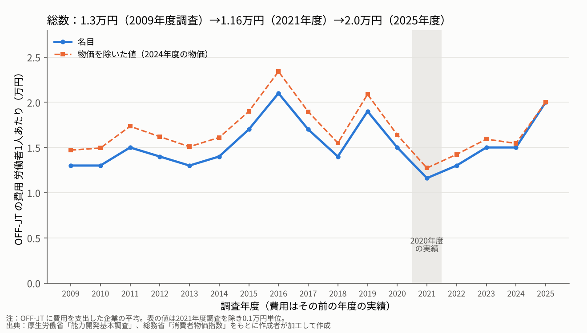
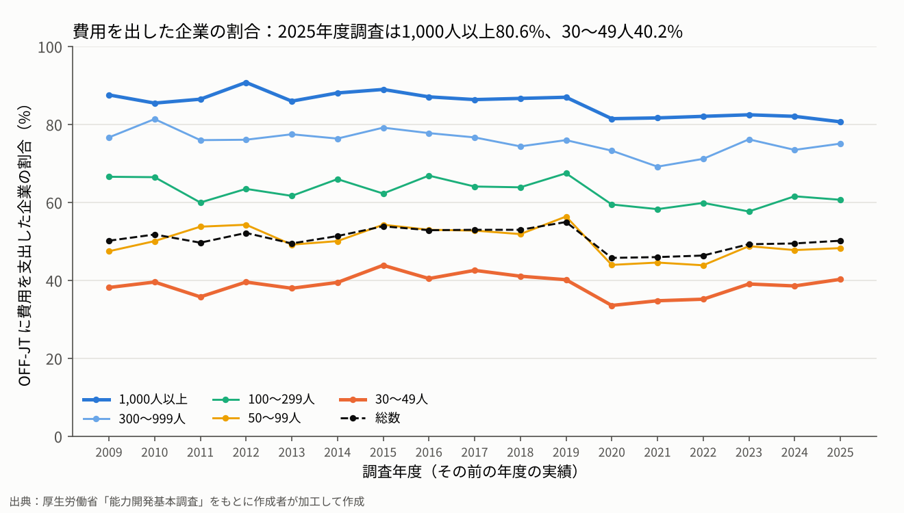
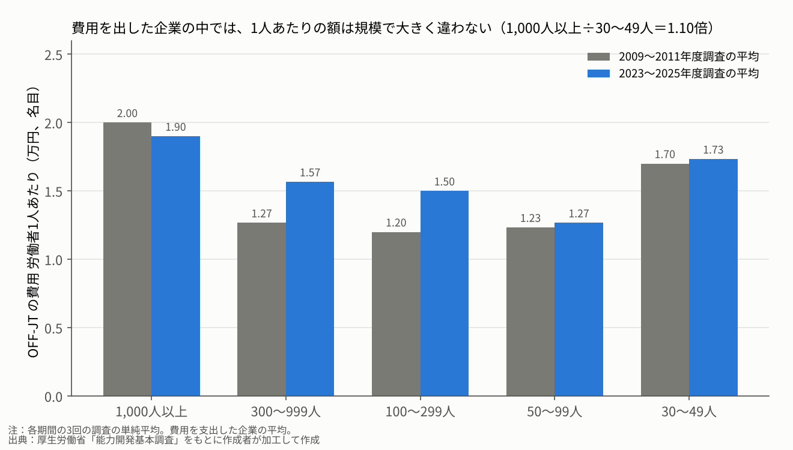
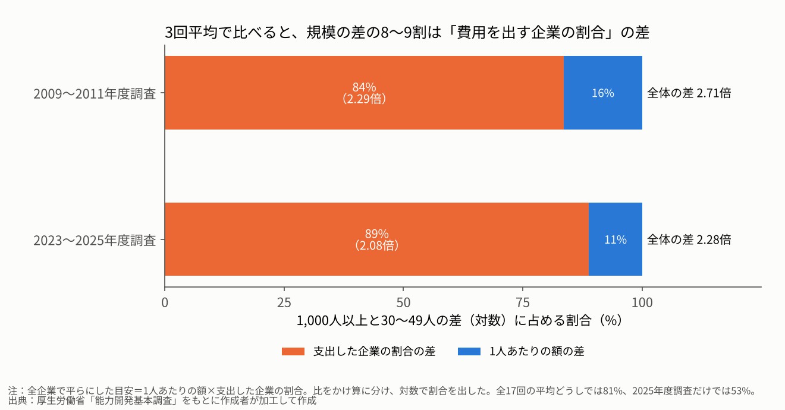

# F438 企業の研修（OFF-JT）の費用は、増えたのか？ 労働者1人あたりは2009年度調査の1.3万円から2025年度調査の2.0万円に。ただ大企業と小さい企業の差の大半（8割前後）は、1人あたりの額ではなく「費用を出す企業の割合」（81%対40%）の差だった

## 結論（先に）
- 厚生労働省「能力開発基本調査」で、OFF-JT（職場の外での教育訓練）に費用を出した企業の、労働者1人あたりの費用（総数）は、2009年度調査の1.3万円から2025年度調査の2.0万円になりました（名目 +54%、物価を除いて +36%）。ただ年度ごとの上下が大きく、3回平均で比べると、はじめ（2009〜2011年度調査）1.37万円→おわり（2023〜2025年度調査）1.67万円で、物価を除くと +9% でした。
- コロナの年（2021年度調査＝2020年度の実績）は1.16万円で、前の年より22.6%少なくなりました。2025年度調査の2.0万円は、コロナ前（2020年度調査）の1.5万円を上回っています。
- 2025年度調査で OFF-JT に費用を出した企業の割合は、1,000人以上80.6%、30〜49人40.2%で、40.4ポイントの差がありました。
- 一方、費用を出した企業の中での1人あたりの額は、規模で大きく違いませんでした。3回平均で1,000人以上1.90万円、30〜49人1.73万円（1.10倍）です。事前の仮説「1,000人以上は30〜49人の2倍以上」は外れました（2025年度調査だけでも1.86倍）。
- 問い直し：「1人あたりの額×費用を出した企業の割合」で全企業に平らにした目安で比べると、1,000人以上は30〜49人の2.28倍（3回平均）。この差の89%は、費用を出す企業の割合の差から来ていました。ただしこの割合は期間の取り方で動き、全17回の平均どうしでは81%、調査年度ごとの中央値は72%、2025年度調査だけでは53%です。

## 問い
「人への投資」「リスキリング」がよく話題になります。企業が研修（OFF-JT）にかける費用は、この15年あまりで増えたのでしょうか。コロナの時期にどれだけ減り、戻ったのでしょうか。大企業と中小企業では、どれだけ違うのでしょうか。人事・研修の担当の人、経営企画の人、働く人のために、厚生労働省の「能力開発基本調査」で確かめます。特定の企業の評価や、研修の助言はしません。

## データ（出典）
- 厚生労働省「能力開発基本調査」企業調査（2009〜2025年度調査の17回分）の第1表（OFF-JT に費用を支出した企業の割合）と第2表（OFF-JT に支出した費用の労働者1人あたり平均額・1社あたり平均額）。企業規模は30〜49人、50〜99人、100〜299人、300〜999人、1,000人以上の5区分です。
- 各年度の調査は前の年度の実績をたずねています（2025年度調査は2024年度の費用）。図と表は調査年度で示しています。
- 平均額は「費用を支出した企業」の平均です。支出していない企業は入りません。値は0.1万円（1,000円）単位で、2021年度調査だけ0.01万円単位です。
- 物価を除くときは、総務省「消費者物価指数」（全国、総合）の、費用の年度の平均で割り、2024年度の物価にそろえました。

## 事前の計画
[PLAN.md](PLAN.md)（2026-11-16 14:23、値を集計する前に作成）。下見では各年度の表の見出しと注だけを見ました。

| 仮説 | 外れの基準 | 結果 | 判定 |
|---|---|---|---|
| H1 2025年度調査の1人あたり費用は、1,000人以上が30〜49人の2倍以上 | 2倍未満 | 2.6万円 対 1.4万円（1.86倍） | 外れ |
| H2 2025年度調査の費用を出した企業の割合は、30〜49人が1,000人以上より20ポイント以上低い | 差が20ポイント未満 | 80.6% 対 40.2%（40.4ポイント） | 支持 |
| H3 2021年度調査の総数の1人あたり費用は、2020年度調査より20%以上少ない | 減り方が20%未満 | 1.5→1.16万円（−22.6%） | 支持 |
| H4 2025年度調査の総数の1人あたり費用は、2020年度調査を上回る | 同じか下回る | 2.0 対 1.5万円 | 支持 |

## やったこと
1. 17回分の Excel から、総数・規模別・産業別の「費用を出した企業の割合」と「1人あたり・1社あたりの平均額」を取り出しました（02_build.py）。表の形が年度で少し違うので、列は見出しの言葉で探しました。消費者物価指数から年度平均も作りました。
2. 規模別・年度別の値、比、変化率、仮説、頑健性を出しました（03_analysis.py）。
3. 結果を見てから、3回平均で年度の振れをならし、規模の差を「費用を出す企業の割合」と「1人あたりの額」に分けました（03b_requestion.py）。

## 分かったこと

### 1. 総数の1人あたり費用は、上下しながら少し増えた（図1）

総数の1人あたり費用は、2009〜2014年度調査は1.3〜1.5万円、2016年度調査に2.1万円まで上がり、その後は1.4〜1.9万円の間を上下しました。いちばん低いのはコロナの年の2021年度調査（1.16万円）で、2025年度調査は2.0万円でした。2024年度調査の1.5万円から1年で0.5万円上がっていて、1回の値だけで流れを判断するのは難しい動き方です。

### 2. 費用を出す企業の割合は、規模で大きく違う（図2）

OFF-JT に費用を出した企業の割合は、どの年度も規模が大きいほど高く、2025年度調査は1,000人以上80.6%、300〜999人75.0%、100〜299人60.6%、50〜99人48.2%、30〜49人40.2%でした。2020年度調査（2019年度の実績）で、すべての規模でそろって下がりました（総数で −9.2ポイント）。2019年度の終わりはコロナの始まりと重なりますが、ここまで下がった理由はこの表からは分かりません。その後、30〜49人は33.5%から40.2%に戻りましたが、1,000人以上は81〜82%前後のままです。

### 3. 費用を出した企業の中では、1人あたりの額は規模で大きく違わない（図3）

3回平均の1人あたりの額は、2023〜2025年度調査で1,000人以上1.90万円、300〜999人1.57万円、100〜299人1.50万円、50〜99人1.27万円、30〜49人1.73万円でした。規模が小さいほど少ない、という順番にはなっていません。年度ごとの振れ（前回との差の標準偏差）は、30〜49人で0.78万円、100〜299人で0.98万円と大きく、1回分の値の差は慎重に見る必要があります。

## 問い直し（結果を見てから足した）

### 規模の差は、どこから来ているのか（図4）

「1人あたりの額×費用を出した企業の割合」は、費用を出さない企業も含めて全企業に平らにした目安になります。この目安の1,000人以上と30〜49人の比は、はじめ（2009〜2011年度調査の平均）2.71倍、おわり（2023〜2025年度調査）2.28倍でした。

比はかけ算に分かれます。おわりの期間では、費用を出した企業の割合の比が2.08倍、1人あたりの額の比が1.10倍で、対数で見ると差の89%が割合の差から来ていました（はじめの期間は84%）。小さい企業の研修の少なさは、「1人あたりにかける額が少ない」ことよりも、「そもそも OFF-JT に費用を出す企業が少ない」ことから来ています。

割合の差は、はじめ48.7ポイント→おわり42.4ポイントに縮まりました。主に1,000人以上の割合が下がった（86.4%→81.7%）ためで、30〜49人は37.8%→39.2%とほぼ同じでした。

## 頑健性

| 確かめ方 | 値 |
|---|---|
| 1人あたり 総数 2009→2025年度調査（名目） | +54% |
| 同（物価を除く） | +36% |
| 1人あたり 総数 3回平均 はじめ→おわり（名目／物価を除く） | +22% ／ +9% |
| 1人あたり 総数 2015→2025年度調査（名目） | +18% |
| 1人あたり 総数 2019→2025年度調査（名目） | +5% |
| 1人あたり 総数 2020→2021年度調査（物価を除く） | −22% |
| 1人あたり 総数 2020→2025年度調査（物価を除く） | +22% |
| 1人あたり 1,000人以上÷30〜49人 2025年度調査 | 1.86倍 |
| 同 3回平均（2023〜2025年度調査） | 1.10倍 |
| 全企業で平らにした目安 1,000人以上÷30〜49人 2025年度調査 | 3.72倍 |
| 1社あたり平均額 1,000人以上÷30〜49人 2025年度調査 | 169倍 |
| 差のうち「費用を出す企業の割合」から来る部分：3回平均 はじめ／おわり | 84% ／ 89% |
| 同 全17回（2009〜2025年度調査）の平均どうし | 81% |
| 同 調査年度ごとの中央値（2025年度調査だけ） | 72%（53%） |

差の分け方は、どの期間で比べても割合の差の方が大きい（調査年度ごとでも17回すべてで半分を超える）一方、「約9割」と言えるのは3回平均で比べたときだけでした。総数の1人あたり費用が増えたかどうかは、比べる年度で +5% から +54% まで変わります。3回平均でならすと、物価を除いて1割弱の増加です。1社あたりの額は企業の人数の違いをそのまま映すので、規模の比較には1人あたりの額を使いました。

## 言えないこと
- 平均は費用を出した企業だけの平均で、出していない企業は入りません。全企業に平らにした目安は、規模の中の企業の人数の違いを考えていない近似です。
- 標本調査で年度ごとの振れが大きく、表に標準誤差がないので、1回分の小さい差がはっきりした差かは判断できません。
- OFF-JT の質や効果、職場の中での訓練（OJT）や自己啓発は、ここでは扱っていません。
- 特定の企業や業種の評価、研修の助言はしません。

## 仕事で使うなら
- 研修費を他社と比べるときは、「1人あたりの額」（費用を出した企業の平均）と「費用を出す企業の割合」を分けて見ると、規模の違いを読み違えにくくなります。
- 規模別・年度別の値は results/size_wide.csv、3回平均は results/early_late.csv にあります。

## 計画からの変更
- 頑健性に「3回平均の比較」を足しました。1回分の値の振れが大きかったためです。
- 問い直し（差の分け方）は結果を見てから足しました。

## 再現のしかた
```
sh src/run_all.sh        # オフライン。所要数秒
python3 src/01_fetch.py  # 元データを取り直すときだけ（ネットを使う）
```

| ファイル | 中身 |
|---|---|
| src/02_build.py | 34個の Excel と物価の CSV から data/offjt.csv・cpi_fy.csv を作る |
| src/03_analysis.py | 規模別・年度別の値・仮説・頑健性 → results/main.json・size_wide.csv・robustness.csv |
| src/03b_requestion.py | 問い直し → results/requestion.json・early_late.csv |
| src/04_figures.py | 図4枚 |

repro_check：/tmp/rep_F438 に写して流し、results・figures・data の CSV がすべて cmp で一致（件数と所要時間は results/repro_check.txt）。乱数は使っていません。

## レビューで直したこと

独立レビュー（2026-11-17）で、数字の照合・再実行・図を確かめ、次を直しました。直したあとに /tmp の新しいフォルダで流し直し、results と figures がすべて一致することを確かめています。

| # | 指摘 | 直し方 |
|---|---|---|
| 1 | 題名・結論の「差の約9割は企業の割合の差」は3回平均どうしの比較だけの値で、調査年度ごとでは中央値72%、2025年度調査だけでは53%と期間で大きく動く | 03b に調査年度ごと・全17回平均での分け方を足し（results/requestion_by_year.csv、requestion.json）、題名を「差の大半（8割前後）」に、結論・note・頑健性の表に幅（全17回平均81%、年度ごと中央値72%、2025年度53%）を書き足した |

## 出典
- 厚生労働省「能力開発基本調査」企業調査 第1表・第2表（各年度）：https://www.e-stat.go.jp/stat-search/files?toukei=00450451&tstat=000001031190 （各ファイルの URL は data/raw/SOURCES.md）
- 総務省「消費者物価指数」2025年基準（全国、特殊分類）：https://www.e-stat.go.jp/stat-search/file-download?statInfId=000040482943&fileKind=1

（いずれも 厚生労働省「能力開発基本調査」、総務省「消費者物価指数」をもとに作成者が加工して作成）
