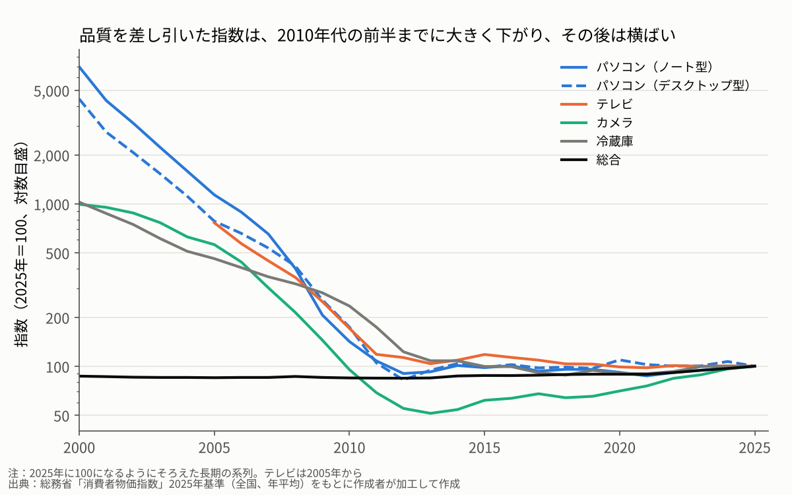
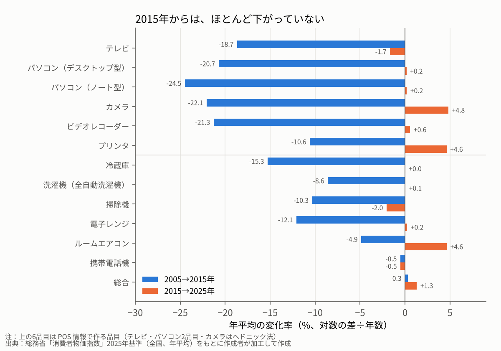
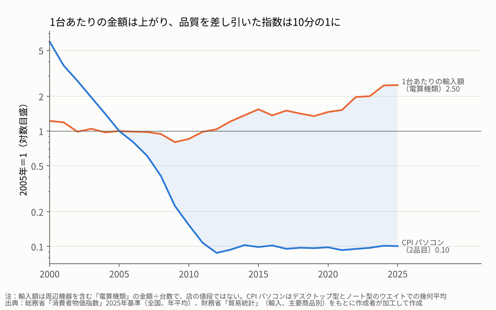
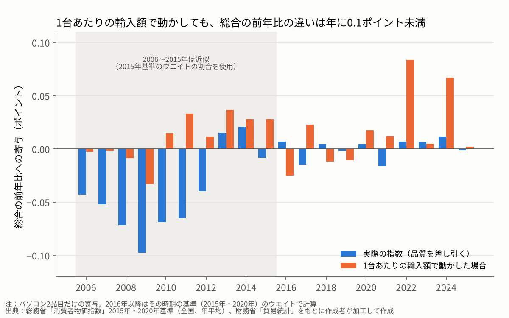

# F439 テレビやパソコンの値段は、品質の向上を差し引くとどれだけ下がって見えるのか？ 2005→2025年にテレビ −87%、ノート型パソコン −91%。下げたのはほぼ2015年まで

## 結論（先に）
- 消費者物価指数（CPI）の品目の指数は、2005→2025年にテレビ −86.9%（約7.6分の1）、パソコン（デスクトップ型）−87.2%、パソコン（ノート型）−91.2%（約11.4分の1）、カメラ −82.2% でした。同じ期間の総合は +17.6% です。
- 下がったのは2010年代の前半までです。年平均の変化率は、2005→2015年がテレビ −18.7%、ノート型パソコン −24.5%。2015→2025年はテレビ −1.7%、ノート型パソコン +0.2%、カメラ +4.8% でした。冷蔵庫など比べた家電6品目の平均も −8.6% から +0.4% に変わりました。テレビは2005→2025年の下げ（対数）の約9割が2015年までで、パソコン2品目とカメラは2015年からは下げていません。
- 品質を差し引かない目安として、輸入の「電算機類」の1台あたりの金額を見ると、2005年 15,133円 → 2025年 37,845円（+150.1%）でした。CPI のパソコン（2品目）は −89.9% です。対数の差は 3.21（約25倍）で、1年あたりにならすと約16%の差です。
- ただし、品質調整をしない携帯電話機でも、輸入の1台あたりの金額と CPI の差は 2017→2025年に 0.38 ありました（パソコンは同じ期間に 0.46）。この差のすべてが「品質の向上を差し引いた分」ではありません。
- 総合への効き方は小さい：テレビ・パソコンなど POS 情報で作る7品目の、総合の前年比への寄与は2016〜2020年の平均で −0.003ポイントでした。パソコン2品目を1台あたりの輸入額で動かした場合との差も、2016〜2025年の平均で 0.016ポイント、2006〜2015年（近似）で 0.052ポイントです。

## 問い
CPI のテレビやパソコンの指数は、長い期間で見ると何分の一にもなっています。一方で、店で払う金額はそこまで下がっていない、むしろ高くなったという実感もよく聞かれます。このずれは、CPI が「同じ性能のものの値段」を比べるように、性能の向上の分を差し引いている（品質調整）ことから来ます。

物価の解説を読む人、家電やパソコンを仕入れたり売ったりして値段を追う人に向けて、①品質を差し引いた指数はどれだけ、いつ下がったのか、②品質を差し引かない金額の目安とどれだけ違うのか、③総合の物価をどれだけ動かしているのか、を数字で確かめます。どの指数を使うべきか、価格をどうすべきかは扱いません。

総務省の解説（2025年基準）では、テレビ・パソコン（デスクトップ型・ノート型）・カメラの4品目は POS 情報（店の販売記録）から**ヘドニック法**（性能と価格の関係を重回帰で推計し、性能の差による価格差を取り除く方法）で毎月の指数を作り、タブレット端末・プリンタ・ビデオレコーダーは**固定スペック方式**（決めた性能の範囲に入る機種だけで比べる方法）で作るとされています。2015年基準の解説では、ヘドニック法の対象はパソコン2品目とカメラの3品目でした。

## データ（出典）
| データ | 中身 | 使い方 |
|---|---|---|
| 総務省「消費者物価指数」2025年基準 品目別価格指数（全国、年平均＝暦年、e-Stat 000040482831） | 1970〜2025年 | 品目の長期の動き（図1・図2） |
| 同 月次（000040482945） | 1970年1月〜2026年9月 | 暦年の表と一致するかの確かめ |
| 同 2020年基準（000032103938）・2015年基準（000031431772）の年平均の表 | 各基準のウエイトつき | 総合への寄与（その時期の基準のウエイト） |
| 財務省「貿易統計」輸出入額の推移 輸入 世界 年別 主要商品別 | 電算機類（含周辺機器）・電話機の金額と台数 | 1台あたりの輸入額（図3） |

- 暦年の値は暦年（年平均）の表を使いました。年度平均の表（000040482959）は使っていません。
- 1台あたりの輸入額は、周辺機器（キーボードなど）を含む「電算機類」の金額を台数で割ったもので、店の値段ではありません。品質を調整していない「平均の値段」の目安としてだけ使います。
- 取得の URL と日付は `data/raw/SOURCES.md`。

## 事前の計画
集計の前に [PLAN.md](PLAN.md) を書きました（2026-11-18 11:40）。仮説と判定：

| 仮説 | 外れの基準 | 結果 | 判定 |
|---|---|---|---|
| H1：2005→2025年に、テレビ・パソコン2品目・カメラはどれも −50% 以下 | 1つでも −50% より小さい下げ | −86.9%、−87.2%、−91.2%、−82.2% | 支持 |
| H2：2015→2025年の下がり方は2005→2015年より鈍い（4品目のうち3以上） | 2品目以下 | 4品目すべてで鈍った | 支持 |
| H3：2005→2025年の対数の変化で、1台あたりの輸入額は CPI パソコンより 1.0 以上大きい | 1.0 未満 | 差 3.21 | 支持（ただし携帯電話機でも差が出たので、差のすべてを品質調整とは読めない） |
| H4：POS 7品目の総合の前年比への寄与は、2016〜2020年の平均で −0.1ポイントより小さい押し下げ | −0.1ポイント以上の押し下げ | 平均 −0.003ポイント | 支持 |

## やったこと
1. 2025年基準の長期の表から、POS で作る7品目と、比べる家電など6品目（冷蔵庫・全自動洗濯機・ルームエアコン・掃除機・電子レンジ・携帯電話機）と総合を抜き出し、5年ごとの年平均の変化率（対数の差÷年数）を出しました。
2. 貿易統計の電算機類の1台あたりの輸入額を2005年＝1にし、CPI のパソコン（デスクトップ型とノート型を2025年基準のウエイトで重みづけした幾何平均）と比べました。
3. その時期の基準の表では、総合＝Σ（ウエイト×品目の指数）÷Σウエイト になります。これを使い、前年比への寄与＝ウエイト×（今年−前年）÷（Σウエイト×総合の前年）×100 を、2016〜2020年は2015年基準、2021〜2025年は2020年基準で出しました。
4. 頑健性を5つ確かめ、結果を見てから問い直しを1つ足しました。

## 分かったこと

### 図1 品質を差し引いた指数は、2010年代の前半までに大きく下がり、その後は横ばい

- 2025年＝100でそろえると、2005年の指数はテレビ 764、ノート型パソコン 1,135、デスクトップ型パソコン 781、カメラ 561 でした（2005→2025年の倍率 7.6・11.4・7.8・5.6）。
- いちばん低かった年は、デスクトップ型パソコン 2012年（82.3）、カメラ 2013年（51.3）です。テレビとノート型パソコンは2021年が最低（97.8・87.2）ですが、2015年からの動きは小さい幅です。
- 冷蔵庫も2005→2025年に −78.2% でした。（推測）銘柄を入れ替えるときの品質調整（オーバーラップ法など、解説に載っている方法）が効いていると考えられますが、品目ごとにどの方法を使ったかはこのデータでは分かりません。

### 図2 2015年からは、ほとんど下がっていない

- 年平均の変化率は、2005→2015年にテレビ −18.7%、デスクトップ型 −20.7%、ノート型 −24.5%、カメラ −22.1%。2015→2025年は −1.7%、+0.2%、+0.2%、+4.8% でした。
- 比べた家電6品目の平均も、−8.6% から +0.4% に変わりました。総合は +0.3% から +1.3% です。
- 2015→2025年のカメラ（+62.1%）・プリンタ（+58.7%）は、総合（+14.0%）より大きく上がりました。（推測）売れる機種が高い価格帯に移ったことや円安が考えられますが、このデータでは分けていません。

### 図3 1台あたりの金額は上がり、品質を差し引いた指数は10分の1に

- 電算機類の1台あたりの輸入額は、2005年 15,133円 → 2025年 37,845円（+150.1%）。CPI のパソコン（2品目）は同じ期間に −89.9% でした。
- 2つの比は約25倍（対数の差 3.21）で、1年あたりにならすと約16%の差です。ただし、この差のすべてが「性能の向上」として差し引かれた分ではありません。品質調整をしない携帯電話機でも同じ向きの差が出ました（頑健性の表）。
- ただし、1台あたりの輸入額は周辺機器を含み、売れる機種の組み合わせも変わります。円安（ドル建ての値段が同じでも円では上がる）も入っています。同じ品物の値段の比較ではありません。

## 問い直し（結果を見てから足した）
**パソコン2品目の指数が、品質を差し引かない1台あたりの輸入額と同じ率で動いていたら、総合の前年比はどれだけ違ったか。**（図4）


- 2016〜2025年（その時期の基準のウエイト）では、差の平均は 0.016ポイントでした。いちばん差が開いたのは2011年（近似、0.098ポイント）、2016年は逆向き（−0.032ポイント）です。
- 2006〜2015年は、2015年基準のウエイトの割合をその年の支出の割合とみなした近似で、差の平均は 0.052ポイントでした。実際のパソコン2品目の寄与は平均 −0.041ポイントです。
- 1台あたりの輸入額との差は、品目の指数では何十倍にもなりますが、総合の前年比では年に0.1ポイント未満でした。ウエイトが小さい（POS の7品目で1万分の47〜70）ためです。

## 頑健性
| 確かめたこと | 結果 | 結論は同じか |
|---|---|---|
| 期間を 2006→2024 年に | テレビ −82.3%、デスクトップ型 −83.7%、ノート型 −89.0%、カメラ −78.0% | 同じ（どれも −50% 以下） |
| 期間を 2005→2024 年に | −86.9%、−86.3%、−91.4%、−82.8% | 同じ |
| 期間を 2007→2023 年に | −77.6%、−81.2%、−85.5%、−70.9% | 同じ |
| 暦年の表と、月次の1〜12月の平均（2000〜2025年、8系列） | 差の最大 0.17%、平均 0.032% | 同じ（暦年の表で正しい） |
| 2015→2020年の変化率を、2025年基準の長期の表と2020年基準の表で | テレビ −16.2%／−16.2%、デスクトップ型 +11.2%／+11.2%、ノート型 −6.5%／−6.5%、カメラ +14.1%／+14.0% | 同じ（つなぎ方で変わらない） |
| 携帯電話機（ヘドニック法の品目ではない）で、輸入の1台あたりの金額と CPI を比べる（2017→2025年、対数の差） | 輸入 +0.429、CPI +0.047、差 0.382（パソコンは同じ期間に 0.455） | 一部変わる：差は品質調整の品目だけに出るわけではない |
| Σウエイト×品目の指数÷Σウエイト と公表の総合の差 | 2015年基準 −0.00〜+0.14、2020年基準 −0.04〜+0.04 | 寄与の大きさの読みは同じ（差は0.15以内） |

- 寄与の式のずれ（2015年基準の2018〜2020年に 0.10〜0.14）は、（推測）生鮮食品の一部の品目で月ごとにウエイトを変えている分と、品目の指数の丸めによるものと考えられます。POS 7品目の寄与（平均 −0.003ポイント）の読みは変わりません。

## 言えないこと
- 品質調整が「正しい」かどうかは決められません。どの性能にどれだけの価値があるとみるかで、指数は変わります。
- 1台あたりの輸入額は、店の値段でも、同じ品物の値段でもありません。周辺機器、機種の組み合わせ、為替が混ざっています。携帯電話機でも同じくらいの差が出たので、図3の差を品質調整の大きさそのものとは読めません。
- 2006〜2015年の総合への寄与は、2015年基準のウエイトの割合を当てた近似です。当時の基準（2005年・2010年）のウエイトは使っていません。
- 品質の向上が家計の満足や暮らしをどれだけよくしたかは、このデータでは分かりません。
- 2015年以降に下がらなくなった理由（性能の伸びの鈍化、売れ筋の変化、為替など）は分けていません。

## 仕事で使うなら
- CPI の品目の指数を「1台あたりの値段」として読まない。品質を差し引いた値段であることを、表や図の注に書く。
- 販売データの平均単価と比べるときは、機種の組み合わせと為替の動きを別に並べて見る。
- 総合の物価への効き方は、品目の変化率ではなく「ウエイト×変化」で見る。

## 計画からの変更
- 頑健性の「期間の端を変える」で、計画の 2003→2025年はテレビの系列が2005年からのため使えず、2005→2024年と2007→2023年にしました。
- 問い直し（パソコンを1台あたりの輸入額で動かした場合）は、結果を見てから足しました。2006〜2015年の近似の式（ウエイトの割合×変化率）は、はじめ「2015年基準のウエイト×その年の指数の水準」で計算しましたが、当時のパソコンの支出の割合を10倍以上に見積もってしまうため、割合を固定する形に直しました。
- 2025年基準の年平均の表にある品目名（「冷蔵庫」など）を使いました。2015年基準では「電気冷蔵庫」など名前が違います。

## 再現のしかた
```
sh src/run_all.sh        # 02_build → 03_analysis → 03b_requestion → 04_figures（ネットにつながない）
python3 src/01_fetch.py  # 元データを取り直すときだけ（run_all.sh からは呼ばない）
```
| ファイル | 中身 |
|---|---|
| `data/raw/` | 元データ（CSV 5つ、約2.8MB）と SOURCES.md |
| `src/02_build.py` | 使う品目と貿易統計の列を抜き出す → `data/cpi_items_annual.csv`・`data/cpi_items_monthly_2025.csv`・`data/trade_units.csv` |
| `src/03_analysis.py` | 変化率・1台あたりの輸入額との比較・寄与・頑健性 → `results/main.json`・`item_rates.csv`・`unit_value_vs_cpi.csv`・`contribution.csv`・`robustness.csv` |
| `src/03b_requestion.py` | 問い直し → `results/requestion.json`・`requestion_counterfactual.csv` |
| `src/04_figures.py` | 図4枚 → `figures/` |

- 使うライブラリ：`requirements.txt`（matplotlib・numpy）。乱数は使いません。
- 所要時間：CPU 1つで約3秒。
- 再現の確かめ：`results/repro_check.txt`（/tmp に写して流し直し、results・figures・data の CSV がバイト単位で一致）。

## レビューで直したこと
独立レビュー（2026-11-18）で、数字の照合・再実行・図・使った表（暦年の年平均の表であること）を確かめ、次を直しました。

| # | 指摘 | 直し方 |
|---|---|---|
| 1 | 題名の「1台あたりの輸入額は+150%」は、何の1台か（周辺機器を含む電算機類）が分からず、品質調整の大きさのように読める。携帯電話機でも同じ向きの差が出ており、題名に置くほど確かな結果ではない | 題名の結果を、本文の主な結果「下げたのはほぼ2015年まで」に替えた（README・note・status） |
| 2 | 図3の説明「この分が『性能の向上』として差し引かれた形」は言い過ぎ | 「この差のすべてが性能の向上の分ではない」に直し、携帯電話機の確かめを示した |
| 3 | 図4の題「パソコンの品質調整が総合を動かした幅」は、輸入額との差を品質調整と同じに扱っている | 「1台あたりの輸入額で動かしても、総合の前年比の違いは年に0.1ポイント未満」に直した（04_figures.py、図を作り直し） |
| 4 | note の太字の結果が +150.1% を前に出していた | 2015年までの下げと、総合への寄与（−0.003ポイント）に替えた |

## 出典
- 総務省統計局「消費者物価指数」2025年基準・2020年基準・2015年基準 長期時系列データ（e-Stat）：https://www.e-stat.go.jp/stat-search/files?toukei=00200573
- 総務省統計局「2025年基準 消費者物価指数の解説」付録（POS 情報を用いた品目別価格指数の算出）：https://www.stat.go.jp/data/cpi/2025/kaisetsu/pdf/fu2.pdf
- 総務省統計局「2025年基準 消費者物価指数の解説」（品質調整）：https://www.stat.go.jp/data/cpi/2025/kaisetsu/pdf/3-2.pdf
- 総務省統計局「2015年基準 消費者物価指数の解説」付録：https://www.stat.go.jp/data/cpi/2015/kaisetsu/pdf/fu1-2.pdf
- 財務省「貿易統計」輸出入額の推移（主要商品別）：https://www.customs.go.jp/toukei/suii/html/time.htm

（いずれも 総務省「消費者物価指数」、財務省「貿易統計」 をもとに作成者が加工して作成）
