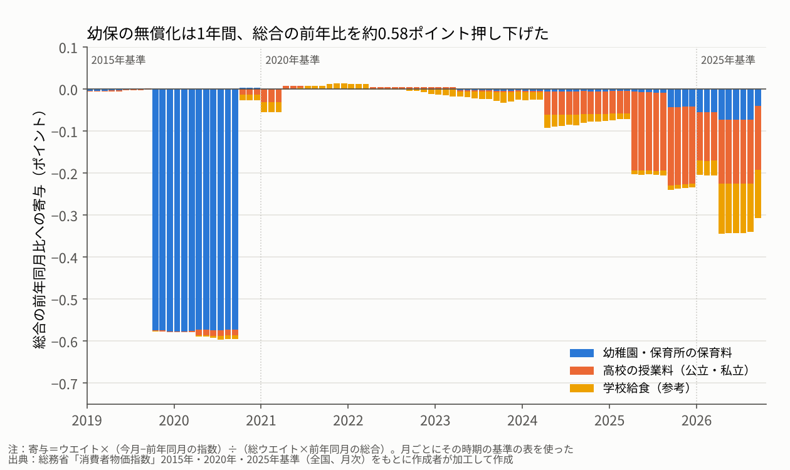
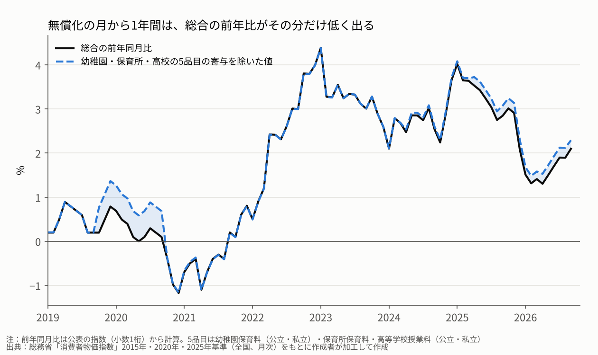
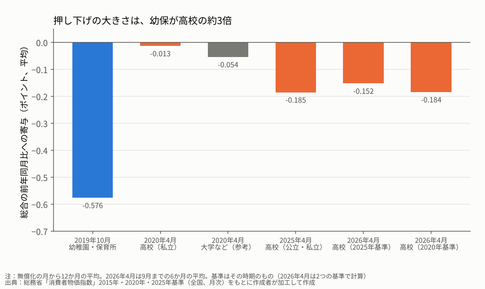
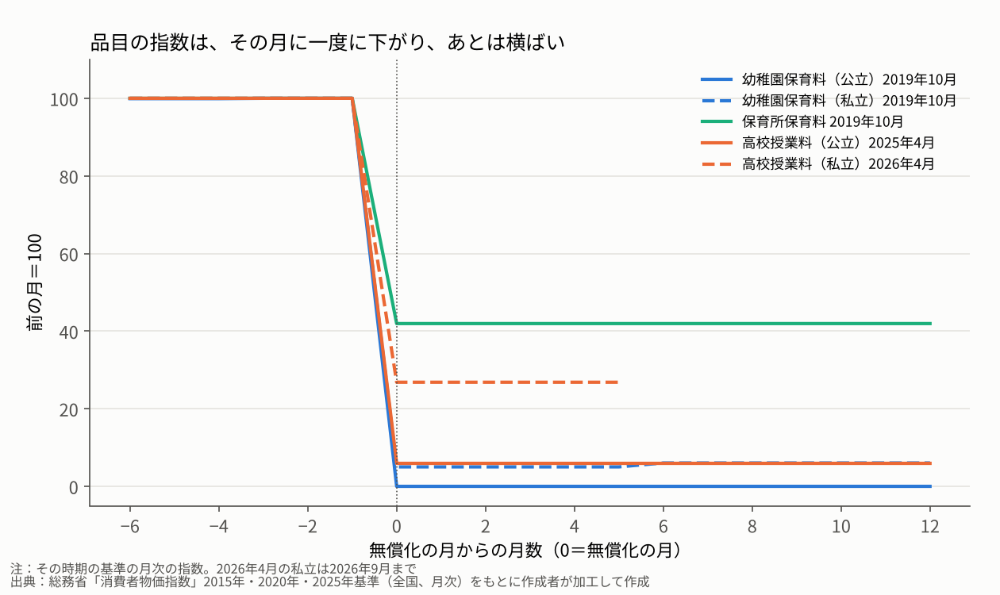

# F440 幼児教育と高校の無償化で、消費者物価はどれだけ下がったのか？ 2019年10月の幼保は総合の前年比を1年間 0.58ポイント、2025年4月の高校は 0.19ポイント押し下げた。幼保の分は12か月たつと消えた

## 結論（先に）
- 2019年10月の幼児教育・保育の無償化で、幼稚園保育料（公立）は前月比 −100%、（私立）は −95.0%、保育所保育料は −58.1% 下がりました。3品目の寄与で、総合の前年同月比は2019年10月〜2020年9月の平均で **−0.576ポイント** 押し下げられました。総務省の試算（約0.6ポイント、図の値 −0.57〜−0.58）とほぼ同じです。
- 2025年4月の高校の授業料（公立 −94.1%、私立 −10.6%）は、2025年4月〜2026年3月の平均で **−0.185ポイント**。2026年4月の私立高校（−73.2%）は、4〜9月の平均で −0.152ポイント（2025年基準）でした。2020年4月の私立高校は −0.013ポイントと小さめです。
- 幼保の押し下げは、無償化の月からちょうど12か月で前年同月比から消えました（2020年10月の幼保の寄与は +0.003ポイント。2020年4月の私立高校も13か月目は +0.005ポイント）。指数の水準は低いまま残りますが、次の下げが重ならなければ、前年比で見る「物価の上がり方」への効き方は1年で終わります。高校は2026年4月に私立の拡充が重なったため、13か月目の2026年4月も高校の寄与は −0.185ポイント（2020年基準）で、押し下げが続いています。
- 問い直し：2019年10月〜2020年9月の総合の前年比は平均 0.32% でしたが、5品目の寄与を除くと 0.90% でした。2026年4月は小学校などの給食費も下がり、学校給食の寄与は −0.117ポイントと高校（−0.152）に近い大きさでした。
- 同じ2026年4月の高校でも、2020年基準のウエイトで計算すると −0.184ポイントで、基準によって0.03ポイントほど違います。

## 問い
物価の前年比は、賃金の話し合いや契約の見直し、物価のニュースでよく使われます。無償化のあった月から1年間は、その分だけ総合の前年比が低く出ます。「物価の上がり方が鈍った」と見えるうち、どれだけが無償化の分なのか、それはいつ消えるのかを知りたい人に向けて、品目の指数とウエイトから寄与を計算します。

ここで扱うのは、物価指数の数字の読み方までです。無償化という政策の良し悪しや、どうすべきかは扱いません。

## データ（出典）
| データ | 中身 | 使い方 |
|---|---|---|
| 総務省「消費者物価指数」2015年基準 品目別価格指数（全国）月次（e-Stat 000031431698）・年平均（000031431772） | 1970年〜2021年 | 2019年10月・2020年4月 |
| 同 2020年基準 月次（000032103844）・年平均（000032103938） | 1970年〜2026年9月 | 2025年4月、2026年4月の確かめ |
| 同 2025年基準 月次（000040482945）・年平均（000040482831）・中分類（000040482829） | 1970年〜2026年9月 | 2026年4月 |

- 見た品目：幼稚園保育料（公立・私立）、保育所保育料、高等学校授業料（公立・私立）。参考に大学・短大・専修学校の授業料、学校給食。
- 2020年基準・2025年基準には「幼稚園保育料」の品目がありません（無償化のあとの基準）。そのため、無償化のあった時期の基準の表で計算しました。
- 暦年の値は暦年（年平均）の表を使いました。年度平均の表（000040482959・000040482957 など）は使っていません。
- 2015年基準の月次は、はじめ別の表（000031431788）を取りましたが、総合のウエイトが全国の年平均の表と合わず、全国の表でないと分かったので、寄与の計算の前に 000031431698 に替えました（`data/raw/SOURCES.md`）。

## 事前の計画
集計の前に [PLAN.md](PLAN.md) を書きました（2026-11-18 11:50）。仮説と判定：

| 仮説 | 外れの基準 | 結果 | 判定 |
|---|---|---|---|
| H1：2019年10月の幼保の無償化は、12か月の平均で総合の前年比を0.5ポイント以上押し下げた | 0.5ポイント未満 | −0.576ポイント | 支持 |
| H2：この計算は総務省の試算（約0.6ポイント）と0.1ポイント以内で一致（2019年10〜12月） | 0.1ポイントより大きくずれる | −0.577ポイント（差 0.023） | 支持 |
| H3：2025年4月の高校の押し下げは、12か月の平均で0.1ポイント未満 | 0.1ポイント以上 | −0.185ポイント | 外れ |
| H4：2026年4月の高校の押し下げは、2025年4月より大きい（4〜9月の平均） | 小さいか同じ | 2026年 −0.152（2020年基準では −0.184）、2025年 −0.187 | 外れ |

H3 が外れたのは、2020年基準では高校の授業料のウエイトが公立・私立あわせて1万分の56あり、公立が −94.1% と大きく下がったためです。

## やったこと
1. その時期の基準の中では、総合＝Σ（ウエイト×品目の指数）÷Σウエイト になります（基準年＝100の固定ウエイト）。そこで、品目の前年同月比への寄与＝ウエイト×（今月−前年同月）÷（総ウエイト×前年同月の総合）×100（ポイント）としました。前年同月も同じ基準の表から取ります。
2. 無償化の月から12か月（2026年4月は9月までの6か月）の寄与の平均・最大を出しました。
3. 暦年の表でも、暦年の総合の前年比への寄与を出しました（2019年 −0.149、2020年 −0.430、2021年 +0.001ポイント。高校は2024年 −0.040、2025年 −0.153ポイント）。
4. 頑健性を5つ確かめ、結果を見てから問い直しを1つ足しました。

## 分かったこと

### 図1 幼保の無償化は1年間、総合の前年比を約0.58ポイント押し下げた

- 2019年10月〜2020年9月の幼保3品目の寄与は −0.573〜−0.579ポイントで、ほぼ一定でした（最も大きいのは2019年12月〜2020年2月の −0.579）。
- 3品目のウエイトは2015年基準で1万分の83（公立幼稚園 2.8、私立幼稚園 27.4、保育所 52.8）でした。下げ幅のほとんどは保育所と私立幼稚園から来ています。
- 2024年から高校の授業料の寄与が見え始め（2024年9月 −0.054ポイント）、2025年4月からは −0.19ポイント前後になりました。（推測）2024年4月の一部の自治体の支援の拡充が入っていると考えられますが、このデータでは分けられません。
- 2025年9月ごろからは保育所保育料も少し押し下げています（2026年4月 −0.073ポイント）。（推測）自治体ごとの保育料の軽減と考えられますが、確かめていません。

### 図2 無償化の月から1年間は、総合の前年比がその分だけ低く出る

- 2019年10月〜2020年9月の総合の前年比は平均 0.32%、5品目（幼稚園2品目・保育所・高校2品目）の寄与を除くと 0.90% でした。
- 2020年に総合の前年比が0以下になった月は5月と10〜12月です。5品目を除くと、0以下は10〜12月だけで、5月の0以下は無償化の分でした。
- 2025年4〜12月は、総合 2.98% に対し除くと 3.19%、2026年4〜9月は 1.73% に対し 1.95% でした。

### 図3 押し下げの大きさは、幼保が高校の約3倍

- 12か月の平均で、2019年10月の幼保 −0.576、2025年4月の高校 −0.185、2020年4月の私立高校 −0.013ポイントでした。参考の2020年4月の大学・短大・専修学校は −0.054ポイントです。
- 2026年4月の高校は、2025年基準 −0.152、2020年基準 −0.184ポイント。2025年基準では、2025年の無償化のあとの支出でウエイトを決めているため、高校（公立）のウエイトが1万分の19.1から2.8に下がっています。

### 図4 品目の指数は、その月に一度に下がり、あとは横ばい

- 品目の指数は無償化の月に一度に下がり、その後はほとんど動きません。だから、次の下げが重ならなければ、前年同月比の押し下げは12か月続き、13か月目に消えます。
- 公立幼稚園は0（−100%）、私立幼稚園は約5%の水準、保育所は約42%の水準まで下がりました。（推測）無償の範囲の外の費用（上限を超える分など）が残るためと考えられます。
- 2010年4月の公立高校の授業料の無償化は、2015年基準の年平均の表で、2009年 631.5 → 2010年 165.8 → 2011年 9.8 でした（当時のウエイトの表がないので寄与は出していません）。

## 問い直し（結果を見てから足した）
**2026年4月は小学校などの給食費の無償化も同じ月に始まった。高校の授業料と給食は、それぞれどれだけ押し下げたか。**
- 学校給食の指数は2026年4月に前月比 −71.0%（2025年基準）。寄与は4〜9月の平均で −0.117ポイント（2020年基準では −0.128）でした。高校の −0.152ポイント（2020年基準 −0.184）に近い大きさです。
- 高校・幼保の5品目に給食を足して除くと、2026年4〜9月の総合の前年比の平均は 1.73% から 2.07% になります。
- 給食はこの記事の問い（幼児教育と高校）の外ですが、同じ月に重なるため、高校の分だけを見ると押し下げを小さく読み違えます。

## 頑健性
| 確かめたこと | 結果 | 結論は同じか |
|---|---|---|
| 総務省の試算（2019年10月、約0.6ポイント、図の値 −0.57〜−0.58）と照らす | この記事の計算：2019年10〜12月の平均 −0.577ポイント | 同じ |
| Σウエイト×品目の指数÷Σウエイト と公表の総合の差（月次） | 2015年基準 +0.01〜+0.09、2020年基準 −0.06〜−0.01、2025年基準 +0.02〜+0.10 | 同じ（差は0.1以内） |
| 2026年4月の高校を2020年基準でも計算 | 2020年基準 −0.184／2025年基準 −0.152ポイント | 大きさは基準で0.03ほど変わる |
| 分母を生鮮食品を除く総合（コア）に | 幼保 −0.602、高校2025年 −0.194、2026年 −0.158、私立高校2020年 −0.013ポイント | 同じ（コアへの寄与は少し大きい） |
| 暦年の表と、月次の1〜12月の平均（2015年以降、使った品目） | 差の最大 0.075 | 同じ（暦年の表で正しい） |

- 総合の再現の差（最大0.1ポイント）は、（推測）生鮮食品の一部で月ごとにウエイトを変えていることと、品目の指数の丸めによるものと考えられます。寄与の大きさ（0.01ポイントの単位）の読みは変わりません。

## 言えないこと
- 物価指数が下がったのは「家計が窓口で払う値段」です。無償化の費用（税など）は物価に入りません。家計の負担が全体でどうなったかは、このデータでは分かりません。
- 全国の平均の物価で見た大きさです。対象の子どもがいる世帯の物価の下がり方は、もっと大きくなります。
- 2010年4月の公立高校の無償化の寄与は、当時の基準（2005年基準）のウエイトの表を使っていないので出していません。
- 2024年の高校、2025年からの保育所の下げに、どの制度（国・自治体）がどれだけ効いたかは分けていません。
- 前年比への寄与で見ているので、「無償化がなければ物価はいくらだったか」（ほかの値段への波及など）は分かりません。
- 政策の良し悪しや、どうすべきかは書きません。

## 仕事で使うなら
- 物価の前年比を使うときは、無償化のあった月から12か月は、その分を差し引いた値も並べて見る。
- 13か月目に前年比が上がって見えても、それは押し下げが消えた分で、値上がりが急に進んだとは限らない。
- 寄与の大きさは、その時期の基準のウエイトで計算する（基準が変わると0.03ポイントほど違うことがある）。

## 計画からの変更
- 2015年基準の月次の表を、全国の表（000031431698）に替えました（寄与の計算の前）。
- 学校給食（2026年4月）は計画になく、結果を見てから問い直しとして足しました。
- 2020年4月の大学・短大・専修学校の授業料は、参考として足しました（問いの対象の外）。

## 再現のしかた
```
sh src/run_all.sh        # 02_build → 03_analysis → 03b_requestion → 04_figures（ネットにつながない）
python3 src/01_fetch.py  # 元データを取り直すときだけ（run_all.sh からは呼ばない）
```
| ファイル | 中身 |
|---|---|
| `data/raw/` | 元データ（CSV 7つ、約7.0MB）と SOURCES.md |
| `src/02_build.py` | 使う品目を抜き出す → `data/cpi_items_monthly.csv`・`data/cpi_items_annual.csv` |
| `src/03_analysis.py` | 出来事ごとの寄与・暦年の寄与・頑健性 → `results/main.json`・`event_contrib_monthly.csv`・`annual_contrib.csv`・`robustness.csv` |
| `src/03b_requestion.py` | 問い直し（給食、5品目を除いた前年比） → `results/requestion.json`・`requestion_ex_free.csv` |
| `src/04_figures.py` | 図4枚 → `figures/` |

- 使うライブラリ：`requirements.txt`（matplotlib・numpy）。乱数は使いません。
- 所要時間：CPU 1つで約3秒。
- 再現の確かめ：`results/repro_check.txt`（/tmp に写して流し直し、results・figures・data の CSV がバイト単位で一致）。

## レビューで直したこと
独立レビュー（2026-11-18）で、数字の照合・再実行・図・使った表（暦年の年平均の表、2015年基準の月次が全国の表 000031431698 であること）を確かめ、次を直しました。

| # | 指摘 | 直し方 |
|---|---|---|
| 1 | 題名と結論の「12か月で消える」「どちらも12か月で消える」は、高校には当てはまらない。2026年4月に私立高校の拡充が重なり、13か月目の2026年4月も高校の寄与は −0.185ポイント（2020年基準）だった | 題名を「幼保の分は12か月で消えた」に直し、結論・note の太字に高校の押し下げが続いていることを書いた（README・note・status） |
| 2 | 図4の説明「13か月目に消えます」は、次の下げが重なる場合を除いていない | 「次の下げが重ならなければ」を足した |

## 出典
- 総務省統計局「消費者物価指数」2015年・2020年・2025年基準 長期時系列データ（e-Stat）：https://www.e-stat.go.jp/stat-search/files?toukei=00200573
- 総務省統計局「消費税率引上げ及び幼児教育・保育無償化の影響（試算）」（2019年10月）：https://www.stat.go.jp/data/cpi/2015/pdf/tsuikaz201910.pdf
- ニッセイ基礎研究所の解説（2025年4月の全国 CPI。公立高校授業料の前年比の確かめに使った）：https://www.nli-research.co.jp/files/topics/82026_ext_18_0.pdf?site=nli

（いずれも 総務省「消費者物価指数」 をもとに作成者が加工して作成）
