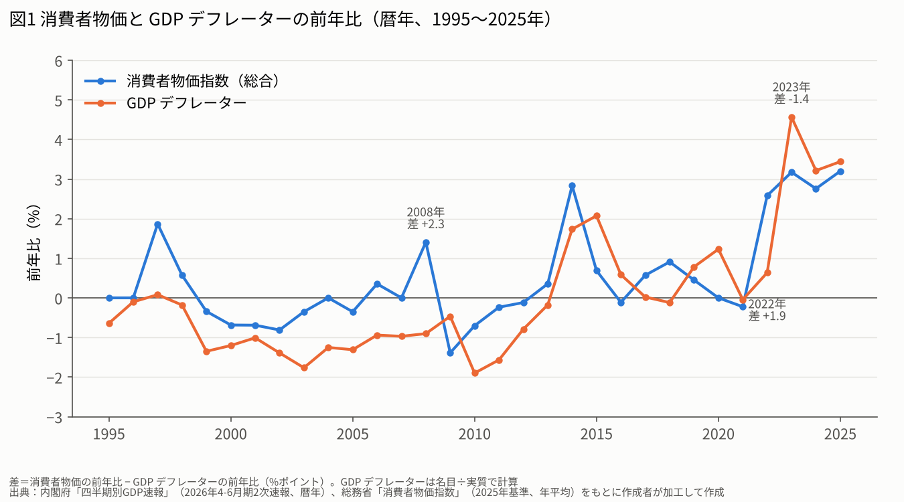
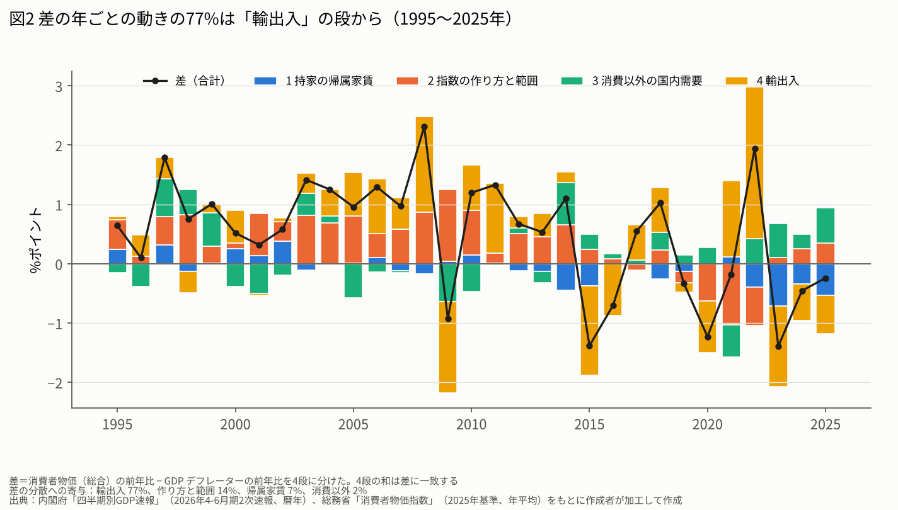
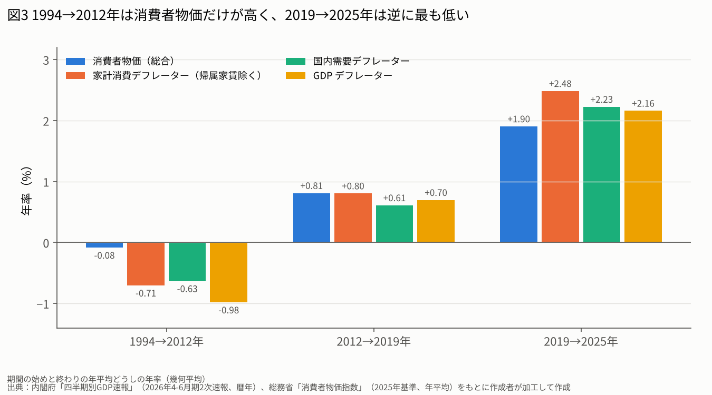
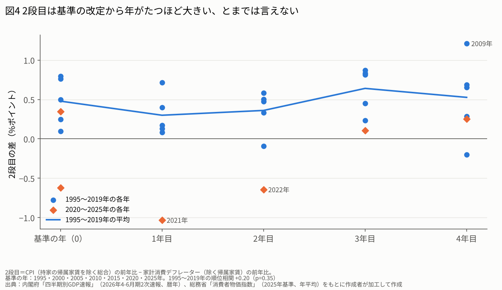

# F441 GDP デフレーターと消費者物価は、なぜ違う動きをするのか？ 年ごとの差の動きの77%は輸出入の段から生まれ、1994→2025年は消費者物価が17%上がる間に GDP デフレーターは0.1%下がった

## 結論（先に）

- 1994→2025年の31年間で、消費者物価指数（総合）は16.7%上がり、GDP デフレーター（国内で生み出した付加価値の値段）は0.1%下がりました。年率にすると 0.50% と 0.00% で、差は年0.50ポイントです。
- 前年比の差（消費者物価 − GDP デフレーター）を4つの段に分けると、年ごとの差の動き（分散）の77%は「輸出入」の段で説明できました。輸入の値段が上がった年は、GDP デフレーターがその分だけ下がり、消費者物価との差が開きます。2022年は輸入デフレーターが27.3%上がり、差は+1.95ポイントでした。
- 長い期間の差を作ったのは、むしろ「指数の作り方と範囲」の段です。1994→2025年の年0.50ポイントの差のうち0.32ポイントがこの段で、消費者物価の方が家計消費のデフレーターより高く出ていました。
- 2019年以降は様子が変わりました。2019→2025年の年率は、消費者物価1.90%、GDP デフレーター2.16%で、消費者物価の方が低くなっています。差（年−0.26ポイント）のうち、帰属家賃の段が−0.31、2段目が−0.27でした。2段目には、2021年の携帯電話の通信料の値下げ（通信の指数は−21.5%）が効いたとみられます（推測：デフレーター側での扱いは確かめていません）。
- 結果を見てから「2段目は基準の改定から年がたつほど大きくなるか」を確かめましたが、はっきりした傾向は出ませんでした（順位相関+0.20、p=0.35）。

## 問い

物価のニュースでは、「消費者物価は2%を超えて上がっているのに、GDP デフレーターはほとんど上がっていない」、あるいはその逆、という場面がよくあります。内閣府の年次経済財政報告（2014年度）は、円安で輸入の値段が上がると、消費者物価は押し上げられる一方、GDP デフレーターは輸入の分が差し引かれるため、はじめは下がりやすいと説明しています（要約は作成者）。

物価や賃金の記事を読む人、計画で「物価の上がり方」の数字を選ぶ人に向けて、この説明が1995〜2025年の数字でどこまで当てはまるかを、差を段に分けて確かめます。どちらを使うべきか、物価の見通しや政策の良し悪しは扱いません。

## データ（出典）

| データ | 中身 | 期間 |
|---|---|---|
| 内閣府「四半期別GDP速報」2026年4-6月期2次速報（暦年） | 名目額・実質額（2020年連鎖価格）：GDP、民間最終消費支出、家計最終消費支出、同（除く持ち家の帰属家賃）、国内需要、輸出、輸入。デフレーター（2020年＝100） | 1994〜2025年 |
| 総務省「消費者物価指数」2025年基準 全国 中分類指数 年平均（e-Stat statInfId 000040482829） | 総合、持家の帰属家賃を除く総合、通信 | 1970〜2025年 |

- どちらも**暦年**でそろえました。消費者物価は暦年の表（000040482829）で、年度平均の表（000040482957）は使っていません。
- デフレーターは名目÷実質×100 で計算しました（表の値との差は最大0.05）。
- 元のファイル4本（約53KB）を data/raw に同梱しています。

用語：GDP デフレーターは国内で生み出した付加価値全体の値段で、輸入の分は引かれます。家計消費デフレーターは家計が買ったもの全体の値段で、毎年つなぎ直す式（連鎖）です。持家の帰属家賃は、持ち家の人が自分に家賃を払うとみなした値段です。

## 事前の計画

[PLAN.md](PLAN.md)（2026-11-18 12:50、集計の前に作成）。差の分け方と仮説は先に決めました。

差（消費者物価の前年比 − GDP デフレーターの前年比）を次の4段の和に分けます（恒等式）。

1. 持家の帰属家賃：消費者物価（総合）− 消費者物価（持家の帰属家賃を除く総合）
2. 指数の作り方と範囲：消費者物価（帰属家賃除く）− 家計消費デフレーター（除く帰属家賃）
3. 消費以外の国内需要：家計消費デフレーター（除く帰属家賃）− 国内需要デフレーター
4. 輸出入：国内需要デフレーター − GDP デフレーター

| 仮説 | 外れの基準 | 結果 | 判定 |
|---|---|---|---|
| H1 年ごとの差の動きを最も多く説明するのは「4 輸出入」 | 分散への寄与で4段目が最大でない | 4段目76.5%（ほか14.3%・6.7%・2.4%） | 支持 |
| H2 輸入デフレーターが10%以上上がった年は差がプラス | 該当年の半分以上で差が0以下 | 2006・2013・2021・2022年の4年中3年でプラス（2021年は−0.18） | 支持 |
| H3 1994→2025年の年率で「2 作り方と範囲」はプラス | 0以下 | +0.32ポイント | 支持 |
| H4 2022年は差がプラス、2023〜2024年のどちらかでマイナス | どちらかが当てはまらない | 2022年+1.95、2023年−1.39、2024年−0.46 | 支持 |

## やったこと

1. 前年比を計算し、差を4段に分け、各段の「差の分散への寄与」（共分散÷分散。合計は1）を出しました。
2. 4段目を、前の年の名目 GDP に対する輸出・輸入の割合で、輸出の値段と輸入の値段の寄与に近似で分けました。
3. 期間（1994→2012、2012→2019、2019→2025年）ごとに年率を比べ、頑健性を6通り確かめました。

## 分かったこと

### 図1 1990年代後半から2013年ごろまでは、消費者物価がほぼいつも上だった



- 1995〜2025年の31年のうち22年で、消費者物価の前年比が GDP デフレーターを上回りました。
- 差が最も大きかったのは2008年（+2.31ポイント）、次が2022年（+1.95）です。どちらも輸入の値段が大きく上がった年です。
- 逆に2023年は、消費者物価3.17%に対し GDP デフレーター4.57%で、差は−1.39でした。輸入の値段は−1.6%と下がっていました。それまでの輸入の値上がりが、遅れて国内の値段に移った年とみられます（推測：時間差はデータで確かめていません）。

### 図2 年ごとの差の動きは、ほとんどが輸出入の段から



- 差の分散への寄与は、輸出入76.5%、指数の作り方と範囲14.3%、帰属家賃6.7%、消費以外の国内需要2.4%でした。
- 差と輸入デフレーターの前年比の相関は0.56です。
- 2022年の差+1.95のうち、輸出入の段が+2.57でした。近似の分解では、輸入の値段の上昇が+4.33、輸出の値段の上昇が−2.36です。輸出の値段も上がったので、輸入の分の一部は打ち消されています。
- 輸出入の段の中では、輸入の値段の寄与が段の動きの134%を占め、輸出の値段がその一部を打ち消す形でした。

### 図3 長い期間で見ると、差は「作り方と範囲」の段が大きい



- 1994→2012年の年率は、消費者物価−0.08%、家計消費デフレーター（除く帰属家賃）−0.71%、国内需要デフレーター−0.63%、GDP デフレーター−0.98%でした。差は年0.90ポイントで、そのうち0.57が2段目、0.35が4段目です。
- 2012→2019年はほぼ並びました（消費者物価0.81%、GDP デフレーター0.70%）。
- 2019→2025年は、消費者物価1.90%に対し、家計消費デフレーター2.48%、GDP デフレーター2.16%で、消費者物価の方が低くなりました。差は年−0.26ポイントで、帰属家賃の段（−0.31）と2段目（−0.27）がマイナスでした。
- 2段目がマイナスになった年の1つは2021年（−1.03）です。この年、消費者物価の通信の指数は−21.5%で、2025年基準のウエイトで近似すると総合を約0.73ポイント押し下げました。携帯電話の料金の値下げが、消費者物価には大きく出たとみられます（推測：デフレーター側での扱いは確かめていません）。

## 問い直し（結果を見てから足した）

H3 で2段目が長い期間にプラスだったのを見て、「消費者物価は基準年の買い物かごを5年間固定するので、基準の改定から年がたつほど、毎年つなぎ直すデフレーターより高く出るのではないか」を確かめました（src/03b_requestion.py、図4）。



- 1995〜2019年の2段目の平均は、基準の年0.48、1年目0.30、2年目0.36、3年目0.64、4年目0.53ポイントでした。
- 年数との順位相関は+0.20（p=0.35）、傾きは1年あたり+0.04ポイントで、はっきりした傾向とは言えません。
- 2段目の平均は1995〜2019年が+0.46、2020〜2025年が−0.27でした。2020年以降のマイナスは基準からの年数では説明できず、個別の値下げ（通信料など）の影響が大きいとみられます（推測）。

## 頑健性

「どの段が差の動きを最も多く説明するか」を、条件を変えて確かめました（値は分散への寄与）。

| 確かめたこと | 1 帰属家賃 | 2 作り方と範囲 | 3 消費以外 | 4 輸出入 | 結論は変わったか |
|---|---|---|---|---|---|
| 基本：1995〜2025年 | 0.067 | 0.143 | 0.024 | 0.765 | — |
| 期間を2000〜2025年 | 0.050 | 0.138 | −0.025 | 0.836 | 変わらない |
| 消費者物価を帰属家賃除く総合に（1段目なし） | 0 | 0.143 | 0.090 | 0.766 | 変わらない |
| 民間最終消費支出デフレーター（対家計民間非営利団体を含む） | 0.067 | 0.135 | 0.032 | 0.765 | 変わらない |
| 表のデフレーター（小数1桁に丸めた値） | 0.067 | 0.148 | 0.028 | 0.756 | 変わらない |
| 大きな年（1997・2009・2014・2019・2022年）を除く | 0.105 | 0.276 | −0.093 | 0.712 | 変わらない（2段目の割合は上がる） |

どの条件でも4段目（輸出入）が最大でした。

## 言えないこと

- どちらの物価が「正しい」かは言えません。測っているものが違います。
- 4段の分け方は会計上の分け方で、因果（円安が何をどれだけ動かしたか）ではありません。
- 2段目には「式の違い（固定か連鎖か）」と「範囲の違い（消費者物価に入らない金融・保険のサービスなど）」が混ざっていて、分けられません。
- 通信料の値下げの寄与（約0.73ポイント）は2025年基準のウエイトによる近似で、当時の基準のウエイトでは違う値になります。
- GDP の値は2026年4-6月期2次速報の時点のもので、のちの年次推計で改訂されます。
- 年平均どうしの比較で、年の途中の動きや、輸入の値段が国内の値段に移るまでの時間差は見ていません。

## 仕事で使うなら

- 「物価が何%上がった」と書くときは、消費者物価か GDP デフレーターかで、輸入の値段が大きく動いた年ほど数字が離れることを添えると、読み違いが減ります。
- 長い期間の比較では、消費者物価が家計消費デフレーターより年0.3ポイントほど高く出る時期が続いたことも、数字を読むときの目安になります。

## 計画からの変更

- 仮説・手法・頑健性は計画どおりです。頑健性に「表のデフレーター（丸めた値）で計算」を足しました。
- 問い直し（基準の改定からの年数）と、2021年の通信の動きを結果を見てから足しました。

## 再現のしかた

```sh
pip install -r requirements.txt
sh src/run_all.sh          # ネットにつながず data/raw から全部作る
# python3 src/01_fetch.py  # 元データを取り直すときだけ（ネットが必要）
```

| ファイル | 役割 |
|---|---|
| src/01_fetch.py | 内閣府と e-Stat から4ファイルを取得して data/raw に保存（run_all.sh からは呼ばない） |
| src/02_build.py | 年ごとの表 data/annual.csv を作る |
| src/03_analysis.py | 前年比、4段の分解、分散への寄与、期間の年率、仮説の判定、頑健性 |
| src/03b_requestion.py | 問い直し（基準の改定からの年数、通信の動き） |
| src/04_figures.py | 図4枚 |

所要時間は約3秒（CPU 1つ）。乱数は使っていません。再実行の確かめは results/repro_check.txt にあります。

## 関連する記事

- F355「名目と実質で、日本の成長の見え方はどれだけ変わるのか？」：名目 GDP と実質 GDP の差（GDP デフレーター）と交易条件を見た記事。本記事は、GDP デフレーターと消費者物価の差を段に分けた点が違います。
- F113「物価指数の作り方で、インフレ率はどれだけ変わるか？」：指数の式の違いだけを比べた記事。本記事の2段目（作り方と範囲）は式と範囲が混ざった差で、F113 はその式の部分を扱っています。
- F88「携帯料金の値下げは、物価をどれだけ下げたか？」：2021年の通信料の値下げの寄与を詳しく見た記事。本記事では2021年の2段目のマイナスの説明に近似で触れただけです。

## レビューで直したこと

独立レビュー（2026-11-18）で、再実行の一致・数字の照合・図・物価の表が暦年（000040482829）であることを確かめ、次を直しました。

| # | 指摘 | 直し方 |
|---|---|---|
| 1 | 題名・結論・図2の「76%」は、分散への寄与0.7655を3桁に丸めてから丸め直した値で、正しく丸めると77% | 題名・結論・note・図2を77%に（図2は4桁の値から丸めるよう src/04_figures.py を直した） |
| 2 | 図3の題「2019年以降はほぼ並んだ」が、2019→2025年は消費者物価が4つの中で最も低い（1.90%対2.16〜2.48%）という本文と合わない | 図3の題を「2019→2025年は逆に最も低い」に |
| 3 | 結論で、2019年以降に消費者物価が低くなった理由を「通信料の値下げなどで2段目がマイナスに転じたため」と断定していた。実際は帰属家賃の段（−0.31）も同じくらい効いており、通信料の扱いはデフレーター側で確かめていない | 2つの段の値を並べ、通信料は「推測」と明記 |
| 4 | 指数の式の違いと携帯料金の値下げを扱った既存の記事が「関連する記事」になかった | F113・F88 を足し、違いを1文で |

残る弱点（直していない）：2段目は式の違いと範囲の違いを分けられません。2021年の通信料の寄与は2025年基準のウエイトでの近似です。問い直しは傾向なしでした。

## 出典

- 内閣府「国民経済計算（GDP統計）」四半期別GDP速報 2026年4-6月期2次速報：https://www.esri.cao.go.jp/jp/sna/data/data_list/sokuhou/files/2026/qe262_2/gdemenuja.html
- 総務省統計局「消費者物価指数」2025年基準 長期時系列データ（e-Stat）：https://www.e-stat.go.jp/stat-search/files?toukei=00200573&tstat=000001243876
- 内閣府「平成26年度 年次経済財政報告」第2章（GDP デフレーターと輸入物価の説明）：https://www5.cao.go.jp/j-j/wp/wp-je14/pdf/p02011_4.pdf

（いずれも内閣府「四半期別GDP速報」、総務省「消費者物価指数」をもとに作成者が加工して作成）
