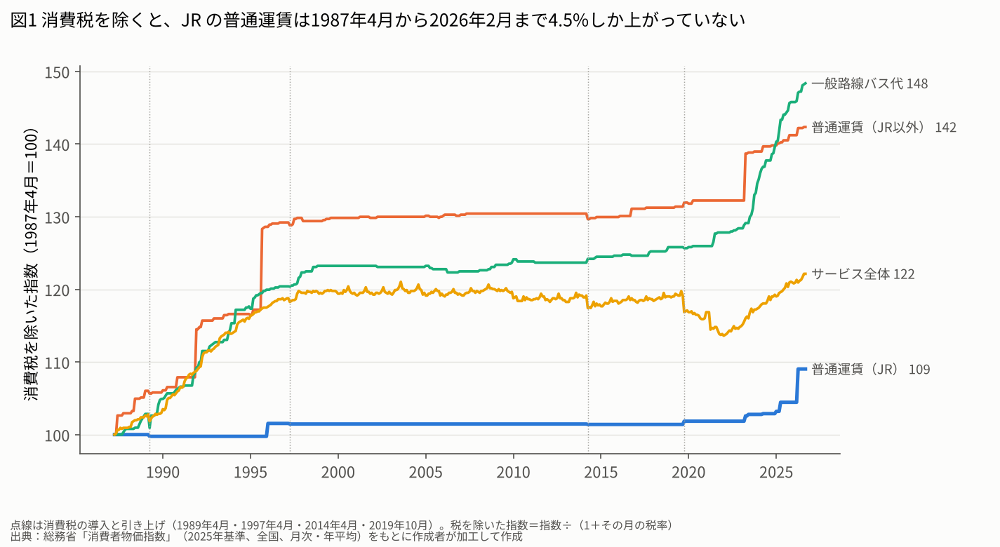
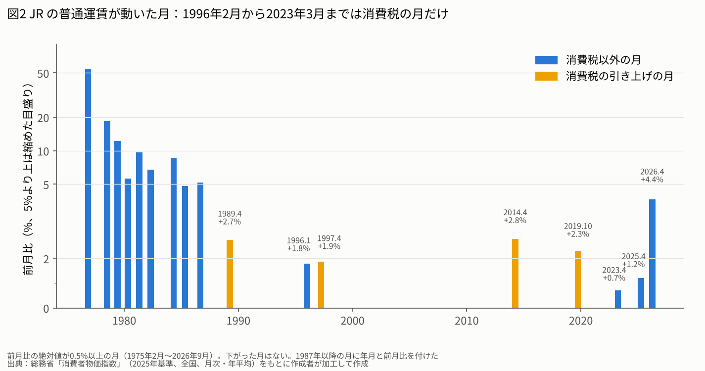
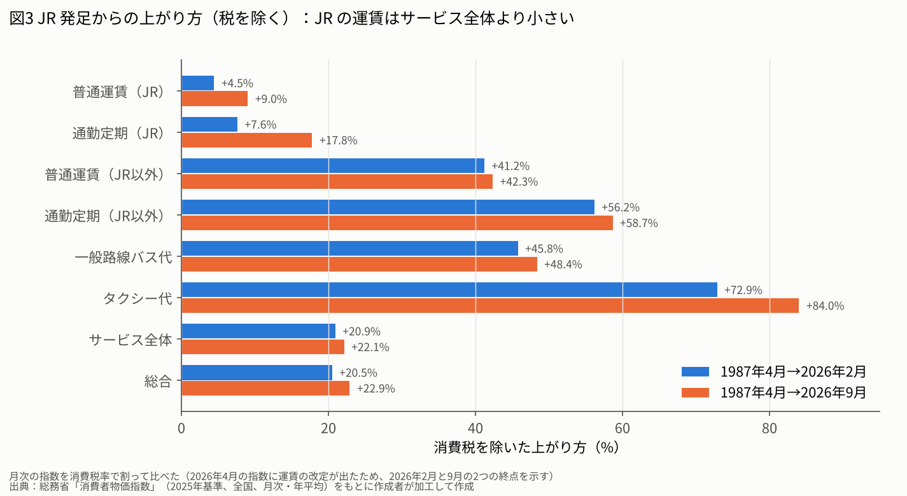
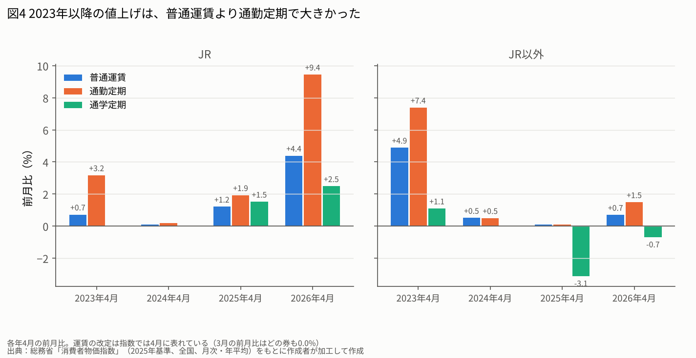

# F442 鉄道の運賃は、何十年も上がっていなかったのか？ 消費税を除いた全国の指数で、JR の普通運賃は1987年4月→2026年2月に4.5%上昇とサービス全体の21%を大きく下回り、2026年4月に4.4%上がった

## 結論（先に）

- 消費者物価指数の「普通運賃（JR）」は、1996年2月から2023年3月までの27年あまり、消費税の引き上げの月（1997年4月・2014年4月・2019年10月）を除いて一度も動きませんでした（前月比0.0%）。
- 消費税を除いて比べると、JR の普通運賃は1987年4月（JR の発足）から2026年2月までに4.5%しか上がっていません。同じ期間にサービス全体は20.9%、JR 以外の鉄道の普通運賃は41.2%、一般路線バス代は45.8%上がりました。
- ただし「まったく上がっていなかった」わけではありません。全国の平均で見ると、JR の普通運賃は1996年1月（+1.8%）、2023年4月（+0.7%）、2025年4月（+1.2%）にも上がっています。
- 2026年4月の指数では、JR の普通運賃が+4.4%、通勤定期が+9.4%上がりました。3月の前月比は0.0%でした。2026年3月の JR 東日本の改定が4月の指数に出たとみられます（推測：時期が合うことからの判断で、会社ごとの内訳は表にありません）。
- 結果を見てから確かめ直すと、2023年以降の値上げは、JR・JR 以外とも普通運賃より通勤定期で大きく出ていました（2023年2月→2026年9月：JR の通勤定期+16.2%、普通運賃+7.1%）。

## 問い

2026年3月に JR 東日本が運賃を改定しました。報道では、消費税の引き上げに伴うものを除けば、1987年の会社発足以来初めての値上げで、平均の上げ幅は7.8%と紹介されました（要約は作成者）。

交通費の精算や通勤の費用を扱う人、物価のニュースを読む人は、「鉄道の運賃は本当に何十年も変わっていなかったのか」「ほかのサービスの値段と比べてどうだったのか」を知りたいはずです。ここでは、全国の消費者物価指数の品目「普通運賃（JR）」「普通運賃（JR以外）」などの動きを、月ごとに確かめます。運賃の水準が妥当か、値上げの良し悪しは扱いません。

## データ（出典）

| データ | 中身 | 期間 |
|---|---|---|
| 総務省「消費者物価指数」2025年基準 品目別価格指数 月次（e-Stat 000040482945） | 普通運賃・通勤定期・通学定期（JR と JR 以外）、鉄道運賃（JR）、一般路線バス代、タクシー代、総合 | 1970年1月〜2026年9月（普通運賃などは1975年1月から） |
| 同 財・サービス分類指数 月次（000040482946） | サービス、公共サービス | 同 |
| 同 品目別・財・サービス分類 年平均（暦年、000040482831・000040482832） | 同じ品目の暦年の値 | 1970〜2025年 |

- 年の値は暦年の表を使い、年度平均の表（000040482959 など）は使っていません。
- 指数は消費税を含む値段です。「税を除いた指数」は、指数÷（1＋その月の税率）で作りました（税率：1989年4月から3%、1997年4月から5%、2014年4月から8%、2019年10月から10%）。
- 元のファイル4本（約2.5MB）を data/raw に同梱しています。

## 事前の計画

[PLAN.md](PLAN.md)（2026-11-18 12:58、月次の集計の前に作成）。下見で年平均の表の値を見てから書いたため、仮説は月次で確かめる中身にしました。

| 仮説 | 外れの基準 | 結果 | 判定 |
|---|---|---|---|
| H1 1997年5月〜2023年2月に普通運賃（JR）が+0.5%以上動いた月は、消費税の月だけ | ほかに1か月でもある | 2014年4月・2019年10月の2か月だけ | 支持 |
| H2 税を除いた普通運賃（JR）は1997年4月→2023年2月で±3%以内 | 範囲の外 | +0.38% | 支持 |
| H3 2026年3月の普通運賃（JR）の前月比は+5%以上 | 5%未満 | 3月は0.0%（4月に+4.39%） | 外れ |
| H4 1997年4月→2026年9月の上がり方（税を除く）は JR 以外の方が大きい | 同じか小さい | JR 以外+10.5%、JR+7.5% | 支持 |

H3 は2つの点で外れました。改定が指数に出たのは4月でした。全国の平均では、上げ幅も5%に届きませんでした。全国の指数には JR 東日本以外の会社の運賃も入っているため、改定の上げ幅（平均7.8%）より小さく出るとみられます（推測：会社ごとのウエイトは公表の表では分かりません）。

## やったこと

1. 月次の表から、使う品目だけを取り出しました（src/02_build.py）。
2. 前月比の絶対値が0.5%以上の月を「値段が動いた月」とし、消費税の月とそれ以外に分けました（src/03_analysis.py）。
3. 税を除いた指数で、1987年4月・1997年4月からの上がり方を品目ごとに比べました。
4. 問い直しとして、券の種類ごとの4月の前月比を比べました（src/03b_requestion.py）。

## 分かったこと

### 図1 税を除くと、JR の普通運賃はほとんど動いていない



- 税を除いた JR の普通運賃は、1987年4月→2026年2月で+4.5%でした。消費税を含めると+14.9%です。
- 同じ期間に、サービス全体は+20.9%、総合は+20.5%、JR 以外の普通運賃は+41.2%、一般路線バス代は+45.8%、タクシー代は+72.9%でした。
- JR 以外の普通運賃も、1997年8月から2016年9月までの約19年（230か月）は、消費税の月を除いて0.5%以上動いていません。
- 国鉄の時代は違いました。年平均（暦年）で1975→1987年に、JR（当時は国鉄）の普通運賃は+204%、総合は+59%でした。

### 図2 JR の普通運賃が動いた月は、1987年以降で8回



- 1987年4月以降に前月比が0.5%以上動いた月は8回で、下がった月はありません。消費税の月が4回（1989年4月+2.7%、1997年4月+1.9%、2014年4月+2.8%、2019年10月+2.3%）、それ以外が4回（1996年1月+1.8%、2023年4月+0.7%、2025年4月+1.2%、2026年4月+4.4%）です。
- 1996年2月から2023年3月まで、消費税の月を除いて動かない期間が326か月（27年2か月）続きました。
- 消費税の月の上がり方は、税率の上がり方（たとえば2014年4月は 1.08÷1.05 で+2.9%）に近い値でした。

### 図3 JR 発足からの上がり方は、ほかの交通やサービスより小さい



- 税を除いて1987年4月→2026年9月で見ると、JR の普通運賃+9.0%、通勤定期+17.8%に対し、サービス全体+22.1%、総合+22.9%でした。
- JR 以外は、普通運賃+42.3%、通勤定期+58.7%です。JR 以外の上がり方の多くは、1987〜1997年に起きています（年平均で JR 以外+33.0%、JR+6.0%）。

## 問い直し（結果を見てから足した）

H3 で改定が4月に出たのを見て、「2023年以降の値上げは、普通運賃と定期のどちらで大きかったのか」を確かめました（図4）。



- 2026年4月の前月比は、JR の普通運賃+4.4%、通勤定期+9.4%、通学定期+2.5%でした。
- 2023年4月は、JR 以外の普通運賃+4.9%、通勤定期+7.4%、通学定期+1.1%でした。JR は通勤定期+3.2%、普通運賃+0.7%です。
- 2023年2月→2026年9月で見ると、JR の通勤定期+16.2%、普通運賃+7.1%、通学定期+5.1%、JR 以外の通勤定期+11.0%、普通運賃+7.7%、通学定期−1.3%でした。
- 最近の改定は、通勤定期の割引を小さくする形で上がり方が大きくなっているとみられます（推測：運賃表そのものは確かめていません）。

## 頑健性

| 確かめたこと | 消費税以外で上がった月（1997年5月〜2023年2月） | 税を除いた変化（1997年4月→2023年2月） | 結論は変わったか |
|---|---|---|---|
| 基本：普通運賃（JR）、しきい値0.5% | 0 | +0.38% | — |
| しきい値0.3% | 0 | +0.38% | 変わらない |
| しきい値1.0% | 0 | +0.38% | 変わらない |
| 品目を通勤定期（JR）に | 0 | +0.22% | 変わらない |
| 品目を通学定期（JR）に | 0 | +0.81% | 変わらない |
| 品目を鉄道運賃（JR の類）に | 103 | −0.96% | 月の数は変わる（特急料金などの季節の動きが入るため）。水準は変わらない |
| 始まりを1987年4月に | 1（1996年1月） | +1.84% | ほぼ変わらない |
| 税の月の段差をなかったことにして計算 | — | 0.00% | 変わらない |

## 言えないこと

- 指数は全国の平均で、会社ごと・区間ごとの運賃の変化は分かりません。どの月の上昇がどの会社の改定によるかも、この表からは言えません。
- 運賃の水準が高いか低いか、値上げが妥当かは言えません。
- 指数に入る会社の組み合わせや割合は、5年ごとの基準の改定で変わります。
- 特急料金・新幹線の料金、割引の切符、IC カードと切符の違いなど、品目に入らない値段の動きは見ていません。
- 2026年4月の上昇を JR 東日本の改定によるものとみるのは、時期が合うことからの推測です。
- 「サービス全体」と「総合」には消費税のかからない家賃なども入るため、指数を税率で一律に割ると、税を除いた上がり方を小さめに見積もります。税の月の段差だけを除く計算では、1987年4月→2026年2月のサービス全体は+26.8%、総合は+24.6%でした。どちらでも、JR の普通運賃（+4.4〜4.5%）を大きく上回ります。

## 仕事で使うなら

- 「鉄道の運賃が○年ぶりに上がった」という数字を読むときは、消費税込みか税を除いた値か、全国平均か会社ごとかを確かめると、受け取り方の違いが減ります。
- 通勤費の数字では、普通運賃と通勤定期で上がり方が違う時期があることを添えておくと、読み違いが減ります。

## 計画からの変更

- 仮説・手法・頑健性は計画どおりです。
- 問い直し（券の種類ごとの4月の前月比）を結果を見てから足しました。

## 再現のしかた

```sh
pip install -r requirements.txt
sh src/run_all.sh          # ネットにつながず data/raw から全部作る
# python3 src/01_fetch.py  # 元データを取り直すときだけ（ネットが必要）
```

| ファイル | 役割 |
|---|---|
| src/01_fetch.py | e-Stat から4ファイルを取得して data/raw に保存（run_all.sh からは呼ばない） |
| src/02_build.py | 使う品目の月次表 data/monthly.csv と暦年表 data/annual.csv を作る |
| src/03_analysis.py | 動いた月、税を除いた水準、期間の変化、仮説の判定、頑健性 |
| src/03b_requestion.py | 問い直し（券の種類ごとの4月の前月比） |
| src/04_figures.py | 図4枚 |

所要時間は約3秒（CPU 1つ）。乱数は使っていません。再実行の確かめは results/repro_check.txt にあります。

## レビューで直したこと

独立レビュー（2026-11-18）で、再実行の一致・数字の照合・図・物価の表が暦年（000040482831・832）と月次（945・946）であることを確かめ、次を直しました。

| # | 指摘 | 直し方 |
|---|---|---|
| 1 | 結論の1点目で、1996年2月〜2023年3月の間の消費税の月として1997年4月が抜けていた | 「1997年4月・2014年4月・2019年10月」に（その他の月の前月比が0.0%であることも月次で確かめた） |
| 2 | 「3月に実施された改定は、指数では4月に表れています」と断定していた。どの月の上昇がどの会社の改定かは表から分からない | 「4月の指数に出たとみられます（推測）」に（README・note） |
| 3 | 題名の「JR の普通運賃」が会社ごとの運賃にも読める | 題名に「全国の指数で」を足した（status・note もそろえた） |
| 4 | 「サービス全体」「総合」には消費税のかからない家賃なども入るので、税率で一律に割ると上がり方を小さめに見積もる | 言えないことに、税の月の段差だけを除く値（サービス全体+26.8%、総合+24.6%）を足した。結論の向きは変わらない |
| 5 | 図2の2023年4月・2025年4月の注記が隣の棒に重なっていた。図1の点線に1989年4月（消費税の導入）がなかった | 注記を左にずらし、1989年4月の点線を足した |

残る弱点（直していない）：下見で年平均（暦年）の値を見てから計画を書いています（PLAN に明記）。

## 出典

- 総務省統計局「消費者物価指数」2025年基準 長期時系列データ（e-Stat）：https://www.e-stat.go.jp/stat-search/files?toukei=00200573&tstat=000001243876
- JR 東日本の運賃改定の報道（ITmedia Mobile、2024年12月10日）：https://www.itmedia.co.jp/mobile/amp/2412/10/news154.html

（いずれも総務省「消費者物価指数」をもとに作成者が加工して作成）
