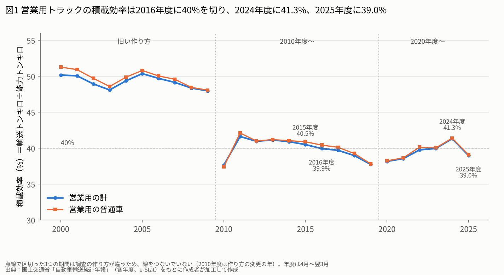
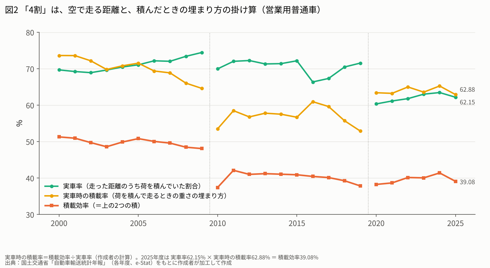
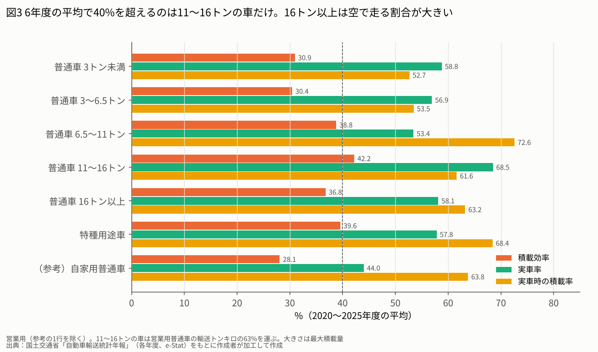
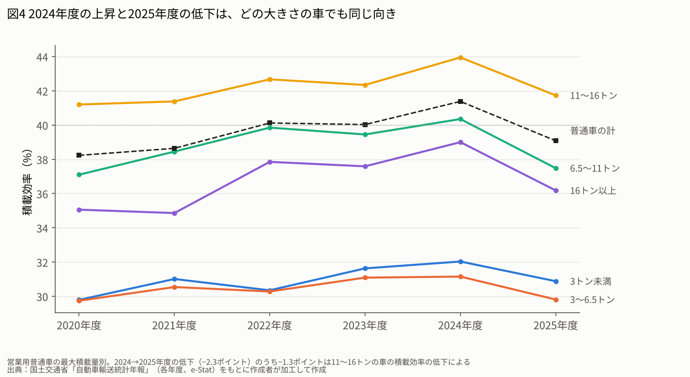

# F443 「トラックの積載率は4割を切った」は、どの運び方で起きているのか？ 営業用は2025年度39.0%、2020〜25年度平均で4割を超えるのは11〜16トン車だけ、積んで走るときの埋まり方は約6割

## 結論（先に）

- 自動車輸送統計年報で、営業用トラック（運送会社の車）の積載効率（輸送トンキロ÷能力トンキロ）は、2015年度の40.5%から2016年度に39.9%と4割を切り、2019年度は37.7%でした。2020年度からの新しい系列では、2023年度39.9%、2024年度41.3%、2025年度39.0%です。
- この「4割」には、空で走る距離が入っています。営業用普通車の2025年度は、実車率（走った距離のうち荷を積んでいた割合）62.2%と、実車時の積載率（荷を積んで走るときの重さの埋まり方）62.9%の掛け算で39.1%でした。荷台が6割空いているわけではありません。
- 大きさで違いがあります。2020〜2025年度の平均で4割を超えたのは、最大積載量11〜16トンの車（42.2%）だけでした。3トン未満は30.9%、3〜6.5トンは30.4%です（年度ごとに見ると、2024年度は6.5〜11トン40.4%・特種用途車41.7%も40%を超えました）。16トン以上（36.8%）は、積んだときの埋まり方（63.2%）は高いのに、空で走る割合が大きい（実車率58.1%）車でした。
- 2024年度の上昇（+1.35ポイント）と2025年度の低下（−2.30ポイント）は、どの大きさの車でも同じ向きでした。どちらも、車の大きさの構成の変化ではなく、それぞれの大きさの中での変化でほぼ説明できます。
- 事前の4つの仮説は、すべて外れました（下の表）。

## 問い

国の物流の施策では、トラックの積載効率が「近年40%以下の水準で推移してきた」として、全体の車両で44%まで引き上げる目標が示されています（国土交通省の解説書による。要約は作成者）。報道では「積載率が4割を切る」「積載率が9年ぶりに40%台に回復」と書かれます。

物流・調達の担当や物流のニュースを読む人は、この「4割」が荷台の空きなのか、帰り道に空で走る分も含むのか、どの大きさの車の話なのかを知りたいはずです。自動車輸送統計年報で確かめます。どうすれば積載効率が上がるか、目標の良し悪しは扱いません。

## データ（出典）

| データ | 中身 | 期間 |
|---|---|---|
| 国土交通省「自動車輸送統計年報」各年度の「貨物輸送量」（e-Stat） | 営業用・自家用、車種別（普通車・小型車・特種用途車・軽自動車）の輸送トン数・輸送トンキロ・能力トンキロ・実車キロ（2009年度までは走行キロも） | 2000〜2025年度 |
| 同「原単位（貨物輸送）」 | 実車率、2020年度からは積載効率も。2020年度からは営業用普通車の最大積載量別 | 同 |

- 積載効率 ＝ 輸送トンキロ ÷ 能力トンキロ。能力トンキロは、最大積載量 × 走行キロで、空で走る距離も含みます。
- 実車時の積載率 ＝ 積載効率 ÷ 実車率（作成者の計算）。
- 調査の作り方が2010年度と2020年度に変わっているため、2000〜2009年度、2010〜2019年度、2020〜2025年度の3つの系列に分け、つないだ変化は言いません。
- 元の Excel 52本（約1.3MB）を data/raw に同梱しています。年度は4月〜翌3月です。

## 事前の計画

[PLAN.md](PLAN.md)（2026-11-18 13:20、年ごとの系列を集計する前に作成）。表の形を確かめるために、2010・2018・2020・2025年度の表の中身を一度表示しています。

| 仮説 | 外れの基準 | 結果 | 判定 |
|---|---|---|---|
| H1 営業用普通車の積載効率は2010〜2025年度のどの年度も40%未満 | 40%以上の年度がある | 2011〜2017年度と2022〜2024年度は40%以上（最大は2011年度42.09%） | 外れ |
| H2 営業用普通車の実車時の積載率は、どの年度も55%以上 | 55%未満の年度がある | 2010年度53.48%、2019年度52.86% | 外れ |
| H3 2020〜2025年度平均で、11トン以上の車は3トン未満より10ポイント以上高い | 差が10ポイント未満 | 11〜16トンは+11.26、16トン以上は+5.81 | 外れ |
| H4 営業用普通車の積載効率は2010→2019年度で下がった | 同じか上がった | 37.40% → 37.81%（+0.41） | 外れ |

H4 は始点の2010年度が低かったためです。2010年度は調査の作り方が変わった年で、2011年3月の東北・北海道の一部の数値を含みません。計画外の確かめとして始点を2011年度にすると、2011→2019年度は42.09%→37.81%（−4.29ポイント）でした。

## やったこと

1. 各年度の Excel から、区分ごとの輸送トンキロ・能力トンキロ・実車キロ・実車率を取り出しました（src/02_build.py）。
2. 積載効率と実車時の積載率を計算し、変化を対数の差で「実車率の変化」と「実車時の積載率の変化」に分けました（src/03_analysis.py）。
3. 2020年度からの最大積載量別に比べました。問い直しで、年ごとの変化を大きさ別に分けました（src/03b_requestion.py）。

## 分かったこと

### 図1 営業用の積載効率は2016年度に4割を切り、2024年度にいったん戻った



- 営業用の計（普通車・小型車・特種用途車・軽自動車）は、2011年度41.6%から2015年度40.5%、2016年度39.9%、2019年度37.7%へ下がりました。
- 2020年度からの系列では38.2%から上がり、2024年度は41.3%でした。報道の「2024年度41.3%、9年ぶりの40%台」は、この営業用の計の値と一致します（前に40%以上だったのは2015年度）。2025年度は39.0%に下がりました。
- 2009年度までの旧い作り方では48〜51%で、2010年度からの値とは水準が大きく違います。作り方の違いによる段差とみられます（推測）。

### 図2 「4割」は、空で走る距離と、積んだときの埋まり方の掛け算



- 営業用普通車の2025年度は、実車率62.15% × 実車時の積載率62.88% ＝ 積載効率39.08%でした。
- 2020〜2025年度は、実車率60.3〜63.4%、実車時の積載率62.9〜65.2%で、どちらもおよそ6割です。
- 2010〜2019年度の系列では、実車率が66〜72%、実車時の積載率が53〜61%でした。2020年度に実車率の水準が約10ポイント下がっているのは、作り方の変更の影響とみられます（推測）。2つの率への分け方は、系列によって変わります。
- 2011→2019年度の低下（対数で−10.7%）のほとんどは、実車時の積載率の低下（−10.1%）でした。

### 図3 6年度の平均で40%を超えるのは11〜16トンの車だけ



- 2020〜2025年度の平均の積載効率は、3トン未満30.9%、3〜6.5トン30.4%、6.5〜11トン38.8%、11〜16トン42.2%、16トン以上36.8%でした。特種用途車は39.6%です。
- 11〜16トンの車は、営業用普通車の輸送トンキロの63%を運んでいます。実車率68.5%が、ほかの大きさ（53〜59%）より高いのが特徴です。
- 6.5〜11トンの車は、積んだときの埋まり方が72.6%と最も高い一方、実車率は53.4%で最も低い値でした。
- 小さい車（6.5トン未満）は、実車時の積載率が53%前後で、積んで走るときも荷台の重さの余裕が大きい車です。
- 参考に、自家用普通車は積載効率28.1%、実車率44.0%でした。

## 問い直し（結果を見てから足した）

2024年度に41.4%へ上がり、2025年度に39.1%へ下がった営業用普通車の積載効率を、大きさごとの変化と構成の変化に分けました（図4）。



- 2023→2024年度の+1.35ポイントは、大きさの中での変化が+1.36、構成の変化が0.00でした。11〜16トンの車の分が+0.97です。
- 2024→2025年度の−2.30ポイントは、大きさの中での変化が−2.31でした。11〜16トンが−1.34、16トン以上が−0.52です。5つの大きさのすべてで下がりました（−1.15〜−2.87ポイント）。
- 2024→2025年度の低下を2つの率に分けると、実車率が−2.0%、実車時の積載率が−3.7%（対数の差）でした。
- 2024年度の上昇が時間外労働の上限（2024年4月から）と関係するかは、このデータでは言えません。2025年度に戻った理由も分かりません。

## 頑健性

| 確かめたこと | 積載効率（2010〜2025年度の範囲） | 実車時の積載率の範囲 | 2010→2019年度の変化 | 結論は変わったか |
|---|---|---|---|---|
| 基本：営業用普通車 | 37.40〜42.09 | 52.86〜65.24 | +0.41 | — |
| 範囲を営業用の計に | 37.64〜41.61 | 52.75〜66.12 | +0.10 | 変わらない |
| 2020年度以降の公表値と計算の差 | 最大0.005ポイント（72の区分×年度） | — | — | 計算は公表値と一致 |
| 旧い作り方（2000〜2009年度） | 48.06〜51.26 | 64.58〜73.60 | （2000→2009）−3.20 | 水準は違うが、掛け算の形は同じ |
| 自家用普通車 | 25.73〜32.04 | 60.70〜76.89 | −5.82 | 営業用より低い |
| （計画外）始点を2011年度に | — | — | （2011→2019）−4.29 | H4 の向きが変わる |

## 言えないこと

- 積載効率は重さで測っていて、軽くてかさばる荷物（容積）での荷台の埋まり方は分かりません。
- 調査の作り方の変更（2010年度・2020年度）をまたいだ長い変化は言えません。
- 帰り荷が取れない理由や、どうすれば積載効率が上がるかは、このデータでは分かりません。
- 2024年度の上昇と2025年度の低下の原因は分かりません。
- 年報は標本調査の推計値で、誤差があります。

## 仕事で使うなら

- 「積載率4割」という数字を見たら、空で走る距離を含む積載効率か、積んだときの積載率かを確かめると、読み違いが減ります。
- 車の大きさで水準が10ポイント以上違うため、自社の数字と比べるときは同じ大きさの車の値と並べると比べやすくなります。

## 計画からの変更

- 仮説・手法・頑健性は計画どおりです。計画外の確かめとして、H4 の始点を2011年度にした値を足しました（判定は計画どおり2010年度から）。
- 問い直し（大きさごとの変化と構成の変化）を結果を見てから足しました。

## 再現のしかた

```sh
pip install -r requirements.txt
sh src/run_all.sh          # ネットにつながず data/raw から全部作る
# python3 src/01_fetch.py  # 元データを取り直すときだけ（ネットが必要）
```

| ファイル | 役割 |
|---|---|
| src/01_fetch.py | e-Stat から52ファイルを取得して data/raw に保存（run_all.sh からは呼ばない） |
| src/02_build.py | 年度×区分の表 data/fy_long.csv を作る |
| src/03_analysis.py | 積載効率・実車率・実車時の積載率、仮説の判定、分解、頑健性 |
| src/03b_requestion.py | 問い直し（大きさごとの変化と構成の変化） |
| src/04_figures.py | 図4枚 |

所要時間は約3秒（CPU 1つ）。乱数は使っていません。再実行の確かめは results/repro_check.txt にあります。

## 関連する記事

- F301「「物流2024年問題」で、トラックの運ぶ量と働く時間はどう変わったか？」：運んだ量と労働時間を見た記事。本記事は積載効率を分けた点が違います。
- F454（荷物の小口化）：1件あたりの荷物の重さを見た記事。

## レビューで直したこと

独立レビュー（2026-11-18）で、再実行の一致・数字の照合・図・2010年度の表の注記（2010年10月の作り方の変更、2011年3月の北海道・東北の数値を含まない）を確かめ、次を直しました。

| # | 指摘 | 直し方 |
|---|---|---|
| 1 | 題名と図3の「4割を超えるのは11〜16トン車だけ」は2020〜2025年度の平均の話で、2024年度だけを見ると6.5〜11トン（40.4%）と特種用途車（41.7%）も40%を超えている | 題名・図3の題・note に「2020〜25年度平均で」「6年度の平均で」を足し、結論に2024年度の例外を書いた |
| 2 | 題名が長い（102字） | 2016年度の値を本文に任せて97字に縮めた（status・note もそろえた） |
| 3 | 3トン未満の6年度平均を31.0%と書いていたが、値は30.9498で図は30.9 | 30.9%にそろえた |

残る弱点（直していない）：2010年度と2020年度の作り方の変更で、3つの系列はつなげません。2020年度に実車率が約10ポイント下がる段差の理由は推測です。重さで測っていて容積は分かりません。PLAN の前に一部の表の中身を見ています（PLAN に明記）。

## 出典

- 国土交通省「自動車輸送統計年報」（e-Stat）：https://www.e-stat.go.jp/stat-search/files?toukei=00600330&tstat=000001078083
- 国土交通省「貨物自動車運送役務の持続可能な提供の確保に資する運転者の運送及び荷役等の効率化に関する判断の基準の解説書」（積載効率の定義と目標）：https://www.mlit.go.jp/seisakutokatsu/freight/content/001984867.pdf
- 日本食糧新聞（2025年10月）の報道：https://news.nissyoku.co.jp/news/yokotah20250929035540883

（いずれも国土交通省「自動車輸送統計年報」をもとに作成者が加工して作成）
