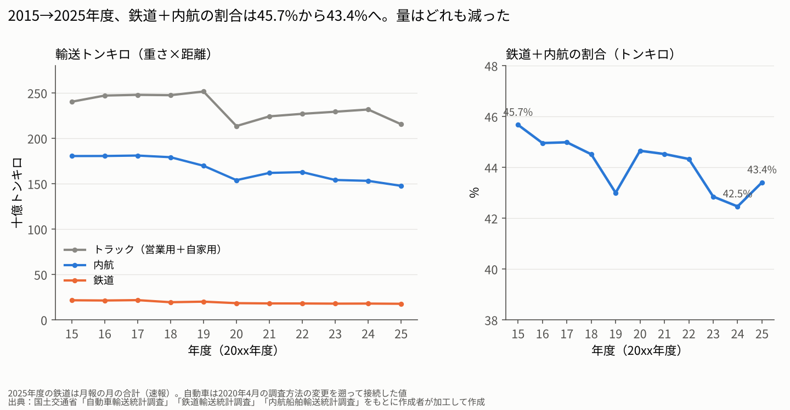
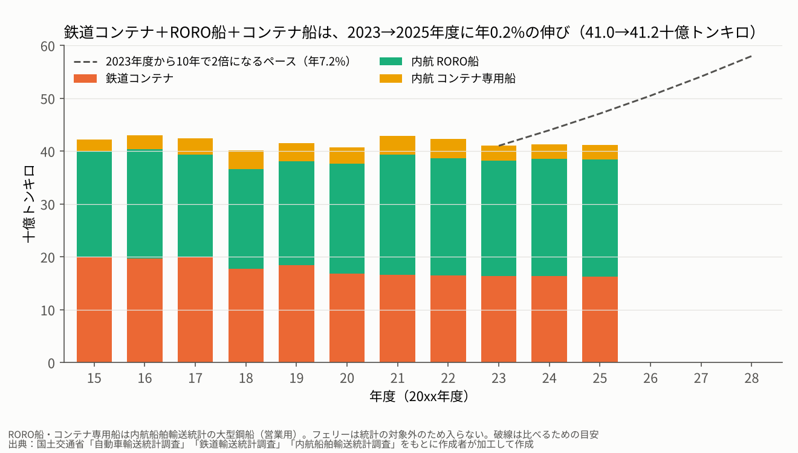
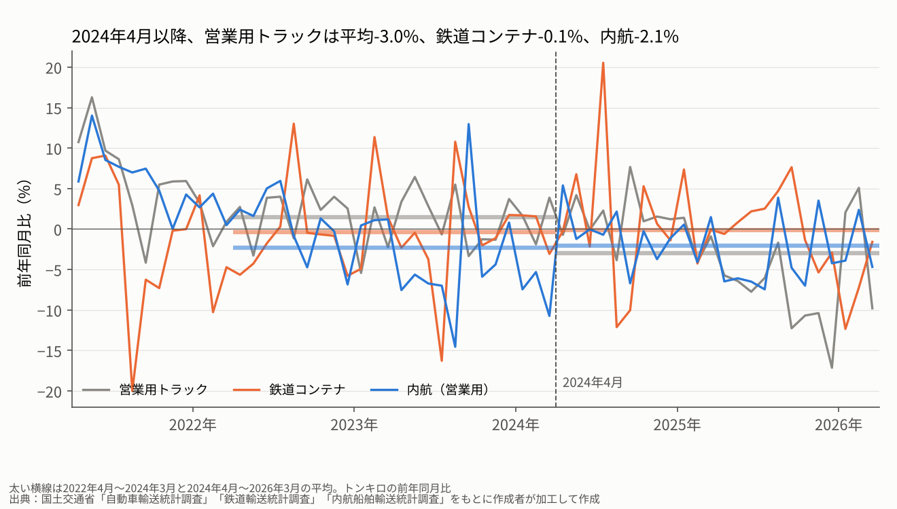
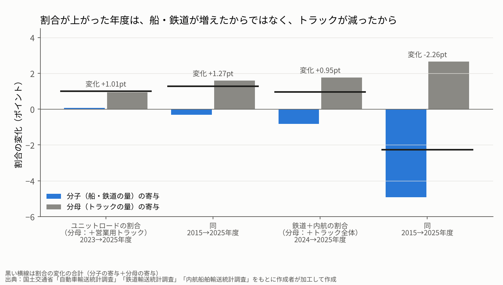

# F444 トラックから船・鉄道への切り替え（モーダルシフト）は、進んでいるのか？ 鉄道＋内航の割合は2015年度45.7%→2025年度43.4%。2025年度の上昇はトラックが7%減った分で、船・鉄道の量は増えていない

貨物の量（トンキロ＝重さ×距離）をトラック・鉄道・内航（国内の船）の3つの統計で並べ、2015〜2025年度の割合と量を確かめました。政策の良し悪しは扱わず、数字の読み方までにします。

## 結論（先に）

- **割合で見ると、船・鉄道の側は増えていません。** 3つの合計に占める鉄道＋内航の割合（トンキロ）は、2015年度 45.67% → 2024年度 42.46% → 2025年度 43.41% でした。2015年度より2.26ポイント低い値です。
- **量で見ると、どれも減りました。** 2015→2025年度の輸送トンキロは、トラック −10.3%、内航 −18.2%、鉄道 −18.0% です。
- **政府の目標の対象に近い「ユニットロード」（鉄道コンテナ＋内航のRORO船＋コンテナ専用船）は、ほぼ横ばいです。** 2023→2025年度は41.0→41.2十億トンキロ（年0.2%）で、10年で2倍のペース（年7.2%）とは開いています。中身はRORO船が増え（2015→2025年度 +11.5%）、鉄道コンテナが減りました（−18.9%）。
- **2025年度に割合が上がったのは、分母のトラックが減ったからです**。ユニットロードの割合（営業用トラックとの合計に対して）の2023→2025年度の +1.01ポイントのうち、量の増加の寄与は +0.06、トラックの減少の寄与が +0.94ポイントでした。
- **2024年4月の前後で、トラックが減った月に船・鉄道が増える形は見えません。** 前年同月比の平均は、営業用トラックが +1.5% → −3.0%、鉄道コンテナは −0.4% → −0.1%、内航は −2.3% → −2.1% でした。



## 問い

2023年10月の政府の「物流革新緊急パッケージ」は、鉄道（コンテナ貨物）と内航（フェリー・RORO船等）の輸送量・輸送分担率を今後10年程度で倍増させるとしました。2024年4月からはトラック運転者の時間外労働に上限がかかりました。

統計の上で船・鉄道への切り替えは見えるのか。知りたい人は、物流や荷主の担当、物流の記事を読む人です。関連する記事の F301 はトラックの量と労働時間を、この記事は船・鉄道との割合を見ます。

## データ（出典）

- 国土交通省「自動車輸送統計調査」：月報の総括表（年度 2015〜2025、月 2020年4月〜2026年3月）。営業用（運送会社）と自家用
- 国土交通省「鉄道輸送統計調査」：年報の貨物トンキロ（全国計・コンテナ）。2025年度は月報の月の値（速報）を足した値
- 国土交通省「内航船舶輸送統計調査」：年報の第1表 推移表、第5表 大型鋼船の用途別（RORO船・コンテナ専用船）
- 航空の国内貨物はトンキロで0.2%程度なので入れていません。フェリーで運ぶトラックは内航船舶輸送統計の対象外です。
- 元のファイルは `data/raw/` に同梱しています（40ファイル、約1.6MB）。

## 事前の計画

集計の前に [PLAN.md](PLAN.md) を書きました（2026-11-18 12:57）。ファイルの形の確認で年度の合計を目にしていたので、H1・H2 は確かめの意味が弱いと書いています。

| 仮説 | 外れの基準 | 結果 | 判定 |
|---|---|---|---|
| H1 鉄道＋内航の割合は2015年度より2025年度のほうが1ポイント以上は高くない | 1ポイント以上高い | −2.26ポイント | 支持（下見の値から立てた） |
| H2 ユニットロードの2023→2025年度の伸びは年7.2%を下回る | 上回る | 年0.2% | 支持（同上） |
| H3 営業用トラックと鉄道コンテナ・内航の前年同月比の相関は −0.3 より大きい | どちらかが −0.3 以下 | 0.03・0.01 | 支持 |
| H4 1トンあたりの距離は営業用トラックで3%以上縮み、鉄道コンテナ・内航は3%以上は縮まない（2023→2025年度） | 左のどれかを満たさない | トラック −3.0%、鉄道コンテナ −5.2%、内航 −1.9% | 外れ |

## やったこと

1. 3つの統計から年度と月のトン・トンキロを取り出しました。自動車の月の合計は年度の値と合います。
2. 年度の割合（トンキロとトン、分母2通り）、ユニットロードの量、2024年4月の前後2年の前年同月比と相関、1トンあたりの距離を出しました。
3. 結果を見てから、割合の変化を分子と分母に分けました。

## 分かったこと

### 割合は下がり、量はどれも減った（図1）

- 鉄道＋内航の割合は2015年度が最大（45.67%）、2024年度が最小（42.46%）でした。
- 2025年度の内訳はトラック 56.59%、内航 38.77%、鉄道 4.64%。
- トンで数えると、鉄道＋内航の割合は2025年度で8.47%です。船・鉄道は遠くまで運ぶので、トンキロでは割合が5倍ほど大きく見えます。

### ユニットロードは横ばいで、中身が入れ替わった（図2）



- ユニットロードは2015年度 42.2、2019年度 41.5、2023年度 41.0、2025年度 41.2（十億トンキロ）で、10年でほぼ同じ量です。
- RORO船は19.9→22.2十億トンキロ（2015→2025年度）で、ユニットロードに占める割合は47.2%から53.9%に。鉄道コンテナは20.0→16.2十億トンキロでした。
- 10年で2倍のペースなら2025年度は2023年度の114.9%、実際は100.5%でした。
- 「輸送分担率の倍増」と「輸送量の倍増」は別のものです。営業用トラックが2023年度のままなら、ユニットロードの割合（16.86%）を2倍にするには量を2.51倍にする計算になります。

### 2024年4月の前後で、船・鉄道の動きは変わらなかった（図3）



- 前年同月比の平均（2024年4月の前2年 → 後2年）は、営業用トラック +1.46% → −2.96%、鉄道コンテナ −0.36% → −0.13%、内航（営業用）−2.29% → −2.07% でした。
- 2022年4月〜2026年3月（48か月）の相関は、営業用トラックと鉄道コンテナが 0.03、内航が 0.01 でした。

### 1トンあたりの距離は、トラックだけが縮んだわけではない

- 2023→2025年度で、営業用トラック 80.5→78.0km（−3.0%）、鉄道コンテナ 808→766km（−5.2%）、内航 506→496km（−1.9%）、RORO船 831→860km（+3.4%）でした。
- 鉄道コンテナが縮んだ理由は、この統計では分かりません。

## 問い直し（結果を見てから足した）

2025年度に割合が上がったのは、船・鉄道が増えたからか、トラックが減ったからか。割合の変化を、分子（船・鉄道の量）だけ動かした差と、そのあと分母（トラックの量）を動かした差に分けました。



| 割合 | 期間 | 変化 | 分子の寄与 | 分母の寄与 |
|---|---|---|---|---|
| ユニットロード（＋営業用トラック） | 2023→2025年度 | +1.01pt | +0.06pt | +0.94pt |
| 同 | 2015→2025年度 | +1.27pt | −0.32pt | +1.59pt |
| 鉄道＋内航（＋トラック全体） | 2024→2025年度 | +0.95pt | −0.83pt | +1.77pt |
| 同 | 2015→2025年度 | −2.26pt | −4.92pt | +2.65pt |

割合が上がった期間は、どれも分母（トラックの減少）の寄与が大きく、分子はほぼ動いていないか減っていました。2024→2025年度の量は、トラック全体 −7.0%、鉄道＋内航 −3.3%、ユニットロード −0.3%でした。

## 頑健性

| 確かめ | 仮説 | 値 | 判定 |
|---|---|---|---|
| 主（トンキロ、トラック全体、2015年度比） | H1 | −2.26pt | 支持 |
| トンで（2017→2025年度） | H1 | −0.38pt（8.85%→8.47%） | 支持 |
| 分母を営業用トラックだけ | H1 | −2.19pt（48.80%→46.61%） | 支持 |
| 基準を2019年度 | H1 | +0.41pt（43.00%→43.41%） | 支持 |
| 2020・2021年度を除いた傾き | H1 | 年 −0.25pt | 支持 |
| 主（2023→2025年度の年率） | H2 | 0.23% | 支持 |
| 基準を2019／2015年度、RORO船だけ、鉄道コンテナだけ | H2 | −0.13%／−0.23%／0.82%／−0.36% | 支持 |
| 主（鉄道コンテナ／内航） | H3 | 0.03／0.01 | 支持 |
| 2024年4月以降だけ／トラック全体・2021年4月から | H3 | 0.01・0.32／0.16・0.36 | 支持 |
| 主（2023→2025年度） | H4 | トラック −3.0%、鉄道コンテナ −5.2% | 外れ |
| 基準を2019年度 | H4 | トラック −1.0% | 外れ |
| トラック全体・RORO船で | H4 | トラック −2.0%、RORO船 +3.4% | 外れ |

H1 は基準の年で向きが変わります（2015年度比 −2.26、2019年度比 +0.41ポイント）。

## 言えないこと

- 荷主が実際に切り替えた量は分かりません。統計は機関ごとの合計です。
- フェリーで運んだトラック・シャーシは入っていません。目標の対象の「フェリー・RORO船等」のうち、フェリーの分は見えていません。
- 3つの統計は調べ方が違います。自動車は2020年4月に調査方法が変わり、それ以前は遡って直した値です。2025年度の鉄道は月報の速報の合計です。
- 量の変化の理由（景気、品目の構成、運休、運賃）は分けていません。
- 割合の分解は、分子と分母のどちらを先に動かすかで少し値が変わります。

## 仕事で使うなら

- 「分担率が上がった」という数字は、分子と分母の両方の動きを並べて読みます。
- トンとトンキロのどちらの割合かを確かめます。同じ年でも8%と43%のように違います。
- 目標と比べるときは、対象（コンテナ・RORO船・フェリー）と統計の範囲が合っているかを先に確かめます。

## 計画からの変更

- 割合を倍にするのに要る量の倍数（2.51倍）は、結果を見てから足しました。

## 再現のしかた

```sh
pip install -r requirements.txt
sh src/run_all.sh        # オフライン（約5秒）
python3 src/01_fetch.py  # 取り直すときだけ（要ネット）
```

| ファイル | 中身 |
|---|---|
| `src/01_fetch.py` | 取得（`data/raw/`） |
| `src/02_build.py` | 年度・月の表（`data/`） |
| `src/03_analysis.py` | 分析と頑健性（`results/main.json` ほか） |
| `src/03b_requestion.py` | 問い直し |
| `src/04_figures.py` | 図4枚 |

再現の確かめ（2026-11-18）：/tmp/rep_F444 に写して生成物を消してから流し、14ファイルがバイト単位で一致、所要3秒。

## レビューで直したこと

| # | 指摘 | 直し方 |
|---|---|---|
| 1 | note の題名の「船・鉄道の量はほぼ横ばい」が、鉄道＋内航の量の3.3%減（2024→2025年度）と合わない | 「船・鉄道の量は増えていない」に直し、数字を足した |
| 2 | SOURCES.md に同梱外の2ファイル | 使わないと注記 |

## 出典

- 国土交通省「自動車輸送統計調査」：https://www.e-stat.go.jp/stat-search/files?toukei=00600330&tstat=000001017236
- 国土交通省「鉄道輸送統計調査」：https://www.e-stat.go.jp/stat-search/files?toukei=00600350&tstat=000001011026
- 国土交通省「内航船舶輸送統計調査」：https://www.e-stat.go.jp/stat-search/files?toukei=00600340&tstat=000001018595
- 「物流革新緊急パッケージ」（2023年10月6日。国土交通省のサイトに掲載）：https://www.mlit.go.jp/seisakutokatsu/freight/content/001706144.pdf
- 各ファイルの URL と取得日：`data/raw/SOURCES.md`

（いずれも 国土交通省「自動車輸送統計調査」「鉄道輸送統計調査」「内航船舶輸送統計調査」 をもとに作成者が加工して作成）
