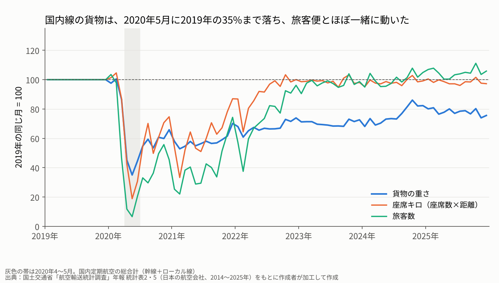
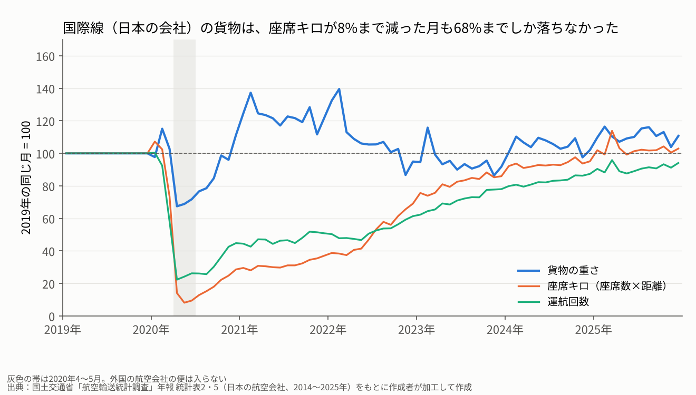
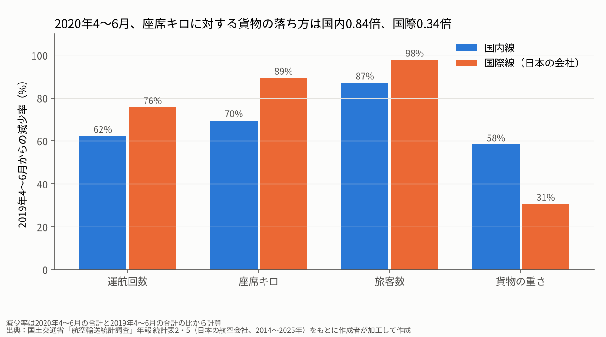
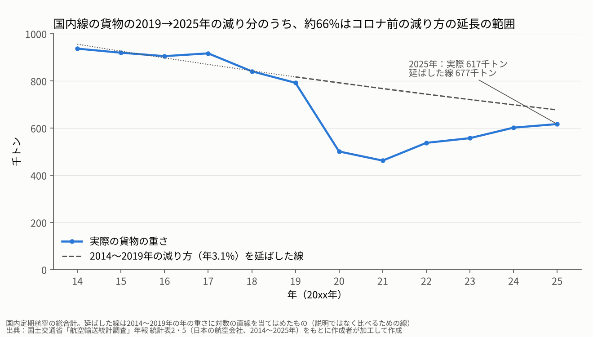

# F445 航空貨物は、旅客便が減った時期にどれだけ落ちたのか？ 国内線は座席キロとほぼ一緒に落ち、国際線（日本の会社）は落ち方が3分の1だった

2020年に旅客便が大きく減ったとき、飛行機で運ぶ貨物はどれだけ減ったのかを、国土交通省「航空輸送統計調査」の月別の数字（2014〜2025年）で確かめました。運賃や、どの運び方を選ぶべきかは扱いません。

## 結論（先に）

- **国内線の貨物は、旅客便とほぼ一緒に落ちました。** 2020年4〜5月の貨物の重さは2019年の同じ月より59.7%少なく、座席キロ（座席数×距離。旅客便の「運べる量」の目安）の減り方69.6%の0.86倍でした。最も落ちた2020年5月は2019年5月の35%です。
- **国際線（日本の航空会社の便）の貨物は、落ち方がずっと小さかった。** 2020年4〜6月の貨物は30.6%減で、座席キロの減り方89.4%の0.34倍でした。1便あたりの貨物は2019年の9.2トンから、2020年4〜5月は26.4トンになりました。2021年の年間の貨物は、運航回数が2019年の半分に満たないのに2019年より22.4%多くなりました。
- **国内線の貨物は、旅客が戻っても戻っていません。** 2025年の貨物は616,898トンで2019年より22.1%少なく、座席キロは1.6%減、旅客数は4.8%増でした。幹線（−21.8%）もローカル線（−22.9%）も同じくらいです。
- **ただし、国内線の貨物はコロナの前から減っていました**（結果を見てから足した確かめ）。2014〜2019年の減り方（年3.1%）を延ばすと、2025年は677千トンです。2019→2025年の減り分のうち約66%はこの延長の範囲で、残りの約34%（延ばした線より8.9%少ない分）がコロナ後に上乗せされた形です。延ばす期間を2016〜2019年にすると、減り分はすべて延長の範囲に入ります。



## 問い

航空貨物の多くは、旅客機の床下（ベリー）に積んで運ばれると説明されます。それなら、旅客便が止まれば貨物も同じだけ止まるはずです。2020年には「旅客便の減便で貨物を積む場所が足りない」と報じられました。

知りたい人は、物流や荷主の担当で、飛行機で運ぶ荷物の量が旅客便の数にどれだけ左右されるのかを数字で知りたい人です。航空の統計を読む人が、国内線の貨物がコロナのあとどこまで戻ったかを確かめるのにも使えます。

## データ（出典）

- 国土交通省「航空輸送統計調査」年報（e-Stat）、2014〜2025年の各年
  - 統計表2「国内定期航空月別運航及び輸送実績」：月別の運航回数・旅客数・座席キロ・貨物の重さ・貨物トンキロ・郵便物。総合計・幹線・ローカル線
  - 統計表5「国際航空月別運航及び輸送実績」：月別の運航回数・旅客数・座席キロ・貨物の重さ・利用可能トンキロ
- 対象は日本の航空会社です。国際線に外国の航空会社の便は入りません。旅客便と貨物専用機（フレイター）は表で分かれていません。
- 元のファイルは `data/raw/` に同梱しています（24ファイル、約0.6MB）。

## 事前の計画

集計の前に [PLAN.md](PLAN.md) を書きました（2026-11-18 12:50）。下見で国内線の年の貨物（2019年 791,800トン、2025年 616,898トン）を見ていたので、H3 は確かめの意味が弱いと計画に書いています。

| 仮説 | 外れの基準 | 結果 | 判定 |
|---|---|---|---|
| H1 国内線の貨物は座席キロと一緒に落ちた（2020年4〜5月の減少率の比が0.7〜1.3） | 範囲の外 | 0.86 | 支持 |
| H2 国際線の貨物の落ち方は座席キロの半分未満（2020年4〜6月） | 0.5以上 | 0.34 | 支持 |
| H3 2025年の国内線の貨物は2019年より10%以上少なく、座席キロは95%以上に戻った | どちらかを満たさない | 貨物 −22.1%、座席キロ −1.6% | 支持（下見の数字から立てた） |
| H4 2019→2025年の変化率の差が幹線とローカル線で10ポイント以内 | 10ポイントより大きい | 1.0ポイント | 支持 |

## やったこと

1. 統計表2・5から、月ごとの運航回数・座席キロ・旅客数・貨物の重さを取り出しました（`src/02_build.py`）。総合計＝幹線＋ローカル線になることを確かめています。
2. 月ごとに2019年の同じ月を100とした指数を作り、2020年4〜5月・4〜6月の減少率と、その比（貨物の減少率÷座席キロの減少率）を出しました（`src/03_analysis.py`）。
3. 月別の対数の回帰（貨物の対数を座席キロの対数と月の違いで説明する式）で、座席キロが1%動いたときに貨物が何%動くか（弾力性）を期間別に出しました。
4. 年の合計で2019年と2025年を比べました。
5. 結果を見てから、コロナ前の減り方を延ばした線と比べる確かめを足しました（`src/03b_requestion.py`）。

## 分かったこと

### 国内線：貨物は旅客便と一緒に落ちた（図1）

- 2020年5月は、座席キロが2019年5月の18.9%、貨物が35.0%でした。旅客数（2020年4〜5月は90.9%減）ほどは落ちていません。
- 2020年4〜5月の減少率の比は、座席キロに対して0.86、運航回数に対して0.96でした。
- 1便あたりの貨物は、2019年の0.92トンに対し、2020年4〜5月は0.94トンで、ほとんど変わりません。国内では、便が減った分だけ貨物も減った形です。
- 2020〜2022年の月別の弾力性は0.46（95%区間 0.37〜0.54）で、減便の大きかった月ほど貨物の落ちは座席キロより小さめでした。ふだんの年（2014〜2019年）は座席キロの動きが小さく、弾力性は決められませんでした（−1.44、区間 −2.79〜−0.10）。

### 国際線：座席が9割減っても、貨物は3割しか減らなかった（図2・図3）



- 2020年5月の座席キロは2019年5月の8.2%まで減りましたが、貨物が最も落ちた2020年4月でも67.5%でした。
- 貨物トンキロが利用可能トンキロ（運べる重さ×距離）に占める割合は、2019年4〜6月の26.6%から2020年4〜6月の53.7%に上がりました。運べる量のうち貨物に使われた分が倍になっています。
- 2021年の年間の貨物は2019年より22.4%多く、運航回数は52.9%少なくなりました。
- 理由は表からは決められません。貨物専用機の便、旅客を乗せずに貨物だけで飛ばした旅客機の便、1便あたりの積み方のどれが効いたかは分けられないからです（推測：貨物専用機をもつ会社の便が、国際線の貨物を支えた）。



- 2020年4〜6月で国内と国際をそろえて並べると、座席キロの減り方に対する貨物の減り方の比は、国内線0.84、国際線0.34でした（国内線は4〜5月だと0.86）。

### 国内線：旅客は戻ったが、貨物は2割少ないまま（図1・図4）

- 2025年の国内線は、座席キロが2019年の98.4%、旅客数が104.8%まで戻りました。貨物は77.9%です。
- 座席キロ1,000あたりの貨物は、2014年 7.15kg、2019年 5.90kg、2025年 4.67kg と下がり続けています。
- 国際線（日本の会社）の2025年の貨物は2019年より10.9%多く、国内線と逆の動きです。

## 問い直し（結果を見てから足した）

国内線の貨物が戻らないのは、コロナのせいなのか。2014〜2019年にも国内線の貨物は15.5%減っていたので、その減り方を延ばした線と2025年を比べました。



- 2014〜2019年の年の重さに対数の直線を当てはめると、年3.1%の減りで、2025年は677千トンになります。実際の616,898トンはこれより8.9%少ない値です。
- 2019→2025年の減り分（約175千トン）のうち、約66%は延ばした線の範囲です。
- 延ばす期間を2016〜2019年にすると年4.75%の減りになり、2025年の実際は延ばした線より3.1%多くなります。どこから延ばすかで「コロナの上乗せ」は0〜9%の幅で変わります。
- 幹線は延ばした線より10.5%少なく、ローカル線は4.3%少なくなりました。
- 延ばした線は比べるための目安で、減り続けた理由の説明ではありません。

## 頑健性

| 確かめ | 仮説 | 値 | 判定 |
|---|---|---|---|
| 主（座席キロ、2019年基準、重量） | H1 | 0.86 | 支持 |
| 基準を2018年 | H1 | 0.91 | 支持 |
| トンキロで | H1 | 0.85 | 支持 |
| 運航回数で割る | H1 | 0.96 | 支持 |
| 郵便物を足す | H1 | 0.83 | 支持 |
| 幹線だけ／ローカル線だけ | H1 | 0.85／0.91 | 支持 |
| 主（座席キロ、2019年基準、重量） | H2 | 0.34 | 支持 |
| 基準を2018年 | H2 | 0.45 | 支持 |
| トンキロで | H2 | 0.35 | 支持 |
| 運航回数で割る | H2 | 0.40 | 支持 |
| 郵便物を足す | H2 | 0.35 | 支持 |
| 2020年4〜12月で | H2 | 0.19 | 支持 |
| 基準を2018年 | H3 | 貨物 −26.6%、座席キロ +1.1% | 支持 |
| トンキロで | H3 | −21.3% | 支持 |
| 2024年で | H3 | 貨物 −24.0%、座席キロ −1.6% | 支持 |
| 基準を2018年 | H4 | 幹線 −26.5%、ローカル −27.1% | 支持 |
| トンキロで | H4 | 幹線 −22.4%、ローカル −17.7% | 支持 |

どの確かめでも判定は変わりませんでした。国際線の比は基準を2018年にすると0.45になり、基準の年で幅があります。

## 言えないこと

- 旅客便と貨物専用機を分けられません。国際線の落ち方が小さかった理由は、この統計では決められません。
- 外国の航空会社の便が入らないので、日本の空港を出入りする国際貨物の全体ではありません。
- 国内線の貨物が減り続けている理由（トラックや船への移り、荷物の小口化、運賃）は見ていません。
- 運賃の動きや、貨物を積めなかった荷主の数は分かりません。
- 「コロナ前の減り方の延長」は直線を当てはめた目安で、延ばす期間を変えると結論の大きさが変わります。

## 仕事で使うなら

- 国内線の貨物の量を見通すときは、旅客便の座席の量だけでなく、コロナ前からの減り方も並べて見ると、戻りの「足りなさ」を大きく見積もりすぎずに済みます。
- 国際線の数字は日本の会社だけの値です。空港全体の量とは別のものとして読みます。

## 計画からの変更

- 国際線の「重量利用率」は旅客の重さも含むため、貨物の使われ方を見る指標として、貨物トンキロ÷利用可能トンキロを足しました。
- 弾力性は、ふだんの年は座席キロの動きが小さく決められなかったため、主な結論には使わず補足にしました。

## 再現のしかた

```sh
pip install -r requirements.txt
sh src/run_all.sh        # オフライン（約4秒）
python3 src/01_fetch.py  # 取り直すときだけ（要ネット）
```

| ファイル | 中身 |
|---|---|
| `src/01_fetch.py` | 統計表2・5の取得（`data/raw/`） |
| `src/02_build.py` | 月別の表（`data/`） |
| `src/03_analysis.py` | 指数・減少率・弾力性・頑健性 → `results/main.json` ほか |
| `src/03b_requestion.py` | 問い直し |
| `src/04_figures.py` | 図4枚 |

再現の確かめ（2026-11-18）：/tmp/rep_F445 に写して生成物を消してから流し、13ファイルがバイト単位で一致、所要4秒。

## レビューで直したこと

| # | 指摘 | 直し方 |
|---|---|---|
| 1 | note の題名が国内線（2020年4〜5月の0.86）と国際線（4〜6月の0.34）で期間の違う比を並べていた | 図3と同じ4〜6月にそろえ（国内0.84）、国際線に「日本の会社」を足した。本文に4〜6月の比を足した |

## 出典

- 国土交通省「航空輸送統計調査」（政府統計の総合窓口 e-Stat）：https://www.e-stat.go.jp/stat-search/files?toukei=00600360&tstat=000001018894
- 各ファイルの URL と取得日は `data/raw/SOURCES.md` にあります。

（いずれも 国土交通省「航空輸送統計調査」 をもとに作成者が加工して作成）
