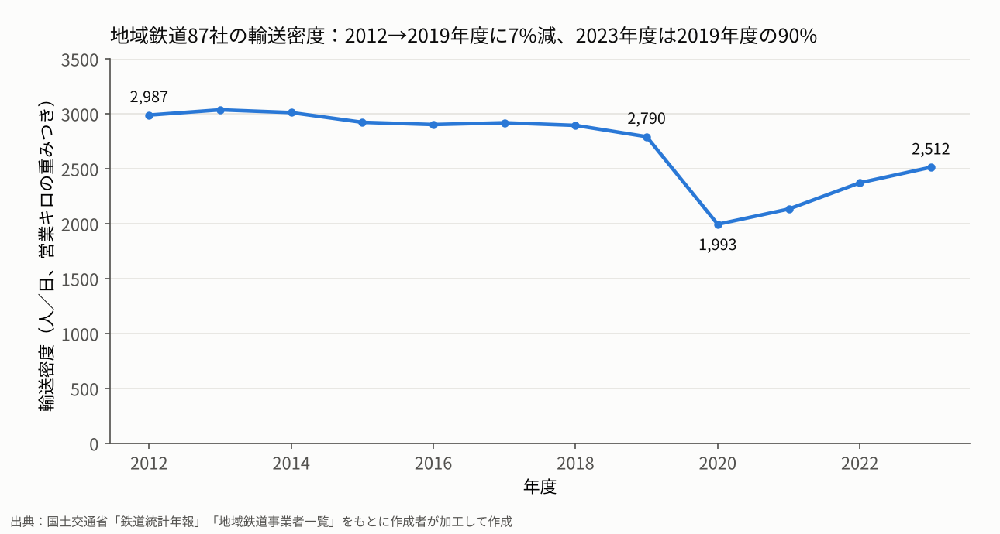
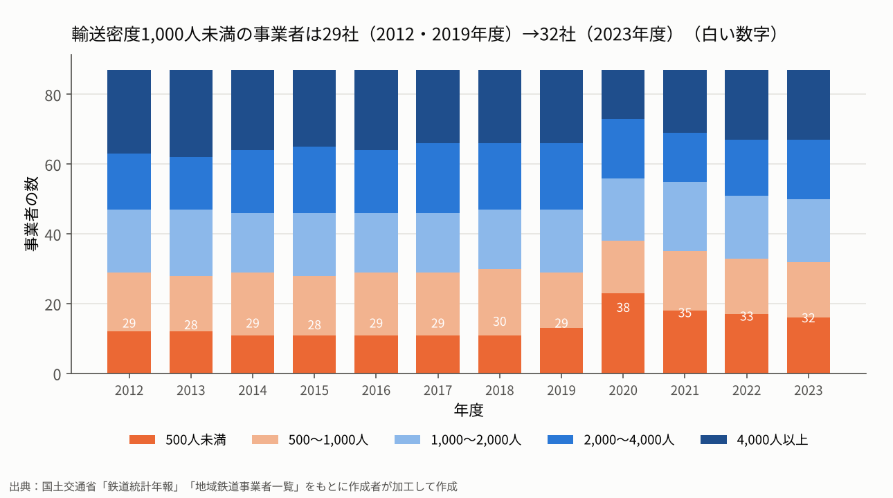
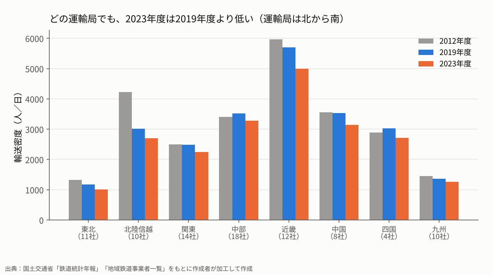
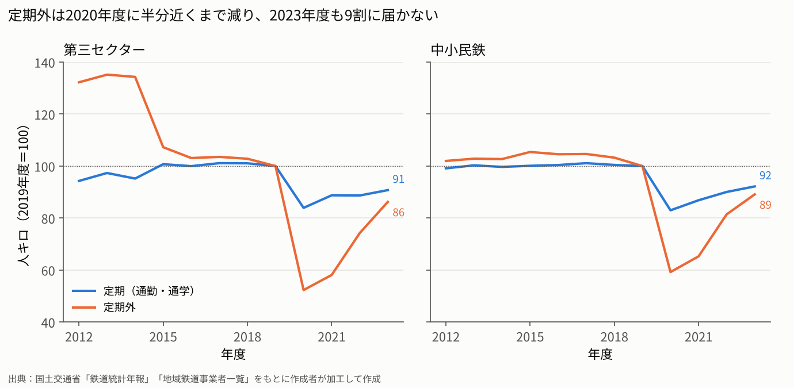

# F446 地方の中小私鉄・第三セクターの1日の利用（輸送密度）は、どこまで減ったのか？ 地域鉄道87社の輸送密度は2012→2019年度に7%減り、2023年度は2019年度の90%。1,000人未満の事業者は29社から32社に

（もとの問い「タクシーの1台あたりの稼働（実車の割合）は、コロナ前に戻ったのか？」は、全国の実車率を同じ定義で最近の年度まで機械で読める表がなかったため、予備 R50 に替えました。作業の記録に残しています）

## 結論（先に）

- 国が「地域鉄道事業者」とする98社（中小民鉄と第三セクター）のうち、2012〜2023年度の数字がそろう87社をまとめると、輸送密度（1日あたり、路線の1kmごとに平均何人が通ったか）は、2012年度の2,987人から2019年度の2,790人へ6.6%下がりました。このうち一部は、しなの鉄道と三陸鉄道が利用の少ない区間を引き継いで路線が延びた分で、この2社を除くと5.8%の低下です。
- 2020年度は1,993人（2019年度の71.4%）まで下がり、2023年度は2,512人で2019年度の90.0%でした。
- 輸送密度が1,000人未満の事業者は、2012年度・2019年度の29社から、2023年度は32社に増えました。500人未満は12社（2012年度）・13社（2019年度）から16社です。
- 第三セクターは中小民鉄より下がり方が大きく、2012→2023年度の変化率の中央値は第三セクター−18.2%、中小民鉄−7.5%でした。2023年度の輸送密度の中央値は、第三セクター707人、中小民鉄2,879人です。
- 2023年度に戻りきっていないのは、定期（通勤・通学）より定期外のほうでした（2019年度比で定期91.7%、定期外88.2%）。

## 問い

国土交通省は、新幹線・在来幹線・都市鉄道以外の路線を運営する中小民鉄と第三セクターを「地域鉄道事業者」と呼び、2026年4月1日時点で98社としています。国の資料「地域鉄道の現状」は、その輸送人員がピークの1991年度からコロナ前の2019年度にかけて約22%減り、2024年度は2019年度より約6%少ない、と示しています（70社の集計。要約）。

人数は、路線が短くても長くても1人は1人です。路線の長さに比べてどれだけ使われているかは、輸送密度（人キロ÷営業キロ÷日数）で見ます。地域鉄道の輸送密度は、この10年あまりでどこまで下がり、コロナのあとどこまで戻ったのでしょうか。事業者のあいだで差は広がったのでしょうか。沿線の自治体や地域交通の計画にかかわる人、鉄道事業者の企画の担当に向けた基本の数字です。路線を残すべきか、どう支えるべきかは扱いません。

## データ（出典）

- 国土交通省「鉄道統計年報」2012〜2023年度（国交省のサイトの各年度のページにある Excel）。2026-11-18 取得。
  - （２）運輸成績表：事業者ごとの旅客人キロ（定期・定期外・合計）と平均通過数量（旅客、人／日）
  - （４）営業キロ及び走行キロ表：年度末営業キロ（確かめに使用）
- 国土交通省「地域鉄道事業者一覧」（2026年4月1日現在、98社、PDF）：事業者名と第三セクターの印。PDF から pdftotext で名前・営業キロ・印を抜き出し、`data/raw/chiiki_tetsudo_list.csv` にしました（抜き出しは `src/01_fetch.py`）。
- 98社すべてが年報の表で見つかりました。名前の変化は対応表で合わせています（北近畿タンゴ鉄道→ＷＩＬＬＥＲ ＴＲＡＩＮＳ、東海交通事業→JR東海交通事業）。2012〜2023年度のすべてに数字がある87社を「そろう事業者」として使いました。途中で開業・転換した事業者（2015年の北陸新幹線の開業で生まれた3社など）は入りません。
- 表の平均通過数量には、人キロとつじつまが合わない年度があります（人キロ÷平均通過数量÷日数で逆算した営業キロが、その事業者のふだんの値から25%以上ずれる年度）。87社×12年度＝1,044のうち16について、人キロ÷（ふだんの営業キロ×日数）に置き換えました。路線が実際に延びたしなの鉄道（2015年度から）と三陸鉄道（2019年度から）は、延びる前と後で「ふだんの営業キロ」を分けています。置き換えない値での結果も頑健性に出しています。

## 事前の計画

[PLAN.md](PLAN.md)（2026-11-18 17:20、輸送密度を集計する前に作成）。仮説と判定は次のとおりです。

| 仮説 | 「外れ」の基準 | 結果 | 判定 |
|---|---|---|---|
| H1：そろう事業者のまとめた輸送密度は、2019年度が2012年度より低い | 低くない | 93.4%（−6.6%） | 支持（路線が延びた2社を除くと94.2%、大きく動いた8社を除くと97.6%） |
| H2：2023年度は2019年度の90%未満 | 90%以上 | 90.03% | 外れ（境目。基準を2018年度にすると86.8%で、確かめで入れ替わる） |
| H3：1,000人未満の事業者は2012年度より2023年度のほうが多い | 多くない | 29社→32社 | 支持 |
| H4：2012→2023年度の変化率の中央値は、第三セクターのほうが下がり方が大きい | 中小民鉄のほうが大きい | −18.2%と−7.5% | 支持 |

## やったこと

1. 12年度分の（２）から事業者ごとの人キロと平均通過数量を読み、一覧の98社と名前で合わせました（`src/02_build.py`）。
2. まとめた輸送密度は「Σ人キロ ÷ Σ（人キロ÷輸送密度）」で出しました。営業キロ×日数で重みをつけた平均で、長い路線ほど重く入ります（`src/03_analysis.py`）。
3. 輸送密度の帯ごとの事業者の数、事業者ごとの変化率の分布、運輸局別（北から南）、第三セクターと中小民鉄の別を出しました。事業者名を悪い方から並べた表は作っていません。
4. 結果を見てから、人キロを定期と定期外に分けました（`src/03b_requestion.py`）。

## 分かったこと

### 図1：コロナ前から少しずつ下がり、2023年度は2019年度の9割



- まとめた輸送密度は、2012年度2,987人、2016年度2,901人、2019年度2,790人と、少しずつ下がっていました。2012→2019年度の6.6%の低下には、しなの鉄道（2015年3月に北しなの線を引き継ぎ）と三陸鉄道（2019年3月にリアス線の宮古〜釜石を引き継ぎ）の路線が延びた分も入ります。2社を除くと5.8%の低下でした。
- 2020年度は1,993人に下がり、2021年度2,132人、2022年度2,371人、2023年度2,512人と戻っています。
- 87社の人キロの合計は、2012年度36.3億人キロ、2019年度35.0億人キロ、2023年度31.5億人キロでした。
- 事業者ごとに見ると、2012→2019年度の変化率の中央値は−3.9%（真ん中の半分は−12.2%〜+4.4%）で、87社のうち53社が下がりました。2019→2023年度の中央値は−10.0%で、78社が2019年度を下回りました。

### 図2：1,000人未満の事業者が増えた



- 輸送密度1,000人未満の事業者は、2012年度から2019年度まで28〜30社でほぼ動かず、2020年度に38社に増え、2023年度は32社でした。
- 500人未満は、2012年度12社、2019年度13社から、2023年度は16社です。4,000人以上は24社→21社→20社でした。
- 事業者の輸送密度の中央値は、1,847人（2012年度）、1,808人（2019年度）、1,775人（2023年度）です。

### 図3：どの運輸局でも2023年度は2019年度より低い



- 運輸局を北から南に並べると、2019→2023年度の変化は東北−13.7%、北陸信越−10.4%、関東−9.8%、中部−6.7%、近畿−12.3%、中国−11.0%、四国−10.0%、九州−7.1%で、すべて下がりました（北海道の道南いさりび鉄道は2016年度からなので、そろう事業者に入りません）。
- 2012→2019年度では、北陸信越が−28.6%、東北が−12.0%と大きく、ほかは−6.5%〜+4.8%でした。北陸信越には、2015年の北陸新幹線の開業で北越急行を通る特急がなくなったこと（北越急行の輸送密度は2014→2015年度に8,371人から1,543人）と、しなの鉄道が利用の少ない北しなの線を引き継いだことが効いていると考えられます（推測）。東北の下がり方には、三陸鉄道がリアス線を引き継いで路線が延びたことが入ります。

## 問い直し（結果を見てから足した）

図1で、2023年度の戻りが9割にとどまっていたので、「戻っていないのは通勤・通学の定期か、それ以外の定期外か」を分けました。



- 87社全体で、2023年度の人キロは2019年度に比べて定期91.7%、定期外88.2%でした。2020年度は定期83.3%、定期外57.1%で、コロナで大きく減ったのは定期外です。
- 第三セクターは定期90.8%・定期外86.2%、中小民鉄は定期92.2%・定期外89.1%です。
- コロナ前（2012→2019年度）にも、第三セクターの定期外は75.6%まで下がっていました（定期は106.1%）。北越急行を除くと100.2%で、この下がりはほぼ北越急行の分でした。
- 人キロに占める定期の割合は、51.1%（2012年度）→54.4%（2019年度）→55.4%（2023年度）と上がりました。

## 頑健性

| 確かめ | 2019/2012（H1） | 2023/2019（H2） | 結論は変わったか |
|---|---|---|---|
| 基本（営業キロの重みつき、置き換えあり） | 93.4% | 90.0% | — |
| 事業者の単純な中央値 | 97.9% | 98.2% | H1 は変わらない。H2 は外れのまま（中央値では戻りが大きく見える） |
| 基準の年度を変える（2018/2013、2023/2018） | 95.3% | 86.8% | H1 は変わらない。H2 は支持に変わる |
| 表の平均通過数量をそのまま使う | 93.4% | 90.0% | 変わらない（H3 も +3社で同じ） |
| 路線が延びた2社（しなの鉄道・三陸鉄道）を除く | 94.2% | 90.3% | 変わらない |
| どこかの年度で前年の半分未満または2倍超になった8社を除く | 97.6% | 90.3% | H1 の下がり方は小さくなる（−2.4%）。H4 の差は−10.7ポイントで変わらない |

H2 は90%の境目にあり、確かめ方で支持と外れが入れ替わります。「2023年度は2019年度のおよそ9割」と読むのが正確です。

## 言えないこと

- JR の地方の路線は、この表では会社ごとの合計しかなく、路線ごとの輸送密度は入りません。「地方の鉄道」のうち、地域鉄道事業者の分だけを見ています。
- 輸送密度が下がった理由（沿線の人口、運賃、ダイヤ、道路、観光）は、この分析では分けていません。
- 2024年度以降の表はまだ出ていません。国の資料にある2024年度の約6%減（輸送人員）とは、年度も指標も対象の社数も違います。
- 表の平均通過数量には、人キロとつじつまが合わない年度があり、16か所を置き換えました。置き換えの基準（25%）は作成者が決めたものです。
- 季節だけ走る路線や、年度の途中で区間が変わった事業者では、輸送密度の意味が少し違います。
- この数字だけで、路線を残すべきかどうかは判断できません。

## 仕事で使うなら

- 地域鉄道の利用を比べるときは、人数だけでなく輸送密度を並べると、路線の長さの違いをならして見られます。
- まとめ方（営業キロの重みか、事業者の中央値か）で戻りの見え方が変わるので、両方を出しておくと説明しやすくなります。
- 年報の平均通過数量は、人キロ÷営業キロ÷日数と一度照らし合わせてから使うのが安全です。

## 計画からの変更

- 計画では平均通過数量をそのまま使う予定でしたが、人キロとつじつまの合わない年度が見つかったため、置き換えたものを基本にし、そのままの値を頑健性に回しました。
- 確かめのため、（４）営業キロ及び走行キロ表も取りました（年度末の値で、複数の線区をもつ事業者では事業者の行の値が線区の値になっている年度があり、基本の計算には使っていません）。
- 計画の頑健性4（定期の割合）は、問い直しの中で扱いました。

## 再現のしかた

```sh
pip install -r requirements.txt
sh src/run_all.sh      # オフラインで 02 → 03 → 03b → 04（所要 約5秒）
python3 src/01_fetch.py  # 元データを取り直すときだけ（ネットと pdftotext が必要）
```

| ファイル | 中身 |
|---|---|
| `data/raw/nenpo_<年度>_t02.xlsx`、`nenpo_<年度>_t04.xlsx` | 鉄道統計年報（２）（４）、2012〜2023年度。取得日と URL は `data/raw/SOURCES.md` |
| `data/raw/chiiki_tetsudo_list.pdf`、`chiiki_tetsudo_list.csv` | 地域鉄道事業者一覧と、そこから抜き出した98社 |
| `data/operator_year.csv`、`data/chiiki_panel.csv` | 02 が作る表 |
| `results/main.json` | 本文の数字 |
| `results/panel_balanced.csv` | そろう87社×12年度（置き換えの印つき） |
| `results/aggregate_by_year.csv` | まとめた輸送密度の推移 |
| `results/count_by_band.csv`、`results/change_distribution.csv` | 帯ごとの数、変化率の分布 |
| `results/by_bureau.csv`、`results/by_kind.csv` | 運輸局別、区分別 |
| `results/robustness.csv`、`results/pass_share.csv` | 頑健性、定期の割合 |
| `results/requestion_pass_nonpass.csv` | 問い直し |
| `figures/fig1〜4_*.png` | 図 |

再現の確認：`results/repro_check.txt`。

## レビューで直したこと

| # | 指摘 | 直し方 |
|---|---|---|
| 1 | 平均通過数量の置き換えで、「ふだんの営業キロ」を12年度の中央値1つにしていたため、路線が実際に延びたしなの鉄道（2012〜2014年度）と三陸鉄道（2019〜2023年度）の正しい値まで置き換えていた（三陸鉄道の2019年度は表の410人が616人に、しなの鉄道の2012年度は6,766人が4,302人になっていた） | 2社は延びる前と後で中央値を分けた（`src/03_analysis.py` の EXTEND）。置き換えは24か所→16か所。まとめた輸送密度の2012→2019年度は−4.0%→−6.6%、第三セクターの変化率の中央値は−16.6%→−18.2%、北陸信越・東北の2012→2019年度の値が変わった。2023/2019（90.0%）と H1〜H4 の判定は変わらない |
| 2 | 2社の路線が延びた分が2012→2019年度の低下に入る | 頑健性に「路線が延びた2社を除く」（94.2%）を足し、本文に書いた |
| 3 | 題名の「地方の鉄道」だと JR の地方の路線も入るように読める | 問いを「地方の中小私鉄・第三セクターの…」に直し、結果の数字（4%→7%）とあわせて status・note の1行目とファイル名をそろえた |
| 4 | 図1の題に「4%減」を直接書いていた | main.json の値から作るようにした |

## 出典

- 国土交通省「鉄道統計年報」（年度ごとのページの一覧）：https://www.mlit.go.jp/tetudo/tetudo_tk6_000032.html （各ファイルの URL は `data/raw/SOURCES.md`）
- 国土交通省「地域鉄道事業者一覧」（2026年4月1日現在）：https://www.mlit.go.jp/tetudo/content/001885901.pdf
- 国土交通省「地域鉄道の現状」：https://www.mlit.go.jp/tetudo/content/002027241.pdf （地域鉄道対策のページ：https://www.mlit.go.jp/tetudo/tetudo_tk5_000002.html）

（いずれも 国土交通省「鉄道統計年報」「地域鉄道事業者一覧」をもとに作成者が加工して作成）
