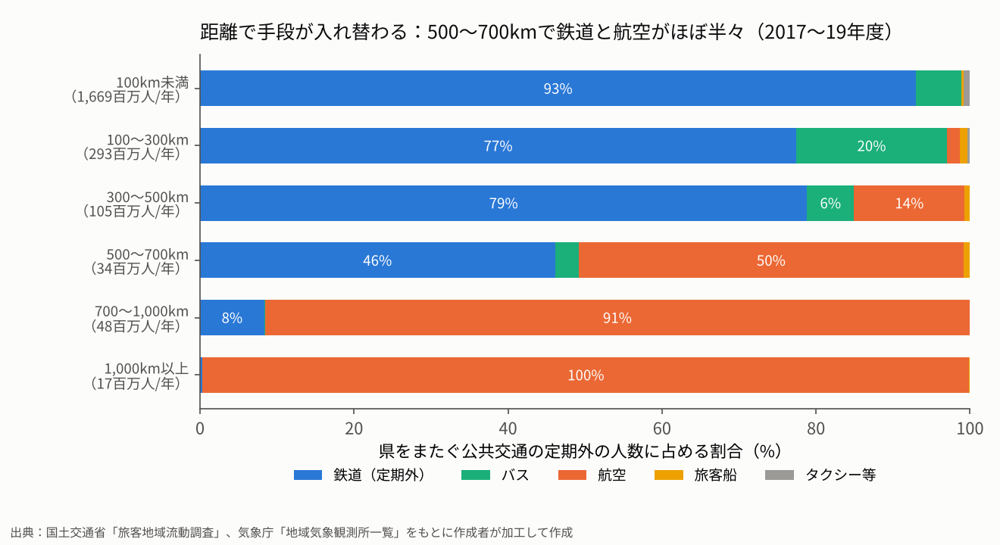
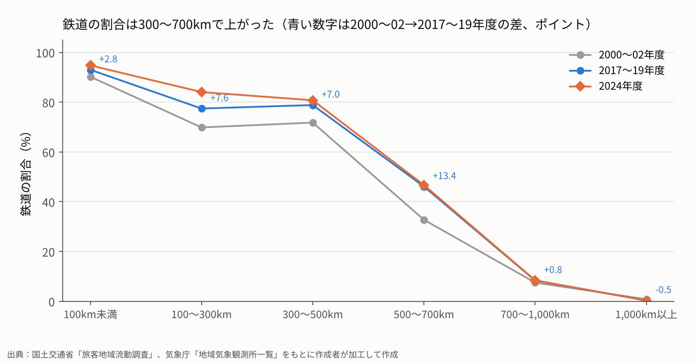
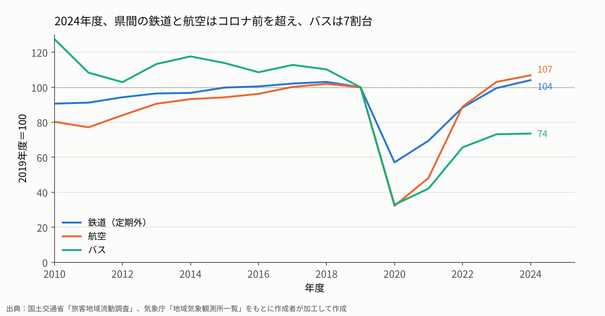
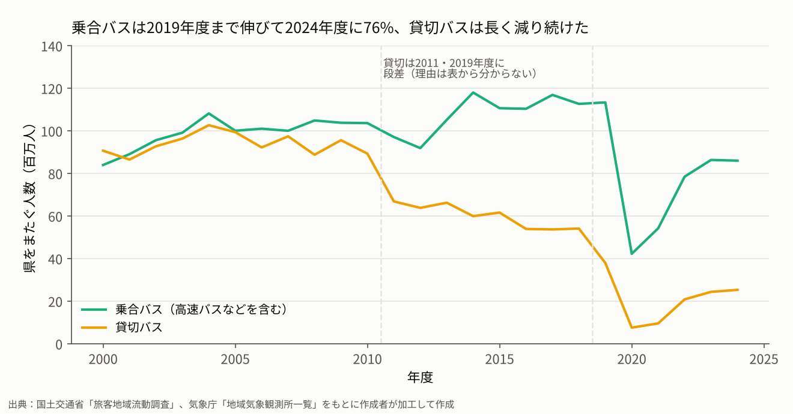

# F447 県をまたぐ移動の手段は、鉄道・航空・バスでどう変わったのか？ 500〜700kmで鉄道の割合は33%から46%に上がり、2024年度は鉄道104%・航空107%とコロナ前を超えた。バスは74%

## 結論（先に）

- 県をまたぐ公共交通の移動（通勤・通学の定期を除く）を、県庁所在地の間の直線距離で分けると、2017〜19年度は300〜700kmで鉄道が70.9%、700km以上で航空が93.6%でした。「中距離は鉄道、長距離は航空」という国の調査のまとめと合います。
- 入れ替わりは500〜700kmで起きていて、この帯では鉄道46.1%、航空50.0%とほぼ半々です。鉄道の割合は2000〜02年度の32.7%から13.4ポイント上がりました。ただし2000〜01年度は、タクシー等に遠い県の間の大きな値が入っていて、タクシー等を除くと+11.9ポイント、起点を2003〜05年度にすると+8.9ポイントです。300〜500kmでも7.0ポイント上がっています。
- 700km以上では、鉄道の割合は6%前後のまま、ほとんど変わっていません。
- 2024年度の県間の人数は、2019年度に比べて鉄道104.1%、航空106.9%とコロナ前を超えました。バスは73.6%で、戻りが遅れています。
- 自家用の乗用車は2009年度までしか数がありません。2000〜02年度には、300km未満の県間の移動の63.4%が自家用乗用車でした。2010年度からの「自動車」の変化は、この統計では分かりません。

## 問い

国土交通省の全国幹線旅客純流動調査（2015年）の概要は、ふだんの生活圏を越える移動について、「300km未満は乗用車など、300〜700kmは鉄道、700km以上は航空が主に使われる」とまとめています（要約。出典は下）。この調査は5年ごとで、毎年の動きは分かりません。

毎年出ている旅客地域流動調査には、都道府県の間の人数が機関ごとにあります。これを距離で分ければ、「距離による分担」が毎年どう動いたか、コロナのあと、どの手段がどこまで戻ったかが見られます。観光や出張の需要を見る人、交通事業者の企画の担当、地域の交通政策にかかわる人に向けた基本の数字です。運賃や路線をどうすべきかは扱いません。新幹線の開業の前後の比較は既存の記事（F29・F95・F184）があるので、ここでは距離帯の分担と全体の動きに絞りました。

## データ（出典）

- 国土交通省「旅客地域流動調査」府県相互間旅客輸送人員表（2000〜2024年度、e-Stat、1年度1ファイル）。2026-11-18 取得。単位は千人。
  - 使ったシート：ＪＲ定期外、民鉄定期外、乗合バス、貸切バス、営業用乗用車（タクシー等）、旅客船、航空。2009年度までは自家用乗用車・自家用バスも。
  - 発と着が異なる都道府県の組（47×46＝2,162組）を使い、北海道は1つにまとめました。各年度で、機関の合計が「全機関」と一致することを確かめています。
- 気象庁「地域気象観測所一覧」：県庁所在地にある観測所の緯度・経度から、県の間の直線距離を出しました（例：東京〜大阪 401km、東京〜福岡 889km）。距離の目安です。

## 事前の計画

[PLAN.md](PLAN.md)（2026-11-18 16:50、機関別の人数を集計する前に作成）。仮説と判定は次のとおりです。

| 仮説 | 「外れ」の基準 | 結果 | 判定 |
|---|---|---|---|
| H1：2017〜19年度、300〜700kmで鉄道5割以上、700km以上で航空5割以上 | どちらかを満たさない | 鉄道70.9%、航空93.6% | 支持 |
| H2：2000〜02年度、300km未満の県間の移動の5割以上が自家用乗用車 | 5割未満 | 63.4% | 支持 |
| H3：700km以上で、鉄道の割合が2000〜02年度より2017〜19年度のほうが高い | 高くない | 5.9%→6.2%（+0.4ポイント） | 基準の上では支持。ただし区切りを変えると−0.1ポイントになり、実質は「変わらない」 |
| H4：2024年度の2019年度比で、航空の戻りが鉄道より5ポイント以上低い | そうでない | 航空106.9%、鉄道104.1% | 外れ（航空のほうが戻った） |

## やったこと

1. 25年度分の Excel から、機関ごとに県×県の表を読み、発≠着の組を1本の表にしました（`src/02_build.py`）。
2. 県庁所在地の観測所の間の直線距離で、100km未満〜1,000km以上の6つの帯に分けました。
3. 帯ごとに、公共交通の定期外（鉄道・バス・航空・旅客船・タクシー等）に占める各手段の割合を、2000〜02年度、2017〜19年度、2024年度で出しました（`src/03_analysis.py`）。
4. 機関ごとの県間の人数の推移と、2019年度に対する比を出しました。
5. 結果を見てから、戻りの遅いバスを乗合と貸切に分けました（`src/03b_requestion.py`）。

## 分かったこと

### 図1：距離で手段が入れ替わる



- 2017〜19年度の平均で、100km未満の県間の移動は年16.7億人で、93.0%が鉄道です。大都市圏の中の移動が多くを占めます。
- 100〜300kmは鉄道77.4%、バス19.6%。バスの割合がいちばん大きい帯です。
- 300〜500kmは鉄道78.8%、航空14.4%。500〜700kmは鉄道46.1%、航空50.0%で、ここで入れ替わります。
- 700〜1,000kmは航空91.5%、1,000km以上は航空99.5%です。

### 図2：鉄道の割合は300〜700kmで上がった



- 2000〜02年度→2017〜19年度で、鉄道の割合は500〜700kmで+13.4ポイント（32.7%→46.1%）、300〜500kmで+7.0ポイント（71.8%→78.8%）、100〜300kmで+7.6ポイント上がりました。
- 700km以上では5.9%→6.2%で、ほとんど動いていません。
- 2024年度は、どの帯も2017〜19年度とほぼ同じか、少し鉄道寄りでした（100〜300kmは84.0%）。
- 公共交通の定期外の全体では、鉄道の割合は82.9%（2000〜02年度）→86.9%（2017〜19年度）→89.1%（2024年度）です。

### 図3：コロナのあと、鉄道と航空はコロナ前を超え、バスは7割台



- 県間の公共交通の定期外の人数は、2019年度の21.2億人から2020年度に11.5億人へ減り、2024年度は21.6億人（2019年度の102.0%）でした。
- 2024年度の2019年度比は、鉄道104.1%、航空106.9%、旅客船101.1%、タクシー等97.1%、バス73.6%です。
- 2023年度で見ても、航空103.1%、鉄道99.5%で、航空のほうが先に戻っていました。

## 問い直し（結果を見てから足した）

図3でバスだけが戻っていないので、「戻らないのは高速バスなどの乗合バスか、団体旅行などの貸切バスか」を分けました。



- 県間の乗合バスは、2000年度の8,390万人から2019年度の1億1,330万人へ135.0%に増えていました。2024年度は8,590万人で、2019年度の75.9%です。
- 貸切バスは、2000年度の9,060万人から2019年度の3,790万人へ、すでに41.8%まで減っていました。2024年度は2,530万人で、2019年度の66.7%です。
- 貸切バスは2011年度と2019年度に、前の年より大きく下がる段差があります。表には理由が書かれていません。統計の取り方の変化による可能性もあり（推測）、2019年度は年度の終わり（2020年2〜3月）にコロナの影響が始まった年でもあります。段差の前後の比較は慎重に読む必要があります。
- バスの戻りの遅れは、乗合・貸切の両方にあります。乗合では、100〜300kmで73.5%、300km以上で66.6%でした。

## 頑健性

| 確かめ | 300〜700km の鉄道（H1） | 700km以上の航空（H1） | 700km以上の鉄道の変化（H3） | 結論は変わったか |
|---|---|---|---|---|
| 基本 | 70.9% | 93.6% | +0.4ポイント | — |
| 距離の区切りを0.8倍（240・560km など） | 79.2% | 83.3% | +4.0ポイント | H1 は変わらない。H3 は差が大きくなる |
| 距離の区切りを1.2倍（360・840km など） | 58.7% | 96.0% | −0.1ポイント | H1 は変わらない。H3 は向きが逆になる |
| 北海道・沖縄の発着を除く | 71.7% | 87.6% | +0.4ポイント | 変わらない |

| 確かめ（H4・H2） | 値 | 結論は変わったか |
|---|---|---|
| H4 基本：2024/2019 の航空−鉄道 | +2.8ポイント | — |
| H4：東京・神奈川・埼玉・千葉の間の組を除く | +9.3ポイント | 変わらない（航空のほうが戻った） |
| H4：2023年度で比べる | +3.5ポイント | 変わらない |
| H2：300km未満の自家用乗用車、2007〜09年度 | 62.8% | 変わらない |
| 参考：500〜700km の鉄道の割合の変化、基本（2000〜02→2017〜19年度） | +13.4ポイント | — |
| 参考：タクシー等を分母から除く | +11.9ポイント | 上がったことは変わらない（幅は小さくなる） |
| 参考：起点を2003〜05年度にする | +8.9ポイント | 上がったことは変わらない（幅は小さくなる） |

## 言えないこと

- 2010年度からは自家用乗用車・自家用バスの数がありません（自動車輸送統計調査の見直しによる）。2010年代の「自動車へ移ったか、鉄道へ移ったか」は、この統計では言えません。
- 旅客地域流動調査は、乗り換えを機関ごとに数えます。1回の旅行が鉄道と航空の両方に入ることがあり、「旅行の数」や「主な手段」とは同じではありません。
- 距離は県庁所在地の間の直線で、実際の道のりより短く、広い県では県の中の位置の違いも入りません。
- 移動の目的（観光・出張・帰省）は分かりません。定期を除いても、通勤・通学の一部は入ります。
- 鉄道の割合が上がった理由（新幹線の延伸、運賃、航空便の数）は、この分析では分けていません。
- タクシー等は2010年度の前後で数え方が変わっている可能性があり（推測）、割合の小さな変化は読みません。2000〜01年度には、2000年度の広島発・東京着（約680km）が145万人のように、遠い県の間で大きな値が出ています。500〜700kmの2000〜02年度の鉄道の割合（32.7%）は、この分だけ低めに出ている可能性があります。

## 仕事で使うなら

- 県間の需要を見るときは、距離帯ごとに手段の割合を出すと、500〜700kmのように鉄道と航空が競う帯が見えます。
- コロナのあとの戻りは手段で大きく違うので、全体の数字だけでなく、機関別・距離帯別に分けて見ると読み違いを減らせます。
- 2010年度の前後で自動車の範囲が変わるので、長い期間の「自動車」の比較には使わないのが安全です。

## 計画からの変更

- 問い直しで、バスを乗合と貸切に分けました。
- 頑健性の「東京圏の1都3県の間を除く」は、計画では全体の確かめとしていましたが、H4（コロナ後の戻り）の確かめに使いました。

## 再現のしかた

```sh
pip install -r requirements.txt
sh src/run_all.sh      # オフラインで 02 → 03 → 03b → 04（所要 約9秒）
python3 src/01_fetch.py  # 元データを取り直すときだけ（ネットが必要）
```

| ファイル | 中身 |
|---|---|
| `data/raw/ryokaku_<年度>_<statInfId>.xls(x)` | 元データ25本（合計 約12MB）。取得日と URL は `data/raw/SOURCES.md` |
| `data/raw/ame_master.zip` | 気象庁 地域気象観測所一覧 |
| `data/od_wide.csv`、`data/pref_distance.csv`、`data/pref_capital_station.csv` | 02 が作る表 |
| `results/main.json` | 本文の数字 |
| `results/band_mode_share.csv` | 距離帯×手段の割合 |
| `results/band_mode_share_with_private_car.csv` | 自家用を入れた割合（2009年度まで） |
| `results/national_by_mode_million.csv`、`results/index_2019_100.csv` | 機関別の推移 |
| `results/recovery_2024_vs_2019_by_band.csv` | 距離帯×手段の2024/2019 |
| `results/robustness.csv` | 頑健性 |
| `results/requestion_*.csv` | 問い直し |
| `figures/fig1〜4_*.png` | 図 |

再現の確認：`results/repro_check.txt`。

## レビューで直したこと

| # | 指摘 | 直し方 |
|---|---|---|
| 1 | 題名の問いに「自動車」とあるが、自家用乗用車は2009年度までで、題名の結果にも自動車の数字がない | 問いを「鉄道・航空・バスで」に直し、status・note の1行目とファイル名をそろえた。自家用乗用車は本文の H2（2000〜02年度）で扱うまま |
| 2 | 500〜700km の鉄道の割合の起点（2000〜02年度、32.7%）に、2000〜01年度のタクシー等の遠い県の間の大きな値が入っている（この帯でタクシー等が4.3%） | 頑健性に「タクシー等を除く」（+11.9ポイント）と「起点を2003〜05年度に」（+8.9ポイント）を足し、結論と言えないことに書いた |
| 3 | 貸切バスの2019年度の段差は、年度末にコロナの影響が始まった年でもある | 問い直しの節に一言足した |

## 出典

- 国土交通省「旅客地域流動調査」府県相互間旅客輸送人員表（e-Stat、各年度の URL は `data/raw/SOURCES.md`）：https://www.e-stat.go.jp/stat-search/files?toukei=00600460&tstat=000001016696
- 気象庁「地域気象観測所一覧」：https://www.jma.go.jp/jma/kishou/know/amedas/ame_master.zip
- 国土交通省「全国幹線旅客純流動調査の概要」（第6回、2015年調査）：https://www.mlit.go.jp/report/press/content/001913931.pdf

（いずれも 国土交通省「旅客地域流動調査」、気象庁「地域気象観測所一覧」をもとに作成者が加工して作成）
