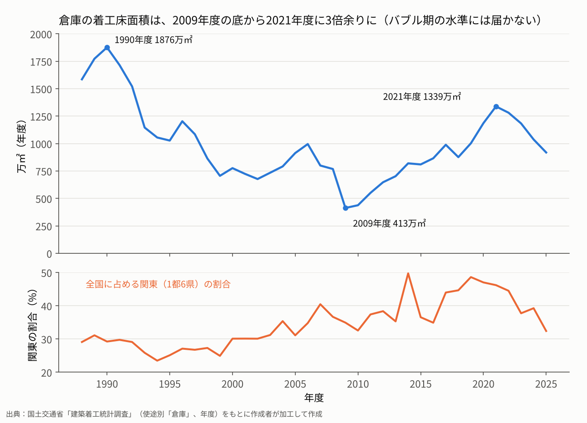
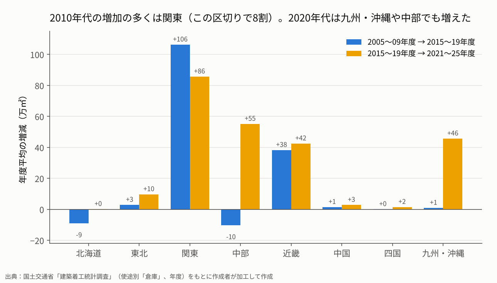
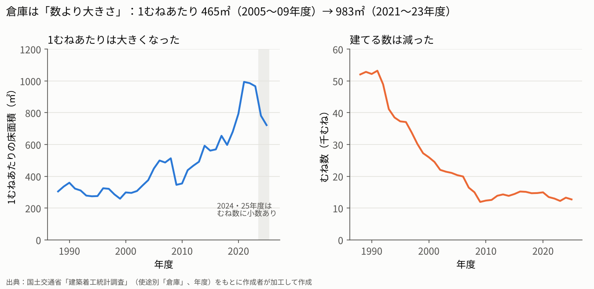
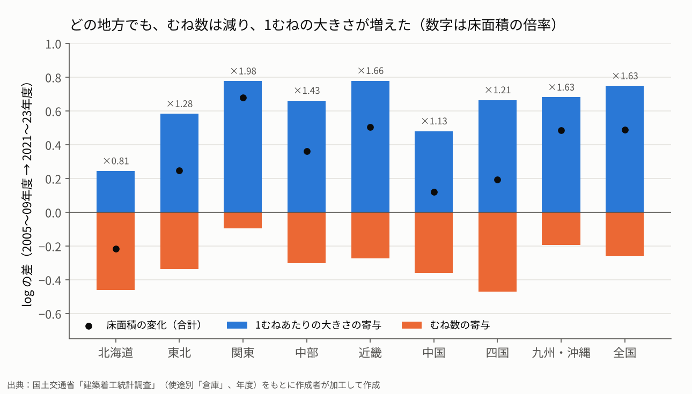

# F448 物流倉庫の建設は、どこで増えたのか？ 2010年代の増加の5〜8割は関東。2020年代は九州・沖縄で58%、中部で40%増えて広がり、1むねの大きさは約2倍に

## 結論（先に）

- 倉庫の着工床面積（全国、年度）は、1990年度の1,876万㎡から2009年度の413万㎡まで減り、2021年度に1,339万㎡まで戻りました（底の3.24倍）。それでも1990年度の0.71倍で、バブル期の水準には届いていません。2025年度は919万㎡です。
- 2005〜09年度の平均から2015〜19年度の平均への全国の増加分のうち、81.4%が関東（1都6県）でした。「2010年代の増加は関東に集中した」という見方は、着工の統計でも見えます。区切りや定義を変えても、関東の割合は51〜64%で、半分を下回りませんでした。
- 2015〜19年度から2021〜25年度にかけては、増え方が広がりました。九州・沖縄は58.0%、中部は40.3%増え、全国の増加分に占める関東は35.2%に下がりました。
- 建てる数（むね数）はどの地方でも減り、1むねあたりの床面積が増えました。全国では465㎡（2005〜09年度）から983㎡（2021〜23年度）へ2.11倍です。床面積の伸びは「数」ではなく「大きさ」から来ています。
- 東京都と周りの6県の増え方の差は小さく、「都心から外へ移った」とは、この統計の県の単位では言えませんでした。

## 問い

国土交通省の「物流拠点の今後のあり方に関する検討会」（2024年10月）に出された資料は、物流施設のストック（建っている量）について、1990年代には全国で増えたが、2010年代の増加は関東に局所的に集中している、という見方を示しています（要約。出典は下）。ネット通販の伸びも理由として挙げつつ、正確にはつかみにくいとしています。

この見方は、だれでも取れる公的統計で確かめられるでしょうか。建築着工統計には、建物の使いみち（使途）として「倉庫」があり、都道府県別・年度別に床面積が出ています。物流の拠点を計画する人、倉庫や物流不動産の担当、地域の産業や道路の計画にかかわる人にとって、「どこで、どれだけ、どんな大きさで」建ったかは基本の数字です。この記事は、倉庫をどこに建てるべきかは扱いません。数字と読み方までにします。

## データ（出典）

- 国土交通省「建築着工統計調査」建築物着工統計 時系列表【建築物】構造別 用途別 都道府県別（年度、1988〜2025年度、e-Stat、statInfId=000040451302）。2026-11-18 取得。
  - 使途別の再掲「倉庫」の建築物の数（むね）・床面積の合計（㎡）・工事費予定額（万円）を、47都道府県×38年度で使いました。
  - 令和6年度（2024年度）は「4月〜12月」と「1月〜3月」の2シートに分かれていたので足しました。
  - 照合用に、同じ表の用途別（産業の分類）「運輸業用建築物」（2003年度から）も使いました。
- 全国の値は47都道府県の合計です（表の全国計の行には内訳がないため）。
- 地方は8つに分けました：北海道／東北（6県）／関東（茨城・栃木・群馬・埼玉・千葉・東京・神奈川）／中部（新潟・富山・石川・福井・山梨・長野・岐阜・静岡・愛知）／近畿（三重・滋賀・京都・大阪・兵庫・奈良・和歌山）／中国／四国／九州・沖縄。県名は表の見出しの文字で読んでいます（行の順には頼っていません）。
- 2025年1月以降の分（2024年度の1〜3月と2025年度）は、むね数と工事費予定額に小数が入っています。表に注はありません。推測ですが、何らかの推計や按分によるものと思われます。床面積は整数のままです。むね数を使う計算では、この2年度を除いた確かめも出しました。

## 事前の計画

[PLAN.md](PLAN.md)（2026-11-18 16:20、倉庫の行を集計する前に作成）。仮説と判定は次のとおりです。

| 仮説 | 「外れ」の基準 | 結果 | 判定 |
|---|---|---|---|
| H1：全国の床面積は2015〜19年度の平均が2005〜09年度より30%以上多い | 30%未満 | +16.8% | 外れ（ただし区切りで−1%〜+56%と大きく変わる） |
| H2：その増加分の半分以上が関東 | 半分未満 | 81.4% | 支持 |
| H3：関東の中で、東京都より周りの6県の増え方が大きい | 東京都が大きい | 東京都 +42.2%、周りの6県 +38.1% | 外れ（2021〜25年度で比べると逆で、差は小さい） |
| H4：1むねあたりの床面積は2021〜25年度が2005〜09年度の1.5倍以上 | 1.5倍未満 | 1.91倍（2021〜23年度なら2.11倍） | 支持 |

## やったこと

1. Excel の年度ごとのシートから、都道府県ごとに「倉庫」の行（むね数・床面積・工事費予定額）を抜き出しました（`src/02_build.py`）。どの年度も47都道府県がそろうことを確かめています。
2. 全国の推移、5年度ごとの平均、地方別の増減と全国の増加分に占める割合（寄与）を出しました（`src/03_analysis.py`）。地方は北から南の順に並べ、県を悪い方から並べる表は作っていません。
3. 頑健性として、期間の区切り、定義（運輸業用建築物）、量の測り方（工事費予定額）、大きな年度を除くことを試しました。
4. 結果を見てから、床面積の変化を「むね数」と「1むねの大きさ」に分けました（`src/03b_requestion.py`）。

## 分かったこと

### 図1：全国の倉庫の着工は、底から3倍余りに戻ったが、バブル期には届かない



- 1990年度の1,876万㎡が、38年度の中での最大です。2009年度の413万㎡が最小で、そこから2021年度の1,339万㎡まで増えました。その後は減り、2025年度は919万㎡です。
- 5年度ごとの平均で見ると、1988〜92年度は1,694万㎡、2005〜09年度は778万㎡、2015〜19年度は909万㎡、2021〜25年度は1,152万㎡です。
- 全国に占める関東の割合は、1988〜92年度の平均29.7%から、2005〜09年度35.6%、2015〜19年度41.7%と上がり、2021〜25年度は40.0%でした。

### 図2：2010年代の増加は関東、2020年代は広がった



- 2005〜09年度→2015〜19年度の全国の増加分（年度平均で131万㎡）のうち、関東が81.4%、近畿が29.3%でした。北海道と中部は減っていて、その分を差し引くと合計が100%になります。
- 2015〜19年度→2021〜25年度では、関東の割合は35.2%に下がり、中部（22.7%）、九州・沖縄（18.8%）、近畿（17.5%）が続きます。増加率では九州・沖縄が58.0%、中部が40.3%でした。
- 2005〜09年度と2021〜25年度を比べると、47都道府県のうち31で床面積の年度平均が増えました。

### 図3：建てる数は減り、1むねは大きくなった



- 全国のむね数は、1990年度の5万2千むねから、2005〜09年度の平均1万6,727むね、2021〜25年度の平均1万2,943むねへ減りました。
- 1むねあたりの床面積は、465㎡（2005〜09年度）→613㎡（2015〜19年度）→890㎡（2021〜25年度）です。むね数に小数が入る2024・2025年度を除いた2021〜23年度は983㎡でした。
- 2024・2025年度の1むねあたりの値は下がって見えますが、むね数の数え方が変わった可能性があり（推測）、ここでは結論に使っていません。

## 問い直し（結果を見てから足した）

図3で、むね数が減っているのに床面積が増えていることが見えたので、「床面積の伸びは、数と大きさのどちらから来たのか」を地方ごとに分けました。床面積＝むね数×1むねあたりの床面積なので、2005〜09年度→2021〜23年度の log の差（変化率の近似）を2つに分けます。



- 8つの地方すべてで、むね数は減り（寄与はマイナス）、1むねの大きさは増えました（寄与はプラス）。
- 全国では、床面積が1.63倍、むね数が0.77倍、1むねの大きさが2.11倍です。
- 関東はむね数の減り方が0.91倍と小さく、大きさの伸び（2.17倍）がほぼそのまま床面積の伸び（1.98倍）になりました。北海道は大きさの伸びが1.28倍と小さく、むね数の減り（0.63倍）を補えず、床面積は0.81倍でした。

## 頑健性

| 確かめ | 全国の増加率 | 増加分に占める関東 | 結論は変わったか |
|---|---|---|---|
| 基本：2005〜09→2015〜19年度、床面積 | +16.8% | 81.4% | — |
| 区切り：2007〜09→2017〜19年度 | +44.7% | 63.6% | H1 は支持に変わる。H2 は変わらない |
| 区切り：2010〜14→2016〜20年度 | +55.7% | 52.3% | 同上 |
| 区切り：2003〜07→2013〜17年度 | −1.1% | （全国が減ったので割合は意味をなさない） | H1 は外れのまま |
| 定義：運輸業用建築物（産業の分類） | +40.1% | 60.2% | H2 は変わらない |
| 測り方：工事費予定額（名目） | +69.5% | 51.1% | 建築費の上昇を含む。H2 は変わらない |
| 各期間で最大の年度（2006・2019）を除く | +22.3% | 60.5% | 変わらない |
| H4：1むねあたり、2021〜23年度で比べる | — | — | 2.11倍。変わらない |
| H3：2005〜09→2021〜25年度で比べる | 東京都 +66.1%、周りの6県 +69.9% | — | 向きが逆になる。差は小さい |

全国の増加率（H1）は、どこを起点にするかで−1%から+56%まで動きます。2005・06年度が山、2009年度が底で、起点の選び方がそのまま結果に出るためです。一方、「関東が増加の半分以上」（H2）は、どの確かめでも変わりませんでした。

## 言えないこと

- 着工は「建て始め」の量です。今ある倉庫の量（ストック）、取り壊し、空き具合は分かりません。検討会の資料が見ているのはストックで、この記事の数字とは同じものではありません。
- 「倉庫」には、物流会社の営業倉庫も、工場や農家の自家用の倉庫も入っています。冷蔵・危険物などの種類も分かりません。
- ネット通販の伸びとの関係は確かめていません。全国の時系列どうしは同じ向きに動きますが、それだけでは関係の強さは言えません。
- 高速道路（圏央道など）の開通が倉庫を増やしたかは、因果としては言えません。県の単位では、道路沿いかどうかも分けられません。
- 2025年1月以降のむね数・工事費予定額に小数が入る理由は、表からは分かりません。2024・2025年度の1むねあたりの値の低下は、数え方の変化による可能性があります（推測）。
- 工事費予定額は名目で、建築費の上昇を除いていません。

## 仕事で使うなら

- 倉庫の量を地域で比べるときは、床面積とむね数を分けて見ると、「数が減って大きくなった」動きを取り違えずにすみます。
- 増加率は起点の年度で大きく変わるので、複数の区切りで出しておくと説明しやすくなります。
- 2025年1月以降のむね数・工事費予定額は、それ以前と同じ扱いでよいか、元の統計の説明を確かめてから使うのが安全です。

## 計画からの変更

- 照合に使った「運輸業用建築物」は、表にあるのが2003年度からでした（計画では2002年度以降と書いていた）。
- むね数に小数が入る年度があることは計画の時点で知らなかったため、H4 の確かめに2021〜23年度の値を足しました。
- 計画で「参考」としたハーフィンダール指数は出していません。地方別の寄与で足りると判断しました。

## 再現のしかた

```sh
pip install -r requirements.txt
sh src/run_all.sh      # オフラインで 02 → 03 → 03b → 04（所要 約6秒）
python3 src/01_fetch.py  # 元データを取り直すときだけ（ネットが必要）
```

| ファイル | 中身 |
|---|---|
| `data/raw/chakko_yoto_pref_fy_000040451302.xls` | 元データ（9.1MB）。取得日と URL は `data/raw/SOURCES.md` |
| `data/pref_year.csv` | 02 が作る県×年度の表（倉庫・運輸業用建築物） |
| `results/main.json` | 本文の数字 |
| `results/national.csv` | 全国の年度ごとの値と関東の割合 |
| `results/region_5yr_mean_10k_m2.csv` | 地方別の5年度平均（万㎡） |
| `results/contrib_*.csv` | 地方別の増減と寄与 |
| `results/kanto_prefs.csv` | 関東の1都6県の期間平均 |
| `results/floor_per_bldg_by_region.csv` | 地方別の1むねあたり床面積 |
| `results/robustness.csv` | 頑健性 |
| `results/requestion_count_size.csv`、`results/pref_change_2005_09_to_2021_25.csv` | 問い直し |
| `figures/fig1〜4_*.png` | 図 |

再現の確認：`results/repro_check.txt`（/tmp に写して流し直し、results と figures と data/pref_year.csv が cmp で一致することを確かめた記録）。

## レビューで直したこと

| # | 指摘 | 直し方 |
|---|---|---|
| 1 | 題名の「増加の81%は関東」は、確かめの中でいちばん大きい値。基本の区切りでは全国の増加が+16.8%と小さく、割合が大きく出やすい（ほかの区切り・定義では51〜64%） | 題名を「5〜8割は関東」に直し、status・note の1行目をそろえた（ファイル名は問いの部分が同じなので変わらない）。図2の題も「多くは関東（この区切りで8割）」にした |
| 2 | 地方の分け方（三重を近畿、新潟・山梨を中部）が README に書かれていなかった | データの節に書いた |

## 出典

- 国土交通省「建築着工統計調査」建築物着工統計 時系列表【建築物】構造別 用途別 都道府県別（年度）：https://www.e-stat.go.jp/stat-search/file-download?statInfId=000040451302&fileKind=0 （一覧：https://www.e-stat.go.jp/stat-search/files?toukei=00600120&tstat=000001016965）
- 国土交通省 物流拠点の今後のあり方に関する検討会 資料「物流拠点のあり方に関する現状把握と仮説」（2024年10月30日）：https://www.mlit.go.jp/seisakutokatsu/freight/content/001841024.pdf

（いずれも 国土交通省「建築着工統計調査」をもとに作成者が加工して作成）
